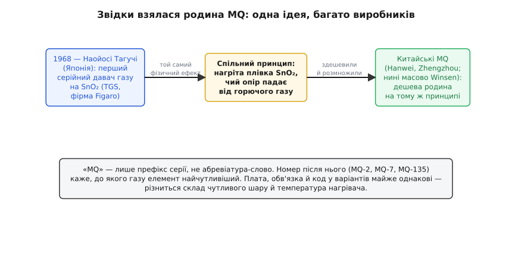
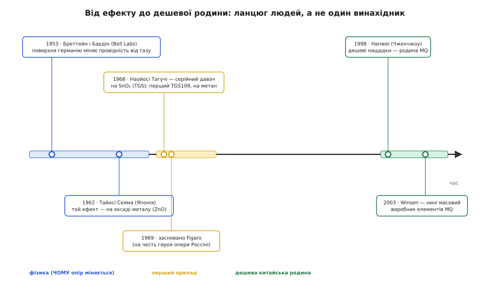
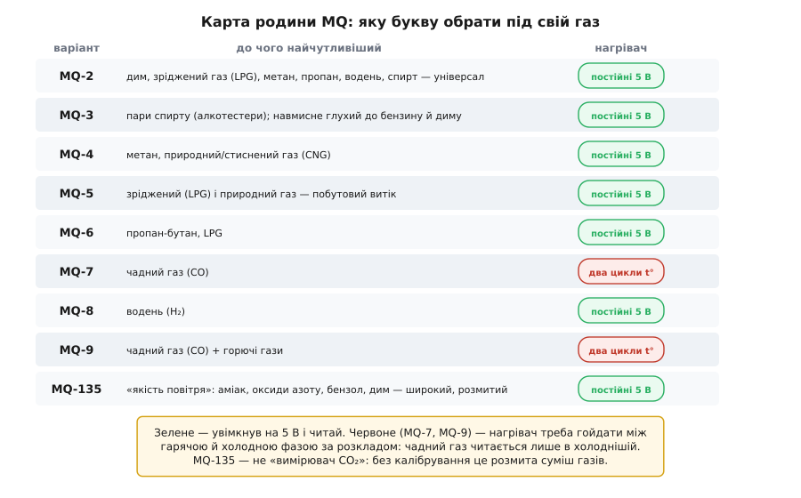
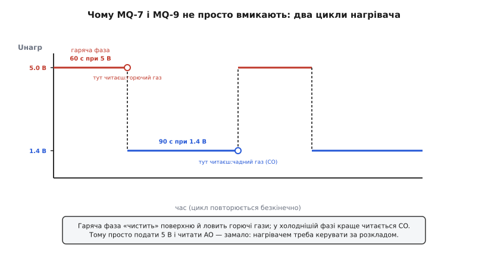
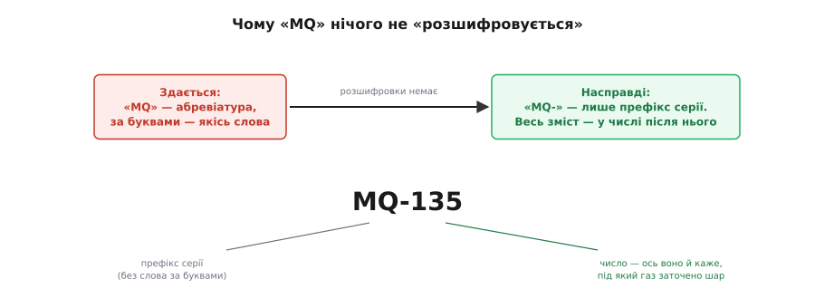

# Родина MQ (напівпровідникові давачі газу)

Газові сенсори родини MQ — це найпоширеніші та найдоступніші напівпровідникові давачі для аматорської та промислової автоматики. Завдяки характерному сітчастому металевому ковпачку, схожому на мініатюрну бочечку, вони миттєво впізнаються серед електронних компонентів. Родина об'єднує понад десяток варіантів датчиків (MQ-2, MQ-3, MQ-7, MQ-135 тощо), які працюють на єдиному фізичному принципі хемосорбції, але завдяки різним каталітичним домішкам оптимізовані для детекції конкретних газів: диму, спирту, метану, чадного газу або аміаку.

---

## 1. Історія та спільний родовід сенсорів на діоксиді олова (SnO2)

Усі сучасні сенсори родини MQ походять від єдиного фундаментального винаходу кінця 1960-х років:

### Еволюційний шлях технології:
1. **Відкриття явища (1953–1962):** Фізики Волтер Бреттейн і Джон Бардін у лабораторіях Bell Labs помітили газочутливість поверхні германію. Пізніше Ґеорґ Хейланд у Німеччині та Тайосі Сеяма в Японії перенесли цей ефект на термостійкі оксиди металів (ZnO та SnO2).
2. **Винахід Наойосі Тагучі (1968):** Після серії побутових вибухів газу в Японії інженер Наойосі Тагучі створив перший масовий промисловий сенсор на діоксиді олова під назвою TGS (Taguchi Gas Sensor) і заснував всесвітньо відому компанію Figaro Engineering.
3. **Поява лінійки MQ (1998 — наш час):** Китайські виробники (зокрема Hanwei Electronics та Zhengzhou Winsen) взяли надійну японську конструкцію, уніфікували її в дешевий 6-вивідний корпус і розширили до масової лінійки MQ. Літери «MQ» є просто заводським префіксом серії, а вся спеціалізація закодована в номері після дефіса.

---

## 2. Фізико-хімічний механізм поверхневої адсорбції

Принцип дії будь-якого датчика родини MQ ґрунтується на зміні електричного опору тонкого полікристалічного шару діоксиду олова (SnO2) при нагріванні до високої температури (200–400 °C):

### Хімічні процеси на мікрорівні:
1. **У чистому повітрі (окиснювальна рівновага):**
   - Вбудована ніхромова або платинова спіраль розігріває керамічну підкладку з плівкою SnO2.
   - Молекули кисню з повітря адсорбуються на гарячій поверхні і захоплюють вільні електрони з зони провідності напівпровідника, перетворюючись на іони O2- або O-.
   - На межах зерен утворюється збіднений на електрони шар із високим потенційним бар'єром. Опір чутливого шару R0 у чистому повітрі стає максимальним (від десятків кілоомів до сотень кілоомів).
2. **У присутності горючого газу-відновника (метан, CO, спирт, водень):**
   - Молекули газу вступають у каталітичну реакцію окиснення із захопленими іонами кисню на поверхні (наприклад, `2 CO + O2- --> 2 CO2 + e-`).
   - Захоплені електрони повертаються назад у кристалічну решітку SnO2.
   - Потенційний бар'єр на межах зерен падає, і електричний опір датчика Rs стрімко зменшується пропорційно концентрації газу в повітрі.

---

## 3. Огляд та вибір представників родини MQ під конкретні гази

Номер після назви сенсора визначає хімічний склад каталізаторів (домішки платини, паладію, золота) та цільове призначення:

| Модель | Цільовий газ / речовина | Діапазон вимірювання | Типове застосування |
| :--- | :--- | :--- | :--- |
| **MQ-2** | Дим, пропан, бутан, метан, водень | 300–10000 ppm | Універсальні пожежні сигналізації та витік газу |
| **MQ-3** | Пари етилового спирту (алкоголь) | 0.05–10 мг/л (25–500 ppm) | Алкотестери, контроль тверезості водіїв |
| **MQ-4** | Метан (природний газ, побутові плити) | 300–10000 ppm | Детектори витоку магістрального газу та метану |
| **MQ-5** | Зріджений нафтовий газ (LPG), пропан | 200–10000 ppm | Контроль витоку балонного газу на кухнях |
| **MQ-6** | Пропан, бутан, скраплені гази | 300–10000 ppm | Газобалонне обладнання автомобілів (ГБО) |
| **MQ-7** | Чадний газ (монооксид вуглецю, CO) | 20–2000 ppm | Сигналізатори чаду біля печей, камінів, котлів |
| **MQ-8** | Чистий водень (H2) | 100–10000 ppm | Воднева енергетика, акумуляторні станції |
| **MQ-9** | Чадний газ та горючі гази (LPG, CH4) | 10–1000 ppm CO | Комбіновані побутові системи безпеки |
| **MQ-135** | Загальна якість повітря (NH3, NOx, дим) | 10–1000 ppm | Вентиляційні системи (не придатний для точного CO2) |

---

## 4. Особливий режим роботи з чадним газом (CO): температурний цикл MQ-7

Більшість сенсорів родини MQ працюють при постійній напрузі підігріву 5 В. Проте давачі чадного газу (MQ-7 та MQ-9) вимагають обов'язкового циклічного температурного коливання:

### Двофазний температурний протокол:
1. **Гаряча фаза очищення (60 секунд при напрузі 5.0 В):**
   - Нагрівач розжарюється до високої температури (~400 °C).
   - За такої температури з поверхні діоксиду олова випаровуються та згорають усі випадкові органічні забруднення, волога та важкі горючі гази (метан, пропан). Відбувається регенерація чутливого шару.
2. **Холодна фаза вимірювання (90 секунд при напрузі 1.4 В):**
   - Напруга знижується до 1.4 В, і температура падає приблизно до 100–150 °C.
   - За цієї низької температури сенсор стає вибірково чутливим саме до молекул чадного газу (CO), водночас залишаючись глухим до метану чи пропану.
   - Зчитування аналогового сигналу здійснюється строго наприкінці холодної фази (на 85–90 секунді).
3. Загальний період циклу становить 150 секунд і безперервно повторюється в прошивці мікроконтролера.

---

## 5. Схемотехніка підключення, нагрівальний елемент та інтерпретація сигналу

Готові модулі MQ містять 4-контактний роз'єм (VCC, GND, DO, AO) та підлаштовний потенціометр:

### Електричні особливості:
- **Енергоспоживання:** Опір нагрівача становить близько 31–33 Ом, тому датчик споживає струм близько 150–160 мА (потужність близько 0.8 Вт) і постійно відчутно теплий на дотик. Живити його від 3.3 В виводу мікроконтролера суворо заборонено!
- **Аналоговий вихід (AO):** Підключений до дільника напруги, утвореного опором сенсора Rs та навантажувальним резистором RL. При появі газу опір Rs падає, а вихідна напруга зростає.
- **Дискретний вихід (DO):** Формується компаратором LM393. Поріг спрацьовування регулюється багатообертовим потенціометром для подачі тривожного сигналу переривання.
- **Прогрів (Burn-in):** Новий сенсор після тривалого зберігання вимагає безперервного початкового прогріву протягом 24–48 годин для стабілізації кристалічної ґратки перед проведенням точного калібрування.
