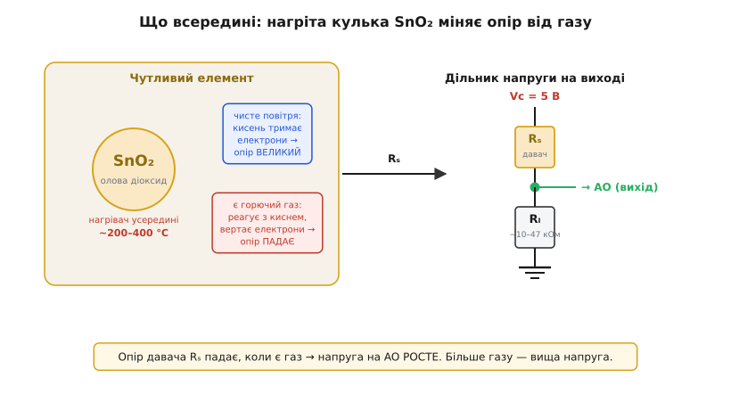
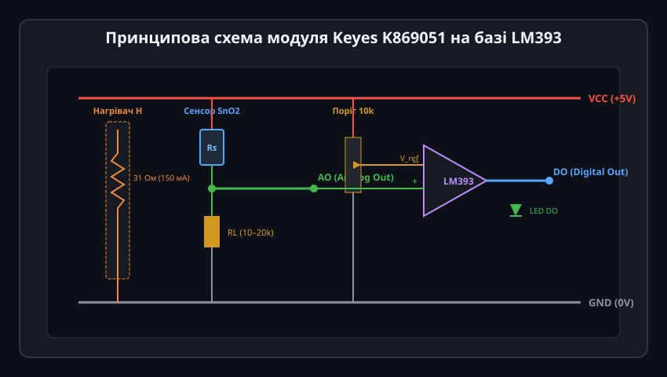
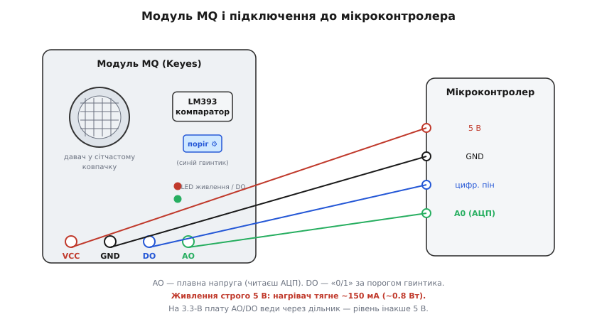
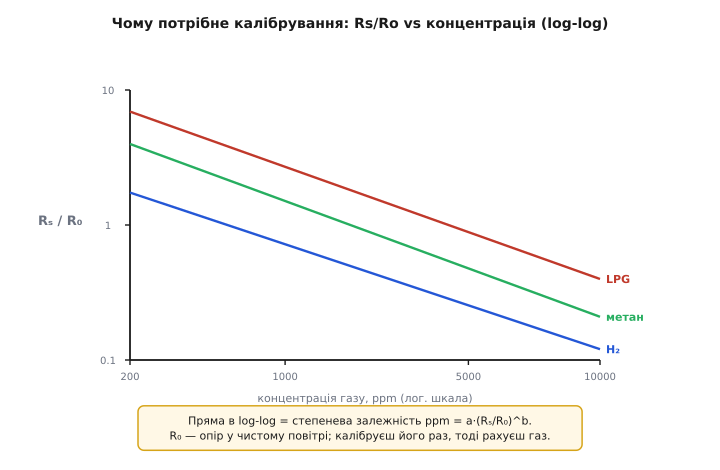
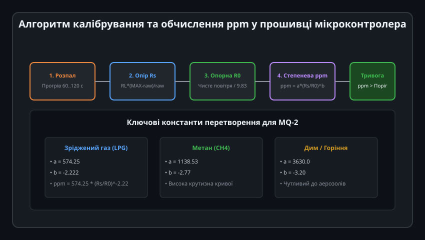

# MQ — давач газу (Keyes K869051)

Модуль газу Keyes K869051 (у каталозі виробника також відомий як Ks0040) — це готовий до підключення сенсорний вузол на базі напівпровідникового давача газу родини MQ (найчастіше встановлюється універсальний елемент MQ-2). Модуль містить чутливу голівку, навантажувальний дільник напруги, пороговий компаратор LM393 із регулюванням чутливості та світлодіодні індикатори живлення й спрацьовування тривоги.

---

## 1. Принцип дії сенсора SnO2 та хемосорбція кисню

Усередині сітчастого металевого ковпачка розташована керамічна основа з тонким шаром діоксиду олова (SnO2) та вбудованим нагрівальним елементом:

### Фізика перетворення:
1. **Розігрів чутливого шару:** Для активації хімічних процесів спіраль нагрівача розжарює шар SnO2 до робочої температури 200–350 °C. За нижчої температури реакції сповільнюються, а давач втрачає чутливість.
2. **Стан у чистому повітрі:** Молекули атмосферного кисню осідають на поверхні кристала та захоплюють вільні електрони провідності, формуючи збіднений шар із високим потенційним бар'єром. Опір чутливого шару `Rs` стає високим (десятки або сотні кілоомів).
3. **Реакція на горючий газ:** При появі в повітрі газів-відновників (LPG, пропан, метан, спирт, дим) їхні молекули вступають у каталітичну реакцію з іонами кисню на гарячій поверхні. Зв'язані електрони повертаються в зону провідності, потенційний бар'єр зникає, і опір датчика `Rs` різко знижується.

---

## 2. Апаратна будова модуля Keyes K869051 на базі LM393

Модуль спроектований так, щоб надати користувачу два паралельні варіанти інтерфейсу: безперервний аналоговий сигнал та швидкий цифровий сигнал тривоги:

### Схемотехніка плати:
- **Дільник навантаження (RL):** Сенсор `Rs` включений послідовно з навантажувальним резистором `RL` (зазвичай номіналом 10–20 кОм). Аналоговий вихід **AO** знімає напругу з середньої точки дільника: чим більше газу, тим нижчий опір `Rs` і тим вища напруга на виході AO.
- **Аналоговий компаратор LM393:** Порівнює напругу з виходу AO із опорною напругою `V_ref`, заданою підлаштовним потенціометром.
- **Дискретний вихід DO:** Працює за схемою активного низького або високого рівня. Коли концентрація газу перевищує заданий поріг, вихід перемикається, засвічуючи індикаторний світлодіод DO-LED, що дозволяє використовувати модуль автономно навіть без мікроконтролера.

---

## 3. Підключення до мікроконтролерів та узгодження рівнів

Через наявність потужного нагрівача модуль вимагає дотримання суворих правил живлення:

### Електричні вимоги:
1. **Живлення суворо +5 В:** Нагрівач споживає струм близько 150 мА (потужність 0.75–0.8 Вт). Живити його від слабкострумових виводів 3.3 В або безпосередньо від внутрішніх LDO плати суворо заборонено — датчик просто не вийде на робочу температуру.
2. **Узгодження з 3.3 В контролерами (ESP32, STM32, Raspberry Pi Pico):**
   - Оскільки живлення становить 5 В, напруга на аналоговому виході AO може підніматися до 4.5–5.0 В при високій концентрації газу.
   - Подача напруги понад 3.3 В на аналоговий вхід ESP32 пошкоджує вхідний мультиплексор АЦП. Необхідно обов'язково використовувати резистивний подільник напруги (наприклад, 10 кОм та 20 кОм) або транслятор рівнів.

---

## 4. Калібрувальна крива та степенева модель ppm

Зв'язок між електричним опором сенсора та концентрацією газу в даташитах виробника наводиться у подвійному логарифмічному масштабі:

### Степенева математична модель:
У логарифмічних координатах крива чутливості є прямою лінією, що відповідає класичній степеневій функції:

ppm = a * (Rs / R0)^b

де:
- `Rs` — поточний опір датчика в досліджуваному повітрі,
- `R0` — базовий опір цього самого датчика у чистому повітрі (особистий нуль приладу),
- `a` та `b` — калібрувальні емпіричні коефіцієнти для конкретного типу газу (для MQ-2 при детекції LPG: `a ≈ 574.25`, `b ≈ -2.222`).

Оскільки опір `Rs` входить у відношення до `R0`, похибка абсолютного номіналу навантажувального резистора `RL` практично повністю взаємно скорочується під час калібрування!

---

## 5. Програмний алгоритм калібрування R0 та розрахунок концентрації

Для отримання достовірних результатів у коді мікроконтролера реалізують двостадійний алгоритм вимірювання:

### Покроковий алгоритм у прошивці:
1. **Прогрів (Preheat):** Після подачі живлення витримується пауза не менше 60–120 секунд для виходу спіралі на стаціонарний температурний режим. Новий датчик після покупки потребує первинного «випалу» (burn-in) протягом 24–48 годин.
2. **Визначення R0 в чистому повітрі:** У чистому середовищі опір `Rs` вимірюють 50 разів і усереднюють. Оскільки для MQ-2 відношення `Rs/R0` у чистому повітрі за графіком дорівнює приблизно `9.83`, значення опорного опору знаходять як:
   
   R0 = Rs_clean / 9.83

3. **Розрахунок поточного Rs:** За відліком АЦП розраховують поточний опір:
   
   Rs = RL * (ADC_MAX - raw_adc) / raw_adc

4. **Обчислення концентрації:** Знаходять відношення `Rs / R0` та застосовують функцію `pow()` для знаходження значення в ppm.
5. **Фільтрація та порівняння:** Отримане значення згладжують медіанним фільтром та порівнюють із порогом аварійної пожежної або вибухової небезпеки.
