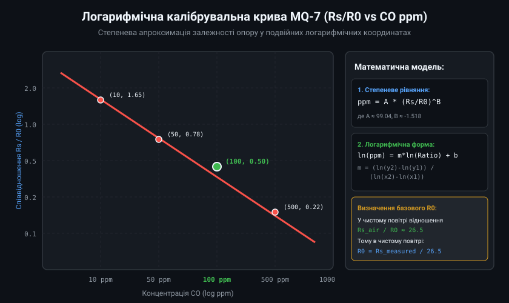
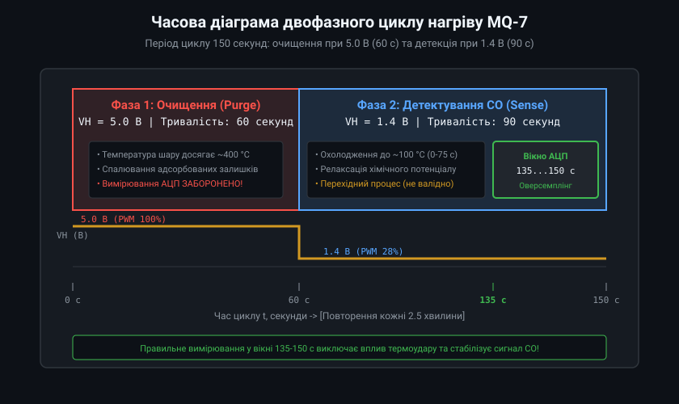
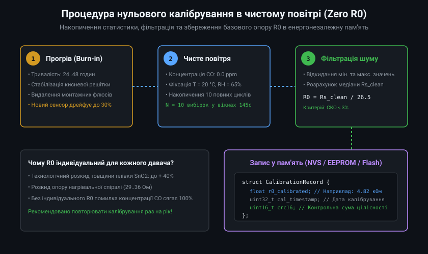
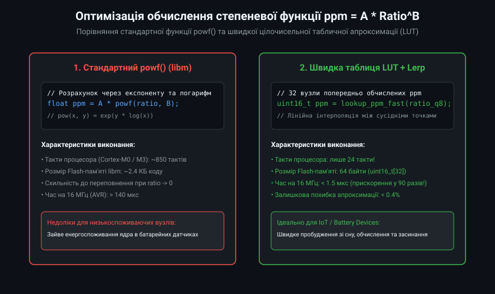
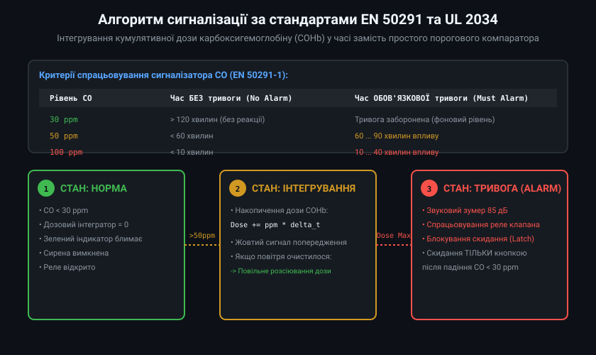

# Програмне калібрування та обчислення концентрації CO (MQ-7)

Напівпровідниковий давач чадного газу MQ-7 вимагає індивідуального програмного калібрування через значний технологічний розкид параметрів чутливого шару SnO2 та нагрівальної спіралі (до +/-30...40%). Для отримання точних значень концентрації монооксиду вуглецю (CO) у ppm (parts per million) розробник повинен реалізувати алгоритм визначення базового опору в чистому повітрі R0, степеневу апроксимацію градуювальної характеристики та часову дискретизацію циклу нагріву.

## 1. Степенева математична модель перетворення

Залежність електричного опору чутливого елемента Rs від концентрації монооксиду вуглецю у подвійних логарифмічних координатах має лінійний характер і описується степеневим законом:
ppm = A * (Rs / R0)^B

де:
- Rs — електричний опір чутливого шару за поточної концентрації CO;
- R0 — базовий опір сенсора за стандартних умов (100 ppm CO, 20 °C, 65% RH);
- A та B — емпіричні коефіцієнти крутизни перетворення, що визначаються за паспортною характеристикою сенсора (типово A ≈ 99.04, B ≈ -1.518).



Для розрахунку коефіцієнтів беруться дві опорні точки з паспорта давача: (10 ppm, Rs/R0 = 1.65) та (100 ppm, Rs/R0 = 0.50). Лінійна регресія у логарифмічному масштабі ln(ppm) = m * ln(Rs/R0) + b дає точні параметри степеневої функції для прошивки мікроконтролера.

## 2. Керування двофазним циклом підігріву сенсора

Давач MQ-7 працює у строгому циклічному режимі з періодом 150 секунд, що реалізується апаратно за допомогою ШІМ-виходу таймера мікроконтролера та польового транзистора:
1. **Фаза очищення (Purge, 60 секунд):** На нагрівач подається повна напруга 5.0 В. Температура шару досягає ~400 °C, що забезпечує швидке термоокиснення та видалення всіх адсорбованих залишків газів і вологи. Оцифрування сигналу під час цієї фази суворо заборонено.
2. **Фаза детектування (Sense, 90 секунд):** Напруга знижується до 1.4 В (шпаруватість ШІМ близько 28%). Сенсор охолоджується до температури каталітичної реакції CO (~100 °C).



Хімічна рівновага на поверхні SnO2 стабілізується лише після 70-75 секунд низькотемпературного охолодження. Тому зчитування сигналу АЦП виконується виключно в останні 15 секунд циклу (з 135-ї по 150-ту секунду).

## 3. Процедура нульового калібрування в чистому повітрі (Zero R0)

Оскільки калібрувальний газ із концентрацією 100 ppm CO у лабораторних умовах є рідкісним і токсичним, побутове калібрування виконують у чистому атмосферному повітрі (де вміст CO близький до 0 ppm).

За паспортними даними MQ-7, відношення опору в чистому повітрі Rs_air до опору в еталонній точці R0 (100 ppm CO) є константою:
Rs_air / R0 ≈ 26.5



Алгоритм калібрування передбачає попередній 24-годинний відпал (burn-in) нового сенсора, накопичення 10 послідовних вимірювань опору у вікні стабілізації, фільтрацію викидів і обчислення R0 = Rs_air_median / 26.5 із записом результату в енергонезалежну пам'ять (EEPROM або NVS).

## 4. Оптимізація обчислень для низькоспоживаючих мікроконтролерів

Виклик стандартної математичної функції `powf()` з бібліотеки `libm` вимагає значних ресурсів процесора (понад 800 тактів на Cortex-M0) та збільшує розмір коду. У пристроях з автономним батарейним живленням або простих 8-бітних MCU застосовують швидку табличну апроксимацію (LUT) із фіксованою комою.



Таблиця з 32 вузлів, що охоплює діапазон відношення Rs/R0 від 0.1 до 3.0, займає лише 64 байти флеш-пам'яті та обчислюється за 24 такти за допомогою лінійної інтерполяції, скорочуючи час розрахунку концентрації з 140 мкс до 1.5 мкс без втрати точності.

## 5. Алгоритм сигналізації тривоги за стандартом EN 50291

Чадний газ є кумулятивною отрутою: токсичність для організму людини залежить не лише від миттєвої концентрації, але й від тривалості експозиції (утворення карбоксигемоглобіну в крові COHb). Тому сертифіковані прилади сигналізації відповідно до європейського стандарту EN 50291 та американського UL 2034 не використовують простий миттєвий компаратор.



Програмний кінцевий автомат (FSM) реалізує інтегрування дози накопичення:
- При концентрації 30 ppm тривога не формується щонайменше 120 хвилин.
- При концентрації 50 ppm тривога активується через 60-90 хвилин безперервного впливу.
- При концентрації 100 ppm тривога спрацьовує через 10-40 хвилин.
- При концентрації 300 ppm негайна сирена вмикається менш ніж за 3 хвилини.

Приклад базового коду калібрування та вимірювання CO на базі Arduino/ESP32:

```cpp
#include <Arduino.h>

const uint8_t PIN_HEATER_PWM = 25; // Вихід ШІМ для MOSFET нагрівача
const uint8_t PIN_ANALOG_MQ  = 34; // Вхід АЦП для вимірювального дільника

const float RL_RESISTOR = 10000.0f; // Опір навантаження RL = 10 кОм
const float V_SUPPLY    = 5.0f;     // Напруга живлення дільника
float g_r0_clean        = 4850.0f;  // Базовий опір R0 (знайдено калібруванням)

// Стан двофазного циклу нагріву
enum class HeaterPhase {
    PURGE_HIGH_5V,
    SENSE_LOW_1V4
};

HeaterPhase g_current_phase = HeaterPhase::PURGE_HIGH_5V;
uint32_t g_phase_start_time = 0;

void setup() {
    Serial.begin(115200);
    ledcAttach(PIN_HEATER_PWM, 5000, 8); // ШІМ 5 кГц, 8 біт

    // Старт із фази високого очищення (5 В -> 100% заповнення)
    ledcWrite(PIN_HEATER_PWM, 255);
    g_current_phase = HeaterPhase::PURGE_HIGH_5V;
    g_phase_start_time = millis();
}

float read_sensor_rs() {
    // Усереднення 16 відліків АЦП
    uint32_t raw_acc = 0;
    for (int i = 0; i < 16; i++) {
        raw_acc += analogRead(PIN_ANALOG_MQ);
        delayMicroseconds(50);
    }
    float raw_adc = (float)raw_acc / 16.0f;
    float v_out = (raw_adc / 4095.0f) * 3.3f; // ESP32 АЦП 3.3 В опорне

    if (v_out <= 0.05f) return 1e6f;
    return RL_RESISTOR * (V_SUPPLY - v_out) / v_out;
}

float calculate_co_ppm(float rs, float r0) {
    float ratio = rs / r0;
    // Степенева характеристика MQ-7: ppm = 99.04 * (Rs/R0)^(-1.518)
    return 99.04f * powf(ratio, -1.518f);
}

void loop() {
    uint32_t elapsed_sec = (millis() - g_phase_start_time) / 1000;

    if (g_current_phase == HeaterPhase::PURGE_HIGH_5V) {
        if (elapsed_sec >= 60) {
            // Перехід у фазу вимірювання 1.4 В (28% від 5 В -> 71/255)
            ledcWrite(PIN_HEATER_PWM, 71);
            g_current_phase = HeaterPhase::SENSE_LOW_1V4;
            g_phase_start_time = millis();
            Serial.println("[КЛІК] Фаза 2: Охолодження та вимірювання (90 с)...");
        }
    } else { // SENSE_LOW_1V4
        // Вікно зчитування в останні 15 секунд (з 75-ї по 90-ту секунду фази)
        if (elapsed_sec >= 75 && elapsed_sec < 90) {
            float rs = read_sensor_rs();
            float ppm = calculate_co_ppm(rs, g_r0_clean);
            Serial.printf("CO: %.1f ppm | Rs: %.1f кОм | Ratio: %.2f\n", ppm, rs / 1000.0f, rs / g_r0_clean);
            delay(1000);
        }

        if (elapsed_sec >= 90) {
            // Повернення у фазу очищення 5 В
            ledcWrite(PIN_HEATER_PWM, 255);
            g_current_phase = HeaterPhase::PURGE_HIGH_5V;
            g_phase_start_time = millis();
            Serial.println("[КЛІК] Фаза 1: Високотемпературне очищення (60 с)...");
        }
    }
}
```

Грамотне налаштування програмного конвеєра з витримкою часових інтервалів стабілізації температури забезпечує відмінну повторюваність вимірювань і виключає хибні тривоги в системах раннього попередження про загрозу чадного газу.
