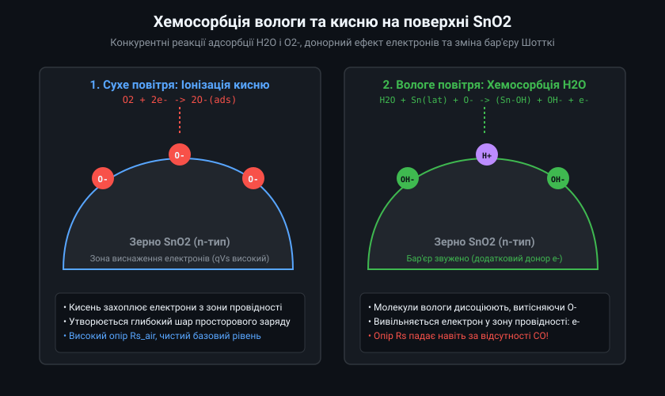
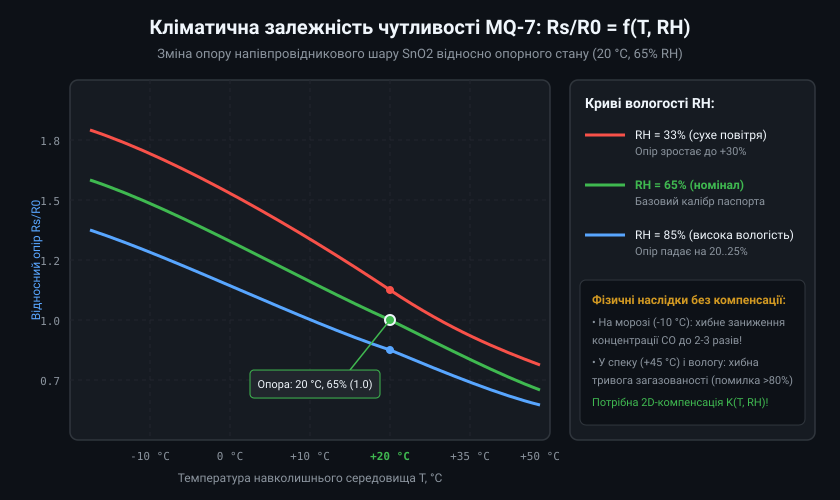
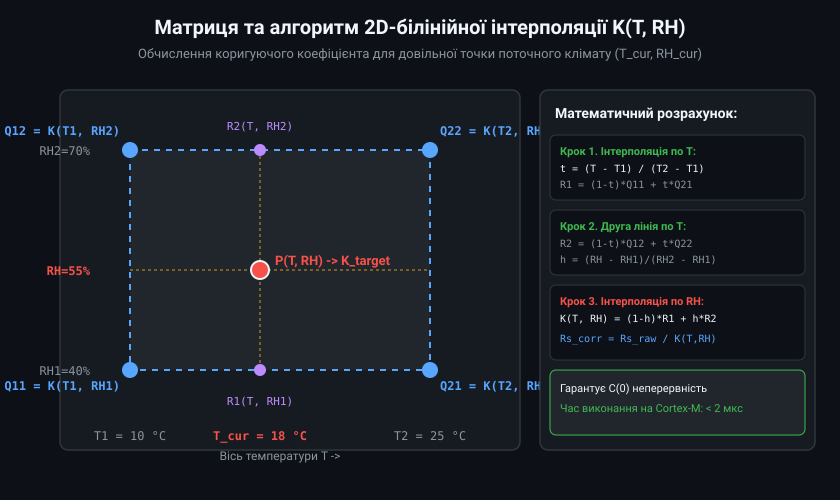
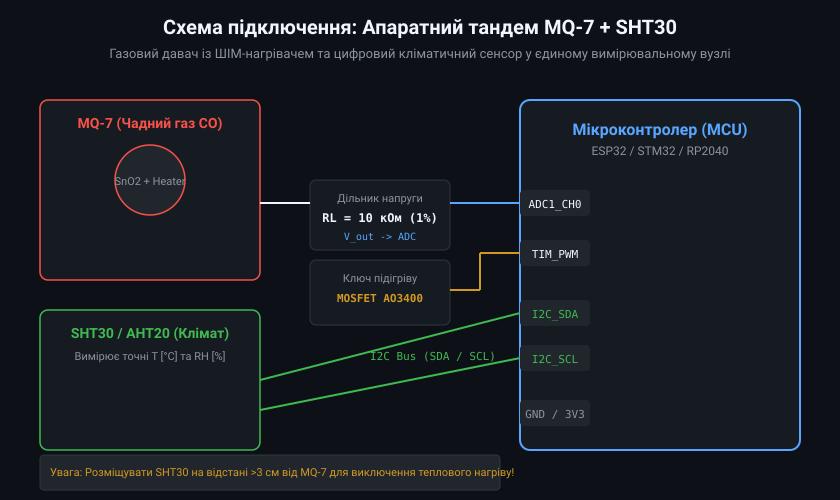
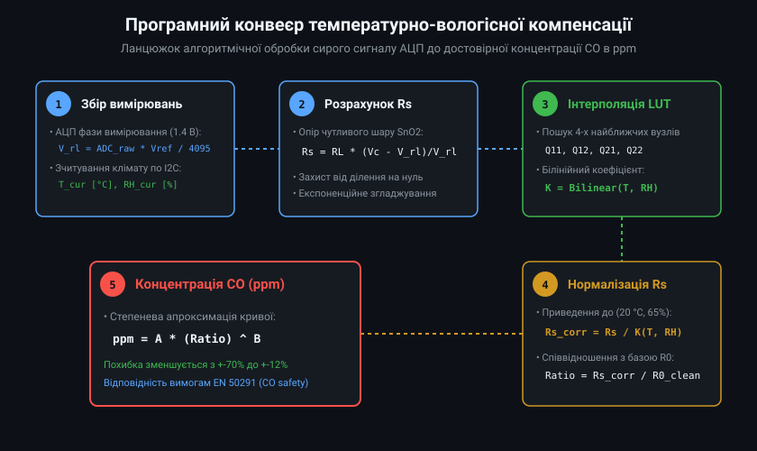

# Промислова температурно-вологісна компенсація газових давачів MQ-7

Точність та стабільність напівпровідникових газових сенсорів на основі нанокристалічного діоксиду олова (SnO2) безпосередньо лімітуються станом газової адсорбції на межах кристалічних зерен. Для монооксиду вуглецю (CO) у сенсорі MQ-7 температурно-вологісні збурення мають подвійну природу: термодинамічне зміщення електронного балансу провідності напівпровідника та хімічну конкуренцію між гідроксильними радикалами води і молекулами чадного газу.

## 1. Мікрофізика поверхневих бар'єрів SnO2 та дебаївська довжина екранування

Провідність полікристалічної плівки SnO2 визначається висотою міжкристалітних потенційних бар'єрів Шотткі qVs на границях зерен. Електрони провідності з об'єму зерна переходять на адсорбований поверхневий кисень O-, утворюючи збіднений шар товщиною W0. Електричний опір шару описується експоненційною залежністю від висоти потенційного бар'єру:
Rs = R_bulk * exp(qVs / (k_B * T))

де R_bulk — власний опір матеріалу зерен, k_B — стала Больцмана, T — абсолютна температура в Кельвінах, q — елементарний заряд електрона.

Товщина збідненого шару тісно пов'язана з дебаївською довжиною екранування L_D:
L_D = sqrt((epsilon * epsilon_0 * k_B * T) / (2 * q^2 * n_0))

де epsilon — діелектрична проникність SnO2 (~13.5), epsilon_0 — електрична стала, n_0 — концентрація вільних електронів у зоні провідності.



Коли волога присутня в атмосфері, молекули води розпадаються на поверхні на гідроксильні групи OH- та протони H+. Протони взаємодіють із решітковим киснем SnO2 або хемосорбованими іонами кисню, утворюючи донорні комплекси. Це призводить до інжекції електронів назад у зону провідності:
H2O + O_ads- + 2Sn_lat <-> 2(Sn-OH) + e-

Цей процес різко зменшує висоту бар'єру qVs, викликаючи падіння опору сенсора Rs навіть без наявності CO. За температури робочої фази детекції MQ-7 (~100 °C при напрузі нагрівача 1.4 В) десорбція води уповільнена, тому чутливість сенсора до вологості максимальна.

## 2. Аналіз сімейства ізотерм та матрична модель компенсації

Кліматична характеристика MQ-7 описується відношенням поточного опору в чистому повітрі до базового опору за стандартних умов:
K(T, RH) = Rs(T, RH, clean_air) / Rs(20 °C, 65% RH, clean_air)



Експериментальні дослідження та заводські випробування показують такі закономірності:
1. **Низькі температури (-10...0 °C):** Термічна іонізація донорів утруднена, десорбція O- блокується, внаслідок чого K(T, RH) зростає до 1.5-1.9. У приміщенні неопалюваного складу за низьких температур сенсор без компенсації занижує концентрацію CO у 2.5-3 рази.
2. **Високі температури (+35...+50 °C):** Термічна активація носіїв заряду знижує базовий опір; за підвищеної вологості (85% RH) коефіцієнт K(T, RH) падає до 0.55-0.65. Це провокує помилкові спрацьовування порогу тривоги (false alarm) при концентраціях безпечного фонового рівня.

Для дискретизації нелінійної поверхні чутливості формується опорна матриця вузлів K[H_SIZE][T_SIZE]. Для промислових вимірювань використовується 5 температурних вузлів (-10, 0, 15, 25, 45 °C) та 4 вузли вологості (20, 40, 65, 85% RH).

## 3. Математика швидкої білінійної та сплайн-інтерполяції на MCU

Для роботи на мікроконтролерах із ядром Cortex-M або RISC-V без апаратного блоку обчислення подвійної точності білінійна інтерполяція є оптимальним компромісом між швидкістю та плавністю розрахунку K(T, RH).



Для довільної точки клімату (T, RH), яка потрапляє у прямокутний сегмент між вузлами [T_i, T_{i+1}] та [RH_j, RH_{j+1}], обчислюються нормовані координати зміщення:
u = (T - T_i) / (T_{i+1} - T_i)
v = (RH - RH_j) / (RH_{j+1} - RH_j)

де u та v знаходяться в діапазоні [0.0, 1.0]. Значення коригуючого коефіцієнта K(T, RH) є зваженою сумою чотирьох вершин:
K(T, RH) = (1 - u) * (1 - v) * Q_{11} + u * (1 - v) * Q_{21} + (1 - u) * v * Q_{12} + u * v * Q_{22}

Цей алгоритм виконується за 8 операцій множення та 7 операцій додавання, що на частоті 80-240 МГц займає менше 1.5 мікросекунди. Нормалізація сирого опору Rs_raw дозволяє отримати приведене значення:
Rs_norm = Rs_raw / K(T, RH)

## 4. Схемотехнічне розв'язання та термодинаміка взаємного нагріву

Вбудований нагрівальний елемент MQ-7 (спіраль із ніхромового або платинового сплаву) виділяє потужність:
- Фаза високотемпературного очищення (VH = 5.0 В, RH_res ~33 Ом): P_high = 5.0^2 / 33 = 0.76 Вт.
- Фаза низькотемпературного детектування (VH = 1.4 В, RH_res ~33 Ом): P_low = 1.4^2 / 33 = 0.059 Вт.

При циклічному перемиканні (60 с нагріву / 90 с вимірювання) середня теплова потужність становить близько 0.34 Вт. Якщо розмістити кліматичний датчик SHT30/AHT20 на одній друкованій платі безпосередньо біля MQ-7, температура плати підвищиться на +8...+14 °C відносно кімнатної, а локальна відносна вологість впаде на 20-30% через локальний розігрів повітря.



Інженерні заходи для забезпечення точності вимірювання:
1. **Термоізоляційні фрезеровані пази (milling slots):** Навколо контактних майданчиків MQ-7 робляться наскрізні прорізи шириною 1.5-2.0 мм, що розривають тепловий міст мідних шарів друкованої плати.
2. **Розділення повітряних потоків:** Корпус приладу повинен мати дві незалежні камери: конвекційну камеру газового сенсора з металевою сіткою та захищену термоізольовану камеру кліматичного сенсора.
3. **Керування нагрівом через ШІМ із замкненим зворотним зв'язком:** Напруга 1.4 В формується за допомогою ШІМ-модуляції 5 В шини через польовий транзистор MOSFET. Оскільки опір спіралі змінюється від температури, мікроконтролер вимірює діюче значення напруги через дільник АЦП і коригує коефіцієнт заповнення ШІМ (duty cycle) для стабілізації 1.40 В +/- 0.02 В.

## 5. Промисловий C++ клас компенсації та фільтрація результатів

Архітектура вбудованого ПЗ передбачає конвеєр: АЦП оцифрування -> ковзне медіанне відсікання імпульсних завад -> обчислення K(T, RH) -> нормалізація Rs -> обчислення ppm за градуйованою степеневою кривою.



```cpp
#pragma once
#include <cstdint>
#include <cmath>
#include <algorithm>

class Mq7ClimateCompensator {
public:
    static constexpr size_t T_POINTS = 5;
    static constexpr size_t H_POINTS = 4;

    struct CalibrationConfig {
        float temp_grid[T_POINTS];
        float hum_grid[H_POINTS];
        float k_matrix[H_POINTS][T_POINTS];
        float rl_resistor_ohms;
        float r0_clean_air_ohms;
        float power_curve_a;
        float power_curve_b;
    };

    explicit Mq7ClimateCompensator(const CalibrationConfig& config)
        : cfg_(config), filtered_rs_(0.0f), is_initialized_(false) {}

    // Обчислення двовимірного інтерполяційного коефіцієнта K(T, RH)
    float evaluateK(float temp_c, float rh_pct) const {
        float t = std::clamp(temp_c, cfg_.temp_grid[0], cfg_.temp_grid[T_POINTS - 1]);
        float h = std::clamp(rh_pct, cfg_.hum_grid[0], cfg_.hum_grid[H_POINTS - 1]);

        size_t i = 0;
        while (i < T_POINTS - 2 && t > cfg_.temp_grid[i + 1]) {
            ++i;
        }

        size_t j = 0;
        while (j < H_POINTS - 2 && h > cfg_.hum_grid[j + 1]) {
            ++j;
        }

        float t1 = cfg_.temp_grid[i];
        float t2 = cfg_.temp_grid[i + 1];
        float h1 = cfg_.hum_grid[j];
        float h2 = cfg_.hum_grid[j + 1];

        float u = (t - t1) / (t2 - t1);
        float v = (h - h1) / (h2 - h1);

        float q11 = cfg_.k_matrix[j][i];
        float q21 = cfg_.k_matrix[j][i + 1];
        float q12 = cfg_.k_matrix[j + 1][i];
        float q22 = cfg_.k_matrix[j + 1][i + 1];

        float r1 = (1.0f - u) * q11 + u * q21;
        float r2 = (1.0f - u) * q12 + u * q22;

        return (1.0f - v) * r1 + v * r2;
    }

    // Обробка миттєвого вимірювання АЦП під час фази детекції 1.4 В
    float processSample(float v_out_volts, float v_supply_volts, float ambient_t, float ambient_rh) {
        if (v_out_volts < 0.02f || v_out_volts >= v_supply_volts) {
            return 0.0f; // Сенсор відключено або коротке замикання
        }

        // Розрахунок фізичного опору сенсора Rs
        float rs_raw = cfg_.rl_resistor_ohms * (v_supply_volts - v_out_volts) / v_out_volts;

        // Експоненційний фільтр нижніх частот (alpha = 0.25)
        if (!is_initialized_) {
            filtered_rs_ = rs_raw;
            is_initialized_ = true;
        } else {
            filtered_rs_ = 0.25f * rs_raw + 0.75f * filtered_rs_;
        }

        // Кліматична нормалізація
        float k = evaluateK(ambient_t, ambient_rh);
        float rs_normalized = filtered_rs_ / k;

        // Співвідношення до чистого повітря
        float ratio = rs_normalized / cfg_.r0_clean_air_ohms;

        // Степеневе перетворення концентрації CO: ppm = A * (Rs/R0)^B
        float co_ppm = cfg_.power_curve_a * std::pow(ratio, cfg_.power_curve_b);

        return std::max(0.0f, co_ppm);
    }

    void resetFilter() {
        is_initialized_ = false;
    }

private:
    CalibrationConfig cfg_;
    float filtered_rs_;
    bool is_initialized_;
};
```

Ця архітектура відповідає стандартам побутової та промислової сигналізації UL 2034 та EN 50291, де тестування газоаналізатора на стійкість до хибних спрацьовувань передбачає перебування в камері з вологістю 90% при 40 °C протягом 30 діб. Завдяки програмній матричній корекції система запобігає як помилковим евакуаціям персоналу, так і смертельній інтоксикації монооксидом вуглецю при аварійних витоках у зимовий період.
