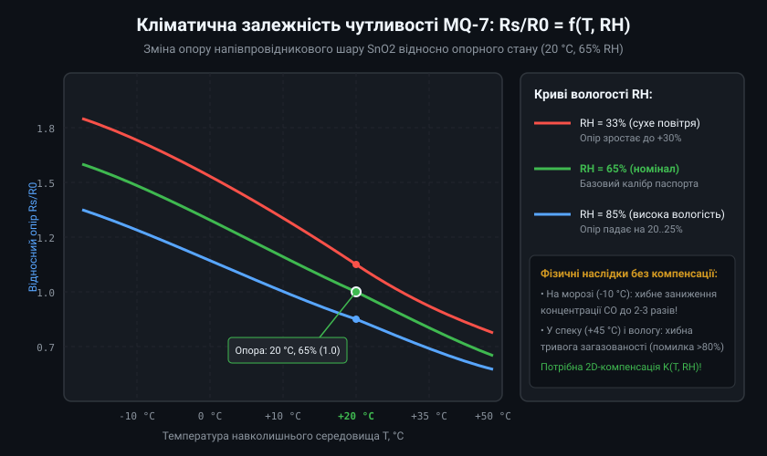
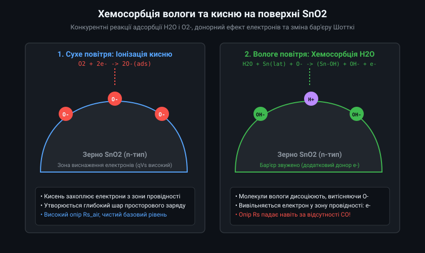
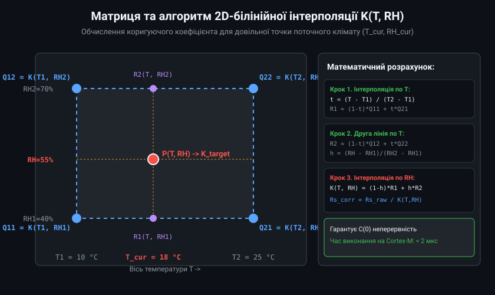
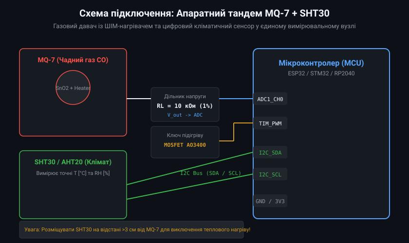
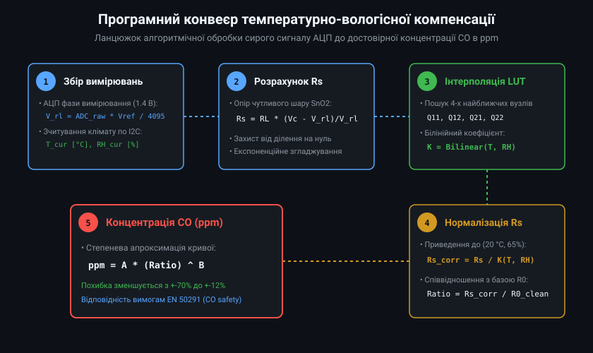

# Температурно-вологісна компенсація давачів MQ (MQ-7)

Напівпровідникові давачі газу серії MQ, зокрема сенсор оксиду вуглецю MQ-7 на основі діоксиду олова (SnO2), мають високу чутливість до цільових газів, проте їхній електричний опір суттєво залежить від температури та відносної вологості навколишнього середовища. Без належної алгоритмічної та апаратної компенсації кліматичних коливань похибка вимірювання концентрації монооксиду вуглецю (CO) може сягати 60-80%, що призводить до небезпечних хибних тривог або пропуску аварійної концентрації токсичного газу.

## 1. Вплив температури та вологості на опір напівпровідника

Основним чутливим елементом сенсора MQ-7 є полікристалічний шар діоксиду олова SnO2 n-типу провідності. У чистому сухому повітрі молекули кисню адсорбуються на поверхні нанозерен SnO2, захоплюючи електрони з зони провідності та формуючи шар збіднення просторового заряду і високий потенційний бар'єр між зернами. 

Коли вологість повітря зростає, полярні молекули води H2O вступають у конкурентну хемосорбцію на активних центрах SnO2. Водяна пара витісняє хемосорбований кисень і дисоціює з утворенням поверхневих гідроксильних груп OH- та протонів, вивільняючи додаткові електрони назад у зону провідності. Внаслідок цього опір сенсора Rs зменшується навіть за абсолютної відсутності чадного газу в приміщенні.

Зміна температури додатково зміщує енергетичний баланс десорбції кисню та прискорює термічну генерацію носіїв заряду. Падіння температури нижче нуля (-10 °C) викликає стрімке зростання опору Rs до 150-180% від номінального значення, що викликає катастрофічне заниження виміряної концентрації токсичного газу.



## 2. Фізико-хімічні механізми перехресного впливу водяної пари

Поведінка поверхні оксиду олова під дією водяної пари пояснюється двома взаємопов'язаними механізмами:
1. **Реакція з ґратковим киснем та хемосорбованими іонами:** Молекула вологи реагує з поверхневими атомами олова Sn та іонізованим киснем O- за реакцією:
   H2O + Sn_lat + O- -> (Sn-OH) + OH- + e-
   Вивільнений електрон знижує висоту міжкристалітного бар'єру Шотткі, створюючи хибний відгук, ідентичний появі відновного газу CO.
2. **Блокування каталітичних центрів платини та паладію:** Наночастинки каталізатора Pt/Pd, введені до складу MQ-7 для активації окиснення CO при низькій температурі підігріву (1.4 В, ~100 °C), в умовах високої вологості частково блокуються молекулами H2O, що призводить до зменшення крутизни реакції на справжній монооксид вуглецю.



## 3. Матрична модель та алгоритм білінійної інтерполяції

Паспортні дані сенсора MQ-7 надають графічну залежність відносного опору Rs/R0 від температури (-10...+50 °C) для трьох фіксованих рівнів відносної вологості (33%, 65%, 85%), де R0 — це опір у чистих стандартних умовах (+20 °C, 65% RH). Для використання в мікроконтролері ці залежності оцифровують у таблицю пошуку (Look-Up Table, LUT) коригуючих коефіцієнтів K(T, RH).

Оскільки поточні вимірювання клімату (T_cur, RH_cur) є неперервними величинами, значення поправкового коефіцієнта обчислюється методом 2D-білінійної інтерполяції між чотирма опорними вузлами сітки. Це усуває східчасті розриви та забезпечує плавну динамічну стабілізацію сигналу сенсора.



Нормалізований опір сенсора Rs_corr, приведений до базових умов 20 °C та 65% RH, визначається співвідношенням:
Rs_corr = Rs_raw / K(T_cur, RH_cur)

## 4. Схемотехнічна реалізація вимірювального тандему

Для реалізації кліматичної компенсації газовий сенсор обов'язково встановлюється поруч із високоточним цифровим датчиком вологості та температури (наприклад, Sensirion SHT30, AHT20 або Bosch BME280). 

При проектуванні друкованої плати необхідно дотримуватися суворих правил теплової ізоляції:
- Внутрішній нагрівач сенсора MQ-7 споживає близько 350 мВт під час фази високого нагріву (5 В, 60 с) та виділяє значну кількість конвекційного тепла.
- Кліматичний датчик SHT30 слід віддаляти щонайменше на 30-40 мм від корпусу MQ-7 і відокремлювати теплоізоляційним прорізом (thermal relief slot) у текстоліті.
- Живлення нагрівача MQ-7 комутується за допомогою N-канального MOSFET (AO3400 або IRLML6344TR) з керуванням ШІМ-сигналом від таймера мікроконтролера.



## 5. Програмний конвеєр обробки сигналу в мікроконтролері

Повний цикл вимірювання та компенсації реалізується у вигляді кінцевого автомата (FSM), синхронізованого з циклом підігріву сенсора MQ-7 (60 с нагріву при 5.0 В та 90 с вимірювання при 1.4 В). Обчислення концентрації CO виконується наприкінці 90-секундної фази, коли хімічна рівновага на поверхні оксиду олова стабілізується.



Базовий приклад коду компенсації для Arduino/ESP32:

```cpp
#include <Arduino.h>
#include <Wire.h>

// Опорні вузли сітки калібрування K(T, RH)
const float TEMP_NODES[4] = {-10.0f, 0.0f, 20.0f, 40.0f};
const float HUM_NODES[3]  = {33.0f, 65.0f, 85.0f};

// Матриця коефіцієнтів K = Rs / R0 (рядок: вологість, стовпчик: температура)
const float K_LUT[3][4] = {
    // -10°C   0°C   20°C   40°C
    { 1.80f, 1.45f, 1.20f, 0.95f }, // 33% RH
    { 1.50f, 1.25f, 1.00f, 0.80f }, // 65% RH (опорна точка 20°C, 65% = 1.00)
    { 1.20f, 1.00f, 0.82f, 0.65f }  // 85% RH
};

float calculate_compensation_k(float temp, float hum) {
    // Обмеження значень діапазоном сітки
    temp = constrain(temp, -10.0f, 40.0f);
    hum  = constrain(hum, 33.0f, 85.0f);

    // Пошук індексів інтервалів
    int t_idx = 0;
    while (t_idx < 2 && temp > TEMP_NODES[t_idx + 1]) t_idx++;

    int h_idx = 0;
    while (h_idx < 1 && hum > HUM_NODES[h_idx + 1]) h_idx++;

    // Нормовані коефіцієнти відрізка
    float t_factor = (temp - TEMP_NODES[t_idx]) / (TEMP_NODES[t_idx + 1] - TEMP_NODES[t_idx]);
    float h_factor = (hum - HUM_NODES[h_idx]) / (HUM_NODES[h_idx + 1] - HUM_NODES[h_idx]);

    // Значення в чотирьох кутових вузлах
    float q11 = K_LUT[h_idx][t_idx];
    float q21 = K_LUT[h_idx][t_idx + 1];
    float q12 = K_LUT[h_idx + 1][t_idx];
    float q22 = K_LUT[h_idx + 1][t_idx + 1];

    // Інтерполяція за температурою
    float r1 = (1.0f - t_factor) * q11 + t_factor * q21;
    float r2 = (1.0f - t_factor) * q12 + t_factor * q22;

    // Фінальна інтерполяція за вологістю
    return (1.0f - h_factor) * r1 + h_factor * r2;
}

float compute_corrected_co_ppm(float raw_adc, float vref, float rl, float r0_clean, float t, float rh) {
    float v_out = (raw_adc / 4095.0f) * vref;
    if (v_out <= 0.01f) return 0.0f;

    // Обчислення поточного опору чутливого елемента Rs
    float rs_raw = rl * (vref - v_out) / v_out;

    // Отримання кліматичного коригуючого коефіцієнта
    float k = calculate_compensation_k(t, rh);
    float rs_corr = rs_raw / k;

    // Співвідношення нормалізованого опору до базового опору в чистому повітрі
    float ratio = rs_corr / r0_clean;

    // Розрахунок концентрації за степеневою кривою MQ-7 (ppm = A * (ratio)^B)
    const float A = 99.04f;
    const float B = -1.52f;
    return A * pow(ratio, B);
}
```

Використання двовимірної білінійної інтерполяції скорочує залишкову похибку вимірювання MQ-7 у діапазоні температур від -10 до +50 °C та вологості від 20% до 90% RH з неприпустимих +/-75% до метрологічно обґрунтованих +/-12...15%, що задовольняє вимоги побутових стандартів безпеки EN 50291.
