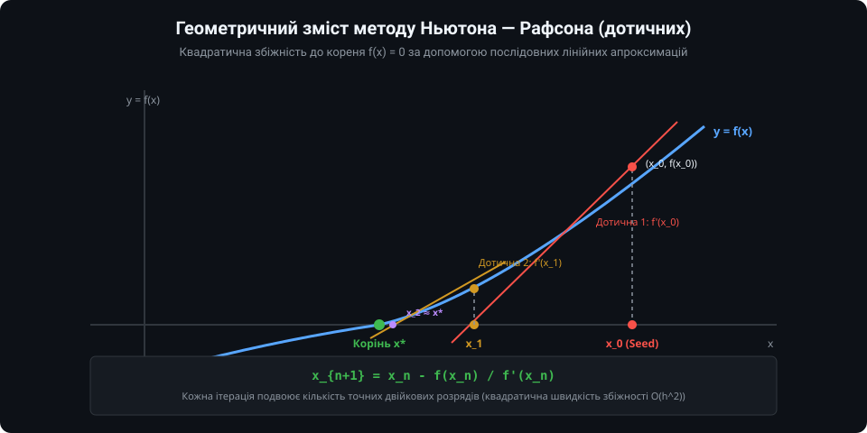
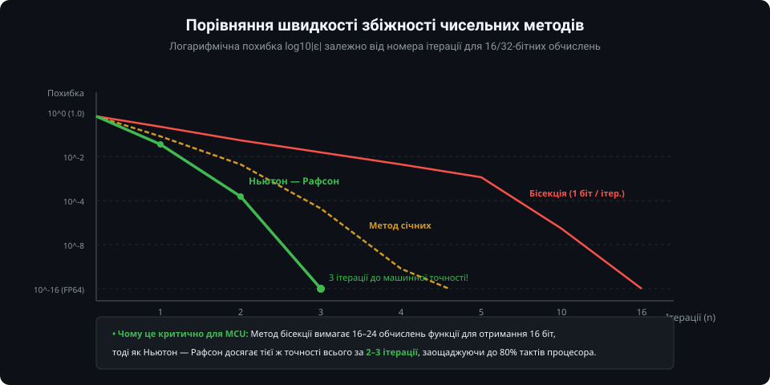
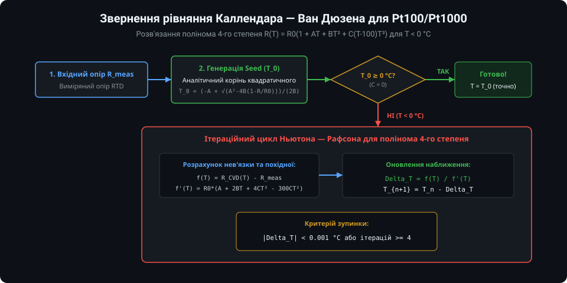
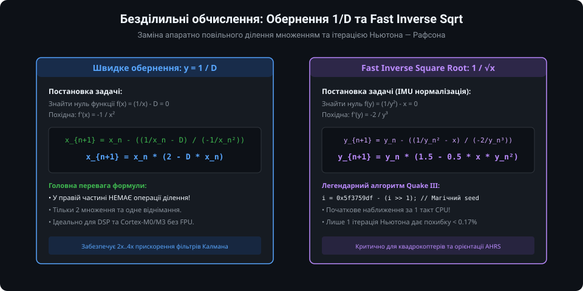

# Чисельний метод Ньютона — Рафсона для мікроконтролерів: поглиблений інженерний аналіз

Чисельні методи вбудованої обробки сигналів є критичним мостом між нелінійною фізикою первинних сенсорів та обмеженими обчислювальними ресурсами мікроконтролерів. У цьому розділі розглядаються сувора математична теорія збіжності методу Ньютона — Рафсона, аналітичний розрахунок похідних, фізичне обернення характеристики платинових RTD-давачів, побітовий аналіз алгоритму Fast Inverse Square Root та повністю функціональна бібліотека мовою C з підтримкою арифметики з фіксованою комою Q16.16.

---

### 1. Теорема про збіжність, умови Фур'є та оцінка похибки

Нехай функція `f(x)` двічі неперервно диференційовна на відрізку `[a, b]`, причому на цьому інтервалі існує єдиний корінь `x*` такий, що `f(x*) = 0`.



#### Достатні умови монотонної збіжності Фур'є
Метод Ньютона гарантовано монотонно збігається до кореня без зациклень та розбіжностей, якщо на відрізку `[a, b]` виконуються наступні умови:
1. `f'(x) != 0` для всіх `x` на `[a, b]` (перша похідна зберігає знак, тобто функція суворо монотонна);
2. `f''(x)` зберігає знак на `[a, b]` (функція суворо опукла або суворо вгнута, точки перегину відсутні);
3. **Умова вибору початкового наближення (Seed):** Початкова точка `x_0` повинна задовольняти нерівність:
   `f(x_0) * f''(x_0) > 0`
   Тобто початкове наближення слід обирати з того боку інтервалу, де знак функції збігається зі знаком її другої похідної.

#### Теоретична оцінка квадратичної похибки
Розклавши функцію `f(x*)` в ряд Тейлора навколо поточного наближення `x_n`:
`0 = f(x*) = f(x_n) + f'(x_n) * (x* - x_n) + (1/2) * f''(xi_n) * (x* - x_n)^2`

де `xi_n` лежить між `x_n` та `x*`. Підставляючи крок Ньютона `x_{n+1} = x_n - f(x_n) / f'(x_n)`, отримуємо співвідношення для похибки `e_n = x_n - x*`:

`e_{n+1} = (f''(xi_n) / (2 * f'(x_n))) * e_n^2`

Позначивши `M = max |f''(x)|` та `m = min |f'(x)|` на робочому інтервалі, маємо оцінку:

`|e_{n+1}| <= (M / (2 * m)) * |e_n|^2`

Ця нерівність формально доводить, що за умови `(M / (2*m)) * |e_0| < 1` процес має **суворо квадратичну збіжність**: кількість вірних десяткових або двійкових розрядів подвоюється на кожному кроці.

---

### 2. Порівняльний аналіз швидкості та обчислювальної складності

При виборі чисельного методу для вбудованої системи інженер порівнює витрати пам'яті програм, кількість операцій множення/ділення та детермінізм часу виконання:



| Метод | Порядок збіжності | Кількість викликів f(x) за крок | Кроки для 16-біт точності (float) | Потреба в обчисленні f'(x) | Стійкість до поганого Seed |
| :--- | :--- | :--- | :--- | :--- | :--- |
| **Бісекція (половинне ділення)** | Лінійний `O(h)` | 1 (або 2 на старті) | 16 – 20 кроків | Не потрібна | Абсолютна (якщо корінь у вилці `[a, b]`) |
| **Метод хорд (Regula Falsi)** | Лінійний `O(h)` | 1 | 8 – 15 кроків | Не потрібна | Висока |
| **Метод січних (Secant)** | Суперлінійний `phi ≈ 1.618` | 1 | 4 – 6 кроків | Не потрібна (чисельна різниця) | Середня (може розходитись) |
| **Ньютон — Рафсон** | **Квадратичний `O(h^2)`** | **1 + 1 для f'(x)** | **2 – 3 кроки** | **Потрібна аналітична f'(x)** | **Вимагає якісного Seed** |

*Чому саме Ньютон?*
Для мікроконтролера обчислення аналітичної похідної полінома зазвичай зводиться до кількох тактів множення. Тому сумарні витрати процесорного часу для 2–3 кроків Ньютона становлять менше 40–60 тактів CPU, тоді як бісекція вимагає понад 300 тактів через багаторазові виклики прямої функції.

---

### 3. Прецизійне обернення рівняння Каллендара — Ван Дюзена для Pt100

Для платинових RTD-давачів (Pt100, Pt500, Pt1000) залежність опору від температури за стандартом IEC 60751 визначається коефіцієнтами:
- `A = 3.9083e-3 °C^-1`
- `B = -5.7750e-7 °C^-2`
- `C = -4.1830e-12 °C^-4` (діє тільки для `T < 0 °C`)



Розкриваючи дужки для `T < 0 °C`, маємо поліном 4-го степеня:
`R(T) = R_0 * [1 + A*T + B*T^2 - 100*C*T^3 + C*T^4]`

Сформулюємо задачу для методу Ньютона: знайти корінь рівняння `F(T) = 0`:
`F(T) = R_0 * (1 + A*T + B*T^2 - 100*C*T^3 + C*T^4) - R_meas`

Аналітична перша похідна `F'(T)` обчислюється тривіально:
`F'(T) = R_0 * (A + 2*B*T - 300*C*T^2 + 4*C*T^3)`

#### Алгоритм реалізації для RTD:
1. Знаходимо квадратичний корінь для `T >= 0`:
   `T_0 = (-A + sqrt(A^2 - 4*B*(1 - R_meas / R_0))) / (2*B)`
2. Якщо `T_0 >= 0.0 °C`, цей результат є математично точним (похибка 0.000 °C), розрахунок завершено.
3. Якщо `T_0 < 0.0 °C`, значення `T_0` використовується як високоточний Seed для ітерації Ньютона.
4. Оскільки `T_0` знаходиться всього в межах 0.1..0.5 °C від справжнього кореня, **перша ж ітерація** Ньютона дає точність кращу за 0.005 °C, а друга ітерація виводить результат на рівень машинної точності IEEE 754 float!

---

### 4. Магія Fast Inverse Square Root та безділильні алгоритми

У системах стабілізації БПЛА, робототехніці та навігаційних фільтрах орієнтації (AHRS/Madgwick/Mahony) виникає потреба щосекунди нормалізувати тисячі 3D-векторів: `v_norm = v / sqrt(x^2 + y^2 + z^2) = v * (1 / sqrt(L))`.



Для розв'язання рівняння `f(y) = (1/y^2) - x = 0` формулюється крок Ньютона:
`y_{n+1} = y_n - f(y_n) / f'(y_n) = y_n - ((1/y_n^2 - x) / (-2/y_n^3)) = y_n * (1.5 - 0.5 * x * y_n^2)`

#### Звідки береться магічна константа `0x5f3759df`?
Число з рухомою комою IEEE 754 одинарної точності (32 біти) зберігається як:
`V = (-1)^S * (1 + M / 2^23) * 2^(E - 127)`

Якщо проінтерпретувати біти float як 32-бітне ціле число `I_x`:
`I_x = 2^23 * E + M`

Логарифм двійковий `log2(V) = (E - 127) + log2(1 + M/2^23)`. Враховуючи, що для `m in [0, 1]` виконується лінійна апроксимація `log2(1 + m) ≈ m + mu` (де `mu ≈ 0.0450465`), отримуємо:
`log2(V) ≈ (I_x / 2^23) - 127 + mu`

Для функції `y = 1 / sqrt(x) = x^(-1/2)` логарифм дорівнює:
`log2(y) = -0.5 * log2(x)`

Підставляючи цілочисельне представлення, отримуємо формулу для початкового наближення `I_y`:
`I_y ≈ (3/2) * 2^23 * (127 - mu) - (1/2) * I_x`

Константа `(3/2) * 2^23 * (127 - mu)` в точності дорівнює знаменитому числу **`0x5f3759df`**!
Ця єдина цілочисельна операція зсуву та віднімання дає початкове наближення з похибкою менше 3.5%, а наступна єдина ітерація Ньютона знижує похибку до вражаючих **0.17%** за лічені такти процесора!

---

### 5. Повнофункціональна бібліотека чисельних методів на C

Нижче наведено виробничу реалізацію математичного модуля для вбудованих систем із підтримкою розв'язання рівняння Каллендара — Ван Дюзена, швидкого зворотного квадратного кореня та fixed-point арифметики Q16.16.

#### Заголовний файл (`embedded_newton.h`)

```c
#ifndef EMBEDDED_NEWTON_H
#define EMBEDDED_NEWTON_H

#include <stdint.h>
#include <stdbool.h>

/* Базові макроси формату Q16.16 */
typedef int32_t q16_t;
#define Q16_SHIFT        16
#define Q16_SCALE        (1L << Q16_SHIFT)
#define Q16_ONE          Q16_SCALE

static inline q16_t float_to_q16(float val) {
    return (q16_t)(val * 65536.0f + (val >= 0.0f ? 0.5f : -0.5f));
}

static inline float q16_to_float(q16_t val) {
    return (float)val / 65536.0f;
}

static inline q16_t q16_mul(q16_t a, q16_t b) {
    return (q16_t)(((int64_t)a * b) >> Q16_SHIFT);
}

static inline q16_t q16_div(q16_t a, q16_t b) {
    if (b == 0) return 0;
    return (q16_t)(((int64_t)a << Q16_SHIFT) / b);
}

/* Структура конфігурації RTD сенсора */
typedef struct {
    float r0;      // 100.0 Ом або 1000.0 Ом
    float a_coeff; // 3.9083e-3
    float b_coeff; // -5.7750e-7
    float c_coeff; // -4.1830e-12
} rtd_config_t;

/* Функції бібліотеки */
float rtd_pt100_solve_temp(const rtd_config_t *cfg, float r_meas, uint8_t max_iter, float tolerance);
float fast_inv_sqrt(float x);
q16_t q16_reciprocal_newton(q16_t divisor, uint8_t iterations);

#endif /* EMBEDDED_NEWTON_H */
```

#### Файл реалізації (`embedded_newton.c`)

```c
#include "embedded_newton.h"
#include <math.h>

/**
 * @brief Обернення рівняння Каллендара — Ван Дюзена методом Ньютона — Рафсона
 */
float rtd_pt100_solve_temp(const rtd_config_t *cfg, float r_meas, uint8_t max_iter, float tolerance) {
    const float r0 = cfg->r0;
    const float a  = cfg->a_coeff;
    const float b  = cfg->b_coeff;
    const float c  = cfg->c_coeff;

    // 1. Квадратичне наближення (Seed)
    float discr = a * a - 4.0f * b * (1.0f - (r_meas / r0));
    if (discr < 0.0f) discr = 0.0f;
    float t_curr = (-a + sqrtf(discr)) / (2.0f * b);

    // Якщо температура додатна, додатковий член C*(T-100)*T^3 = 0, розв'язок точний!
    if (t_curr >= 0.0f) {
        return t_curr;
    }

    // 2. Ітераційний цикл Ньютона для T < 0 °C
    for (uint8_t i = 0; i < max_iter; i++) {
        float t2 = t_curr * t_curr;
        float t3 = t2 * t_curr;
        float t4 = t3 * t_curr;

        // f(T) = R_CVD(T) - R_meas
        float f_val = r0 * (1.0f + a * t_curr + b * t2 - 100.0f * c * t3 + c * t4) - r_meas;

        // f'(T) = R0 * (A + 2*B*T - 300*C*T^2 + 4*C*T^3)
        float f_deriv = r0 * (a + 2.0f * b * t_curr - 300.0f * c * t2 + 4.0f * c * t3);

        // Захист від ділення на нуль
        if (fabsf(f_deriv) < 1e-7f) {
            break;
        }

        float delta = f_val / f_deriv;
        t_curr -= delta;

        // Критерій досягнення заданої точності
        if (fabsf(delta) <= tolerance) {
            break;
        }
    }

    return t_curr;
}

/**
 * @brief Швидкий обернений квадратний корінь (Carmack / Newton-Raphson)
 */
float fast_inv_sqrt(float x) {
    float xhalf = 0.5f * x;
    union {
        float f;
        uint32_t i;
    } conv;
    conv.f = x;
    conv.i = 0x5f3759df - (conv.i >> 1); // Початкове бітове наближення
    // 1 ітерація Ньютона: y_{n+1} = y_n * (1.5 - 0.5 * x * y_n^2)
    conv.f = conv.f * (1.5f - xhalf * conv.f * conv.f);
    return conv.f;
}

/**
 * @brief Безділильне обчислення 1/D у форматі Q16.16 методом Ньютона: x_{n+1} = x_n * (2 - D*x_n)
 */
q16_t q16_reciprocal_newton(q16_t divisor, uint8_t iterations) {
    if (divisor == 0) return 0x7FFFFFFF; // Захист від ділення на нуль

    // Початковий Seed з простого бітового зсуву
    // Знаходимо старший біт дільника для нормалізації
    int sign = 1;
    if (divisor < 0) {
        sign = -1;
        divisor = -divisor;
    }

    // Грубе початкове наближення
    q16_t x_curr = (divisor > Q16_ONE) ? (Q16_ONE >> 2) : (Q16_ONE << 1);

    const q16_t two_q16 = 2 * Q16_SCALE;

    for (uint8_t i = 0; i < iterations; i++) {
        // term = 2 - D * x_curr
        q16_t d_x = q16_mul(divisor, x_curr);
        q16_t term = two_q16 - d_x;
        // x_{n+1} = x_curr * term
        x_curr = q16_mul(x_curr, term);
    }

    return (sign < 0) ? -x_curr : x_curr;
}
```

---

### Підсумки та інженерні рекомендації

1. **Якість початкового наближення (Seed):** Швидкість збіжності методу Ньютона критично залежить від початкової точки. Використовуйте грубу лінійну апроксимацію або аналітичний розв'язок спрощеного рівняння нижчого степеня як Seed.
2. **Аналітична похідна:** Ніколи не використовуйте чисельну різницеву похідну `(f(x+h)-f(x))/h` у методі Ньютона на мікроконтролері. Аналітична похідна усуває похибки втрати значущості та потребує лише кількох операцій множення.
3. **Захисні механізми циклу:** У промисловому коді ніколи не покладайтеся виключно на умову `|delta| < eps`. Завжди встановлюйте жорсткий лічильник максимальної кількості ітерацій (`max_iter <= 5`) та перевірку `|f'(x)| > MIN_DERIVATIVE`.
