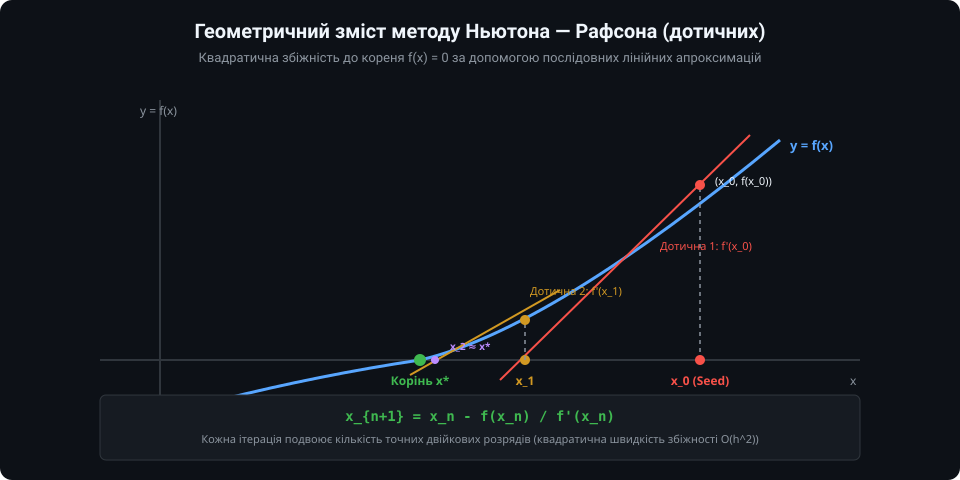
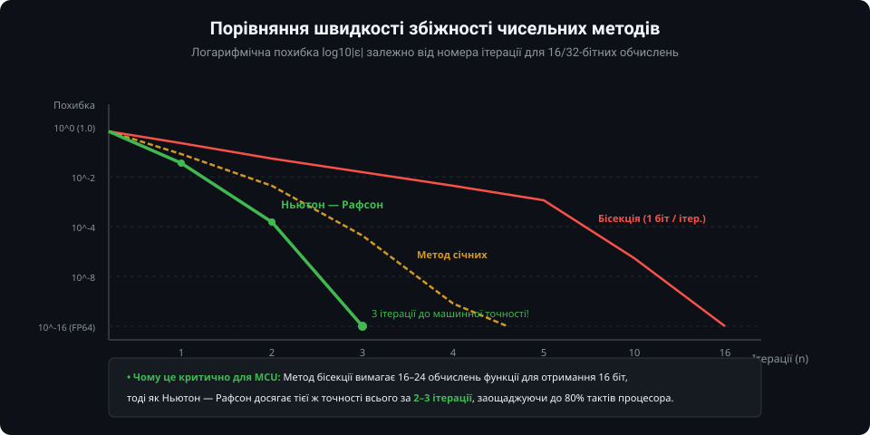
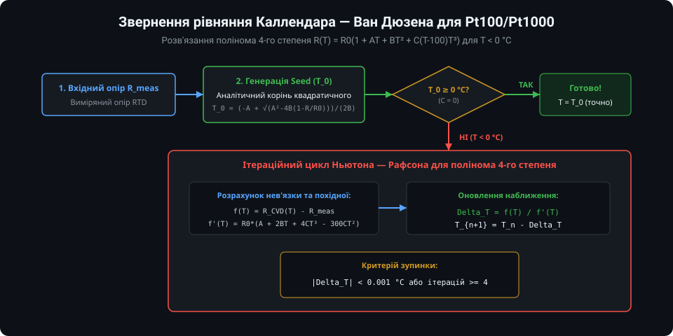
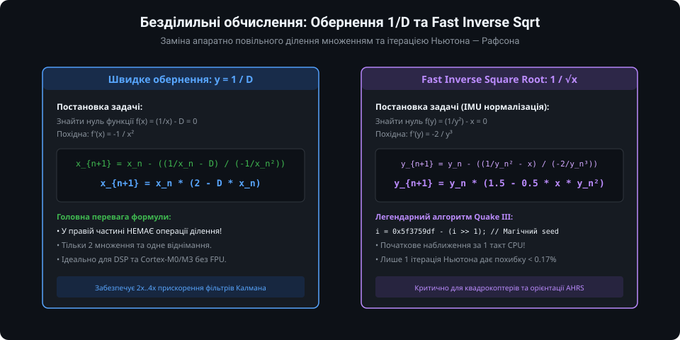
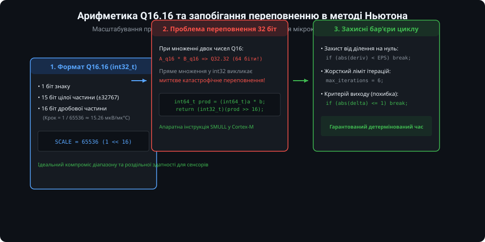

# Чисельний метод Ньютона — Рафсона для мікроконтролерів

У сучасних вбудованих системах мікроконтролер постійно взаємодіє з сенсорами, фізичні характеристики яких є нелінійними: терморезистори (NTC/PTC), платинові термометри опору (Pt100/Pt1000), напівпровідникові оптичні давачі або вимірювачі тиску. Пряме рівняння перетворення описує реакцію сенсора на фізичний вплив (наприклад, опір від температури: `R = f(T)`). Однак перед вбудованим ПЗ стоїть зворотна задача: за виміряним опором `R_meas` знайти справжнє значення температури `T`.

Якщо пряма функція є поліномом високого степеня або містить експоненти, аналітичне обернення або взагалі не існує у замкненому вигляді, або вимагає громіздких формул Кардано/Феррарі. У таких випадках чисельний **метод Ньютона — Рафсона (метод дотичних)** є найбільш швидким, точним та елегантним інженерним рішенням.

---

### 1. Геометричний зміст методу Ньютона — Рафсона

Задача обернення характеристики сенсора зводиться до знаходження кореня рівняння:
`F(x) = f(x) - Y_meas = 0`

де `f(x)` — теоретична модель сенсора, `Y_meas` — обчислена напруга або опір, `x` — шукана фізична величина.

Алгоритм базується на лінеаризації функції за допомогою дотичної:
1. Обирається деяке початкове наближення кореня `x_0` (так званий "Seed");
2. У точці `(x_0, F(x_0))` проводиться дотична до кривої. Рівняння дотичної має вигляд: `y - F(x_0) = F'(x_0) * (x - x_0)`;
3. Точка перетину цієї дотичної з віссю абсцис (`y = 0`) приймається за наступне покращене наближення `x_1`:
   `x_1 = x_0 - F(x_0) / F'(x_0)`
4. Процес повторюється ітераційно для кроку `n`:
   `x_{n+1} = x_n - F(x_n) / F'(x_n)`

Завдяки заміні нелінійної кривої на локальну пряму кожне наступне наближення стрімко підходить до справжнього кореня `x*`.

---

### 2. Квадратична швидкість збіжності

Головною перевагою методу Ньютона — Рафсона є його **квадратична швидкість збіжності** `O(h^2)` в околі кореня:

На практиці це означає:
- Якщо на поточному кроці похибка становила `0.1` (10^-1), то на наступному кроці вона зменшиться приблизно до `0.01` (10^-2), далі — до `0.0001` (10^-4), потім — до `10^-8`, і нарешті — до `10^-16` (машинний нуль для чисел подвійної точності IEEE 754 double).
- **Порівняння з бісекцією (половинним діленням):** Метод бісекції на кожному кроці зменшує похибку рівно в 2 рази (додає 1 біт точності). Щоб отримати 16-бітну точність АЦП, бісекція гарантовано потребує 16–20 ітерацій. Метод Ньютона досягає тієї ж точності всього за **2–3 ітерації**!
- Це дає скорочення обчислювального часу мікроконтролера у 5–8 разів, що критично для систем реального часу з опитуванням сенсорів на частотах 1..10 кГц.

---

### 3. Обернення рівняння Каллендара — Ван Дюзена для Pt100/Pt1000

Класичним прикладом застосування методу в датчиках є термометри опору RTD (Pt100). Відповідно до стандарту IEC 60751, характеристика платини описується рівнянням Каллендара — Ван Дюзена (CVD):
- Для `T >= 0 °C`: `R(T) = R_0 * (1 + A*T + B*T^2)` (квадратне рівняння, має аналітичний корінь);
- Для `T < 0 °C` (до -200 °C): `R(T) = R_0 * [1 + A*T + B*T^2 + C*(T - 100)*T^3]` — це поліном **4-го степеня**, аналітичне розв'язання якого практично неможливе в мікроконтролері.

Застосування методу Ньютона розв'язує задачу в 3 простих кроки:
1. Як початковий Seed `T_0` обчислюється аналітичний корінь квадратичного наближення для додатних температур;
2. Якщо `T_0 < 0`, запускається ітераційний цикл Ньютона;
3. Похідна полінома обчислюється миттєво: `f'(T) = R_0 * [A + 2*B*T + 4*C*T^3 - 300*C*T^2]`. Уже на другій ітерації залишкове відхилення стає меншим за 0.001 °C!

---

### 4. Безділильні обчислення: зворотна величина 1/D та Fast InvSqrt

Багато недорогих мікроконтролерів (наприклад, ARM Cortex-M0/M0+ або застарілі 8-бітні ядра) не мають апаратного блоку ділення (інструкції `SDIV/UDIV`), тому операція ділення чисел з рухомою комою займає сотні тактів ядра. Метод Ньютона дозволяє замінити ділення операціями множення:

1. **Швидке обчислення взаємно оберненого числа `x = 1 / D`:**
   Розв'язується функція `f(x) = (1/x) - D = 0`.
   Ітераційна формула Ньютона набуває вигляду:
   `x_{n+1} = x_n * (2 - D * x_n)`
   У правій частині формули **взагалі немає операції ділення** — тільки 2 множення та одне віднімання! Обчисливши попереднє наближення `x_0` з таблиці або за мантисою, мікроконтролер знаходить точне значення `1/D` всього за 1–2 кроки.

2. **Швидкий зворотний квадратний корінь (Fast Inverse Square Root `1/sqrt(x)`):**
   Критично важливий для нормалізації векторів у системах просторової орієнтації IMU (акселерометри та гіроскопи). Для рівняння `f(y) = (1/y^2) - x = 0` ітерація Ньютона має вигляд:
   `y_{n+1} = y_n * (1.5 - 0.5 * x * y_n^2)`
   Поєднана зі знаменитим бітовим фокусом ініціалізації мантиси числа float, вона виконується за лічені такти процесора.

---

### 5. Адаптація для мікроконтролерів: арифметика Q16.16 та надійність

Для мікроконтролерів без апаратного блоку FPU операції з типом `float` або `double` виконуються через програмні бібліотеки емуляції, що різко збільшує розмір коду та час виконання. Для таких систем алгоритм Ньютона переводять у цілочисельний формат із фіксованою комою **Q16.16**:

Правила безпечної реалізації вбудованого алгоритму Ньютона:
1. **64-бітне проміжне множення:** При перемноженні двох 32-бітних чисел формату Q16.16 результат має розрядність 64 біти (Q32.32). Його акумулюють у змінну `int64_t`, після чого зсувають праворуч на 16 біт (`>> 16`).
2. **Захист від ділення на нуль:** Якщо похідна `f'(x)` прямує до нуля (горизонтальна дотична), крок Ньютона прямує до нескінченності. Перед кожним діленням обов'язково перевіряють поріг `|f'(x)| > EPSILON`.
3. **Жорсткий ліміт ітерацій (Watchdog-лічильник):** Цикл повинен мати ліміт кроків (наприклад, `max_iter = 5`). Це запобігає зависанню прошивки у разі виникнення осциляцій чи незбіжності через шумні дані сенсора.

---

### Підсумки та висновки

Метод Ньютона — Рафсона — це фундаментальний чисельний інструмент розробника вбудованих систем:
1. Забезпечує надзвичайно швидке (2–3 ітерації) розв'язання нелінійних рівнянь сенсорів.
2. Дозволяє повністю розкрити потенціал високоточних платинових сенсорів Pt100/Pt1000 у діапазоні від'ємних температур.
3. Може бути ефективно реалізований як у форматі IEEE 754 float, так і в цілочисельному форматі Q16.16 для бюджетних мікроконтролерів без FPU.
