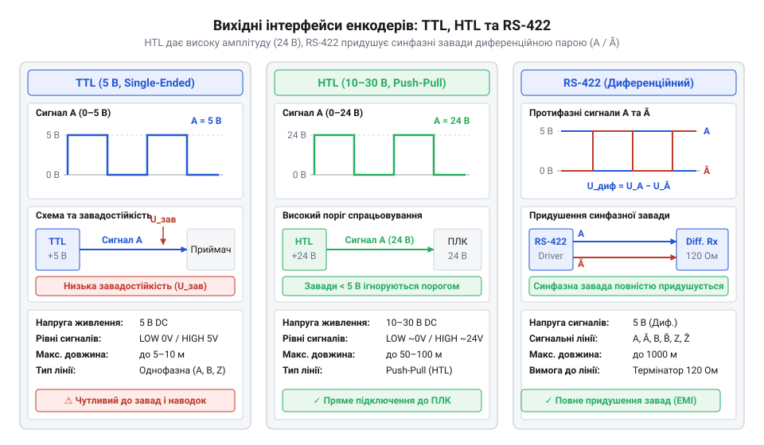
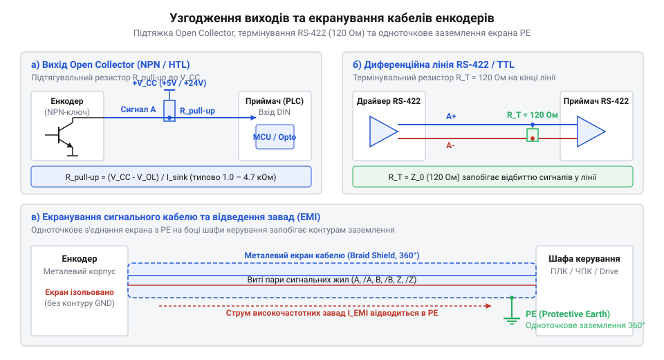
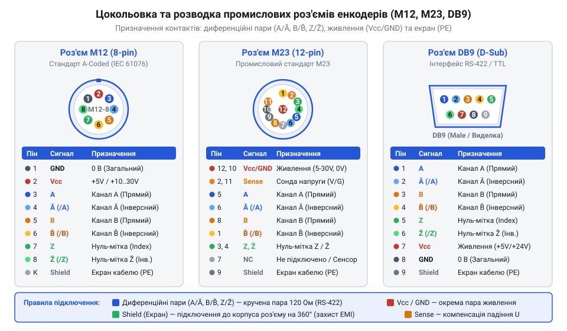
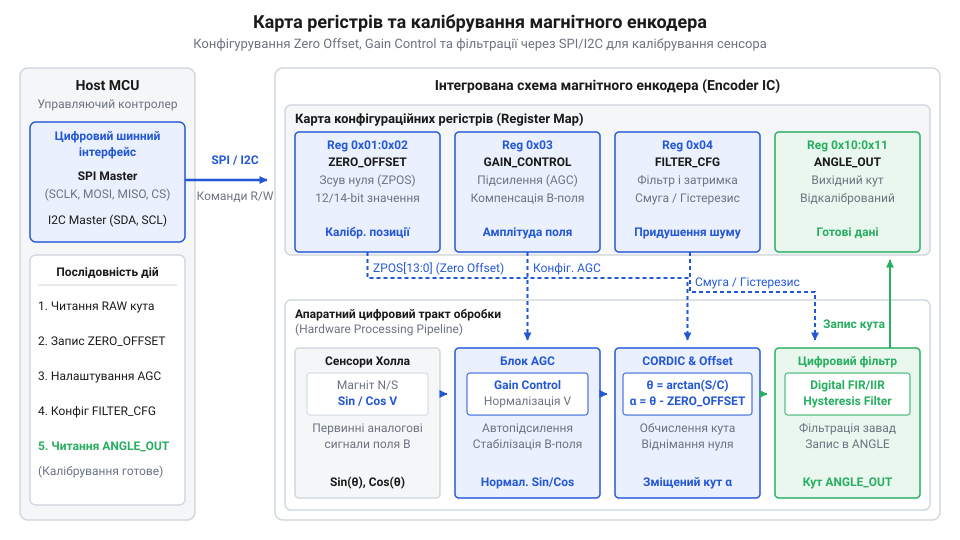

# Електричні інтерфейси, схема підключення та кабельна розводка енкодерів

<preknowlist>
- [Датчики кутового положення сервоприводів: потенціометри та магнітні енкодери](root:cat-hw-sensors/servo-feedback-potentiometers-and-magnetic-encoders) — принципи отримання позиційного сигналу та конструктивні відмінності кутових датчиків
- [Магнітний енкодер кута AS5048](root:cat-hw-sensors/as5048-magnetic-encoder) — базове влаштування інтегрованих магнітних сенсорів із цифровими інтерфейсами
</preknowlist>

## Спотворення сигналів та втрата кроків

У промислових системах автоматизації енкодер виступає критичноважливим елементом зворотного зв'язку за положенням вала. Розглянемо поширену аварійну ситуацію: сервопривід верстата з числовим програмним керуванням, що використовує [датчики кутового положення сервоприводів](root:cat-hw-sensors/servo-feedback-potentiometers-and-magnetic-encoders), підключено до контролера керування через кабель довжиною 20 метрів. Кабель прокладено в спільному силовому лотку поруч із кабелем живлення електродвигуна, що живиться від частотного перетворювача. Під час роботи верстата на малих обертах позиціонування виконується коректно, проте під час розгону двигуна до високих швидкостей контролер починає фіксувати хибні імпульси, накопичувати позиційну похибку або виходити в режим аварійної зупинки через втрату кроків квадратурного декодера (від лат. *quadratura* — надання квадратної форми; @@en|quadrature@@). Чому виникає цей збій, якщо сам датчик абсолютно справний?

Головна фізична причина спотворення прямокутних сигналів — паразитна ємність та опір провідників кабелю. Будь-яка пара скручених мідних жил володіє розподіленим опором `R_line` та розподіленою міжжильною та екранною ємністю `C_line`. У стандартних промислових кабелях ємність становить від `50 pF/m` до `120 pF/m`. Коли вихідний каскад енкодера змінює свій стан з логічного нуля на логічну одиницю, він повинен фізично зарядити цю паразитну ємність. У результаті прямокутний імпульс вихідного сигналу перетворюється на трапецієподібний або експоненціальний сигнал. Швидкість наростання напруги (від англ. *slew rate* — швидкість наростання напруги; @@en|slew rate@@) обмежується постійною часу RC-кола, утвореного опором виходу енкодера (або підтягувального резистора) та ємністю кабельної лінії.

Розрахуємо тривалість фронту наростання напруги `t_r` та граничну частоту зрізу `f_c` для пасивного вихідного каскаду, навантаженого на довгу кабельну лінію з підтягувальним опором `R_line` та загальною ємністю `C_line`.

```
t_r = 2.2 · R_line · C_line
= 2.2 · 2200 · (20 · 100 · 10⁻¹²)      [підстановка опору підтяжки 2.2 кОм та ємності 20 м кабелю]
= 2.2 · 2200 · 2 · 10⁻⁹                 [спрощення значення ємності 2 нФ]
= 9.68 μs                              [тривалість фронту наростання сигналу]
```

З отриманого значення видно, що для перезаряду ємності лінією потрібні майже `10 μs`. Якщо енкодер обертається зі швидкістю, що відповідає частоті проходження імпульсів `100 kHz` (період сигнального прямокутного імпульсу складає `10 μs`, а тривалість активної фази високого рівня — `5 μs`), напруга на сигнальному проводі фізично не встигає досягти порогу спрацьовування логічної одиниці контролера. Вхідний тригер Шмітта контролера взагалі не реєструє імпульс, що призводить до прямої втрати кроків позиціонування.

Другим чинником є імпульсні електромагнітні завади. Під час перемикання силових транзисторів частотного перетворювача виникають високі швидкості зміни напруги `dV/dt` та струму `dI/dt`. Унаслідок ємнісного та індуктивного зв'язку між паралельно прокладеними провідниками виникають перехресні наведення (від англ. *crosstalk* — перехресні наведення; @@en|crosstalk@@). Якщо амплітуда завади на однофазній сигнальній лінії перевищує поріг завадостійкості приймача (наприклад, `0.8 V` для TTL-логіки), контролер помилково сприймає наведену пікову напругу як додатковий імпульс. У каналі @@en|quadrature@@ це призводить до появи тремтіння фази (від англ. *jitter* — тремтіння фази; @@en|jitter@@) або хибного визначення напрямку обертання вала.

Третім джерелом спотворень є різниця потенціалів між заземлювальними точками енкодера та контролера, що виникає при проходженні силових струмів через спільну земляну шину. Утворення земляної петлі (від англ. *ground loop* — земляна петля; @@en|ground loop@@) призводить до появи постійного або змінного зсуву напруги `ΔV_GND`. Оскільки однофазний електричний сигнал передається відносно спільного провідника заземлення, цей зсув додається до сигнальної напруги, переміщуючи логічні рівні у зону невизначеності приймача.

Таким чином, використання стандартних однофазних низьковольтних ліній без узгодження опорів та завадозахисту на довгих дистанціях робить систему непрацездатною. Для надійної передачі даних виникає критична потреба у виборі спеціалізованих вихідних каскадів та електричних інтерфейсів, здатних протистояти RC-згладжуванню, високовольтним наведенням та зсувам земляного потенціалу.

## Електричні рівні сигналів енкодерів

Для подолання спотворень сигналів та забезпечення стабільного зчитування кутового положення у промисловості застосовують три основні типи електричних інтерфейсів вихідних каскадів: однофазний TTL (від англ. *Transistor-Transistor Logic* — транзисторно-транзисторна логіка; @@en|TTL@@), високовольтний HTL (від англ. *High Threshold Logic* — логіка з високим порогом; @@en|HTL@@) та диференційний RS-422 (від англ. *Recommended Standard 422* — рекомендований стандарт 422; @@en|RS-422@@). Вибір інтерфейсу визначається схемотехнікою вихідного каскаду самого енкодера (від англ. *encoder* — кодувальник; @@en|encoder@@).

Схемотехнічно виходи енкодерів поділяються на два базові типи: відкритий колектор (від англ. *open collector* — відкритий колектор; @@en|Open Collector@@) та двотактний вихід (від англ. *push-pull* — двотактний вихід; @@en|Push-Pull@@). У схемі @@en|Open Collector@@ вихідний NPN-транзистор може лише притягувати сигнальну лінію до землі (формувати логічний нуль). Для формування логічної одиниці потрібен зовнішній підтягувальний резистор `R_pull-up`, підключений до джерела живлення. Через це розряд ємності кабелю відбувається швидко через відкритий транзистор, а заряд — повільно через резистор `R_pull-up`, що обмежує граничну довжину кабелю та частоту сигналів. Натомість каскад @@en|Push-Pull@@ містить два комплементарні транзистори: верхній активне джерело струму для швидкого заряду ємності лінії до логічної одиниці, а нижній — для розряду до логічного нуля. Це забезпечує симетричні та круті фронти перемикання.

Електричний інтерфейс @@en|TTL@@ використовує напругу живлення `5 V` DC. Сигнали каналів A, B та референтного імпульсу Z передаються по окремих однофазних провідниках відносно спільного провідника GND. Логічний нуль `V_OL` не перевищує `0.4 V`, а логічна одиниця `V_OH` становить не менше `2.4 V` (типово `3.5–5.0 V`). Поріг спрацьовування приймача становить `0.8 V` для нуля та `2.0 V` для одиниці. Запас завадостійкості складає всього `0.4–0.8 V`, що робить @@en|TTL@@ надзвичайно вразливим до зовнішніх електромагнітних наведень. Застосування @@en|TTL@@ обмежене короткими відстанями (до 2–3 метрів) усередині екранованих корпусів обладнання або в пристроях із вбудованими сенсорами, як-от [магнітний енкодер кута AS5048](root:cat-hw-sensors/as5048-magnetic-encoder).

Високовольтний інтерфейс @@en|HTL@@ розроблено спеціально для промислових умов із високим рівнем завад. Інтерфейс працює при напрузі живлення від `10 V` до `30 V` DC (найчастіше `24 V` DC). Вихідні рівні сигналу на базі двотактного каскаду @@en|Push-Pull@@ досягають `V_OH ≈ V_CC - 1.5 V` (понад `21 V` при живленні `24 V`) та `V_OL ≈ 1.5 V`. Приймач контролера має високий поріг спрацьовування (типово `15 V` для логічної одиниці та `5 V` для логічного нуля). Завдяки високій амплітуді сигналу запас завадостійкості зростає до `5–10 V`. Електромагнітна завада з амплітудою `3 V` просто не спроможна змінити логічний стан входу. Проте висока напруга та активний заряд ємності кабелю призводять до значного теплового розсіювання потужності на вихідних транзисторах @@en|encoder@@ на високих частотах, що обмежує максимальну частоту сигналів @@en|HTL@@ порівняно з диференційними інтерфейсами.

Завадостійким рішенням для довгих ліній зв'язку є диференційний інтерфейс @@en|RS-422@@. Замість передачі напруги відносно землі, для кожного каналу використовується симетрична пара провідників з протифазними (комплементарними) сигналами: `A` та `/A`, `B` та `/B`, `Z` та `/Z`. Інтегральний передавач (від англ. *differential line driver* — диференційний драйвер лінії; @@en|differential line driver@@) формує паралельно два сигнали: коли на лінії `A` напруга зростає до `5 V`, на лінії `/A` вона опускається до `0 V`.

Диференційний приймач контролера вимірює не абсолютну напругу провідників відносно землі, а різницю потенціалів `V_diff = V_A - V_/A`. Поріг визначення логічного стану становить всього `±200 mV`: якщо `V_diff ≥ +200 mV`, реєструється логічна одиниця, якщо `V_diff ≤ -200 mV` — логічний нуль. Коли зовнішня електромагнітна завада наводить напругу `V_noise` на скручену пару провідників, вона діє однаково на обидва жили (синфазна завада; від англ. *common-mode noise* — синфазна завада; @@en|common-mode noise@@). У результаті віднімання на вхідному диференційному підсилювачі завада математично взаємно знищується:

```
V_diff = (V_A + V_noise) - (V_/A + V_noise)
= V_A + V_noise - V_/A - V_noise        [раскриття дужок]
= V_A - V_/A                             [скорочення синфазної завади]
```

Завдяки цьому механізму придушення синфазної завади @@en|RS-422@@ забезпечує передачу даних на відстані до 1000 метрів та роботу на частотах до декількох мегагерц. Такий тип підключення є стандартом для важкого машинобудування та прецизійних систем, де також застосовуються [сельсини та резольвери](root:cat-hw-sensors/synchro-and-resolver-transducers).

Для наочного порівняння параметрів вихідних сигналів наведено схему розводок та діаграми напруг різних інтерфейсів.


*Порівняльна схема та часові діаграми напруг вихідних каскадів TTL (5V), HTL (10–30V) та диференційної лінії RS-422 з протифазними сигналами.*

Вибір між @@en|TTL@@, @@en|HTL@@ та @@en|RS-422@@ залежить від вимог до довжини кабелю, частоти імпульсів та електромагнітної обстановки об'єкта.

## Схемне придушення завад та узгодження

Підключення енкодера до приймача сигналів у промисловому середовищі вимагає електричного узгодження параметрів лінії та захисту від завад. Навіть якщо вихідний каскад датчика розрахований на необхідний рівень напруги, паразитні параметри довгого кабелю та електромагнітні наведення від силового обладнання спотворюють квадратні імпульси. Для відновлення форми фронтів та забезпечення завадостійкості застосовують пасивні елементи схемного узгодження: підтягувальні резистори, термінуючі навантаження та схеми екранування.

Вихід типу @@en|відкритий колектор@@ (від англ. open collector) потребує зовнішнього підтягувального резистора для формування високого логічного рівня. Коли внутрішній NPN-транзистор відкритий, він з'єднує сигнальну лінію з землею, забезпечуючи низький рівень напруги. Коли транзистор закривається, струм у лінію подається виключно через зовнішній підтягувальний резистор `R_pullup`. Вибір величини цього резистора є компромісом між споживаною потужністю та швидкістю наростання фронту сигналу.

Мінімальне значення опору `R_pullup_min` обмежується максимально допустимим струмом вихідного транзистора `I_sink_max`. Якщо опір занадто малий, через відкритий транзистор протікає надмірний струм, що призводить до його перегріву та виходу з ладу. Для обчислення мінімального опору використовують напругу живлення кола підтяжки `U_CC`, напругу насичення колектор-емітер відкритого транзистора `V_OL` та граничний струм розряджання `I_sink_max`:

R_pullup_min = (U_CC - V_OL) / I_sink_max      [розрахунок мінімального опору за допустимим струмом]
= (24 - 0.4) / 0.02                            [підстановка U_CC = 24 В, V_OL = 0.4 В, I_sink_max = 20 мА]
= 1180 Ом                                      [обчислення мінімального безпечного опору]

Максимальне значення опору `R_pullup_max` обмежується паразитною ємністю кабелю `C_line` та необхідною тривалістю наростання фронту `t_r`. Коли транзистор закривається, ємність кабелю заряджається через `R_pullup` за експоненційним законом. Час наростання напруги від 0 до 90% від логічної одиниці становить приблизно `2.3` сталих часу `tau = R_pullup * C_line`. Для збереження прямокутної форми імпульсів при високій частоті обертання час наростання `t_r` не повинен перевищувати 10% від тривалості найкоротшого імпульсу. Розрахунок максимального опору здійснюють за формулою:

R_pullup_max = t_r / (2.3 * C_line)             [розрахунок максимального опору за тривалістю фронту]
= (1 * 10^-6) / (2.3 * 500 * 10^-12)           [підстановка t_r = 1 мкс, C_line = 500 пФ]
= 869 Ом                                       [обчислення максимального допустимого опору]

Порівняння отриманих значень показує фізичне обмеження виходу @@en|відкритий колектор@@: при напрузі живлення `24 В` та ємності кабелю `500 пФ` мінімально безпечний опір `1180 Ом` виявляється більшим за максимально припустимий опір `869 Ом` для частоти `100 кГц`. Це означає, що @@en|відкритий колектор@@ не здатний забезпечити круті фронти сигналів у довгих лініях при високих напругах HTL, що робить неминучим перехід на симетричні диференційні каскади.

Для високошвидкісних ліній передачі сигналів енкодерів стандартів @@en|TTL@@ та @@en|RS-422@@ застосовують @@en|термінування@@ (від лат. terminare — обмежувати) резистором `120 Ом`. Якщо довжина кабелю перевищує декілька метрів, довша за довжину хвилі фронту сигналу, лінія зв'язку поводиться як лінія з розподіленими параметрами. На неузгодженому кінці лінії високий вхідний опір приймача спричиняє відбиття електричної хвилі. Відбитий імпульс накладається на прямому сигналі, викликаючи дзвін (зворотні викиди напруги) та хибні спрацьовування цифрових входів лічильника.

Щоб усунути відбиття хвилі, на самому кінці кабелю безпосередньо між диференційними провідниками `A` та `/A` (а також `B` і `/B`, `Z` і `/Z`) встановлюють @@en|термінуючий резистор@@ `R_term = 120 Ом`. Опір резистора обирають рівним характеристичному хвильовому опору `Z_0` стандартної витої пари. У результаті вся енергія сигналу поглинається резистором, і відбиття хвилі повністю зникає. При цьому вихідний каскад енкодера повинен мати достатнє навантаження за струмом, оскільки постійна потужність розсіювання на паралельному резисторі для диференційної пари `P_term` при диференційній напрузі `U_diff` становить:

P_term = (U_diff)^2 / R_term                   [розрахунок потужності розсіювання термінатора]
= (3.5)^2 / 120                                [підстановка диференційної напруги U_diff = 3.5 В]
= 0.102 Вт                                     [обчислення потужності на одну пару]


*Принципова схема пасивного узгодження сигнальних ліній енкодера та відведення завад через екран кабелю.*

Окрім узгодження хвильового опору, критичною ланкою захисту є відведення високочастотних завад, які створюють @@en|електромагнітна завада@@ (@@en|EMI@@). Для цього застосовують суцільний @@en|екран кабелю@@ (від нім. Schirm — захисний щит) у вигляді плетінки з лудженої міді. Головна пастка підключення екрана полягає у виникненні явищ, відомих як @@en|земляна петля@@. Якщо екран кабелю глухо заземлити з обох боків — на корпусі енкодера та на шасі шафи керування, різниця потенціалів між заземлювачами створює низькочастотний вирівнювальний струм промислової частоти `50 Гц`. Цей струм наводиться високою напругою завади на внутрішніх сигнальних жилах.

Щоб розірвати контур низькочастотного струму, застосовують правильну схему заземлення:
1. Пряме заземлення екрана на захисну землю @@en|PE@@ (від англ. Protective Earth) виконують лише з одного боку — біля приймача сигналів (контролера або перетворювача частоти) через суцільний металевий хомут на `360 градусів`. 2. На боці енкодера екран ізолюють від корпусу обладнання або підключають через паралельний RC-ланцюг (`10 нФ` напругою `1 кВ` та резистор `1 МОм`). Така комбінація забезпечує високий опір для струмів вирівнювання `50 Гц` та низький імпеданс для високочастотних імпульсних наведень EMI, скидаючи їх на земляну шину.

Такий підхід до схемного придушення завад критично важливий для роботи датчиків у важких умовах поруч із потужними двигунами, на відміну від захищених безконтактних датчиків, як-от [резольверів та сельсинів](root:cat-hw-sensors/synchro-and-resolver-transducers), де сигнал обробляється у формі змінної напруги несучої частоти. Докладніше про побудову активних і пасивних ФНЧ, компараторів з тригером Шмітта та опторозв'язок на вхідних каскадах контролерів читайте у матеріалі про [схемотехніку фільтрації та формування сигналів енкодерів](root:hw-sensing/encoder-signal-conditioning-and-filtering).

## Розводка промислових роз'ємів та кабелів

Навіть ідеально розрахована схема узгодження виявиться неефективною, якщо при монтажі кабелю припуститися помилок у цокольовці або прокласти сигнальні провідники поруч із силовими колами. Промисловий кабельний монтаж енкодерів спирається на стандартизовані роз'єми та жорсткі правила фізичного групування жил. Помилки монтажу призводять не лише до втрати імпульсів, а й до фізичного виходу з ладу вхідних каскадів через подачу напруги живлення `24 В` на сигнальні лінії `RS-422`.

Для підключення енкодерів у промисловості найчастіше застосовують три типи роз'ємів: `@@en|M12@@` (від англ. Metric 12 mm — нарізний промисловий з'єднувач діаметром 12 мм), `@@en|M23@@` та `@@en|DB9@@` (від англ. D-subminiature size B 9-pin — 9-контактний роз'єм D-Sub).

Роз'єм `@@en|M12@@` з кодуванням A є стандартом для компактних енкодерів та польових датчиків із ступенем захисту IP67. Найбільш поширені 8-контактні та 12-контактні версії. 8-контактний роз'єм забезпечує підключення трьох диференційних пар (`A`, `/A`, `B`, `/B`, `Z`, `/Z`) та двох провідників живлення (`VCC`, `GND`). 12-контактний роз'єм додатково містить лінії сенсорного контролю напруги живлення (Sense) та сигналу помилки (Fault).

Роз'єм `@@en|M23@@` на 12 або 17 контактів використовують у важкому машинобудуванні та сервоприводах великої потужності. Завдяки металевому корпусу та масивним контактам він стійкий до сильних вібрацій, високих механічних навантажень та має вбудований цанговий затискач для обтискання екрана кабелю.

Роз'єм `@@en|DB9@@` застосовують переважно всередині шаф керування для підключення енкодерних кабелів до плати контролера або модуля лічильника.

При розводці контактів (@@en|цокольовка@@) та комутації жил кабелю обов'язково дотримуються трьох фундаментальних правил:

1. **Правило парної скрутки для диференційних сигналів.** Сигнальна лінія та її інверсний відповідник (наприклад, `A` та `/A`) повинні прокладатися в одній витій парі `@@en|вита пара@@` (від англ. twisted pair). Оскільки обидва провідники у витій парі мають однакову просторову орієнтацію відносно зовнішнього джерела завад, електромагнітна наводка створює однакову напругу на обох жилах. Диференційний приймач розраховує різницю напруг, завдяки чому @@en|синфазна завада@@ повністю взаємознищується.

2. **Пастка перехресного з'єднання пар.** Головною помилкою при монтажі є скручування в одну пару прямого сигналу одного каналу та прямого сигналу іншого каналу (наприклад, `A` та `B`). У такому випадку прямокутні імпульси сигналу `B` через паразитну ємність між жилами наводять потужні @@en|перехресні завади@@ (від англ. crosstalk) у канал `A`, створюючи хибні імпульси лічильника, які неможливо відфільтрувати диференційним приймачем.

3. **Ізоляція кіл живлення.** Контакти живлення `VCC` та `GND` у роз'ємі розташовують так, щоб мінімізувати ризик випадкового замикання на сигнальні лінії при скошуванні роз'єму в момент підключення під напругою. Для цього в роз'ємах `@@en|M23@@` контакти живлення часто роблять більшого діаметра або розміщують по центру роз'єму.

Таблиця стандартного розподілу контактів та кольорового кодування жил кабелю енкодера:

| Сигнал | Позначення | Роз'єм M12 (8-pin) | Роз'єм M23 (12-pin) | Роз'єм DB9 | Стандартний колір жили |
| :--- | :--- | :--- | :--- | :--- | :--- |
| Живлення 0 В | GND | Контакт 1 | Контакт 10 | Контакт 1 | Білий / Зелений |
| Живлення +Vcc | VCC | Контакт 2 | Контакт 12 | Контакт 5 | Коричневий / Зелений |
| Канал A | A | Контакт 3 | Контакт 5 | Контакт 2 | Зелений |
| Канал /A | /A | Контакт 4 | Контакт 6 | Контакт 6 | Жовтий |
| Канал B | B | Контакт 5 | Контакт 8 | Контакт 4 | Сірий |
| Канал /B | /B | Контакт 6 | Контакт 1 | Контакт 8 | Рожевий |
| Канал Z (Індекс) | Z | Контакт 7 | Контакт 3 | Контакт 3 | Синій |
| Канал /Z | /Z | Контакт 8 | Контакт 4 | Контакт 7 | Червоний |
| Екран | Shield | Корпус роз'єму | Корпус роз'єму | Корпус роз'єму | Плетінка екрана |


*Схема розташування контактів та правил розводки жил у промислових роз'ємах M12, M23 і DB9.*

Крім правильної цокольовки роз'ємів, критичне значення має фізичне прокладання кабелю у кабельних каналах та кабель-каналах динамічних ланцюгів (@@en|cable carrier@@). Сигнальний кабель енкодера заборонено прокладати в одному лотку з силовими кабелями живлення електродвигунів, якими протікають високочастотні струми з великою швидкістю наростання напруги `dU/dt` від імпульсно-широтної модуляції перетворювачів частоти.

Мінімально припустима відстань між паралельно прокладеними силовими та сигнальними кабелями становить `20 см`. Якщо кабелі мусять перетинатися, перетин виконують строго під кутом `90 градусів`, щоб звести до нуля взаємну індуктивність між жилами.

При збиранні роз'єму екран кабелю розплітають і обтискають на `360 градусів` металевим цанговим затискачем усередині корпусу роз'єму. Просте викручування екрана у вигляді окремої «хвилястої жили» (так званий @@en|pigtail@@ — косичка) є неприпустимим: така косичка має високу власну індуктивність, яка на високих частотах блокує відведення завад на корпус роз'єму.

Для рухомих з'єднань робототехнічних маніпуляторів та сервоосей використовують спеціальні кабель-треки. Радіус вигину кабелю при динамічному русі повинен становити не менше `10-15` зовнішніх діаметрів кабелю. Порівняно з іншими датчиками положення, як-от [лінійні диференціальні трансформатори LVDT](root:cat-hw-sensors/lvdt-linear-variable-differential-transformers), кутові [датчики положення сервоприводів](root:cat-hw-sensors/servo-feedback-potentiometers-and-magnetic-encoders) або інтегровані [магнітні енкодери AS5048](root:cat-hw-sensors/as5048-magnetic-encoder), механічне розвантаження кабелю та правильне розведення заземлення забезпечують багаторічну роботу енкодера без збоїв від механічного зносу провідників.

## Конфігурація регістрів цифрових енкодерів

Електричне та фізичне підключення енкодера забезпечує передачу сигналів, але без програмного конфігурування інтегрована мікросхема працює лише з дефолтними фабричними налаштуваннями. У сучасних [магнітних енкодерах](root:cat-hw-sensors/servo-feedback-potentiometers-and-magnetic-encoders) (наприклад, [мікросхеми AS5048](root:cat-hw-sensors/as5048-magnetic-encoder)) первинна обробка аналогового сигналу Хола або магніторезистивного елемента виконується всередині чипа, а зв'язок із мікроконтролером здійснюється через послідовні інтерфейси @@en|SPI@@ (англ. *Serial Peripheral Interface*) або @@en|I2C@@ (англ. *Inter-Integrated Circuit*). Конфігурування внутрішньої обробки відбувається через @@en|карту регістрів@@ (англ. *register map*, від лат. *registrum* — список) — зафіксовану таблицю адресованих осередків пам'яті, що керують функціональними блоками датчика.


*Функціональні блоки карти регістрів магнітного енкодера, що показують послідовність обробки сигналу від вимірювального елемента до вихідних регістрів даних.*

Центральним завданням первинного налаштування пристрою є калібрування зсуву нуля — @@en|Zero Offset@@ (від англ. *zero* — нуль, та *offset* — зсув). Механічне юстирування магніта відносно датчика з точністю до часток градуса є трудовитратним і недоцільним. Замість цього вал виконавчого механізму фіксують у фізичному нульовому положенні, після чого керуюча програма зчитує сирове значення кута з регістру даних і записує його в двобайтовий регістр зсуву `ZERO_POS`. Внутрішній арифметичний блок енкодера автоматично віднімає обчислене значення зсуву з кожного наступного виміряного значення:

```
Pos_out = (Pos_raw - Zero_Offset) mod 2ⁿ
```

де `Pos_raw` — поточний сирий кут, `Zero_Offset` — значення з регістру зсуву, а `n` — роздільна здатність енкодера в бітах. Завдяки цьому нульова точка позиціонування програмно прив'язується до будь-якого кутового положення вала без фізичного розбирання вузла.

Наступна група регістрів відповідає за контроль амплітуди магнітного поля та регулювання підсилення — @@en|Gain Control@@ (або @@en|Automatic Gain Control@@, @@en|AGC@@). Вектор магнітного поля залежить від відстані між магнітом і мікросхемою. Якщо повітряний зазор змінюється внаслідок теплового розширення чи механічного люфту, амплітуда сигналу Хола виходить за оптимальний діапазон. Внутрішній контур @@en|AGC@@ автоматично підлаштовує підсилення для відтворення максимальної точності інтерполяції. Зчитування регістру `AGC` дає змогу оцінити величину підсилення (наприклад, 8-бітне значення від 0 до 255). Додаткові статусні прапори `MAG_INC` та `MAG_DEC` у регістрі діагностики вказують на надто слабке або надто сильне магнітне поле, що сигналізує про вихід повітряного зазору за допустимі межі й дозволяє виявити механічний знос підшипників до моменту збою.

Налаштування динамічних властивостей енкодера здійснюється через конфігурацію регістрів @@en|цифрового фільтра@@ (від лат. *filtrum* — цідило) та роздільної здатності. Внутрішній фільтр згладжує високочастотний шум, але вносить затримку фази, що критично для швидкісних контурів керування. У регістрі конфігурації `SETTINGS` розробник вибирає смугу пропускання — @@en|bandwidth@@ (від англ. *band* — смуга, та *width* — ширина) — від низької (10 Hz для високоточного статичного позиціонування) до високої (понад 1 kHz для динамічного сервоприводу). Тут же налаштовується програмний гістерезис для усунення мерехтіння молодшого розряду вихідного коду в стані спокою.

Послідовна передача даних по інтерфейсу @@en|SPI@@ вимагає суворого дотримання формату кадру. Більшість промислових сенсорів використовують 16-бітні кадри, де старший біт визначає операцію (читання або запис), наступний біт відповідає за перевірку парності кадру (англ. *parity check*), а решта містить адресу регістру або дані. Передача команд виконується за принципом "команда — відповідь на наступному такті", де результат запиту повертається в наступній трансферній транзакції.

Оперативні зміни регістрів зберігаються в @@en|тіньових регістрах@@ (англ. *shadow registers*). Для збереження конфігурації після вимкнення живлення дані переносяться в енергонезалежну пам'ять — @@en|EEPROM@@ (англ. *Electrically Erasable Programmable Read-Only Memory*) або @@en|OTP@@ (англ. *One-Time Programmable memory*). Запис у неї вимагає виконання послідовності команд розблокування з перевіркою контрольної суми, щоб запобігти випадковому перезапису під час кидків напруги.

:::tabs
@tab C
:::code api-encoder-hardware-interfaces-and-wiring/c/calc-parity.c

@tab C++
:::code api-encoder-hardware-interfaces-and-wiring/cpp/magneticencoder.cpp
:::