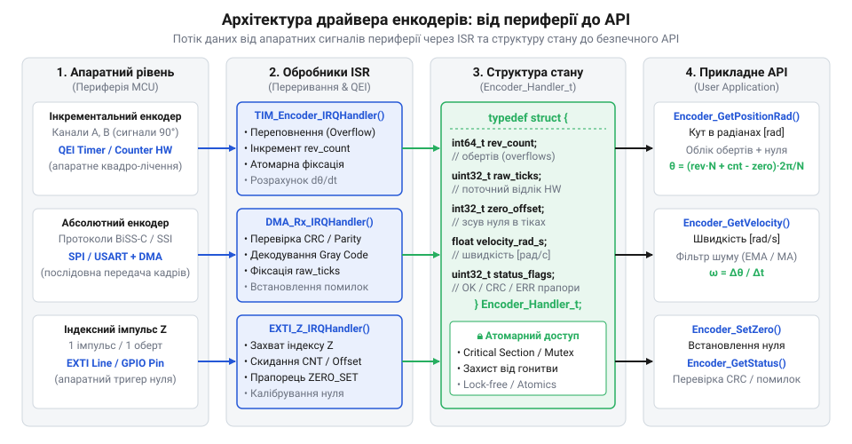
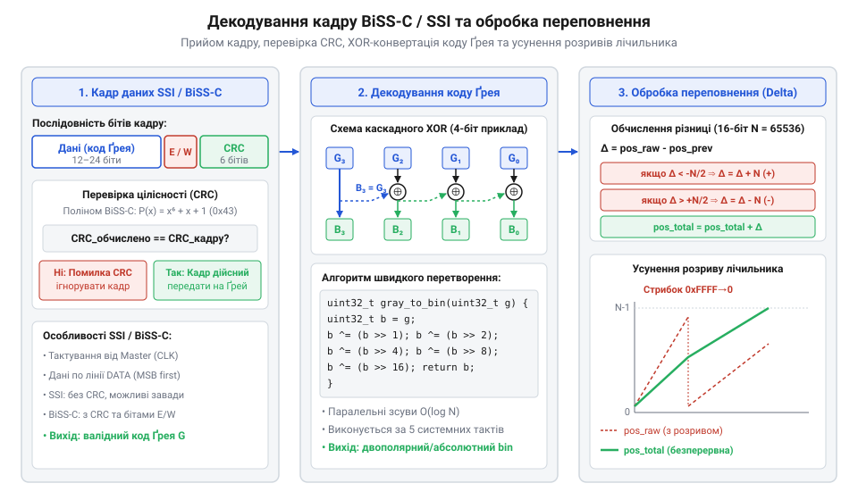

# Програмний інтерфейс драйвера зчитування, декодування та калібрування енкодера

<preknowlist>
- [Датчики кутового положення сервоприводів: потенціометри та магнітні енкодери](root:cat-hw-sensors/servo-feedback-potentiometers-and-magnetic-encoders) — Фізичний принцип формування квадратурних імпульсів каналів A, B та Z, а також різницю між інкрементальним і абсолютним позиціонуванням.
- [Магнітний енкодер кута AS5048](root:cat-hw-sensors/as5048-magnetic-encoder) — Особливості організації послідовних кадрів даних цифрових магнітних сенсорів та первинне зчитування сирих регістрів.
</preknowlist>

## Проблема прямого доступу та архітектура драйвера

Спроба зчитувати регістри таймерів лічильника або виконувати транзакції шини безпосередньо у високочастотному контурі керування призводить до гонок даних та втрати кутової позиції. Якщо прикладний алгоритм перериває зчитування багатобайтового регістру позиції саме в момент переходу через нуль, половина старших бітів зчитується з попереднього значення, а молодші — з нового, що викликає катастрофічні стрибки розрахованого кута. Крім того, пряме запитування цифрових енкодерів через послідовні інтерфейси блокує процесор на час передачі кадру, позбавляючи систему детермінованості часу відгуку на високих швидкостях обертання.

Для усунення цих проблем створюють програмний @@en|driver@@ (англ. *driver*, від *drive* — керувати). Драйвер відділяє периферійні переривання мікроконтролера та апаратні модулі зчитування від обчислювальних задач вищого рівня. Апаратна частина (обробники переривань ISR або каналу @@en|direct memory access@@) зберігає сирі дані лічильників у проміжній структурі стану, тоді як прикладний API надає поточні атомарно оновлені фізичні координати та швидкість.


*Схема взаємодії обробників переривань периферії, лічильників таймера та структури стану драйвера з прикладною програмою.*

При побудові цифрового керування електроприводом порівняно з аналоговими сенсорами, такими як [використання обертових резольверів](root:cat-hw-sensors/synchro-and-resolver-transducers), програмний шар енкодера повинен чітко розмежовувати апаратну обробку та прикладний API. Структура стану драйвера агрегує конфігураційні параметри, поточний відлік, накопичений акумулятор обертів, обчислену кутову швидкість та прапори помилок.

:::tabs
```c|stm32
#include <stdint.h>
#include <stdbool.h>

typedef struct {
    uint32_t cpr;                   // Кількість відліків на один повний оборот
    float scale_factor;             // Коефіцієнт конвертації відліків у радіани
    volatile int32_t raw_counter;   // Поточне значення апаратного лічильника
    volatile int32_t prev_counter;  // Попереднє значення лічильника для обчислення дельти
    volatile int64_t total_counts;  // Неперервний акумулятор відліків
    int32_t zero_offset;            // Програмний зсув калібрування нуля
    float position_rad;             // Поточне абсолютне положення в радіанах
    float velocity_rad_s;           // Поточна кутова швидкість у радіанах за секунду
    uint32_t error_flags;           // Прапори апаратних та програмних помилок
} encoder_driver_t;
```
:::code api-encoder-software-driver-interface/cpp/stm32/encoderdriver.cpp
:::

## Ініціалізація структури даних та периферії

Перед початком зчитування координати необхідно коректно ініціалізувати структуру стану драйвера та налаштувати відповідні периферійні блоки мікроконтролера. Для інкрементальних датчиків використовується модуль @@en|quadrature encoder interface@@ (англ. *quadrature encoder interface*, від *quadrature* — квадратурний, *encoder* — кодувальник, *interface* — інтерфейс) (QEI), який декодує зсунуті на 90 градусів фази A і B. Для абсолютних датчиків налаштовуються послідовні синхронні інтерфейси @@en|synchronous serial interface@@ (англ. *synchronous serial interface*, від *synchronous* — синхронний, *serial* — послідовний, *interface* — інтерфейс) (SSI) або двонапрямлений протокол [інтерфейсу BiSS-C](root:com-devices/biss-c-protocol-interface) (@@en|bidirectional synchronous serial interface@@).

Важливим кроком ініціалізації є розрахунок коефіцієнта масштабування імпульсів у фізичні кутові одиниці. Якщо роздільна здатність давача задана в імпульсах на оборот (@@en|pulse per revolution@@, PPR), то в режимі чотирикратного квадратурного декодування загальна кількість відліків на оборот (@@en|counts per revolution@@, CPR) обчислюється як:

CPR = 4 × PPR

Розрахунок масштабного коефіцієнта `K_rad` для переведення відліків у радіани виконується за формулою:

K_rad = 2 · π ÷ CPR
= 6.28318530718 ÷ CPR      [переведення повного оберту у радіани]

Ініціалізація периферійного таймера передбачає вибір режиму `Encoder Mode x4`, у якому апаратний лічильник фіксує перепади рівнів на двох фазних лініях для досягнення максимальної роздільної здатності. Для захисту від високочастотних шумів та електромеханічного дребезгу на вхідних каналах вмикають @@en|input filter@@ (англ. *input filter*, від *input* — вхідний, *filter* — фільтр) — цифровий фільтр завад, що відсікає короткі імпульси, тривалість яких менша за заданий інтервал тактування. У разі підключення абсолютних датчиків через послідовні інтерфейси SSI чи BiSS-C критично налаштувати частоту тактування лінії: надто висока частота прискорює опитування, проте затримка поширення сигналу у довгому кабелі спричиняє зсув фаз та спотворення кадру даних. Одночасно ініціалізація визначає пріоритети переривань: обробники від індексного імпульсу Z або завершення транзакцій @@en|direct memory access@@ (DMA) мусять мати високий пріоритет у контролері переривань, щоб запобігти затримкам обробки та втраті синхронізації при високих обертах ротора.

:::tabs
```c|stm32
void encoder_init(encoder_driver_t *drv, uint32_t ppr) {
    drv->cpr = ppr * 4;
    drv->scale_factor = 6.28318530718f / (float)drv->cpr;
    drv->raw_counter = 0;
    drv->prev_counter = 0;
    drv->total_counts = 0;
    drv->zero_offset = 0;
    drv->position_rad = 0.0f;
    drv->velocity_rad_s = 0.0f;
    drv->error_flags = 0;
}
```
```cpp|stm32
void init_encoder_hardware(EncoderDriver& drv, uint32_t ppr) {
    // Налаштування регістрів QEI таймера та конфігурація дільників
    // Прив'язка периферії та розрахунок внутрішніх коефіцієнтів
}
```
:::

## Зчитування позиції та декодування протоколів

Після налаштування периферії драйвер виконує періодичне зчитування поточної позиції. Для інкрементальних енкодерів значення зчитується безпосередньо з апаратного лічильника таймера. У випадку абсолютних датчиків з інтерфейсами SSI або BiSS-C драйвер приймає цифровий кадр, у якому біти координати часто кодуються за допомогою коду Ґрея.

Код Ґрея (@@en|Gray code@@, від імені винахідника *Frank Gray*) гарантує, що при переході між сусідніми значеннями змінюється лише один біт. Це усуває помилки зчитування на межах квантів. Алгоритм конвертації коду Ґрея `G` у двійковий формат `B` базується на побітовій операції виключного АБО (XOR):

B_n = G_n
B_i = B_{i+1} ⊕ G_i          [побітова операція виключного АБО]

Для 32-бітного слова декодування робиться каскадом зсувів:

```
B = G
B = B ⊕ (B >> 1)            [побітовий зсув на 1 біт]
B = B ⊕ (B >> 2)            [побітовий зсув на 2 біти]
B = B ⊕ (B >> 4)            [побітовий зсув на 4 біти]
B = B ⊕ (B >> 8)            [побітовий зсув на 8 бітів]
B = B ⊕ (B >> 16)           [побітовий зсув на 16 бітів]
```


*Діаграма декодування кадру даних SSI/BiSS-C та конвертації коду Ґрея з урахуванням обробки переповнення програмного акумулятора.*

На відміну від лінійних вимірювачів переміщення, як-от [лінійних дифтрансформаторів LVDT](root:cat-hw-sensors/lvdt-linear-variable-differential-transformers), кутові сенсори з протоколами SSI та BiSS-C транслюють позицію у вигляді послідовного кадру даних (@@en|data frame@@). Через ризик виникнення електромагнітних завад у сигнальних лініях будь-який спотворений біт може спричинити аномальний стрибок обчисленого кута й дестабілізувати контур керування. Для запобігання цьому під час зчитування регістрів [цифрового енкодера AS5048](root:cat-hw-sensors/as5048-magnetic-encoder) драйвер виконує поетапну перевірку цілісності отриманого 16-бітного слова. Спочатку обчислюється біт парності (@@en|parity bit@@, від лат. *paritas* — рівність): драйвер перевіряє парний паритет усіх 16 бітів за допомогою побітової операції `XOR`, і якщо загальна кількість одиниць виявляється непарною, кадр миттєво відкидається як пошкоджений. Далі аналізується біт 14, який виконує роль прапора помилки (@@en|error flag@@, від англ. *flag* — прапор); його високий рівень свідчить про апаратний збій, такий як переповнення обчислювача чи порушення рівня магнітного поля. У такому разі драйвер позначає поточний замір як недійсний і надсилає окремий запит до регістру `0x0001` для зчитування розширених прапорів стану (@@en|status flag@@) та скидання помилки. Лише за умови успішного проходження обох перевірок драйвер маскує нижні 14 бітів (`raw & 0x3FFF`), виділяючи інформаційні біти кута для подальшої обробки.

:::tabs
:::code api-encoder-software-driver-interface/c/stm32/gray-to-binary32.c
```cpp|stm32
uint32_t decode_gray(uint32_t gray) {
    uint32_t b = gray;
    for (uint32_t shift = 1; shift < 32; shift <<= 1) {
        b ^= (b >> shift);
    }
    return b;
}
```
:::

## Обробка переповнень та калібрування нуля

Під час нескінченного обертання вала апаратний 16-бітний або 32-бітний лічильник неминуче досягає верхньої або нижньої межі та переповнюється. Якщо не обробляти цей перехід, розрахована координата зазнає стрибка на повну шкалу таймера.

Для збереження неперервності відліку драйвер обчислює різницю (дельту) між поточним та попереднім значеннями лічильника з використанням знакового приведення типів:

delta = (int16_t)(current_counter - prev_counter)

Якщо значення `delta` додається до 64-бітного акумулятора `total_counts`, переповнення апаратного регістру компенсується автоматично за умови, що за один крок опитування вал не повертається більше ніж на пів оберту таймера.

Процедура калібрування нуля (встановлення точки відліку) полягає у фіксації програмного зсуву `zero_offset` або скиданні акумулятора при зчитуванні апаратного індексного імпульсу Z. При спрацьовуванні переривання від Z-каналу лічильник прив'язується до механічної мітки:

```
zero_offset = total_counts
angle_calibrated = (total_counts - zero_offset) · K_rad
```

Такий підхід однаковий як для систем із додатковими джерелами зворотного зв'язку, так і для типових [магнітних енкодерів та потенціометрів](root:cat-hw-sensors/servo-feedback-potentiometers-and-magnetic-encoders).

:::tabs
```c|stm32
void encoder_update_accumulator(encoder_driver_t *drv, uint16_t hw_cnt) {
    int16_t delta = (int16_t)(hw_cnt - (uint16_t)drv->raw_counter);
    drv->raw_counter = hw_cnt;
    drv->total_counts += delta;
    
    int64_t calibrated_counts = drv->total_counts - drv->zero_offset;
    drv->position_rad = (float)calibrated_counts * drv->scale_factor;
}

void encoder_set_zero(encoder_driver_t *drv) {
    drv->zero_offset = drv->total_counts;
}
```
```cpp|stm32
void process_overflow_and_zero(EncoderDriver& drv, uint16_t current_hw_val) {
    // Атомарна обробка різниці відліків та калібрування нуля
}
```
:::

## Обчислення швидкості та фільтрація сигналів

Кутова швидкість визначається як перша похідна кутового положення за часом. При дискретному опитуванні з однаковим періодом `Δt` первинна кутова швидкість обчислюється як відношення зміни кута до часового інтервалу:

ω_raw[k] = (θ[k] - θ[k-1]) ÷ Δt

Через дискретність відліків енкодера (шум квантування) чисельне диференціювання викликає високі амплітудні сплески швидкості, особливо при низьких частотах обертання або малих періодах дискретизації `Δt`.

Для згладжування сигналу швидкості застосовують @@en|low-pass filter@@ (англ. *low-pass filter*, від *low-pass* — низькі частоти, *filter* — фільтр) першого порядку або цифрове ковзне середнє (@@en|exponential moving average@@, EMA). Формула експоненційного фільтра має вигляд:

ω_filt[k] = α · ω_raw[k] + (1 - α) · ω_filt[k-1]

Зв'язок між коефіцієнтом фільтрація `α`, частотою зрізу `f_c` та періодом дискретизації `Δt` розраховується так:

```
α = 2 · π · f_c · Δt ÷ (2 · π · f_c · Δt + 1)
= 6.283185 · f_c · Δt ÷ (6.283185 · f_c · Δt + 1)   [розрахунок вагового коефіцієнта фільтра]
```

Оптимальний вибір частоти зрізу дозволяє придушити шум квантування без внесення критичної фазової затримки в контур регулювання швидкості.

:::tabs
```c|stm32
void encoder_calculate_velocity(encoder_driver_t *drv, float dt, float alpha) {
    static float prev_pos = 0.0f;
    float raw_velocity = (drv->position_rad - prev_pos) / dt;
    prev_pos = drv->position_rad;

    // Експоненційне фільтрування низьких частот
    drv->velocity_rad_s = alpha * raw_velocity + (1.0f - alpha) * drv->velocity_rad_s;
}
```
```cpp|stm32
float filter_velocity(float raw_vel, float current_vel, float alpha) {
    return alpha * raw_vel + (1.0f - alpha) * current_vel;
}
```
:::

## Діагностика помилок та безблокувальне опитування

Надійний драйвер енкодера повинен виявляти апаратні збої та забезпечувати безблокувальне опитування периферії, щоб не затримувати виконання основних задач контролера реального часу.

Основними джерелами помилок є:
1. Заборонені стани квадратурного коду QEI (одночасна зміна обох каналів A і B), що свідчить про наявність імпульсних завад або перевищення граничної швидкості давача. 2. Помилка перевірочного коду @@en|cyclic redundancy check@@ (англ. *cyclic redundancy check*, від *cyclic* — циклічний, *redundancy* — надлишковість, *check* — перевірка) (CRC) у кадрах BiSS-C. 3. Таймаут відповіді від абсолютного енкодера по послідовній лінії.

Для забезпечення безблокувальної роботи зчитування абсолютних кадрів передається модулю DMA. DMA в фоновому режимі переносить кадри з інтерфейсу SPI або USART у буфер оперативної пам'яті. По завершенні транзакції викликається переривання, яке перевіряє цілісність CRC та атомарно оновлює структуру стану драйвера.

Обчислення циклічного надлишкового коду CRC для кадру BiSS-C виконується за поліномом [математичного кодування](root:sf-algorithms/gray-code-mathematics-and-circuits) `x^6 + x + 1` (маска `0x43`). Якщо розрахований CRC не збігається з отриманим у кадрі, драйвер відкидає вимірювання та встановлює прапор помилки `ENCODER_ERR_CRC`.

:::tabs
:::code api-encoder-software-driver-interface/c/stm32/calculate-biss-crc6.c
```cpp|stm32
bool verify_and_update(EncoderDriver& drv, uint32_t frame, uint8_t expected_crc) {
    // Асинхронна перевірка кадру та оновлення стану без блокування CPU
    return true;
}
```
:::