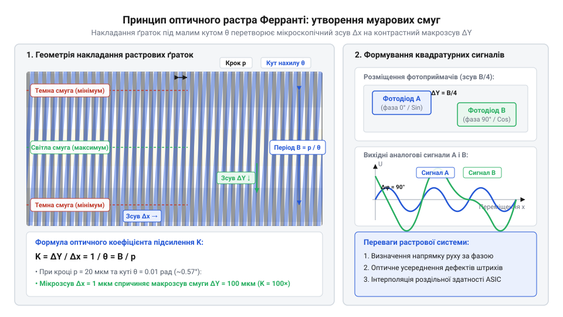
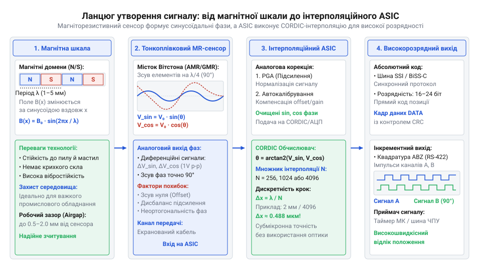

# Еволюція енкодерів: від оптичних растрів Ферранті до тонкоплівкових магнітоіндуктивних датчиків

<preknowlist>
- [Сельсини та резольвери: обертові трансформаторні кутоміри](root:cat-hw-sensors/synchro-and-resolver-transducers) — принцип трансформаторного зчитування кута та обмеження їхньої аналогової точності в ранній автоматиці.
- [Датчики кутового положення сервоприводів: потенціометри та магнітні енкодери](root:cat-hw-sensors/servo-feedback-potentiometers-and-magnetic-encoders) — базові концепції зчитування кутового положення в контурах зворотного зв'язку сервоприводів.
</preknowlist>

## Зародження точного відліку та растри Ферранті

У першій половині 1950-х років швидкий розвиток автоматизованих металообробних верстатів із числовим програмним керуванням (ЧПК, @@en|CNC@@ — @@en|Computer Numerical Control@@) поставив висунуту промисловістю проблему: класичні механічні вузли позиціонування принципово не забезпечували мікронної точності на високих швидкостях. Традиційні ходові гвинти потерпали від зношування різьби, недостатнього мащення та механічного люфту, через який похибка накопичувалася з кожним проходом інструмента. Безконтактні аналогові [потенціометри та магнітні енкодери](root:cat-hw-sensors/servo-feedback-potentiometers-and-magnetic-encoders) мали обмежену лінійність і контактне шумування, індуктивні [диференціальні трансформатори LVDT](root:cat-hw-sensors/lvdt-linear-variable-differential-transformers) працювали лише на малих ходах, а [обертові трансформаторні кутоміри](root:cat-hw-sensors/synchro-and-resolver-transducers) вирішували завдання грубої кутової орієнтації, але не давали субрикових дискрет для авіаційного фрезерування. Вимірювання лінійного та кутового переміщення вимагало відмови від механічного контакту на користь хвильової оптики.

Розв'язанням цієї проблеми став прорив, здійснений 1953 року інженерами британської компанії @@en|Ferranti Ltd.@@ у Единбурзі під керівництвом Давіда Вільямсона (@@en|David Williamson@@). Вони застосували оптичний ефект муарових смуг (від французького @@fr|moire@@ — шовк із хвилястим переливом), який виникає під час перекриття двох растрових ґраток (від латинського @@la|rastrum@@ — граблі, англійською @@en|optical grating@@). Якщо дві скляні пластини з нанесеними мікроскопічними паралельними штрихами накласти одна на одну під малим кутом `θ`, прохідне світло формує макроскопічні черговані темні й світлі інтерференційні смуги.

Період муарових смуг `W` залежить від кроку ґратки `p` (відстані між сусідніми прозорими щілинами) та кута взаємного нахилу `θ` у радіанах:

```
W = p / (2 × sin(θ / 2))
  = p / θ                 [для малих кутів sin(θ/2) ≈ θ/2]
```

Коли одна ґратка зміщується відносно іншої на один мікроскопічний крок `p`, макроскопічна муарова смуга зсувається вздовж оптичної осі на цілий період `W`. Для растра з кроком `p = 10 µm` (10 мікрометрів) і кута нахилу `θ = 0.01 rad` (близько 0.57°) відстань між смугами становить:

```
W = 10 / 0.01
  = 1000 µm
  = 1 mm                  [оптичне підсилення в 100 разів]
```

Таке 100-кратне оптичне підсилення дозволило вакуумним фотоелементам (@@en|photocells@@) 1950-х років упевнено фіксувати мікронні переміщення без складних мікроскопів.

Щоб визначати не лише величину зсуву, а й напрямок руху, в системі @@en|Ferranti Ltd.@@ встановлювали чотири фотоприймачі, зсунуті вздовж муарової смуги на чверть періоду `W` (фазовий зсув 90°). Це формувало два аналогові синусоїдальні сигнали `A` та `B` у просторовій квадратурі (від латинського @@la|quadratura@@ — надання квадратної форми):

```
I_A(x) = I_0 + I_m × sin(2 × π × x / p)
I_B(x) = I_0 + I_m × cos(2 × π × x / p)     [фазовий зсув на 90°]
```

Зіставляючи, який із сигналів випереджає за фазою, електронна схема визначала напрямок переміщення, а підрахунок переходів через нуль давав цифрові імпульси для лампах підсумовувальних лічильників.


*Принцип оптичного підсилення муарового растра Ферранті: нахил двох ґраток із кроком `p` під кутом `θ` перетворює мікронне зміщення на макроскопічний рух інтерференційної смуги.*

## Скляні диски та аналоговий фотодіодний тракт

Інкрементні муарові енкодери забезпечили високу точність, але мали фундаментальну вразливість: будь-який збій живлення чи оптична завада скидали накопичений лічильник імпульсів, вимагаючи тривалої процедури виходу в базову точку (@@en|homing@@). Для авіації, радіолокації та промислових роботів потрібні були абсолютні енкодери (від латинського @@la|absolutus@@ — безумовний), здатні видавати точний кутовий код одразу після увімкнення.

Технологічною основою абсолютних датчиків стали скляні кодові диски. Завдяки прецизійній фотолітографії (від грецького @@el|phos@@ — світло, @@el|lithos@@ — камінь та @@el|grapho@@ — писати) на прозоре скло наносили концентричні доріжки з хромових непрозорих і прозорих секторів. Кожна доріжка відповідала одному двійковому розряду. Проте пряме застосування природного двійкового коду призвело до крайових збоїв зчитування. Наприклад, під час переходу від числа `3` (`011`) до числа `4` (`100`) змінюються одразу три розряди. Через мікроскопічне викривлення оптичної осі чи технологічні допуски один фотодіод спрацьовував раніше за інші, викликаючи хибні проміжні значення на кшталт `111` (`7`) або `000` (`0`).

Для вирішення цієї проблеми американський інженер Френк Ґрей (@@en|Frank Gray@@) із компанії @@en|Bell Labs@@ патентував 1953 року циклічний двійковий код — [коду Ґрея](root:cat-hw-sensors/gray-code) (від англійського @@en|Gray code@@). У цьому коді будь-які два сусідні значення відрізняються зміною лише одного біта:

```
Десятичне:   Природний двійковий:   Код Ґрея:
0            000                    000
1            001                    001
2            010                    011
3            011                    010
4            100                    110
```

Завдяки цьому неідеальне оптичне зчитування меж доріжок могло дати похибку не більше ніж на одну одиницю молодшого розряду (`±1 LSB`).

Аналоговий тракт обробки оптичного сигналу еволюціонував разом із напівпровідниковою елементною базою:
1. У 1950-х роках сигнали від вакуумних фотоелементів підсилювалися громіздкими електронними лампами (на кшталт @@en|12AX7@@), які дрейфували від нагріву та вимагали постійного підлаштування нуля. 2. У середині 1960-х років перехід на дискретні кремнієві транзистори (@@en|silicon transistors@@) дозволив будувати диференціальні операційні підсилювачі безпосередньо у корпусі енкодера.

Історичний факт стверджує, що перші фотодіодні матриці (від англійського @@en|photodiode array@@) розроблялися винятково під потреби ЕОМ і зчитування перфокарт. Насправді саме потреба одночасно зчитувати 8–12 паралельних каналів перфострічок та перфокарт змусила напівпровідникові компанії (зокрема @@en|Texas Instruments@@ та @@en|Fairchild Semiconductor@@) випустити наприкінці 1950-х років перші багатоелементні фотодіодні масиви в бакелітових (@@en|bakelite@@) та керамічних корпусах.

До 1970-х років стандартом високої точності став вихідний аналоговий сигнал синусоїдальної форми з амплітудою 1 В пік-до-піку (@@en|1 Vpp@@, від англійського @@en|1 V peak-to-peak@@: `A+`, `A-`, `B+`, `B-`). Передача аналогового синуса замість прямокутних меандрів дала змогу зовнішнім інтерполяторам обчислювати проміжні кути між штрихами за допомогою арктангенса, підвищуючи роздільну здатність у сотні разів понад графічні можливості фотолітографії.

## Виробничі обмеження оптики й магнітні пошуки

Попри високу точність, скляні оптичні диски виявилися вразливими в умовах реального промислового виробництва (на металургійних комбінатах, у цехах зварювання та на фрезерних верстатах). Експлуатація виявила чотири критичні конструктивні бар'єри:

1. **Механічна крихкість**: Скляні диски розліталися від вібрацій та ударних навантажень на валу двигуна. Спроби замінити скло металом або полімерами знижували чіткість фотолітографічних штрихів. 2. **Забруднення**: Олійний туман, охолоджувальна емульсія та металевий пил проникали всередину корпуса енкодера й осідали на склі чи оптиці, блокуючи світловий потік. 3. **Температурне неузгодження**: Сталевий вал двигуна має коефіцієнт температурного розширення $\alpha_{\text{steel}} \approx 12 \times 10^{-6}/\text{K}$, тоді як оптичне скло — лише $\alpha_{\text{glass}} \approx 8 \times 10^{-6}/\text{K}$. У разі нагрівання двигуна до $80\text{ °C}$ різниця розширення призводила до бічного ексцентриситету дисків та заклинювання підшипників. 4. **Деградація випромінювачів**: Ранні інфрачервоні світлодіоди (@@en|LED@@) на арсеніді галію (@@en|GaAs@@) втрачали яскравість випромінювання під час тривалої роботи в гарячих вузлах.

Альтернативою мав стати магнітний відлік, байдужий до пилу й бруду. Проте перші спроби використати сенсори Холла (відкриті 1879 року фізиком Едвіном Холлом, @@en|Edwin Hall@@) наштовхнулися на фізичні обмеження спаду магнітного поля:

```
B(z) = B_0 × e^(-2 × π × z / λ)     [затухання магнітного поля від поверхні шкали]
```

Де `B(z)` — магнітна індукція на відстані `z`, `B_0` — поле на поверхні шкали, а `λ` — крок магнітних полюсів. Зменшення кроку полюсів `λ` для підвищення точності призводило до експоненціального затухання поля на відстані кількох мікрометрів від шкали. Наслідком була загроза механічного зіткнення сенсора зі шкалою, а самі елементи Холла мали високий температурний дрейф і слабкий сигнал.

Технологічний прорив відбувся завдяки створенню тонкоплівкових магніторезистивних матеріалів (від англійського @@en|magnetoresistance@@):
- **Анізотропний магніторезистивний ефект (AMR)**: Відкритий Вільямом Томсоном (@@en|William Thomson@@) 1857 року та втілений у 1970-х роках у тонких плівках пермалою (сплав @@en|Ni80Fe20@@). Опір плівки змінюється залежно від кута між вектором струму та зовнішнім магнітним полем. - **Гігантський магніторезистивний ефект (GMR)**: Відкритий 1988 року Альбером Фером (@@en|Albert Fert@@) та Петером Ґрюнберґом (@@en|Peter Grünberg@@, Нобелівська премія 2007 року).

Поєднання тонкоплівкових [магніторезистивні сенсори AMR](root:cat-hw-sensors/amr-gmr-tmr-magnetic-sensors), зібраних у мостові схеми Вітстона (@@en|Wheatstone bridge@@), із магнітними шкалами великого кроку (1–2 мм) дало потужний диференціальний сигнал.

Остаточне зрівняння точності магнітних і оптичних систем забезпечили спеціалізовані інтегральні мікросхеми — інтерполяційні ASIC (@@en|interpolation ASIC@@, від англійського @@en|Application-Specific Integrated Circuit@@). Вони оцифровують квадратурні синусоїдальні сигнали й у реальному часі обчислюють векторний арктангенс:

```
θ_calc = arctan(B / A)             [інтерполяційне обчислення кута всередині періоду]
```

Електронна інтерполяція підвищила роздільну здатність магнітних шкал у 1000–4096 разів, дозволивши створити захищені пристрої на кшталт [магнітний енкодер AS5048](root:cat-hw-sensors/as5048-magnetic-encoder), які працюють в маслі й бруді з точністю класичних оптичних систем.


*Тракт перетворення магнітного поля: чергування полюсів магнітної шкали створює синусоїдальний потік, тонкоплівковий місток змінює опір, а інтерполяційний ASIC розраховує точний кут.*

## Магніторезистивні тонкі плівки та інтерполяційні ASIC

Фундаментальним обмеженням класичних елементів Холла залишався експоненціальний спад магнітної індукції при зменшенні кроку полюсів магнітної шкали. Спроба зменшити крок полюсів `λ` для отримання високої точності вимагала зменшення зазору між датчиком і шкалою до кількох мікрометрів, що загрожувало механічним аварійним зіткненням при вібраціях. Промисловості потрібен був фізичний механізм, здатний відчувати мікроскопічні зміни кута магнітного вектора на безпечній відстані від шкали з великогабаритними полюсами.

Вирішенням стали тонкоплівкові магніторезистивні структури. Упродовж 1970–1990-х років технологія пройшла шлях від анізотропного магніторезистивного ефекту (AMR, від англійського @@en|Anisotropic Magnetoresistance@@: @@en|anisotropic@@ — різнонапрямлений, @@en|magneto@@ — магнітний та @@en|resistance@@ — опір) на плівках пермалою (від англійського @@en|permalloy@@) до гігантського (GMR, від англійського @@en|Giant Magnetoresistance@@) та тунельного магніторезистивного ефекту (TMR, від англійського @@en|Tunnel Magnetoresistance@@: @@en|tunnel@@ — тунель). У сенсорах @@en|TMR@@ використовується наноструктура з двох феромагнітних шарів, розділених надтонким діелектриком з оксиду магнію (@@en|MgO@@, @@en|magnesium oxide@@). Зміна напрямку магнітного поля полюса шкали змінює орієнтацію спінів електронної хмари, викликаючи тунелювання електронів крізь бар'єр. Величина тунельного магнітоопору досягає 100–200%, що перевищує співвідношення сигналу до шуму класичних елементів Холла на порядок і дає змогу впевнено зчитувати шкалу з кроком полюсів `λ = 1–2 mm` на відстані понад 1 мм.

Тонкоплівкові резистори об'єднують у диференціальні містки Вітстона (від англійського @@en|Wheatstone bridge@@). Коли магнітна шкала з чергованими полюсами `S-N-S-N` зміщується відносно сенсора, місток формує два аналогові вихідні напруги `V_A` та `V_B`, зсунуті за фазою на 90°:

```
V_A(x) = V_m × sin(2 × π × x / λ)
V_B(x) = V_m × cos(2 × π × x / λ)     [аналогові квадратурні сигнали]
```

Ці сигнали є гладкими періодичними синусоїдами, але їхній фізичний період `λ` становить міліметри. Для досягнення оптичної точності цей період необхідно математично розділити на тисячі дрібних дискретів.

Цю функцію виконують інтерполяційні ASIC (від англійського @@en|interpolation ASIC@@ — @@en|Application-Specific Integrated Circuit@@: спеціалізована інтегральна мікросхема). Інтегрований у корпус сенсора або підключений поруч @@en|interpolation ASIC@@ оцифровує аналогові квадратурні сигнали за допомогою високошвидкісного АЦП (від англійського @@en|flash ADC@@) та розраховує кутовий вектор усередині поточного полюса за допомогою тригонометричного алгоритму CORDIC (від англійського @@en|CORDIC@@ — @@en|Coordinate Rotation Digital Computer@@) або апаратних таблиць пошуку (від англійського @@en|look-up table@@):

```
x_sub = (λ / (2 × π)) × arctan(V_A / V_B)     [інтерполяційне розщеплення періоду]
```

Завдяки 12-бітному або 16-бітному розщепленню фази @@en|interpolation ASIC@@ розбиває один полюсний крок `λ = 2 mm` на `N_interp = 4096` або `65536` відліків. Дискретність вимірювання становить:

```
Δx = λ / N_interp
   = 2000 µm / 4096
   ≈ 0.488 µm             [дискретність вимірювання для 12-бітного ASIC]
```

Поєднання стійкої магнітної шкали, високочутливого місткового сенсора [магніторезистивні сенсори AMR](root:cat-hw-sensors/amr-gmr-tmr-magnetic-sensors) та інтегрованого @@en|interpolation ASIC@@ дозволило створити пристрої на кшталт [магнітний енкодер AS5048](root:cat-hw-sensors/as5048-magnetic-encoder), які забезпечують нанометрову роздільну здатність і не бояться мастила, пилу чи вібрацій.

## Цифрові інтерфейси та співіснування технологій

Висока роздільна здатність, отримана завдяки інтерполяційним ASIC та оптичним растрам, висунула нову проблему на межі енкодера та контролера керування. Передача інкрементних прямокутних або аналогових квадратурних сигналів по довгих промислових кабелях зустрілася з обмеженнями смуги пропускання та завадостійкості. При швидкостях обертання серводвигуна у 6000 об/хв енкодер із роздільністю 100 000 імпульсів на оберт має генерувати імпульсну частоту понад 10 МГц. Промислові диференціальні лінії (на кшталт @@en|RS-422@@) зазнавали спотворень фронтів і втрати бітів через наводки силових інверторів, а будь-який втрачений імпульс накопичував неусунену похибку позиціонування.

Для вирішення проблеми завадостійкості та збереження абсолютної позиції промисловість перейшла від імпульсного рахунку до послідовних цифрових протоколів передачі даних. 1. У 1984 році німецька компанія @@de|Max Stegmann GmbH@@ (нині частина @@de|SICK AG@@) розробила синхронний послідовний інтерфейс SSI (від англійського @@en|Synchronous Serial Interface@@: @@en|synchronous@@ — синхронний, @@en|serial@@ — послідовний та @@en|interface@@ — взаємозв'язок). У ньому управляючий контролер випромінює тактовий сигнал по лінії @@en|RS-422@@, а енкодер у відповідь висуває послідовний цифровий кадр абсолютної позиції по лінії даних. Це усунуло втрату імпульсів, але @@en|SSI@@ залишився однонаправленим протоколом без виявлення помилок передачі. 2. У 2002 році компанія @@de|iC-Haus GmbH@@ представила відкритий протокол BiSS-C (від англійського @@en|Bidirectional Synchronous Serial Interface@@: @@en|bidirectional@@ — двонаправлений). Протокол @@en|BiSS-C@@ забезпечує двонаправлений зв'язок зі швидкостями передачі даних до 10–100 Мбіт/с. Окрім видачі абсолютної позиції у кожному такті, він передає циклічний надлишковий код (@@en|Cyclic Redundancy Check@@, @@en|CRC@@) для контролю цілісності, біти попередження про деградацію випромінювача чи магнітного поля, а також дозволяє зчитувати й записувати внутрішні регістри калібрування сенсора без зупинки основного контуру керування.

Паралельно компанія @@de|HEIDENHAIN@@ розвивала власний високошвидкісний цифровий інтерфейс EnDat (від німецького @@de|EnDat@@ — @@de|Encoder Data@@).

Поява [цифрових інтерфейсів енкодерів](root:cat-hw-sensors/ssi-bissc-digital-interfaces) та точних магніторезистивних ASIC породила міф про швидке й повне витіснення оптичних енкодерів магнітними. Проте фізика зчитування зумовила не витіснення, а чіткий технологічний поділ сфер застосування відповідно до компромісів точності та стійкості:
- **Оптичні енкодери (@@en|optical encoder@@):** Залишаються єдиним вибором там, де потрібна кутова точність на рівні часток кутової секунди (до ±1″) та роздільна здатність понад 24–30 біт на оберт. Вони незамінні в фотолітографічних степерах виробництва мікросхем, великих астрономічних телескопах, високоточних поворотних столах верстатів ЧПК та прецизійних сервоприводах прямого приводу (@@en|direct-drive motor@@). - **Магнітні енкодери (@@en|magnetic encoder@@):** Завоювали сегменти з підвищеними вимогами до механічних навантажень та бруду. З точністю від ±30″ до ±5′ вони працюють у зануреному в мастило стані, при вібраціях до 30g і в температурному діапазоні від −40 °C до +125 °C. Вони є стандартом для важкого машинобудування, вітрогенераторів, будівельної техніки, суглобів промислових роботів та [датчиків кутового положення сервоприводів](root:cat-hw-sensors/servo-feedback-potentiometers-and-magnetic-encoders). - **Індуктивні енкодери (@@en|inductive encoder@@):** Зайняли нішу авіабудування та безколекторних моторів завдяки імунітету до зовнішніх сильних магнітних полів від електромагнітних гальм та обмоток.

Отже, сучасний вибір енкодера спирається на баланс між абсолютною точністю вимірювання та граничними умовами середовища експлуатації.