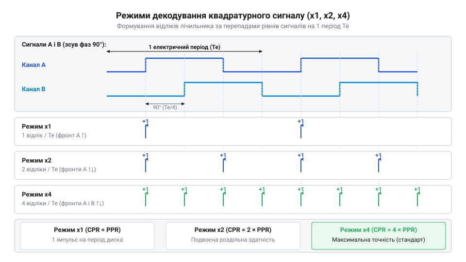
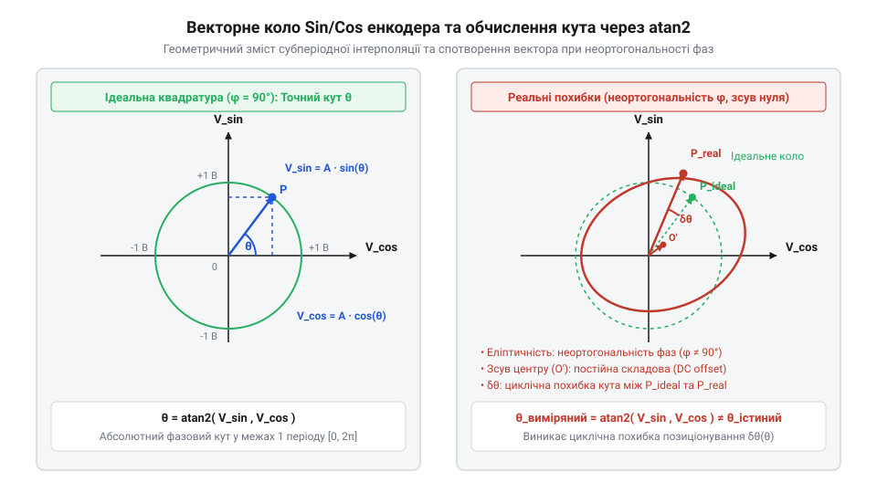
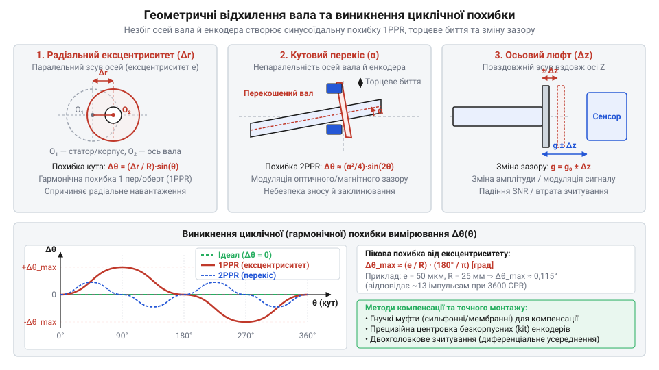
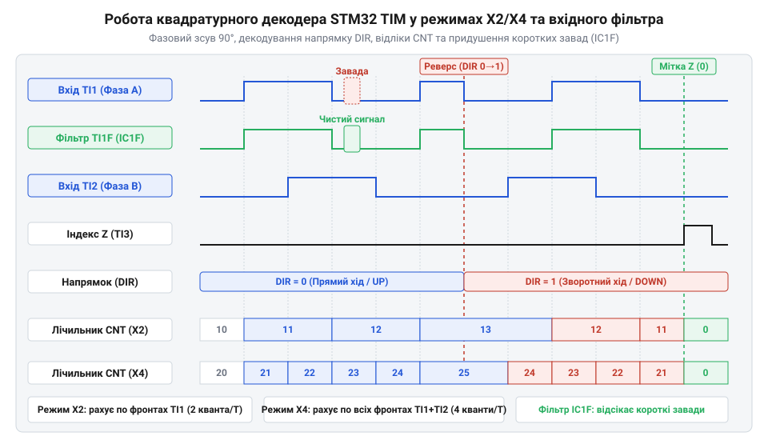

# Розрахунок роздільної здатності, квадратурної інтерполяції та похибок позиціонування

<preknowlist>
- [Датчики кутового положення сервоприводів: потенціометри та магнітні енкодери](root:cat-hw-sensors/servo-feedback-potentiometers-and-magnetic-encoders) — призначення давачів зворотного зв'язку за положенням та фізичний принцип формування квадратурних каналів A і B.
</preknowlist>

## Проблема обмеженості прямого відліку імпульсів

Уявімо механічний вузол @@en|сервоприводу@@ або точного верстата, де електричний двигун обертає вал, а система керування мусить знати його поточний кут із точністю до часток градуса. Найпростіший дискретний первинний перетворювач — оптичний @@en|енкодер@@ (від англ. @@en|encoder@@ — кодувальник) — складається з прозорого диска з радіальними непрозорими штрихами, джерела світла та фотоприймача. Під час обертання вала штрихи періодично перекривають світловий промінь, і на виході сенсора формується послідовність електричних імпульсів.

Якщо розробник вирішить наївно рахувати імпульси за допомогою одного лічильника переривань мікроконтролера, підключаючи лише один сигнальний канал `A`, система миттєво зіткнеться з трьома фундаментальними обмеженнями.

Перша проблема — визначення напрямку руху та ложна акумуляція відліків при вібрації. Одноканальний сигнал фіксує лише сам факт проходження штриха, але не містить жодної інформації про те, у який бік обертається вал — за годинниковою стрілкою чи проти неї. Якщо двигун зупиняється точно на межі непрозорого штриха, будь-яка мікровібрація механіки призводить до того, що світловий промінь багаторазово перетинає край штриха. Одноканальний лічильник буде беззупинно збільшувати своє значення на кожному зростаючому фронті, реєструючи уявний «рух вперед» на тисячі обертів, хоча вал фізично залишається непорушним. Без додаткового фазового сигналу розрізнити корисне переміщення та механічну перешкоду математично неможливо, як і використовувати базові [датчики кутового положення](root:cat-hw-sensors/servo-feedback-potentiometers-and-magnetic-encoders) для замкнених контурів керування.

Друга проблема — жорстка фізична межа роздільної здатності. Якщо оптичний диск має `N` прорізів, то на кожен імпульс припадає кутовий крок `Δθ = 360° ÷ N`. Щоб отримати кутову дискретність у `0.01°`, диск повинен мати `36 000` штрихів. Створити такий диск обмеженого діаметра (наприклад, 30 мм) технічно неможливо через дифракційні межі світла: ширина штриха стає порівнянною з довжиною хвилі, через що втрачається контрастність оптичного сигналу. Прямий відлік імпульсів робить роздільну здатність заручником геометричного розміру диска.

Третя проблема — частотне перевантаження та обмеження обробки в реальному часі. При високих швидкостях обертання `n` (обертів на хвилину) частота проходження фронтів `f_pulse` зростає пропорційно кількості штрихів. Якщо обробляти кожен фронт через програмні переривання процесора, частота подій виходить за межі пропускної здатності переривань. Процесор витрачає увесь свій час на обслуговування переривань (так званий @@en|interrupt storm@@), або ж пропускає фронти, що призводить до втрати точки відліку та фатальних похибок позиціонування.

Отже, наївне підрахування імпульсів не здатне забезпечити надійність. Виникає гостра потреба у математично обґрунтованому способі дискретизації, який дає змогу однозначно визначати напрямок обертання, множити роздільну здатність без зміни фізичного диска та мінімізувати процесорне навантаження.

## Дискретизація та квадратурне декодування сигналів

Щоб усунути невизначеність напрямку руху та підвищити кутову дискретність без зміни механіки, у конструкцію енкодера додають другий оптичний канал `B`, зміщений відносно першого каналу `A` на чверть оптичного періоду. Така конфігурація формує квадратурні (від лат. @@la|quadratura@@ — надавання квадратної форми) сигнали, електрична фаза між якими становить `90°` (або `π ÷ 2` рад).

Для математичного опису дискретизації введемо базові параметри датчика:

1. `PPR` (від англ. @@en|Pulses Per Revolution@@) — кількість фізичних прямокутних імпульсів (періодів) на один повний оберт диска (360° або 2π рад). 2. `LPR` (від англ. @@en|Lines Per Revolution@@) — кількість фізичних штрихів на диску (для дискретних оптичних дисків `PPR = LPR`). 3. `CPR` (від англ. @@en|Counts Per Revolution@@) — підсумкова кількість обчислювальних відліків (квадратурних подій) на один повний оберт після декодування.

Залежно від алгоритму обробки фронтів сигналів `A` та `B` виділяють три режими квадратурного декодування:

* **Режим x1 (однократне декодування)**: Лічильник фіксує лише зростаючі фронти каналу `A`. За один період форми сигналу фіксується одна подія. Підсумкова роздільна здатність дорівнює кількості фізичних штрихів:
  ```
  CPR_x1 = PPR
  ```
* **Режим x2 (двократне декодування)**: Лічильник фіксує як зростаючі, так і спадаючі фронти каналу `A`. За один період фіксується дві події, що подвоює роздільну здатність:
  ```
  CPR_x2 = 2 · PPR
  ```
* **Режим x4 (чотирикратне декодування)**: Лічильник фіксує всі зміни станів (зростаючі та спадаючі фронти) обох каналів `A` і `B`. Один період розбивається на 4 унікальні квадратурні стани, що чотирикратно підвищує дискретність системи:
  ```
  CPR_x4 = 4 · PPR
  ```


*Часові діаграми квадратурних каналів A і B зі зіставленням моментів фіксації подій у режимах декодування x1, x2 та x4.*

Напрямок обертання визначається аналізом поточного та попереднього векторів станів `S = (A, B)`. У режимі x4 послідовність станів `00 → 10 → 11 → 01 → 00` відповідає прямому обертанню (інкремент лічильника `N_count = N_count + 1`), а послідовність `00 → 01 → 11 → 10 → 00` — зворотному обертанню (декремент лічильника `N_count = N_count - 1`). Якщо відбувся одночасний перехід обох каналів (наприклад, `00 → 11`), це свідчить про апаратний збій або перевищення граничної швидкості. Щоб обробляти такі переходи без втрати циклів процесора, застосовують спеціалізовані [апаратні квадратурні декодери](root:hw-arch/enkodernyi-rezhym-taimera).

Перерахунок накопиченого значення лічильника `N_count` у точний кут обертання вала `θ_mech` (у радіанах) здійснюється за такою формулою:

Ми отримуємо кутове положення `θ_mech` із поточного значення відліків `N_count` та підсумкової роздільної здатності `CPR`:

```
θ_mech = (2 · π · N_count) ÷ CPR
       = (2 · π · N_count) ÷ (4 · PPR)      [заміна CPR для режиму x4]
       = (π · N_count) ÷ (2 · PPR)          [скорочення на чисельник 2]
```

Ця формула показує, що кожна квадратурна подія збільшує обчислений кут на мінімальний дискретний крок `Δθ = (2 · π) ÷ CPR`.

Аналогічно, для лінійного енкодера або сервоприводу з ходовим гвинтом, де крок різьби дорівнює `P_pitch` (у метрах), підсумкове лінійне переміщення `x_lin` розраховується з поточних відліків `N_count`:

```
x_lin = (P_pitch · N_count) ÷ CPR
```

**Обчислення дискретності сервоприводу з гвинтовою передачею**

**Умова**: Оптичний енкодер з `PPR = 1024` імпульсів/оберт підключений до ходового гвинта з кроком `P_pitch = 5.0 мм`. Декодування здійснюється у режимі `x4`. Розрахувати підсумкову кількість відліків на оберт `CPR`, кутовий крок `Δθ` у градусах та мінутах, а також лінійну дискретність `Δx` у мікрометрах.

```
CPR = 4 × 1024
    = 4096 відліків/об                     [чотирикратне декодування x4]

Δθ = 360° ÷ 4096
   = 0.087890625°                      [кутова дискретність у градусах]
   = 5.2734 мінут                      [переведення у кутові мінути: 0.087890625 × 60]

Δx = 5.0 мм ÷ 4096
   = 0.001220703125 мм                 [лінійна дискретність у міліметрах]
   = 1.2207 мкм                        [переведення у мікрометри]
```

Висновок: декодування x4 дає змогу вимірювати лінійні переміщення з дискретністю 1.22 мкм на стандартному диску 1024 PPR.

Однак підвищення роздільної здатності створює частотні обмеження. Якщо вал обертається зі швидкістю `n` об/хв, частота проходження прямокутних імпульсів одного каналу `f_pulse` дорівнює:

```
f_pulse = (n ÷ 60) · PPR
```

У режимі x4 частота надходження подій зміни стану `f_edge` у чотири рази вища: `f_edge = 4 · f_pulse`. Мінімальна тривалість одного квадратурного стану `t_state` становить:

```
t_state = 1 ÷ f_edge
        = 15 ÷ (n · PPR)
```

Якщо вхідні кола містять цифровий антидребезговий фільтр (від англ. @@en|debounce filter@@) з часом затримки `t_filter`, то для надійного зчитування мусить виконуватися умова `t_state > 2 · t_filter`. Інакше стан буде відфільтровано як шум, що призведе до втрати відліків.

## Аналогова інтерполяція синусно-косинусних сигналів енкодера

Хоча режим декодування x4 підвищує роздільну здатність у 4 рази, для багатьох високоточних застосувань (наприклад, у напівпровідниковій промисловості чи обробці на верстатах із ЧПК) цього недостатньо. При штриховому інтервалі диска в `20 мкм` режим x4 забезпечує дискретність лише `5 мкм`. Поліпшити дискретність ще в десятки або сотні разів дає змогу аналогова інтерполяція синусно-косинусних сигналів (Sin/Cos 1Vpp).

У таких енкодерах замість прямокутних логічних рівнів вихідні канали `A` та `B` видають аналогові диференціальні синусоїдальні напруги `V_sin` та `V_cos` з піковою амплітудою біля `1 В` (1Vpp, від англ. @@en|1 Volt peak-to-peak@@).

Ідеальна математична модель аналогових сигналів всередині одного оптичного періоду описується через субперіодний електричний кут `θ_el ∈ [0, 2π)`:

```
V_sin = V_m · sin(θ_el)
V_cos = V_m · cos(θ_el)
```

де `V_m` — амплітудне значення напруги (зазвичай `0.5 В` відносно середньої лінії `0 В`), `V_sin` — миттєва напруга синусного каналу, `V_cos` — миттєва напруга косинусного каналу.

Для визначення субперіодного фазового кута `θ_el` застосовують математичну функцію двоаргументного арктангенса `atan2(V_sin, V_cos)` (від англ. @@en|two-argument arctangent@@). Звичайний арктангенс `arctan(V_sin ÷ V_cos)` має період `π` (180°), через що не дає змоги розрізнити квадранти I (+,+) та III (-,-), а також ділить на нуль при `V_cos = 0`. Функція `atan2` аналізує знаки обох напруг окремо й однозначно повертає кут у повному діапазоні від `-π` до `+π` рад (або від `0` до `2π`).

Ми обчислюємо миттєвий субперіодний кут `θ_el` з аналогових напруг каналів `V_sin` та `V_cos`:

```
θ_el = atan2(V_sin, V_cos)
```

Цей вираз виводить точне фазове положення світлової плями всередині одного штриха диска.


*Векторна діаграма синусно-косинусних сигналів у фазовій площині V_sin та V_cos для визначення субперіодного кута theta.*

Підсумковий механічний кут обертання вала `θ_mech` обчислюється шляхом комбінування цілої кількості пройдених періодів `N_line` (отриманих грубим квадратурним лічильником) та обчисленого субперіодного кута `θ_el`:

```
θ_mech = (2 · π · N_line + θ_el) ÷ PPR
```

Якщо аналогово-цифровий перетворювач (АЦП) інтерполятора забезпечує коефіцієнт інтерполяції `k_interp` (наприклад, 256, 1024 або 4096 дискретних рівнів на один аналоговий період), підсумкова еквівалентна роздільна здатність становить:

```
CPR_interp = PPR · k_interp
```

**Розрахунок субоптичного положення для Sin/Cos енкодера**

**Умова**: Енкодер із `PPR = 2048` видає напруги `V_sin = 0.3535 В` та `V_cos = 0.3535 В` (ідеальний сигнал з `V_m = 0.5 В`). Лічильник цілих періодів зафіксував `N_line = 150`. Обчислити субперіодний кут `θ_el` та підсумковий механічний кут `θ_mech` у радіанах і градусах.

```
θ_el = atan2(0.3535, 0.3535)
     = π ÷ 4 рад                            [арктангенс для рівних додатних координат, 45°]
     = 0.785398 рад                         [чисельне значення у радіанах]

θ_mech = (2 · π · 150 + 0.785398) ÷ 2048
       = (942.477796 + 0.785398) ÷ 2048     [сумування кута цілих періодів і субперіодного кута]
       = 943.263194 ÷ 2048                  [підсумковий накопичений кут у періодах]
       = 0.460578 рад                       [ділення на кількість штрихів PPR]
       = 26.3889°                           [переведення у градуси: 0.460578 × (180 ÷ π)]
```

Висновок: функція `atan2` дозволяє вичислити точний кут `26.3889°` всередині 151-го штриха з високою точністю.

На практиці реальні аналогові сигнали мають трьох типів спотворення, які деформують ідеальне коло Ліссажу (від англ. @@en|Lissajous curve@@) на фазовій площині:

1. **Офсет постійного струму** (`V_offset_A`, `V_offset_B`): зміщує центр кола від початку координат `(0,0)`, спричиняючи першу гармоніку похибки кута (один цикл похибки на один штрих). 2. **Амплітудна неузгодженість** (`A_sin ≠ A_cos`): перетворює коло на еліпс, зорієнтований уздовж осей координат, що дає другу гармоніку похибки (два цикли похибки на один штрих). 3. **Неортогональність фаз** (`ϕ_err ≠ 0`): відхилення фазового зсуву від 90° повертає та стискає еліпс.

Для компенсації цих похибок сигнали перед обчисленням `atan2` нормують за формулами калібрування:

```
V_sin_norm = (V_sin - V_offset_A) ÷ A_sin

V_cos_norm = ((V_cos - V_offset_B) ÷ A_cos - V_sin_norm · sin(ϕ_err)) ÷ cos(ϕ_err)

θ_el_corr = atan2(V_sin_norm, V_cos_norm)
```

Подібний математичний апарат синусно-косинусної інтерполяції застосовується також у таких кутових та лінійних сенсорах, як [обертові трансформаторні кутоміри](root:cat-hw-sensors/synchro-and-resolver-transducers) (резольвери), [диференціальні трансформатори LVDT](root:cat-hw-sensors/lvdt-linear-variable-differential-transformers) та високоточний [магнітний енкодер AS5048](root:cat-hw-sensors/as5048-magnetic-encoder).

## Моделювання та сумарний бюджет похибок

У багатьох інженерних проєктах існує ілюзія: якщо лічильник фіксує `8192` відліків на оберт, це автоматично гарантує точність вимірювання кута до `0.04°`. Проте роздільна здатність (англ. @@en|resolution@@) описує лише найменший крок, який здатний розрізнити сенсор, але не його абсолютну точність (англ. @@en|accuracy@@). Реальний @@en|енкодер@@ підпорядковується джерелам механічних та електричних спотворень, які відхиляють обчислений кут від реального геометричного положення вала. Щоб оцінити придатність давача для [датчиків кутового положення](root:cat-hw-sensors/servo-feedback-potentiometers-and-magnetic-encoders) сервоприводу, необхідно побудувати математичну модель окремих складових відхилення та звести їх у підсумковий бюджет похибки (англ. @@en|error budget@@).

Першим неодмінним джерелом відхилення є похибка квантування (від лат. @@la|quantitas@@ — кількість; англ. @@en|quantization error@@). Вона виникає через неперервний характер фізичного кута та дискретну природу цифрового лічильника. Оскільки лічильник змінює свій стан лише в момент перетину фронту, справжній кут вала у будь-який момент часу розташований у межах одного дискретного кроку `Δθ = (2 · π) ÷ CPR`. Припускаючи рівномірний розподіл ймовірності положення вала всередині інтервалу, максимальне абсолютне значення похибки квантування `δθ_quant_max` становить половину дискретного кроку:

Ми обчислюємо максимальну похибку квантування `δθ_quant_max` через підсумкову роздільну здатність `CPR`:

```
δθ_quant_max = Δθ ÷ 2
             = (2 · π ÷ CPR) ÷ 2        [підстановка дискретного кроку Δθ]
             = π ÷ CPR                  [скорочення на чисельник 2]
```

Цей вираз виводить межу відхилення, зумовлену лише цифровою дискретизацією. Середньоквадратичне відхилення цієї похибки для рівномірного розподілу описується виразом `σ_quant = Δθ ÷ (2 · √3)`.

Друге джерело — кутовий гістерезис (від грец. @@el|hysteresis@@ — запізнення; англ. @@en|angular hysteresis@@) та люфт (англ. @@en|backlash@@). Під час реверсу (зміни напрямку обертання вала) механічний зазор у з'єднувальній муфті, а також пороговий гістерезис оптичного чи магнітного компаратора призводять до того, що вал вже повернувся на кут `δθ_hyst`, а лічильник ще не зафіксував зміну квадратурного стану. Внаслідок цього виникає кутова затримка `δθ_hyst`, яка додається до загальної похибки при кожній зміні напрямку руху.

Третє джерело — неортогональність фаз квадратурних каналів `A` і `B`. В ідеальній системі електричний зсув між каналами становить `90°`. Якщо через недосконалість розташування фотоприймачів або елементів [магнітного енкодера AS5048](root:cat-hw-sensors/as5048-magnetic-encoder) виникає кутове відхилення `δϕ_el` (у електричних градусах), тривалість квадратурних станів стає нерівномірною: один стан розширюється до `90° + δϕ_el`, а сусідній звужується до `90° - δϕ_el`.

Ми визначаємо похибку від неортогональності фаз `δθ_phase_max` через фазове відхилення `δϕ_el` та кількість штрихів `PPR`:

```
δθ_phase_max = (δϕ_el ÷ 360°) · (2 · π ÷ PPR)
```

Вираз показує, що фазовий зсув створює циклічну похибку положення, яка повторюється `PPR` разів за один повний оберт вала.

Четверте джерело — механічний ексцентриситет диска (від лат. @@la|eccentricus@@ — поза центром; англ. @@en|eccentricity@@). Якщо центр обертання кодового диска зміщений відносно фізичної осі вала на відстань `e` (радіальне биття), оптична доріжка радіуса `R` під час обертання здійснює синусоїдальне зміщення відносно зчитувальної голівки.


*Складові похибки позиціонування енкодера: синусоїдальна похибка ексцентриситету диска та періодичне спотворення від неортогональності фаз.*

Залежність похибки ексцентриситету `δθ_ecc` від поточного кута вала `θ` виражається формулою:

```
δθ_ecc(θ) = (e ÷ R) · sin(θ)
```

Максимальне значення похибки ексцентриситету `δθ_ecc_max` досягається при `sin(θ) = 1` і дорівнює відношенню радіального зміщення до радіуса доріжки:

```
δθ_ecc_max = e ÷ R
```

Оскільки ексцентриситет робить один повний цикл за оберт, він формує першу гармоніку похибки позиціонування.

Підсумковий бюджет похибки оцінюють двома математичними методами:

1. **За найгіршим сценарієм (англ. @@en|worst-case budget@@)**: передбачає арифметичне сумування пікових значень усіх складових, даючи верхню межу відхилення:
   ```
   δθ_worst = δθ_quant_max + δθ_hyst + δθ_phase_max + δθ_ecc_max
   ```
2. **Статистичним методом (англ. @@en|root sum squared@@, RSS)**: застосовується для взаємно незалежних джерел похибок:
   ```
   δθ_rss = √( δθ_quant_max² + δθ_hyst² + δθ_phase_max² + δθ_ecc_max² )
   ```

**Розрахунок сумарного бюджету похибки кутового енкодера**

**Умова**: Оптичний енкодер має `PPR = 2048` і працює у режимі `x4` (`CPR = 8192`). Радіус кодової доріжки диска `R = 20 мм` (`0.02 м`), радіальний ексцентриситет монтажу `e = 5 мкм` (`0.000005 м`). Фазове відхилення між каналами `δϕ_el = 4°`, а кутовий гістерезис муфти `δθ_hyst = 0.000100 рад`. Обчислити складові похибки, а також підсумкову похибку методами найгіршого сценарію `δθ_worst` та RSS `δθ_rss` у радіанах та кутових мінутах.

```
Δθ = 2 · π ÷ 8192
   = 0.00076699 рад                     [дискретний крок для CPR = 8192]

δθ_quant_max = 0.00076699 ÷ 2
             = 0.00038350 рад           [максимальна похибка квантування]

δθ_phase_max = (4° ÷ 360°) · (2 · π ÷ 2048)
             = 0.01111111 · 0.00306796
             = 0.00003409 рад           [похибка неортогональності фаз]

δθ_ecc_max = 0.000005 ÷ 0.02
           = 0.00025000 рад             [максимальна похибка ексцентриситету]

δθ_worst = 0.00038350 + 0.00010000 + 0.00003409 + 0.00025000
         = 0.00076759 рад               [сума найгіршого сценарію]
         = 2.6385 мінут                 [переведення у кутові мінути: 0.00076759 × (180 ÷ π) × 60]

δθ_rss = √( 0.00038350² + 0.00010000² + 0.00003409² + 0.00025000² )
       = √( 1.4707e-7 + 1.0000e-8 + 1.1621e-9 + 6.2500e-8 )
       = √( 2.2073e-7 )
       = 0.00046982 рад                 [статистична похибка RSS]
       = 1.6151 мінут                   [переведення у кутові мінути]
```

Висновок: механічний ексцентриситет та квантування є домінуючими чинниками похибки. Навіть при високій роздільній здатності `CPR = 8192` реальна точність системи обмежена величиною `1.62′` (RSS) або `2.64′` (worst-case), тому для підвищення точності потрібне прецизійне юстування диска, а не лише збільшення `PPR`.

## Часові та частотні обмеження вимірювального тракту

Побудова високороздільного енкодера та мінімізація геометричних похибок втрачають сенс, якщо електроніка контролера не встигає обробляти потік імпульсів під час руху. Коли вал обертається з високою кутовою швидкістю, часовий інтервал між квадратурними подіями скорочується до часток мікросекунди. Якщо частота проходження фронтів перевищує смугу пропускання ліній зв'язку або швидкість вхідних цифрових каскадів, виникає спотворення сигналів та пропуск відліків (англ. @@en|pulse dropping@@), що повністю дезорієнтує замкнену систему керування.

Математичний зв'язок між частотою сигналів та частотою обертання вала `n` (у обертах на хвилину, об/хв) задається параметром `PPR`. Частота проходження прямокутних імпульсів одного каналу `f_pulse` (у герцах, Гц) описується виразом:

```
f_pulse = (n ÷ 60) · PPR
```

У режимі чотирикратного декодування `x4` апаратний лічильник фіксує переходи станів обох каналів. Частота проходження квадратурних фронтів `f_edge` у чотири рази вища:

```
f_edge = 4 · f_pulse = (n · PPR) ÷ 15
```

Звідси мінімальна тривалість одного квадратурного стану `t_state` (часовий інтервал між двома сусідніми фронтами) дорівнює:

```
t_state = 1 ÷ f_edge = 15 ÷ (n · PPR)
```

Щоб приймач сигналів та цифровий лічильник коректно зафіксували зміну стану, тривалість `t_state` мусить перевищувати сумарну затримку кабельної лінії та час спрацьовування вхідного фільтра.

Для передачі високочастотних квадратурних сигналів на великі відстані стандартні логічні рівні є непридатними через згасання та електромагнітні перешкоди. Застосовують диференціальні передавачі ліній (англ. @@en|differential line driver@@) за стандартом RS-422. Пропускна здатність тракту (англ. @@en|bandwidth@@) обмежується граничною частотою зрізу `f_cutoff` оптронів або диференціальних приймачів. Умова запобігання втраті сигналів визначає максимально допустиму швидкість обертання вала `n_max`:

```
n_max = (60 · f_cutoff) ÷ PPR
```


*Часова діаграма співвідношення тривалості квадратурного стану t_state, смуги пропускання приймача та періоду опитування контролера T_s.*

Окрім апаратного відліку імпульсів, важливу роль відіграє часове узгодження з цифровим контуром керування. Контролер сервоприводу опитує стан енкодера з дискретним періодом `T_s` (або частотою дискретизації `f_s = 1 ÷ T_s`, англ. @@en|sampling rate@@). Обчислення кутової швидкості `ω_disc` здійснюється чисельним диференціюванням кута за один період опитування.

Ми обчислюємо дискретну швидкість `ω_disc` з різниці кутових відліків на інтервалі `T_s`:

```
ω_disc(k) = (θ_mech(k) - θ_mech(k - 1)) ÷ T_s
```

Мінімальний можливий крок зміни обчисленої швидкості `Δω_min` відповідає зміні лічильника рівно на один відлік `Δθ = (2 · π) ÷ CPR` за час `T_s`:

```
Δω_min = (2 · π) ÷ (CPR · T_s)
```

Звідси видно математичну суперечність: надто малий період опитування `T_s` при помірному `CPR` призводить до грубого квантування швидкості та виникнення цифрового шуму квантування (англ. @@en|quantization noise@@). Навпаки, збільшення `T_s` покращує роздільну здатність за швидкістю, але вносить фазову затримку у контур зворотного зв'язку сервоприводу. Подібні часові та частотні обмеження притаманні також аналоговим вимірювальним кутомірам, зокрема [обертовим трансформаторним кутомірам](root:cat-hw-sensors/synchro-and-resolver-transducers) та [диференціальним трансформаторам LVDT](root:cat-hw-sensors/lvdt-linear-variable-differential-transformers).

**Узгодження частотних та часових параметрів вимірювального тракту**

**Умова**: Серводвигун обертається зі швидкістю `n = 6000 об/хв`. На валу встановлено енкодер з `PPR = 2500` імпульсів/оберт, що працює у режимі `x4` (`CPR = 10 000`). Диференціальний приймач сигналів RS-422 має граничну частоту `f_cutoff = 500 кГц`. Контур швидкості контролера опитує енкодер з періодом `T_s = 1 мс` (`0.001 с`). Розрахувати частоту сигналів каналу `f_pulse`, частоту фронтів `f_edge`, мінімальну тривалість стану `t_state`, перевірити обмеження RS-422 та обчислити квант вимірювання швидкості `Δω_min`.

```
f_pulse = (6000 ÷ 60) · 2500
        = 100 · 2500
        = 250 000 Гц = 250 кГц           [частота імпульсів одного каналу]

f_pulse (250 кГц) ≤ f_cutoff (500 кГц)   [умова виконується, сигнал не спотворюється]

f_edge = 4 · 250 000 Гц
       = 1 000 000 Гц = 1 МГц           [частота квадратурних подій у режимі x4]

t_state = 1 ÷ 1 000 000 Гц
        = 0.000001 с = 1.0 мкс          [тривалість одного квадратурного стану]

Δω_min = (2 · π) ÷ (10 000 · 0.001)
       = 6.2831853 ÷ 10
       = 0.628319 рад/с                 [мінімальний крок вимірювання швидкості]
       = 6.0 об/хв                      [переведення у об/хв: 0.628319 × (60 ÷ 2π)]
```

Висновок: вхідний лічильник контролера повинен надійно реєструвати зміни станів тривалістю `1.0 мкс` (частота обробки не менше 1 МГц), а квант дискретизації швидкості `6.0 об/хв` визначає мінімальну швидкість, яку контур керування з `T_s = 1 мс` здатний розрізнити без застосування фільтрації або інтерполяції.