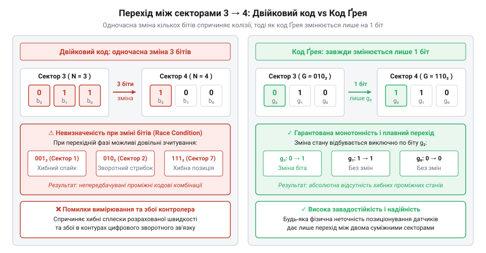
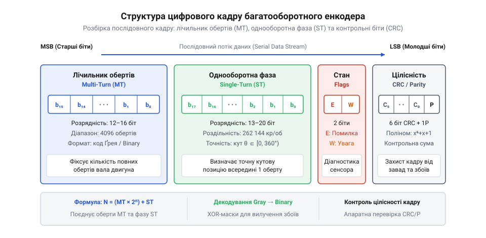

# Перетворення коду Ґрея, декодування абсолютного стану та математика багатооборотних вимірювань

<preknowlist>
- [Датчики кутового положення сервоприводів: потенціометри та магнітні енкодери](root:cat-hw-sensors/servo-feedback-potentiometers-and-magnetic-encoders) — Різницю між інкрементальними та абсолютними вимірюваннями кута та базовий принцип будови кодових дисків.
- [Магнітний енкодер кута AS5048](root:cat-hw-sensors/as5048-magnetic-encoder) — Концепцію зчитування цифрового коду кута через послідовні цифрові шини.
</preknowlist>

## Небезпека джиттеру та гонитва бітів

У цифрових системах керування рухом вимірювання кутового положення вала високої точності є основою зворотного зв'язку. Уявімо оптичний або магнітний диск абсолютного енкодера, поділений на кутові сектори. Якщо кодувати номери цих секторів у звичайній позиційній двійковій системі числення, виникає фундаментальна фізична проблема на межах між суміжними секторами.

Розглянемо перехід між сектором 3 та сектором 4 у 3-бітному двійковому коді. Число 3 описується кодовою комбінацією `011₂`, а число 4 — кодом `100₂`. Під час переходу з одного сектора в інший мають одночасно змінити свій стан усі три біти: молодші два біти скидаються з одиниці в нуль, а старший біт зростає з нуля до одиниці.

Однак у реальному фізичному світі принципово не існує ідеально синхронного перемикання декількох незалежних сигнальних каналів. Фотодатчики optical кодових доріжок, магніточутливі елементи Холла, порогові компаратори та цифрові лінії зв'язку мають неминучий технологічний розкид часу спрацьовування. На це накладаються механічні допуски виготовлення диска, теплові шуми та фазовий @@en|джиттер@@ (від англ. *jitter* — тремтіння фази фронтів сигналу). Через цей розкид один із бітів обов'язково перемкнеться на кілька наносекунд або мікросекунд раніше за інші.

Внаслідок неодночасного перемикання виникає @@en|гонитва сигналів@@ (англ. *race condition*). Якщо під час переходу `011₂ → 100₂` старший біт перемкнеться першим, мікроконтролер на короткий мить зчитає хибний кодовий стан `111₂` (число 7). Якщо ж раніше скинеться один із молодших бітів, система зчитає `001₂` (число 1) або `000₂` (число 0).

Для контуру керування сервоприводом такий короткочасний сплеск значення кута означає хибне обчислення миттєвої швидкості та прискорення. Цифровий диференціатор дасть гігантський вихідний імпульс, що спричинить акустичний удар у двигуні, сплеск струму силових транзисторів або хибне спрацьовування аварійного захисту.

Щоб математично оцінити масштаб цієї проблеми, визначимо кодову відстань між двійковими векторами. Кількість бітових позицій, у яких два двійкові слова однакової довжини мають різні значення, називається @@en|відстанню Геммінґа@@ (англ. *Hamming distance*, на честь математика Річарда Геммінґа). Для двох `n`-бітних векторів `A` та `B` відстань Геммінґа обчислюється як сума побітового додавання за модулем 2: Для детального вивчення фундаментальних властивостей цієї метрики та її застосування в цифрових системах передачі даних перегляньте матеріал про [відстань Геммінґа та коди з виправленням помилок](root:com-modulation/hamming-distance).

d_H(A, B) = ∑ᵢ₌₀ⁿ⁻¹ (Aᵢ ⊕ Bᵢ)

У звичайному двійковому коді відстань Геммінґа між сусідніми цілими числами `k` та `k+1` варіюється від 1 до `n`. Наприклад, при переході від 7 (`0111₂`) до 8 (`1000₂`) у 4-бітному коді відстань Геммінґа дорівнює `d_H(0111₂, 1000₂) = 4`. Це означає можливість появи до `2⁴ - 2 = 14` хибних проміжних станів залежно від комбінації затримок спрацьовування датчиків.

Мінімальні механічні чи фазові зсуви пристроїв зчитування не створюватимуть хибних проміжних станів лише тоді, коли відстань Геммінґа між будь-якими двома суміжними кутовими секторами буде суворо дорівнювати одиниці:

d_H(C(k), C(k+1)) = 1

Вимога одиничної кодової відстані є фундаментальною умовою проектування шкал абсолютного кодування. Якщо між сусідніми станами змінюється лише один біт, то незалежно від джиттеру чи часового зсуву система фізично може перейти або в новий стан, або залишитися у старому. Третього, некоректного значення виникнути не може.


*Порівняння перебігу фазових переходів у двійковому коді та коді Ґрея при зміні кутового стану.*

На відміну від аналогових датчиків положення, таких як [сельсини та резольвери](root:cat-hw-sensors/synchro-and-resolver-transducers) чи [диференціальні трансформатори LVDT](root:cat-hw-sensors/lvdt-linear-variable-differential-transformers), де сигнал змінюється неперервно, цифрові шкали вимагають спеціалізованого кодування. Вперше систему кодування з одиничною кодовою відстанню успішно застосували в імпульсно-кодовій модуляції та абсолютних кодових дисках енкодерів, де вона отримала назву коду Ґрея. Для розуміння побудови сучасних датчиків, таких як [магнітні енкодери кута](root:cat-hw-sensors/as5048-magnetic-encoder) чи оптичні системи [зворотного зв'язку сервоприводів](root:cat-hw-sensors/servo-feedback-potentiometers-and-magnetic-encoders), необхідно детально розібрати алгебру цього коду.

## Алгебра перетворення Binary та Gray

Потреба в одиничній кодовій відстані привела до створення непозиційного двійкового коду, у якому сусідні кодові комбінації відрізняються значенням лише одного розряду. Таке кодування називається @@en|кодом Ґрея@@ (від англ. *Gray code*, на честь інженера Френка Ґрея).

Нехай маємо позиційне двійкове число `B`, що складається з `n` бітів: `B = (bₙ₋₁, bₙ₋₂, ..., b₀)₂`, де `bₙ₋₁` — старший значущий біт (MSB), а `b₀` — молодший значущий біт (LSB). Відповідний йому вектор коду Ґрея позначимо як `G = (gₙ₋₁, gₙ₋₂, ..., g₀)₂`.

Пряме перетворення з двійкового коду в код Ґрея виконується за допомогою побітової операції додавання за модулем 2, тобто операції @@en|виключне або@@ (англ. *XOR*). Старший біт коду Ґрея завжди збігається зі старшим бітом двійкового числа, а кожен наступний біт є результатом XOR поточного двійкового біта з його старшим сусідом:

gₙ₋₁ = bₙ₋₁
gᵢ = bᵢ₊₁ ⊕ bᵢ     [для всіх i від 0 до n-2]

У векторній формі це означає, що значення коду Ґрея `G` отримується побітовим додаванням двійкового числа `B` із його арифметичним зсувом праворуч на один розряд (що еквівалентно цілочисельному діленню на 2):

G = B ⊕ ⌊B / 2⌋ = B ⊕ (B >> 1)

Обчислимо значення коду Ґрея для двійкового числа `B = 6₁₀ = 110₂`:

B              = 110₂
B >> 1         = 011₂
G = B ⊕ (B >> 1)
= 110₂ ⊕ 011₂   [побітове додавання за модулем 2]
= 101₂          [значення коду Ґрея для числа 6]

Завдяки цій формулі перетворення двійкового числа в код Ґрея на будь-якому мікроконтролері виконується всього за дві процесорні інструкції: зсув та XOR.

Обернене перетворення з коду Ґрея `G` у двійковий код `B` вимагає послідовного відновлення двійкових бітів, починаючи від старшого до молодшого. Оскільки `gₙ₋₁ = bₙ₋₁`, маємо `bₙ₋₁ = gₙ₋₁`. Для наступного біта з рівняння `gₙ₋₂ = bₙ₋₁ ⊕ bₙ₋₂`, застосувавши операцію XOR з `bₙ₋₁` до обох частин, отримуємо `bₙ₋₂ = bₙ₋₁ ⊕ gₙ₋₂ = gₙ₋₁ ⊕ gₙ₋₂`. Узагальнюючи цей ланцюжок, довільний двійковий біт `bᵢ` дорівнює префіксній сумі за модулем 2 усіх бітів коду Ґрея від старшого розряду до розряду `i`:

bᵢ = ⊕ⱼ₌ᵢⁿ⁻¹ gⱼ = gₙ₋₁ ⊕ gₙ₋₂ ⊕ ... ⊕ gᵢ

Якщо обчислювати кожен біт послідовно в циклі, алгоритм потребуватиме `O(n)` кроків. Проте для розрядностей мікроконтролерів (16 або 32 біти) існує значно швидший паралельний алгоритм каскадного зсуву (англ. *parallel prefix algorithm*). Він базується на асоціативності операції XOR і виконує декодування за `O(log₂ n)` операцій.

Розглянемо покрокове відновлення двійкового числа `B` із коду Ґрея `G = 101₂` (`5₁₀` у системі Ґрея):

B₀ = G         = 101₂
B₁ = B₀ ⊕ (B₀ >> 1)
= 101₂ ⊕ 010₂   [зсув на 1 біт праворуч і XOR]
= 111₂          [проміжне значення акумулятора]
B₂ = B₁ ⊕ (B₁ >> 2)
= 111₂ ⊕ 001₂   [зсув на 2 біти праворуч і XOR]
= 110₂          [остаточний двійковий код 6]

У разі 32-бітного слова алгоритм виконує послідовні зсуви на 1, 2, 4, 8 та 16 бітів, накладаючи XOR-маску на кожному кроці.

Нижче наведено практичну реалізацію прямого та оберненого перетворень коду Ґрея для мікроконтролерів.

:::tabs
@tab C (ESP-IDF)
:::code math-gray-code-and-multiturn-math/c/esp-idf/binary-to-gray.c
@tab C++ (Arduino)
:::code math-gray-code-and-multiturn-math/cpp/arduino/binarytogray.cpp
:::

Цей алгебраїчний апарат бездоганно працює доти, доки повне число відліків на один оберт дорівнює точно ступеню двійки `M = 2ⁿ`. Однак у реальному інженерному проектуванні часто виникає потреба в недвійкових роздільних здатностях.

## Усічені шкали та непарні роздільності

Класичний код Ґрея довжиною `M = 2ⁿ` володіє кільцевою властивістю (замкненістю): перехід від максимального значення `M - 1` назад до `0` також має відстань Геммінґа `d_H = 1`. Для 4-бітної шкали (`M = 16`) стан 15 описується кодом `1000₂`, а стан 0 — кодом `0000₂`. Різниця між ними полягає лише в єдиному старшому біті.

Проте у багатьох практичних задачах потрібна роздільна здатність, яка не є ступенем двійки (англ. *Non-Power-of-Two resolution*, або @@en|недвійкова роздільність@@). Наприклад, для вимірювання кута у градусах потрібна шкала на `M = 360` відліків, для вимірювання в кутових мінутах або проміле — `M = 1000` чи `M = 400`.

Якщо прості відліки стандартного коду Ґрея просто обрізати на довільному числі `M` (тобто використовувати кодові комбінації від `G(0)` до `G(M-1)`), замкненість шкали катастрофічно руйнується.

Проілюструємо це на прикладі усічення 4-бітної шкали до `M = 10` відліків. Якщо взяти перші 10 елементів стандартного коду Ґрея, отримаємо:
- Стан 0: `G(0) = 0000₂`
- Стан 9: `G(9) = 1101₂`

При переході вала енкодера через нульову позначку (від 9 до 0) відстань Геммінґа дорівнюватиме:

d_H(G(9), G(0)) = d_H(1101₂, 0000₂) = 3

Замість одиничного переходу ми отримуємо одночасне перемикання трьох бітів. На межі повного оберту знову виникає гонитва сигналів і загроза зчитування хибних проміжних станів, що зводить нанівець усі переваги коду Ґрея.

З теорії графів відомо, що замкнений цикл із одиничною відстанню Геммінґа в `n`-вимірному гіперкубі обов'язково повинен мати ПАРНУ кількість вершин `M`. Отже, для будь-якої парної роздільної здатності `M`, що задовольняє умову `2ⁿ⁻¹ < M ≤ 2ⁿ`, існує замкнений код Ґрея. Для математичного обґрунтування існування замкнених циклів Ґрея у багатовимірних бітових просторах перегляньте матеріал про [гіперкуби та гамільтонові цикли у теорії графів](root:math-combinatorics/hamiltonian-cycle).

Найпростішим і найефективнішим алгебраїчним методом побудови замкненого коду для довільного парного `M` є @@en|симетричний зсув діапазону@@ (англ. *excess-K Gray code*, або @@en|усічений код Ґрея@@) відносно центру повного `n`-бітного масиву.

Алгоритм розрахунку складається з трьох кроків:
1. Визначається мінімальна кількість бітів `n`, для якої `2ⁿ ≥ M`. 2. Обчислюється симетричний зсув `K` (початковий відступ шкали), який дорівнює половині невикористаного обсягу кодового простору:

K = (2ⁿ - M) / 2

3. Двійковий лічильник `B ∈ [0, M-1]` перед перетворенням у код Ґрея зсувається на величину `K`:

B_shifted = B + K
G_truncated = B_shifted ⊕ ⌊B_shifted / 2⌋ = B_shifted ⊕ (B_shifted >> 1)

Оскільки послідовність коду Ґрея є повністю симетричною відносно своєї середини, крайні елементи зсунутого діапазону `B_shifted = K` та `B_shifted = 2ⁿ - 1 - K` мають однакові молодші біти й відрізняються лише в одному значенні. Завдяки цьому відстань Геммінґа між ними строго дорівнює 1.

Розрахуємо усічений код Ґрея для `M = 10` відліків (`n = 4` біти, оскільки `2⁴ = 16 ≥ 10`):

K = (16 - 10) / 2
= 6 / 2                     [ділення невикористаного простору навпіл]
= 3                         [величина симетричного зсуву]

Діапазон вхідного двійкового лічильника `B` становить від 0 до 9. Після зсуву діапазон змінної `B_shifted` становить від 3 до 12.

Перевіримо межу переходу від 9 до 0:
- Для `B = 0`: `B_shifted = 3 = 0011₂`. Значення коду Ґрея: `G(0) = 0011₂ ⊕ 0001₂ = 0010₂`. - Для `B = 9`: `B_shifted = 12 = 1100₂`. Значення коду Ґрея: `G(9) = 1100₂ ⊕ 0110₂ = 1010₂`.

Обчислимо відстань Геммінґа на межі wrap-around:

d_H(G(9), G(0)) = d_H(1010₂, 0010₂) = 1

Як бачимо, коди `1010₂` та `0010₂` відрізняються лише в одному найстаршому біті (MSB). Властивість одиничного переходу повністю збережена для всієї недвійкової шкали!

Декодування зчитаного з датчика усіченого коду Ґрея `G_truncated` на мікроконтролері виконується у зворотному порядку: спочатку код декодується у звичайний двійковий формат, а потім від нього віднімається константа зсуву `K`:

B_shifted = gray_to_binary(G_truncated)
B = B_shifted - K

Якщо `B_shifted < K` або `B_shifted > 2ⁿ - 1 - K`, це свідчить про апаратний збій або вихід зчитувача за межі робочого сектора.

Наведемо реалізацію декодування усічених шкал на C та C++.

:::tabs
@tab C (ESP-IDF)
:::code math-gray-code-and-multiturn-math/c/esp-idf/decode-truncated-gray.c
@tab C++ (Arduino)
```cpp|arduino
#include <Arduino.h>

// Декодування усіченого коду Ґрея для довільної парної роздільності M
bool decodeTruncatedGray(uint32_t grayRaw, uint32_t M, uint32_t nBits, uint32_t &outBinary) {
    uint32_t K = ((1UL << nBits) - M) / 2;
    uint32_t bShifted = grayToBinary(grayRaw);
    
    if (bShifted < K || bShifted >= (K + M)) {
        return false;
    }
    
    outBinary = bShifted - K;
    return true;
}
```
:::

Освоєння алгебри коду Ґрея та алгоритмів коригування усічених шкал дозволяє надійно обробляти абсолютний кут одного оберту вала. Однак для побудови повноцінних промислових приводів необхідний перехід до багатооборотного вимірювання та перевірки цілісності даних.

## Математика багатооборотного декодування та фази

У багатьох пристроях точного позиціонування — від суглобів промислових роботів до гвинтових передач верстатів — ротор робить сотні або тисячі повних обертів. Застосування звичайних однооборотних пристроїв, таких як [магнітні енкодери сервоприводів](root:cat-hw-sensors/servo-feedback-potentiometers-and-magnetic-encoders), вимагає постійного програмного підрахунку переходів через нуль. Якщо в системі зникає живлення під час руху механізму, програмний лічильник втрачається, і абсолютну позицію доводиться шукати заново через тривалу процедуру базивання. На відміну від аналогових датчиків кута, як-от [диференціальні трансформатори LVDT](root:cat-hw-sensors/lvdt-linear-variable-differential-transformers) чи [обертові резольвери](root:cat-hw-sensors/synchro-and-resolver-transducers), які потребують додаткових оцифровувачів фази, @@en|багатооборотний енкодер@@ (англ. @@en|multi-turn encoder@@, від multi — багато та turn — оберт) фізично зберігає як поточний кут у межах одного оберту, так і загальну кількість зроблених обертів.

Цифровий @@en|кадр@@ (англ. @@en|frame@@, від давньонім. @@gem|rama@@ — рамка) багатооборотного енкодера передається через [промислові послідовні протоколи](root:com-devices/biss-c-and-ssi-industrial-protocols) як єдине бітове слово загальною довжиною `N` бітів. Це слово розщеплюється на два математичні поля: старші `M` бітів відведено під @@en|лічильник обертів@@ (англ. @@en|multi-turn count@@), а молодші `S` бітів — під @@en|однооборотну фазу@@ (англ. @@en|single-turn phase@@, від single — єдиний та turn — оберт), де `N = M + S`.


*Структура кадру багатооборотного енкодера: побітове розщеплення цифрового слова на лічильник обертів та однооборотну фазу.*

Для виділення складових із сирого двійкового слова `D` застосовують побітову маску та арифметичний зсув. Маска для молодших бітів формується як `2ˢ - 1`, що в двійковому вигляді дає `S` одиниць. Обчислення значення @@en|однооборотної фази@@ `Φ` та @@en|лічильника обертів@@ `T` виконується за алгоритмом:

```
Φ = D & ((1 << S) - 1)    [побітове І з маскою молодших бітів]
T = D >> S                [логічний зсув вправо на S бітів]
```

Значення `Φ` вимірюється в дискретах у діапазоні від `0` до `2ˢ - 1`, що відповідає куту в межах одного оберту. Значення `T` містить ціле число обертів у діапазоні від `0` до `2ᴹ - 1`.

Неперервне абсолютне значення позиції `Θ` у сирих дискретах обчислюється шляхом комбінування обох компонентів. Кут у радіанах `θ` отримують застосуванням масштабного коефіцієнта:

```
Θ = T × 2ˢ + Φ             [абсолютна позиція у дискретах]
θ = 2π × (Θ / 2ᴺ)          [абсолютний кут у радіанах]
```

Оскільки @@en|лічильник обертів@@ `T` має обмежену розрядність `M` бітів, при досягненні значення `2ᴹ - 1` під час обертання за годинниковою стрілкою відбувається переповнення до `0`. При обертанні проти годинникової стрілки відбувається від'ємний перехід від `0` до `2ᴹ - 1`. Обчислення різниці позицій `ΔΘ` між двома послідовними відліками `Θ₁` та `Θ₂` виконується за допомогою @@en|арифметики за модулем@@ `2ᴺ` (англ. @@en|modulo arithmetic@@, від лат. @@la|modulus@@ — міра):

```
ΔΘ = (Θ₂ - Θ₁ + 2ᴺ⁻¹) mod 2ᴺ - 2ᴺ⁻¹    [симетрична різниця кутів]
```

Якщо `ΔΘ > 0`, ротор обертається в прямому напрямку; якщо `ΔΘ < 0` — у зворотному. Такий підхід гарантує коректне відстеження кутового переміщення, доки зміна кута за один такт опитування не перевищує півоберта лічильника.

Коли @@en|багатооборотний енкодер@@ встановлено на валу двигуна, який з'єднаний із вихідним робочим органом через редуктор із @@en|передавальним числом@@ `G` (англ. @@en|gear ratio@@), реальний кут вихідного вала `θ_out` виражається через кут ротора `θ`:

```
θ_out = θ / G = (2π × Θ) / (2ᴺ × G)    [кут з урахуванням редукції]
```

При проведенні розрахунків у фіксованій точці ділення на `G` може призводити до накопичення помилок округлення. Тому цілу кількість обертів вихідного вала `T_out` та залишок @@en|однооборотної фази@@ `Φ_out` обчислюють через ділення з остачею:

```
T_out = Θ ÷ (G × 2ˢ)         [ціла кількість обертів вихідного вала]
Φ_out = Θ mod (G × 2ˢ)       [однооборотна фаза вихідного вала]
```

Нижче наведено практичну реалізацію декодування багатооборотного @@en|кадру@@ для мікроконтролерних систем.

:::tabs
:::code math-gray-code-and-multiturn-math/c/esp-idf/decode-multiturn-frame.c
:::code math-gray-code-and-multiturn-math/cpp/arduino/multiturndecoder.cpp
:::

## Перевірка цілісності даних через CRC

Вимірювальна інформація від енкодера передається високошвидкісними послідовними лініями зв'язку в умовах сильних електромагнітних завад, які виникають під час роботи частотних перетворювачів та силових контакторів. Випадкова інверсія біта в цифровому @@en|кадрі@@ може призвести до хибного обчислення кута на десятки градусів, викликаючи аварійне відключення або розрив контуру керування сервопривода. Для гарантії достовірності кожна передача даних супроводжується математичним контролем цілісності. Інтерфейси зчитування, подібні до [магнітного енкодера AS5048](root:cat-hw-sensors/as5048-magnetic-encoder), використовують для цього @@en|біти паритету@@ та циклічний надлишковий код.

Найпростішим способом перевірки є @@en|біт паритету@@ (англ. @@en|parity bit@@, від лат. @@la|paritas@@ — рівність). При формуванні @@en|кадру@@ до бітів даних додається один контрольний біт `P`, який доповнює загальну кількість одиниць у кадрі до парного числа (англ. @@en|even parity@@) або непарного числа (англ. @@en|odd parity@@). Математично @@en|біт паритету@@ для `K`-бітового слова `D = {bₖ₋₁, ..., b₁, b₀}` обчислюється через побітову операцію @@en|виключне або@@ (англ. @@en|Exclusive OR@@, @@en|XOR@@):

```
P = b₀ ⊕ b₁ ⊕ b₂ ⊕ ... ⊕ bₖ₋₁    [обчислення парного паритету]
```

При отриманні @@en|кадру@@ приймач обчислює операцію @@en|XOR@@ для всіх бітів, включаючи `P`. Якщо результат не відповідає умові парності, це свідчить про спотворення даних. Проте @@en|біт паритету@@ виявляє лише непарну кількість інвертованих бітів. Якщо завада спотворює одночасно два біти, значення паритету залишається незмінним, і помилка проходить непоміченою.

Для надійного виявлення груп спотворених бітів застосовують @@en|циклічний надлишковий код@@ (англ. @@en|Cyclic Redundancy Check@@, @@en|CRC@@). В основі @@en|CRC@@ лежить ділення поліномів над скінченним @@en|полем Галуа@@ GF(2) (англ. @@en|Galois field@@, на честь епоніма Еваріста Галуа), де додавання та віднімання виконуються через операцію @@en|XOR@@ без перенесення розрядів.

Бітовий потік @@en|кадру@@ розглядається як коефіцієнти полінома `D(x)`. Передавач і приймач заздалегідь узгоджують @@en|твірний поліном@@ `G(x)` ступеня `m` (англ. @@en|generator polynomial@@). Контрольна сума @@en|CRC@@ обчислюється як остача від ділення полінома даних, зсунутого на `m` бітів вліво, на @@en|твірний поліном@@:

```
R(x) = (D(x) × xᵐ) mod G(x)    [обчислення остачі CRC]
```

Переданий @@en|кадр@@ `F(x)` формується як `F(x) = D(x) × xᵐ + R(x)`. На приймальній стороні отримане слово знову ділиться на @@en|твірний поліном@@ `G(x)`:

```
Validation = F(x) mod G(x)    [перевірка цілісності кадру]
```

Якщо `Validation = 0`, @@en|кадр@@ вважається цілісним. Якщо `Validation ≠ 0`, у каналі зв'язку виникла помилка, і дані відкидаються.

Нижче наведено покроковий приклад обчислення 6-бітового коду @@en|CRC@@ для 12-бітового кадру даних `D = 0b101100101010` з @@en|твірним поліномом@@ `G(x) = x⁶ + x + 1` (двійкова маска `1000011₂`).

**Обчислення остачі ділення поліномів у GF(2):**

```
D × x⁶ = 101100101010000000₂        [зсув даних на 6 бітів вліво]
G      = 1000011₂                   [твірний поліном]

101100101010000000
⊕ 1000011
------------------
  001101001010000000                [крок 1: XOR з G]
  ⊕ 1000011
  ----------------
    0101010101000000                [крок 2: XOR з G]
    ⊕ 1000011
    --------------
      00101000100000                [крок 3: XOR з G]
      ⊕ 1000011
      ------------
        001001000000                [крок 4: XOR з G]
        ⊕ 1000011
        ----------
          0001011000                [крок 5: XOR з G]
          ⊕ 1000011
          --------
            00111110                [остача R = 0b111110 = 0x3E]
```

Отримана остача `R = 0b111110` (6 бітів) приєднується до кінця @@en|кадру@@. Будь-яка одинична або групова завада змінить остачу ділення на приймачі, дозволяючи виявити спотворення в реальному часі.

Для мікроконтролерних систем перевірка @@en|CRC@@ реалізується за допомогою програмного алгоритму побітового обчислення.

:::tabs
:::code math-gray-code-and-multiturn-math/c/esp-idf/calculate-crc6.c
:::code math-gray-code-and-multiturn-math/cpp/arduino/crc6checker.cpp
:::