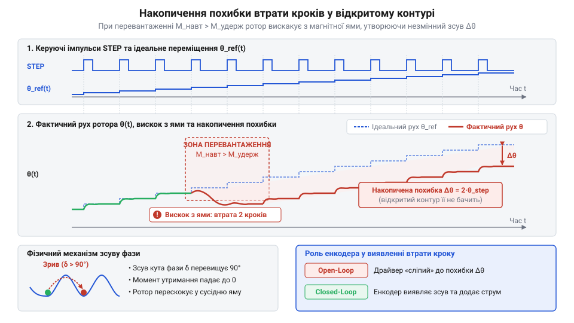
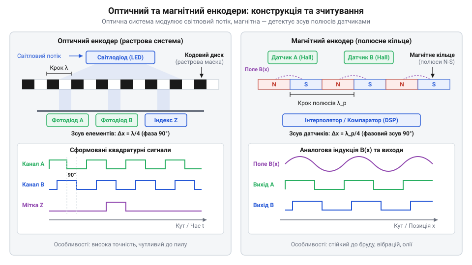
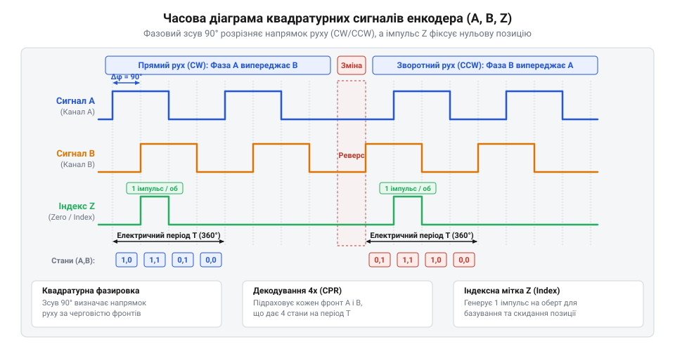
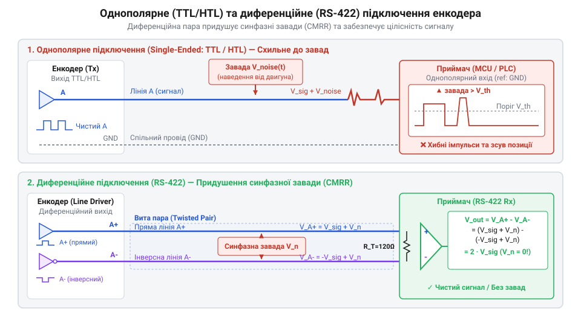
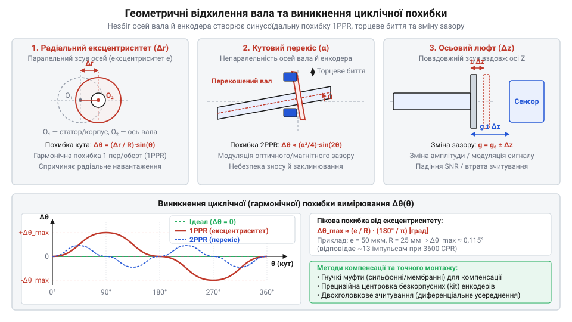
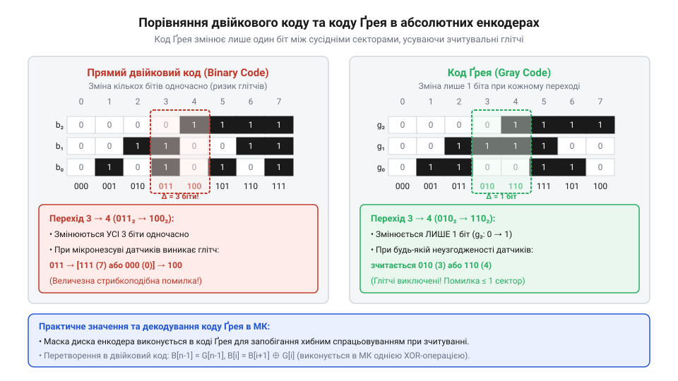

# Енкодери кутового та лінійного переміщення

<preknowlist>
- [Датчики кутового положення сервоприводів: потенціометри та магнітні енкодери](root:cat-hw-sensors/servo-feedback-potentiometers-and-magnetic-encoders) — Базові поняття про зворотний зв'язок за кутом у сервоприводах та відмінності аналогового й цифрового вимірювання.
- [Магнітний енкодер кута AS5048](root:cat-hw-sensors/as5048-magnetic-encoder) — Принцип вимірювання вектора магнітного поля інтегрованою мікросхемою давача.
</preknowlist>

## Проблема втрати кроків у приводі

Уявімо автоматизовану систему точного позиціонування — наприклад, триосьовий фрезерний верстат із числовим програмним керуванням, 3D-принтер або промисловий робот-маніпулятор. Найпростішим і найдешевшим способом організації руху в таких пристроях є @@en|відкритий контур керування@@ (від англ. *open-loop control*), у якому центральний контролер видає послідовність керувальних імпульсів на @@en|кроковий двигун@@ (від англ. *stepper motor*, від *step* — крок). Контролер робить жорстке припущення: кожен електричний імпульс повертає вал двигуна на чітко визначений кутовий крок (наприклад, `1.8°`), а отже, поточна координата робочого органу завжди точно дорівнює добутку кількості поданих імпульсів на величину кроку.

Однак реальний механічний привід функціонує в умовах змінного сухого й в'язкого тертя, динамічних піків навантаження, механічних резонансів та інерційних ривків під час прискорення. Якщо зовнішній момент опору на валу перевищує максимальний утримувальний момент двигуна, ротор фізично не встигає повернутися за обертовим магнітним полем статора і вискакує з магнітної потенціальної ями. Виникає явище, відоме як @@en|пропуск кроків@@ (від англ. *lost steps* або *step loss*).

Головна проблема відкритого контуру полягає в тому, що управляюча система принципово не має сенсорних ліній для виявлення такого механічного просковзування. Передавши в привід 1000 імпульсів, контролер розраховує, що виконавчий орган перемістився на `100 мм`, тоді як через механічне заклинювання або перевантаження вал повернувся лише на 950 кроків і фактично зупинився на позначці `95 мм`.

Оскільки привід продовжує виконувати подальші команди траєкторії від хибної поточної точки, виникає @@en|накопичення похибки позиціонування@@ (від англ. *accumulated positioning error*). З кожним наступним маневром під навантаженням ця похибка зростає, що неминуче призводить до браку деталей, зіткнення робочого органу з технологічним оснащенням або аварійної зупинки всієї системи.


*Часові діаграми заданих імпульсів керування та фактичного кутового переміщення вала крокового двигуна ілюструють момент вискоку ротора з магнітної ями під перевантаженням, що призводить до пропуску кроків та незворотного накопичення просторової похибки.*

Спроби непрямого оцінювання положення вала без застосування фізичних датчиків виявляються непридатними для точної механіки:
- Розрахунок позиції через інтегрування часу та заданої швидкості не враховує пружну деформацію зубчастих пасів, температурне розширення ходових ґвинтів під дією тертя та механічний @@en|люфт@@ (від нім. *Luft* — зазор, вільний хід) у кінематичних парах. - Оцінювання кута за струмом статора або напругою зворотної е.р.с. (@@en|зворотна е.р.с.@@, від англ. @@en|Back-EMF@@, *back electromotive force*) задовільно працює на високих швидкостях обертання безколекторних двигунів, але повністю втрачає працездатність біля нульової швидкості та під час статичного утримання навантаження, коли амплітуда зворотної е.р.с. прямує до нуля.

Непрямий розрахунок неминуче спричиняє @@en|зсув нульової точки@@ (від англ. *zero-point drift*): втративши прив'язку до реального просторового положення вала, система більше не може гарантувати точність жодної з наступних координат.

Єдиним надійним розв'язком цієї проблеми є перехід до замкненого контуру керування (@@en|замкнений контур керування@@, від англ. *closed-loop control*). Для цього на вал двигуна або безпосередньо на рухому каретку встановлюють датчик першимного вимірювання фізичного переміщення. Історично для цього застосовувалися прості аналогові компоненти, як-от [потенціометри та магнітні енкодери](root:cat-hw-sensors/servo-feedback-potentiometers-and-magnetic-encoders) або електромагнітні кутоміри, такі як [лінійні трансформатори LVDT](root:cat-hw-sensors/lvdt-linear-variable-differential-transformers) та [трансформаторні кутоміри резольвери](root:cat-hw-sensors/synchro-and-resolver-transducers). Проте в сучасній цифровій робототехніці та верстатобудуванні стандартним рішенням став @@en|енкодер@@ (від англ. *encoder*, від *encode* — кодувати, перетворювати у цифровий код).

Енкодер формує миттєвий цифровий або аналоговий @@en|зворотний зв'язок@@ (від англ. *feedback*), що дозволяє контролеру порівнювати реальний кут повороту із заданим, миттєво компенсувати відхилення додатковим струмом статора і повністю усунути пропуск кроків.

## Фізичні принципи оптичного й магнітного зчитування

Зрозумівши необхідність безпосереднього зчитування руху вала, розглянемо фізичні механізми, які перетворюють механічний зсув у первинний електричний сигнал. У сучасній приладобудівній галузі домінують два фундаментальні фізичні методи зчитування: @@en|оптичне зчитування@@ (від грец. *optikos* — зоровий) та @@en|магнітне зчитування@@ (від грец. *magnetis* — камінь з Магнезії).

### Оптичний принцип зчитування
В основу оптичного зчитування покладено модуляцію світлового потоку під час переміщення растрової структури відносно оптичної пари. Конструкція оптичного вимірювального вузла складається з чотирьох основних елементів:
1. Джерела випромінювання — високостабільного світлодіода (@@en|світлодіод@@, від англ. *light-emitting diode*, @@en|LED@@) або інфрачервоного лазерного діода (@@en|лазерний діод@@, від англ. *laser diode*).
2. Кодового диска або лінійної шкали, виготовленої зі скла, оптичного полімеру чи тонкого металу, на яку фотолітографічним методом нанесено @@en|оптичний растр@@ (від нім. *Raster*, від лат. *rastrum* — сітка, граблі) — чергування прозорих та непрозорих штрихів.
3. Нерухомої сітки-маски (@@en|діафрагма@@, від грец. *diaphragma* — перегородка) з аналогічним періодом штрихів, розміщеної між диском і приймачем для створення дифракційної або растрової інтерференційної картини.
4. Матриці фотоприймачів — кремнієвих фотодіодів (@@en|фотодіод@@, від грец. *phos* — світло та англ. *diode*) або фототранзисторів (@@en|фототранзистор@@).

Під час обертання кодового диска непрозорі штрихи растру послідовно перекривають світловий промінь. Перекриття штрихів диска та нерухомої маски модулює світловий потік, викликаючи періодичні коливання фотоструму у фотодіодах. Взаємний зсув елементів растру дозволяє отримати синусоїдальні або меандрові електричні сигнали з періодом, що відповідає кутовому кроку растрових позначок.

Історичний процес становлення оптичних вимірювальних систем — починаючи від перших дифракційних растрових шкал 1950-х років до сучасних субмікронних інтерферометрів — описує [еволюція енкодерів Ферранті](root:cat-hw-sensors/optical-and-magnetic-encoders/hist-encoder-tech-evolution.md), де висвітлено інженерний перехід від громіздких оптичних лінійок до напівпровідникових сенсорів.

### Магнітний принцип зчитування
Магнітне зчитування базується на вимірюванні змін вектора магнітної індукції `B` під час руху магнітного носія відносно магніточутливого напівпровідникового або тонкоплівкового елемента. Рухомим елементом слугує @@en|магнітне кодерне кільце@@ (від англ. *magnetic encoder ring*) або гнучка магнітна стрічка з послідовно намагніченими полюсами N і S, або ж дипольний магніт, закріплений на торці вала.

Зчитування вектора магнітного поля здійснюється магніточутливими елементами чотирьох основних типів:
1. **Датчики Голла**: @@en|датчик Голла@@ (від прізвища фізика Едвіна Голла, англ. @@en|Hall effect sensor@@) вимірює нормальну (перпендикулярну) складову магнітної індукції `B_z`. Принцип дії базується на виникненні поперечної різниці потенціалів у напівпровіднику під дією сили Лоренца на носії заряду. Датчики Голла легко інтегруються в кремнієві кристали, як у популярному інтегральному чіпі [датчик AS5048](root:cat-hw-sensors/as5048-magnetic-encoder), але мають помірну роздільну здатність та чутливість. 2. **Анізотропний магніторезистивний ефект (AMR)**: @@en|анізотропний магніторезистивний ефект@@ (від грец. *anisotropos* — нерівнонапрямлений, англ. @@en|Anisotropic Magnetoresistance@@, скорочено @@en|AMR@@) спостерігається в тонких плівках пермалою (@@en|пермалой@@, від англ. *permalloy* — сплав нікелю та заліза). Електричний опір плівки `R` змінюється залежно від кута `θ` між напрямком струму та вектором намагніченості: `R(θ) = R_0 + ΔR · cos²(θ)`. Відносна зміна опору `ΔR/R` становить `2-3%`, а період сигналу дорівнює `180°`, що вимагає розрізнення полярності поля додатковими датчиками. 3. **Гігантський магніторезистивний ефект (GMR)**: @@en|гігантський магніторезистивний ефект@@ (від англ. @@en|Giant Magnetoresistance@@, скорочено @@en|GMR@@) використовує багатошарові наноструктури з чергуванням феромагнітних та немагнітних металевих шарів — так звані спінові вентилі (@@en|спіновий вентиль@@, від англ. *spin valve*). Опір структури залежить від взаємної орієнтації векторів намагніченості ферромагнітних шарів через спін-залежне розсіювання електронів. Ефект досягає `ΔR/R ≈ 10-20%`, що забезпечує значно вище співвідношення сигнал/шум порівняно з AMR. 4. **Тунельний магніторезистивний ефект (TMR)**: @@en|тунельний магніторезистивний ефект@@ (від англ. @@en|Tunnel Magnetoresistance@@, скорочено @@en|TMR@@) реалізується у структурі магнітного тунельного переходу (@@en|магнітний тунельний перехід@@, від англ. *magnetic tunnel junction*, скорочено @@en|MTJ@@), де два ферромагнітні електроди розділені диелектричним тунельним бар'єром (наприклад, оксидом алюмінію `Al₂O₃` або оксидом магнію `MgO`) товщиною близько 1 нм. Імовірність квантовомеханічного тунелювання електронів залежить від паралельної чи антипаралельної орієнтації спінів у шарах. Зміна опору `ΔR/R` у TMR-структурах перевищує `100-200%`, що забезпечує найвищу чутливість, наднизьке енергоспоживання (наноамперні струми) та широкий динамічний діапазон.


*Конструктивні відмінності між оптичним розшифровувальним диском і магнітним кільцем із точковими магніточутливими елементами.*

### Порівняльний аналіз оптичних та магнітних енкодерів

Зіставляючи оптичні растрові системи з магніточутливими елементами, інженер виходить із чотирьох ключових критеріїв:

1. **Роздільна здатність та точність**: Оптичні енкодери є абсолютними лідерами за граничною точністю. Прецизійне літографічне нанесення тисяч штрихів на скляний диск дозволяє отримувати роздільну здатність до `24 біт` (понад 16 мільйонів відліків на оберт) без складної математичної інтерполяції. Магнітні системи вимагають апаратного аналогово-цифрового перетворення та інтерполяції квадратурних сигналів Sin/Cos, тому їхня точність обмежена відхиленнями однорідності намагніченості полюсів та температурним дрейфом. Проте сучасні TMR-матриці досягають високої роздільної здатності у `14-18 біт`. 2. **Швидкодія та смуга пропускання**: Фотодіоди оптичних систем мають час відгуку в декілька наносекунд, що забезпечує смугу пропускання в десятки мегагерц і дозволяє зчитувати позицію на швидкостях обертання вала понад `12 000 об/хв`. Магнітні енкодери обмежені частотою обробки аналогового тракту та спадом чутливості магніторезисторів на високих частотах (зазвичай смуга обмежена сотнями кілогерц). 3. **Енергоспоживання**: Оптична система вимагає постійного струму живлення світлодіода (`10-50 мА`), що є критичним для пристроїв із батарейним живленням. Магніторезистивні TMR-датчики мають високий власний опір тунельного переходу (мегаоми) і споживають мікроамперні або навіть наноамперні струми, завдяки чому є ідеальними для автономних та бездротових вимірювачів. 4. **Стійкість до довкілля та завад**: Оптичні енкодери вразливі до пилу, бруду, масляного туману й конденсату, які перекривають світловий шлях, а скляні растрові диски чутливі до ударів і вібрацій. Магнітні енкодери повністю герметичні (стандарт IP67/IP69K), не бояться бруду, вологи та вібрацій. Проте оптичні системи повністю інертні до зовнішніх магнітних полів, тоді як магнітні енкодери вимагають захисного екранування від магнітних наводок потужних обмоток двигунів та електромагнітних гальм.

## Квадратурні фази A, B та індекс Z

Якщо підключити до обертового вала диск з одноканальною оптичною растровою доріжкою та один фотодіод, при обертанні ми отримаємо послідовність електричних імпульсів. Підрахунок цих імпульсів дозволяє визначити кутовий шлях, але створює принципову проблему: сенсорна система принципово не здатна розрізнити напрямок обертання вала — за годинниковою стрілкою чи проти неї. Щобільше, якщо механічний привід зупиняється на межі штриха і через вібрацію двигуна диск починає коливатися туди-сюди відносно одного фотодіода, одноканальний @@en|інкрементальний енкодер@@ (від англ. *incremental encoder*, від *increment* — приріст) буде безперервно генерувати імпульси. Контролер нарахує тисячі хибних кроків, хоча вал фактично залишається на місці.

Щоб однозначно визначати напрямок руху та усунути чутливість до вібрацій, у вимірювальний вузол додають другий фотоприймач, зсунутий відносно першого на чверть періоду растрової ґратки. В результаті формуються два незалежні канали електричних сигналів `A` та `B`, між якими виникає @@en|фазовий зсув@@ (від англ. *phase shift*) у `90°` (або `π/2` радіан). Через прямокутний геометричний зсув сигналів на чверть періоду таке узгодження отримало назву квадратура (від лат. *quadratura* — утворення прямого кута, англ. @@en|quadrature signal@@).

Під час обертання вала за годинниковою стрілкою (CW) фронт сигналу `A` випереджає фронт сигналу `B` на `90°`. Якщо ж вал змінює напрямок і обертається проти годинникової стрілки (CCW), канал `B` починає випереджати канал `A`. Завдяки цьому пара двох каналів `(A, B)` послідовно проходить через чотири унікальні стани в межах одного оптичного штриха: `(0, 0) → (1, 0) → (1, 1) → (0, 1) → (0, 0)`. Якщо напрямок обертання змінюється на протилежний, послідовність станів дзеркально інвертується: `(0, 0) → (0, 1) → (1, 1) → (1, 0) → (0, 0)`.


*Часова діаграма квадратурних сигналів A і B та індексної позначки Z із висвітленням чотирьох фазових станів на кожен оптичний штрих.*

Аналіз чотирьох фазових станів дозволяє не лише визначати напрямок руху, а й множити фізичну роздільну здатність енкодера за допомогою квадратурної інтерполяції. Для опису здатності давача розрізняти кутові переміщення застосовують три основні величини:
1. @@en|PPR@@ (від англ. *Pulses Per Revolution* — імпульсів на оберт) або @@en|LPR@@ (від англ. *Lines Per Revolution* — ліній на оберт): фізична кількість повних періодів (синусоїд або меандрів) на кодовому диску за один повний оберт `360°`. 2. @@en|CPR@@: залежно від виробника термін означає @@en|Counts Per Revolution@@ (кількість декодованих станів) або *Cycles Per Revolution* (аналог PPR). Щоб уникнути плутанини, в інженерній практиці фіксують кількість фізичних штрихів `PPR` та описують режим апаратного декодування.

Виділяють три режими декодування квадратурних сигналів:
- Режим `x1`: лічильник дискретних кроків змінюється лише за наростаючим фронтом сигналу каналу `A`. Підсумкова кількість відліків на оберт дорівнює фізичній кількості штрихів: `N_cpr = N_ppr`. - Режим `x2`: лічильник фіксує як наростаючий, так і спадаючий фронти каналу `A`, що подвоює роздільну здатність: `N_cpr = 2 × N_ppr`. - Режим `x4`: лічильник обробляє абсолютно всі зміни логічних станів (наростаючі та спадаючі фронти обох каналів `A` та `B`). Оскільки в межах одного растрового періоду відбувається чотири переходи станів, дискретність вимірювання зростає в чотири рази відносно фізичної кількості штрихів.

Розрахуємо підсумкове кутове розрізнення `Δθ` енкодера з фізичним растром `N_ppr = 1024` штрихів у режимі декодування `x4`.

Загальна кількість декодованих відліків на один оберт `N_cpr`:
```
N_cpr = 4 × N_ppr
= 4 × 1024      [множення на коефіцієнт x4]
= 4096 відліків  [підсумкова кількість дискрет на оберт]
```

Кутовий крок одного дискретного відліку `Δθ`:
```
Δθ = 360° ÷ N_cpr
= 360° ÷ 4096   [ділення повного кола на кількість відліків]
= 0.08789°      [підсумкова дискретність позиціонування]
```

Детальні математичні виведення квадратурної інтерполяції, сумарного накопичення похибок та перерахунку лінійного й кутового розрізнення містить [розрахунок роздільної здатності енкодерів](root:cat-hw-sensors/optical-and-magnetic-encoders/math-encoder-resolution-and-quadrature.md).

Попри високу точність, інкрементальний відлік є суто відносним. При першому включенні живлення поточний стан лічильника дорівнює нулю, незалежно від реального просторового положення вала. Для прив'язки відносного відліку до абсолютного нуля механічної системи використовується @@en|індексна мітка Z@@ (від англ. *index pulse* або *reference mark*, також позначається як канал `I` або `Zero`). Вона являє собою окрему кодову доріжку з єдиним прозорим штрихом, який формує один вузький прямокутний імпульс тривалістю в один період растру (або чверть періоду) за один повний оберт диска на `360°`.

Під час ініціалізації системи (процедури базування, або @@en|homing@@) привід повільно обертає вал до моменту виявлення імпульсу `Z`. Фіксація сигналу `Z` скидає внутрішній лічильник позиції мікроконтролера в абсолютний нуль, відновлюючи точну просторову координату.

Передача прямокутних імпульсів від енкодера до приймача вимагає врахування довжини кабелю та рівня електромагнітних завад. В електронній апаратурі застосовують три основні фізичні рівні сигналів:
1. Single-ended `TTL` (@@en|TTL@@, від англ. @@en|Transistor-Transistor Logic@@): транзисторно-транзисторна логіка з амплітудою сигналів `0..5В`. Використовується для коротких кабельних ліній (до 2-3 метрів) усередині захищених шаф. 2. Single-ended `HTL` (@@en|HTL@@, від англ. @@en|High Threshold Logic@@): високопорогова логіка з напругою живлення та сигналів `10..30В` (зазвичай `24В`). Вища напруга підвищує завадостійкість у промислових середовищах. 3. Differential `RS-422` (@@en|RS-422@@, від англ. @@en|Recommended Standard 422@@): диференційна передача через симетричні виті пари. Кожен канал передається двома протифазними лініями: `A` та `/A`, `B` та `/B`, `Z` та `/Z`.

Низький опір витої пари та диференційний приймач забезпечують високу пригніченість синфазних електромагнітних завад (@@en|синфазна завада@@, від англ. *common-mode noise*), утворюваних імпульсними перетворювачами частоти серводвигунів. Будь-яка наводка наводить однаковий потенціал на обидва провідники витої пари, а диференційний приймач обчислює різницю напруг `V_diff = V_A - V_/A`, повністю нейтралізуючи зовнішню заваду. Це дозволяє передавати квадратурні імпульси без втрати кроків на відстані до 100 метрів із частотою послідовності до 2 МГц.


*Порівняння електричних схем передачі сигналів: однополярна лінія проти диференційної витої пари RS-422 із приглушенням завад.*

Правила електричного узгодження напруг, вибір захисних супресорів та термінування витих пар наведені у [електричному API енкодерів](root:cat-hw-sensors/optical-and-magnetic-encoders/api-encoder-hardware-interfaces-and-wiring.md).

Зчитування сигналів `A` та `B` шляхом програмного опитування входів або через переривання по зміні рівня є непридатним для високошвидкісних приводів. При швидкості обертання вала `6000 об/хв` та роздільній здатності `1024 PPR` частота перемикання фаз у режимі `x4` становить `409.6 кГц`. Обробка понад 400 тисяч переривань на секунду повністю заблокує обчислювальне ядро мікроконтролера.

Тому сучасні мікроконтролери містять апаратний блок декодування — @@en|QEI@@ (від англ. @@en|Quadrature Encoder Interface@@) або спеціалізований режим таймерів (наприклад, TIM Encoder Mode у мікроконтролерах STM32). Апаратний декодер стежить за станом виводів `CH1` (канал A) і `CH2` (канал B), автоматично визначає напрямок обертання та інкрементує або декрементує апаратний 16-бітний чи 32-бітний лічильник `CNT` без будь-якої участі процесора.

Наведений нижче приклад демонструє базову конфігурацію апаратного таймера STM32 у режимі квадратурного декодера `x4` мовами C та C++:

:::tabs
:::code optical-and-magnetic-encoders-d/c/stm32-hal/snippet-1.c
:::code optical-and-magnetic-encoders-d/cpp/stm32-hal/quadratureencoder.cpp
:::

Практичну конфігурацію периферійних таймерів мікроконтролера висвітлює [проєкт апаратного квадратурного декодера](root:cat-hw-sensors/optical-and-magnetic-encoders/proj-stm32-hardware-quadrature-decoder.md), а програмні методи обробки переповнення та калібрування зчитування деталізовано в [програмному API енкодерів](root:cat-hw-sensors/optical-and-magnetic-encoders/api-encoder-software-driver-interface.md).

Незалежно від досконалості електроніки, точність інкрементального зчитування суттєво залежить від механічного монтажу. На точність фазових сигналів впливають три геометричні відхилення:
1. Радіальний ексцентриситет (@@en|радіальний ексцентриситет@@, від англ. *radial eccentricity*): незбіжність осі обертання вала з центром кодового диска. Спричиняє гармонічну кутову похибку амплітудою в `1 PPR`, яка періодично стискає та розтягує фазовий зсув між каналами `A` та `B`. 2. Осьовий люфт (@@en|осьовий люфт@@, від англ. *axial play*): поздовжній зсув вала вздовж осі. Змінює відстань між растровим диском та фотодіодною матрицею, що викликає амплітудну модуляцію сигналів та може призвести до зникнення фази. 3. Кутовий перекіс (@@en|кутовий перекіс@@, від англ. *angular misalignment*): непаралельність осі вала та площини оптичної маски, що спотворює строгий `90°` фазовий кут між каналами `A` і `B`.


*Вплив механічних відхилень монтажу вала на геометричну точність і точність зчитування енкодерних фаз.*

Пере перед ходом до абсолютних систем зазначимо, що інкрементальні енкодери залишаються оптимальним вибором для контурів регулювання швидкості, але для задач абсолютного позиціонування без процедури базування потрібен фундаментально інший підхід.

## Абсолютний відлік та використання коду Ґрея

Втрата живлення в робототехнічному комплексі або багатоосьовому верстаті з ЧПК створює аварійну ситуацію для інкрементальних вимірювачів. Якщо робот-маніпулятор тримає важку деталь або перебуває всередині тісного технологічного оснащення, повторне увімкнення вимагає проведення процедури базування (пошуку мітки `Z`). Однак рух валів у довільному напрямку для розшуку нульової позначки може спричинити зіткнення робочого органу з деталями або поломку механіки. Для таких задач необхідний давач, який миттєво після подачі живлення видає точну просторову координату без будь-якого попереднього переміщення вала.

Цю задачу вирішує @@en|абсолютний енкодер@@ (від англ. *absolute encoder*). На його кодовий диск наносять не одну, а `n` концентричних растрових доріжок, кожна з яких зчитується окремим фотоприймачем або елементом матриці. Кількість доріжок визначає розрядність енкодера: `n` доріжок формують `2ⁿ` унікальних цифрових комбінацій на один повний оберт.

Якщо сформувати доріжки диска в звичайній позиційній двійковій системі числення, виникає критична апаратна пастка. При переході між певними суміжними кутами відбувається одночасне перемикання кількох логічних розрядів. Наприклад, при переході від стану 7 (`0111₂`) до стану 8 (`1000₂`) мають одночасно змінити свій стан усі 4 біти. Через неминучі мікронні погрешності виготовлення доріжок та різницю у швидкодії фотодіодів біти принципово не можуть переключитися в одну й ту саму пікосекунду.

В результаті протягом кількох наносекунд або мікросекунд зчитувальна матриця фіксує хибні проміжні стани (@@en|хибні проміжні стани@@, від англ. *spurious code glitches* або *intermediate transition states*) — наприклад, `1111₂` (15) або `0000₂` (0). Для цифрового контролера це виглядає як миттєвий фантомний стрибок координати на половину всієї шкали вимірювання, що викликає катастрофічні ривки в сервоприводі.

Для усунення фатальних кодових збоїв американський фізик і інженер Френк Ґрей (Frank Gray) у 1953 році запропонував спеціальний циклічний рефлексивний двійковий код — код Ґрея (від прізвища винахідника Френка Ґрея, англ. @@en|Gray code@@).

Головна властивість коду Ґрея полягає у дотриманні принципу безперервності та одиничної відстані: при переході між будь-якими двома сусідніми цифровими станами змінюється значення лише одного біта. Для будь-якої пари сусідніх кодових слів відстань Геммінга (від прізвища Річарда Геммінга, англ. @@en|Hamming distance@@) дорівнює строго одиниці:
```
d_H(G_i, G_{i+1}) = 1
```

Завдяки цьому, навіть якщо оптична доріжка зчитується з невизначеністю на самій межі кроку, зчитувач може зафіксувати або попередній стан, або наступний, але принципово не здатний зчитати хаотичне проміжне значення.


*Схема кодових доріжок кодового диска: двійковий код спричиняє кодові збої через мультибітний перехід, тоді як код Ґрея гарантує зміну лише одного біта.*

Оскільки код Ґрея не є позиційним (вага бітів залежить від стану сусідніх розрядів), математичні операції додавання та множення над ним безпосередньо не виконуються. Після зчитування з енкодера код Ґрея необхідно швидко декодувати у стандартний двійковий код `B`.

Перетворення прямого двійкового числа `B` у код Ґрея `G` виконується побітовою операцією додавання за модулем 2 (XOR, `⊕`) кожного біта `B_i` із сусіднім старшим бітом `B_{i+1}`:
```
G_n = B_n
G_i = B_i ⊕ B_{i+1}       [для всіх i від 0 до n-1]
```

У побітовому арифметичному виразі це записується як зсув праворуч та побітове XOR:
```
G = B ⊕ (B >> 1)
```

Зворотне декодування коду Ґрея `G` у двійковий код `B` виконується послідовним каскадним додаванням за модулем 2, починаючи від найстаршого розряду `B_n`:
```
B_n = G_n
B_i = G_i ⊕ B_{i+1}       [послідовне декодування від старшого біта до молодшого]
```

Нижче наведено високоефективні функції перетворення коду Ґрея у двійковий формат мовами C та C++:

:::tabs
```c|embedded-c
// Швидке побітове перетворення n-бітного коду Ґрея у двійковий код на C
uint32_t GrayToBinary32(uint32_t gray) {
    uint32_t mask = gray >> 1;
    while (mask != 0) {
        gray ^= mask;
        mask >>= 1;
    }
    return gray;
}

uint32_t BinaryToGray32(uint32_t binary) {
    return binary ^ (binary >> 1);
}
```
:::code optical-and-magnetic-encoders-d/cpp/embedded-cpp/snippet-3.cpp
:::

Математику побітових XOR-перетворень, алгоритми обробки усічених кодів Ґрея та багатооборотні обчислення детально розглянуто в [декодуванні коду Ґрея](root:cat-hw-sensors/optical-and-magnetic-encoders/math-gray-code-and-multiturn-math.md).

Абсолютні вимірювачі поділяються на два класи за охопленням діапазону руху:
1. @@en|однооборотний енкодер@@ (від англ. *singleturn encoder*): вимірює абсолютний кут повороту строго в межах одного оберту `360°` (наприклад, із розрядністю від `12` до `20 біт`). Після здійснення повного оберту лічильник скидається в 0. 2. @@en|багатооборотний енкодер@@ (від англ. *multiturn encoder*): крім кута всередині одного оберту (singleturn resolution), обчислює та зберігає повну кількість здійснених обертів вала (multiturn resolution, зазвичай `12..16 біт` або до 65536 оборотів).

Для збереження відліку оборотів під час вимкнення живлення використовують два конструктивні підходи:
- Мікромеханічний редуктор: система мініатюрних прецизійних шестерень, пов'язаних із додатковими кодовими дисками. Фізичне положення шестерень однозначно кодує кількість обертів без споживання електроенергії. - Датчики Віґанда (від прізвища винахідника Джона Віґанда, англ. @@en|Wiegand sensor@@): спеціальний бістабільний магнітний дріт із м'яким серцевинним і жорстким оболонковим магнітними шарами. При проходженні магніту вала у дроті виникає стрибкоподібна перемагніченість (ефект Віґанда), яка наводить у котушці імпульс напруги амплітудою до 3-5В. Цей енергетичний сплеск живить мікропотужну енергонезалежну пам'ять енкодера, дозволяючи фіксувати факт оберту вала навіть при повністю знеструмленому пристрої без батарейки.

Виведення 16-32 розрядів абсолютного коду паралельними лініями вимагає громіздкого багатожильного кабелю з 30-40 провідниками, що є недопустимим за вартістю та габаритами. Тому для абсолютних енкодерів застосовують високошвидкісні послідовні синхронні інтерфейси на базі диференційних ліній RS-422:
- @@en|SSI@@ (від англ. @@en|Synchronous Serial Interface@@): класичний промисловий протокол. Майстер (мікроконтролер) генерує послідовність тактових імпульсів `MA` (Clock), а енкодер у відповідь висуває розряди коду Ґрея або двійкового коду по лінії `SL` (Data) синхронно із кожним тактом. - @@en|BiSS-C@@ (від англ. @@en|Bidirectional Serial Synchronous interface@@, версія C): сучасний відкритий протокол точки-до-точки. Дозволяє передавати дані позиції на частотах тактування до 10 МГц із вбудованим контрольним сумуванням (CRC), а також підтримує двонаправлену передачу параметрів конфігурації, діагностичних прапорців перегріву та збоїв фотодіодів.

Архітектуру промислових мереж описують [промислові протоколи SSI](root:com-devices/biss-c-and-ssi-industrial-protocols), а приклад програмно-апаратного драйвера опитування наведено в [модулі BiSS-C та SSI](root:cat-hw-sensors/optical-and-magnetic-encoders/proj-absolute-encoder-biss-ssi-reader.md).

Програмний склад структури даних, коди помилок та обробку аварійних прапорців дивіться у [програмному API енкодерів](root:cat-hw-sensors/optical-and-magnetic-encoders/api-encoder-software-driver-interface.md).

У системах з екстремальними радіаційними та температурними навантаженнями, де напівпровідникові абсолютні енкодери виходять із ладу, як альтернативу застосовують суцільнометалеві електромагнітні кутоміри, такі як [резольвери та індуктосини](root:cat-hw-sensors/synchro-and-resolver-transducers), [трансформаторні кутоміри](root:cat-hw-sensors/synchro-and-resolver-transducers) та [лінійні трансформатори LVDT](root:cat-hw-sensors/lvdt-linear-variable-differential-transformers).

## Електричне узгодження та завадостійкість сигналів

Низьковольтні прямокутні чи цифрові сигнали, сформовані оптичною або магнітною зчитувальною головкою енкодера, рідко обробляються безпосередньо на платі давача. У реальному промисловому обладнанні та робототехнічних комплексах вимірювальні лінії тягнуться на десятки метрів крізь кабельні канали поруч із силовими провідниками частотних перетворювачів, імпульсних джерел живлення та потужних контакторів. Імпульсні завади з крутими фронтами, паразитна ємність довгих кабелів та різниця потенціалів між заземленнями контролера й приводу здатні повністю спотворити фазовий зв'язок каналів `A` та `B`, викликати хибні спрацьовування або вивести з ладу вхідні кола мікроконтролера.

Джерелом первинного спотворення є невідповідність схемотехніки вихідного каскаду енкодера та довжини лінії. На практиці застосовують три основні типи вихідних каскадів:
1. Відкритий колектор (від англ. @@en|open collector@@, або відкритий стік @@en|open drain@@): вихідний транзистор лише притягує лінію до землі (`0В`), а підтягування до напруги живлення `V_CC` здійснюється зовнішнім резистором `R_pullup`. Паразитна ємність кабелю `C_cable` разом із `R_pullup` утворює низькочастотний RC-фільтр із постійною часу `τ = R_pullup × C_cable`. За рахунок повільного заряджання ємності фронт наростання сигналу завалюється, обмежуючи граничну частоту передачі до 20–50 кГц на довжинах понад 5 метрів. 2. Push-Pull (двотактний вихід, з англ. @@en|push-pull@@ — «штовхай-тягни», також відомий як @@en|totem pole@@): містить два протифазні транзистори, що активно притягують лінію як до землі, так і до живлення. Це забезпечує круті фронти наростання й спаду, дозволяючи передавати сигнали `TTL` (`0..5В`) або `HTL` (`10..30В`, найчастіше `24В`) на високих частотах. 3. Диференційний драйвер лінії (від англ. @@en|differential line driver@@): генерує пару симетричних протифазних сигналів для кожного каналу.

Однополярні виходи `TTL` та `HTL` передають напругу відносно спільної шини землі (@@en|single-ended signal@@). Якщо в кабельній трасі виникає електромагнітна наводка від силового кабелю двигуна, наведений струм викликає падіння напруги на провіднику землі. Для приймача це виглядає як фантомна зміна логічного рівня.

Фундаментальне розв'язання проблеми завад забезпечує диференційна передача за стандартом `RS-422`. Замість одного провідника канал `A` передається симетричною витою парою (від англ. @@en|twisted pair@@) із сигналами `A` та `/A` (інверсний клон).

Робота витої пари базується на рівномірному просторовому переплетенні провідників. Будь-яке зовнішнє електромагнітне поле наводить у двох поруч розташованих провідниках практично однакову за амплітудою та фазою напругу завади `V_noise`. На приймальному боці встановлюють диференціальний трансивер (від @@en|transceiver@@, з англ. *transceiver* — «приймач-передавач»), який обчислює вихідний сигнал як різницю потенціалів між входами:

```
V_diff = (V_A + V_noise) - (V_/A + V_noise)
= V_A + V_noise - V_/A - V_noise    [розкриття дужок]
= V_A - V_/A                        [нейтралізація синфазної завади]
```

Здатність приймача пригнічувати таку заваду описує коефіцієнт пригнічення синфазного сигналу (від англ. @@en|common-mode rejection ratio@@, CMRR). Завдяки високому CMRR диференційні лінії RS-422 забезпечують надійне зчитування на відстанях до 100–120 метрів при частотах імпульсів до 2 МГц.

Для запобігання відбиттю високочастотних сигналів від відкритого кінця довгої лінії на вході диференційного приймача встановлюють термінатор (від лат. *terminatus* — «обмежений», англ. @@en|terminator@@) — узгоджувальний резистор `R_term`, опір якого дорівнює хвильовому опору витої пари (зазвичай `100..120 Ом`).

У промислових контролерах енкодери часто живляться від напруги `24В` (`HTL`), тоді як вхідні блоки мікроконтролерів оперують рівнями `3.3В` або `5В`. Для електричного узгодження та гальванічного розв'язування (від англ. @@en|galvanic isolation@@) застосовують оптопару (від @@en|optocoupler@@, з англ. *optocoupler* — «оптична пара», або @@en|optoisolator@@). Опторозв'язка розриває спільну контурну лінію землі між двигуном та контролером, запобігаючи виникненню земляних петель (від англ. @@en|ground loop@@) та захищаючи процесор від імпульсних перенапруг до 2.5–5 кВ.

Проте стандартні низькошвидкісні оптопари мають значний час затримки та розмивання фронтів. Для енкодерних ліній застосовують високошвидкісні оптопари з логічним виходом із частотою перемикання до 10 МГц.

Навіть після диференційного приймача або опторозв'язки в лінійний сигнал можуть проникати високочастотні голчасті імпульси (від англ. @@en|glitch@@). Для їх нейтралізації використовують двоступеневу апаратну фільтрацію:
1. Аналоговий низькочастотний RC-фільтр, який зрізає високочастотний спектр завад вище робочої частоти енкодера `f_c = 1 ÷ (2 × π × R × C)`. 2. Тригер Шмітта (від прізвища винахідника Отто Шмітта, англ. @@en|Schmitt trigger@@): логічний елемент із вбудованим гістерезисом напруги `V_hyst`. Він перемикає вихідний стан лише тоді, коли вхідна напруга перетинає верхній поріг `V_IH` або нижній поріг `V_IL`, унеможливлюючи дріботіння виходу при зашумленому повільному фронті.

У сучасних мікроконтролерах апаратні периферійні блоки таймерів додатково оснащуються вбудованими цифровими глітч-фільтрами (@@en|digital filter / deglitcher@@). Цифровий фільтр безперервно стробує стан вхідного вивода з частотою тактування `f_DTS` і підтверджує зміну логічного стану лише тоді, коли новий рівень утримується протягом `N` послідовних тактів.

Останнім рубежем завадостійкості є програмні перевірки коректності (від англ. @@en|sanity check@@) у драйвері зчитування. Оскільки квадратурні фази `A` та `B` мають послідовно проходити через рефлексивні стани `(0,0) → (1,0) → (1,1) → (0,1) → (0,0)`, одночасна зміна двох бітів (наприклад, прямий стрибок із `(0,0)` у `(1,1)` або з `(1,0)` у `(0,1)`) є фізично неможливою при нормальному обертанні.

Якщо програмний або апаратний обробник фіксує такий перехід, це однозначно свідчить про пропуск імпульсу через заваду. Драйвер фіксує прапорець помилки декодування (@@en|decoding error flag@@) та ініціює алгоритм безпечної зупинки або повторного калібрування.

Параметри вибору кабельних трас, супресорів захисту від перенапруг та термінування ліній викладено у [електричному API енкодерів](root:cat-hw-sensors/optical-and-magnetic-encoders/api-encoder-hardware-interfaces-and-wiring.md). Алгоритми програмної дефільтрації та структури обробки кодових помилок деталізовано у [програмному API енкодерів](root:cat-hw-sensors/optical-and-magnetic-encoders/api-encoder-software-driver-interface.md). Практичну настройку цифрових фільтрів у периферійному модулі STM32 наведено в [проєкті квадратурного декодера](root:cat-hw-sensors/optical-and-magnetic-encoders/proj-stm32-hardware-quadrature-decoder.md).

## Механічні допуски та дрейф точності

Навіть за умови ідеально налаштованої електронної частини та захищених від завад диференційних ліній, реальна точність вимірювання позиції обмежена фізичною механікою приводу. У реальних промислових приладах і роботах кодовий диск чи магнітний ротор кріпляться на вал, який піддається радіальним та осьовим навантаженням, згинальним моментам, температурним коливанням та зносу підшипників. Нераціональний монтаж або нехтування механічними допусками призводить до того, що енкодер високої роздільної здатності видає хибні дані, втрачає фазовий зв'язок або втрачає прив'язку до нульової позначки.

Розглянемо п'ять основних механічних чинників, що спотворюють вимірювання:

1. Радіальне биття (від англ. @@en|radial runout@@) та ексцентриситет (від лат. *eccentricus* — «поза центром», англ. @@en|eccentricity@@). Виникає через незбіжність геометричної осі обертання вала з центром кодового диска чи магнітного кільця на величину `e`. При обертанні вала растрові штрихи з одного боку диска наближаються до зчитувача, а з протилежного — віддаляються. Це породжує циклічну кутову похибку з періодом в один оберт (перша гармоніка).

Найбільше значення кутової похибки ексцентриситету `Δθ_ecc` (у радіанах) визначається співвідношенням величини зсуву `e` до радіуса кодової доріжки `R`:

```
Δθ_ecc ≈ e ÷ R
```

Проведемо розрахунок кутової похибки для прецизійного оптичного диска радіусом `R = 20 мм` при радіальному битті вала `e = 0.05 мм` (50 мкм).

Кутова похибка в радіанах `Δθ_rad`:
```
Δθ_rad = e ÷ R
= 0.05 ÷ 20       [ділення ексцентриситету на радіус доріжки]
= 0.0025 рад      [кутова похибка в радіанах]
```

Переведення похибки у градуси `Δθ_deg`:
```
Δθ_deg = Δθ_rad × (180 ÷ π)
= 0.0025 × 57.2958 [множення на градусну міру радіана]
= 0.1432°          [кутова похибка у градусах]
```

При роздільній здатності енкодера `1024 PPR` (крок одного відліку `0.0879°` в режимі `x4`) похибка від радіального биття в `50 мкм` перевищує крок одного дискретного відліку майже в півтора рази (`0.1432° > 0.0879°`), роблячи молодші розряди зчитування недоствірними.

2. Осьове биття (від англ. @@en|axial play@@ / @@en|axial runout@@). Являє собою поздовжній зсув вала вздовж осі обертання. В оптичних системах осьовий люфт змінює зазор між растровим диском та нерухомою маскою фотоприймача. Це призводить до модуляції амплітуди світлового потоку та зсуву порогів перемикання компараторів. У магнітних енкодерах (таких як [магнітного енкодера AS5048](root:cat-hw-sensors/as5048-magnetic-encoder)) зміна робочого повітряного зазору (від англ. @@en|air gap@@) змінює індукцію магнітного поля `B(z)`. Оскільки векторна інтерполяція базується на амплітуді сигналів датчиків Голла чи AMR/GMR, варіація зазору викликає інтегральну нелінійність (від англ. @@en|integral non-linearity@@, INL) та фазове тремтіння (від англ. @@en|phase jitter@@).

3. Кутовий перекіс (від англ. @@en|angular misalignment@@ / @@en|tilt@@). Виникає при перекосі осі обертання вала відносно нормалі до площини сенсора. Перекіс створює другу гармоніку кутової похибки (з періодом `180°`) та спотворює строго квадратурний фазовий кут в `90°` між каналами `A` і `B`, зменшуючи фазовий запас стійкості декодера.

4. Механічний люфт (від нім. *Luft* — «повітря, зазор», англ. @@en|backlash@@) та гістерезис (від грец. *hysteresis* — запізнення, відставання). *hysteresis* — «запізнення», англ. @@en|hysteresis@@). При реверсі напрямку руху зазори у зубчастих передачах або пружне деформування з'єднувальних елементів утворюють мертву зону (від англ. @@en|deadband@@). Вал двигуна починає обертатися в протилежний бік, але кодовий диск енкодера залишається нерухомим до вибору механічного зазору. Це породжує гістерезисну похибку позиціонування, яка не усувається цифровою інтерполяцією.

5. Температурний розширювальний дрейф (від англ. @@en|thermal expansion drift@@). Матеріали елементів енкодера мають різні коефіцієнти лінійного температурного розширення (від англ. @@en|coefficient of thermal expansion@@, CTE): для скла CTE становить `8..9 × 10⁻⁶ K⁻¹`, для сталевого вала — `11.5 × 10⁻⁶ K⁻¹`, для алюмінієвого корпусу — `23 × 10⁻⁶ K⁻¹`. При зміні температури середовища або нагріванні двигуна нерівномірні температурні деформації спричиняють зміщення відносного положення оптичної головки або магнітної мікросхеми відносно диска. Це викликає температурний зсув нульової позиції (від англ. @@en|home offset drift@@), що критично для прецизійних верстатів із тривалим циклом обробки.

Для компенсації геометричних недосконалостей монтажу та захисту підшипників енкодера від руйнівних радіальних й осьових навантажень застосовують спеціалізовані механічні вузли спряження:
- Гнучкі компенсаційні муфти (від нім. *Muffe* — «з'єднувальна гільза», англ. @@en|flexible coupling@@): застосовуються при торцевому монтажі енкодерів із суцільним валом (@@en|solid shaft encoder@@). Сильфонні муфти (від англ. @@en|bellows coupling@@) з тонкостінної нержавіючої сталі забезпечують високу торсійну жорсткість (відсутність люфту при обертанні), але легко деформуються в радіальному й осьовому напрямках, компенсуючи несосність валів до `0.2..0.5 мм`. Кулачкові або мембранні муфти ізолюють вал енкодера від вібрацій та теплового розширення вала двигуна. - Енкодери з порожнистим валом (від англ. @@en|hollow shaft encoder@@) та статорним реактивним кронштейном (від англ. @@en|stator coupling@@ / @@en|torque arm@@): ротор енкодера насаджується безпосередньо на вал двигуна і фіксується затискним кільцем. Корпус енкодера утримується від прокручування гнучкою пластинчастою пружиною (статорною муфтою). Така конструкція компенсує радіальне та осьове биття вала двигуна за рахунок пружного відхилення корпуса, не створюючи додаткового навантаження на внутрішні підшипники давача.

Узагальнюючи, при проектуванні вимірювальної системи інженер повинен закладати механічні допуски монтажу (радіальне биття не більше `0.02 мм`, кутовий перекіс не більше `0.1°`), використовувати гнучкі муфти та враховувати температурний дрейф.

Врахування механічних обмежень у поєднанні з розглянутими раніше оптичними та магнітними структурами, квадратурним декодуванням та диференційним узгодженням дозволяє створювати надійні системи зворотного зв'язку, здатні працювати з мікрономірною точністю в жорстких промислових умовах.

Математичні виведення сумарного накопичення механічних і фазових похибок наведено у [розрахунку похибок позиціонування](root:cat-hw-sensors/optical-and-magnetic-encoders/math-encoder-resolution-and-quadrature.md). Особливості застосування магнітних вимірювальних систем у сервоприводах розглянуто у [датчиках кутового положення](root:cat-hw-sensors/servo-feedback-potentiometers-and-magnetic-encoders), а специфіку інтегрованих магнітних датчиків векторного типу описано на прикладі [магнітного енкодера AS5048](root:cat-hw-sensors/as5048-magnetic-encoder).