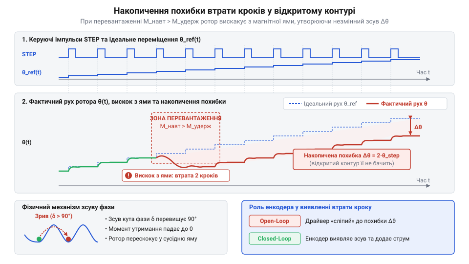
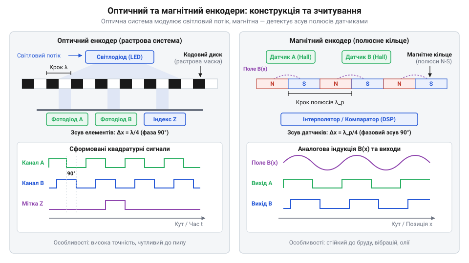
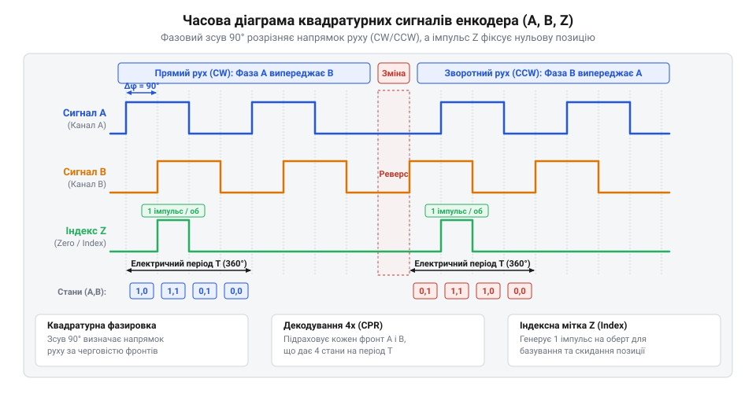
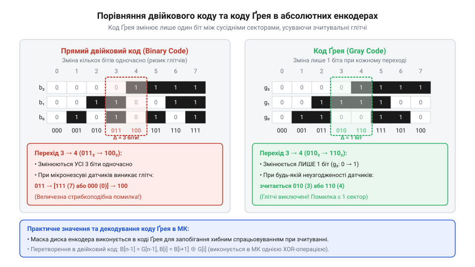
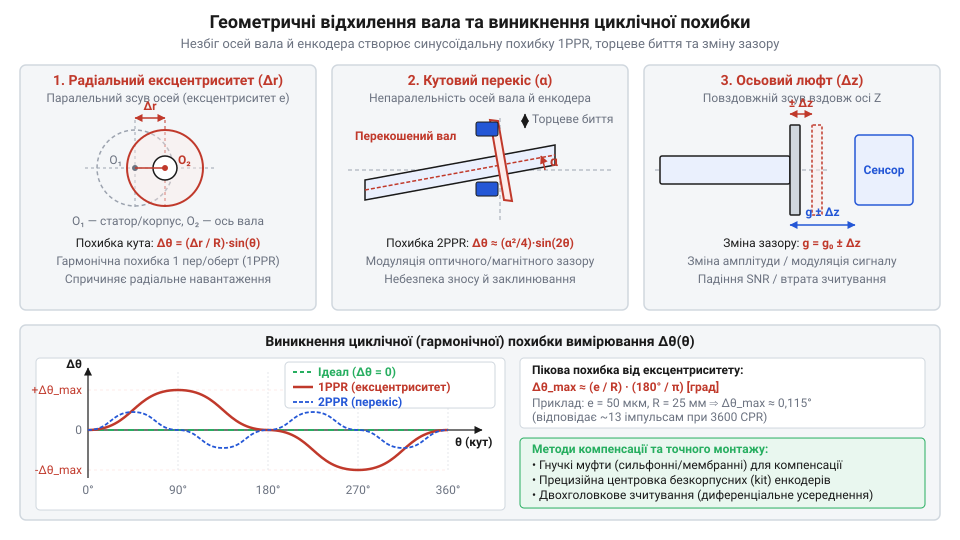

# Енкодери кутового та лінійного переміщення

<preknowlist>
- [Датчики кутового положення сервоприводів: потенціометри та магнітні енкодери](root:cat-hw-sensors/servo-feedback-potentiometers-and-magnetic-encoders) — Концепція зворотного зв'язку за кутом у сервоприводах та принципові відмінності аналогового й цифрового зчитування положення
- [Магнітний енкодер кута AS5048](root:cat-hw-sensors/as5048-magnetic-encoder) — Принцип вимірювання вектора магнітного поля інтегрованою мікросхемою давача
</preknowlist>

## Проблема втрати кроків у приводі

У розімкненому контурі керування (@@en|open-loop system@@) контролер надсилає імпульси без перевірки їх виконання. При перевантаженні ротор пропускає кроки — виникає втрата кроків (@@en|step loss@@).

Без вимірювача кута привід відлічує імпульси від помилкової позиції, накопичуючи похибку. Для її усунення застосовують [безпосередній кутовий зворотний зв'язок](root:cat-hw-sensors/servo-feedback-potentiometers-and-magnetic-encoders) енкодером (від англ. *encoder* — кодувальник, @@en|encoder@@), що фіксує кожен крок вала.

*Розходження між поданими керуючими імпульсами та реальним кутом вала у розімкненій системі призводить до незворотного накопичення похибки.*

## Оптичне та магнітне зчитування руху

Щоб перетворити обертання вала на цифровий сигнал, @@en|encoder@@ модулює світлове або магнітне поле.

В оптичному енкодері диск із растром штрихів перериває світло від світлодіода на фотоприймач, формуючи імпульси. Метод забезпечує найвищу точність, але чутливий до пилу та мастила.

Магнітний енкодер вимірює вектор магнітного поля обертового магніту. Поле зчитують [магнітні давачі кута](root:cat-hw-sensors/as5048-magnetic-encoder) на основі ефекту Голла (@@en|Hall effect@@). Вони герметичні й стійкі до бруду та вібрацій, але мають нижчу точність через нелінійність поля.

*Оптичне зчитування забезпечує високу роздільну здатність через модуляцію світлового потоку, тоді як магнітне гарантує працездатність у брудному середовищі.*

## Квадратурне декодування сигналів і мітка Z

Одноканальний @@en|encoder@@ лише підраховує імпульси: він не визначає напрямок обертання вала, а вібрація на межі штриха створює хибні відліки позиції.

Для розпізнавання напрямку застосовують квадратурні сигнали (від лат. *quadratura* — надання квадратної форми, @@en|quadrature@@) каналів A і B із фазовим зсувом 90 електричних градусів. Порядок їхнього випередження вказує сторону обертання вала.

Обробка чотирьох унікальних станів двох каналів (`00`, `10`, `11`, `01`) за період чотириразово підвищує роздільну здатність. Третій індексний канал (@@en|index pulse@@) генерує один імпульс Z на оберт, прив'язуючи відносний лічильник інкрементального давача (@@en|incremental encoder@@) до механічного нуля.

*Фазовий зсув 90 градусів між каналами A і B визначає напрямок руху та чотирикратно підвищує точність, а мітка Z фіксує механічний нуль.*

## Абсолютні енкодери та код Ґрея

Якщо втрата відліку при знеструмленні недопустима, застосовують абсолютний енкодер (@@en|absolute encoder@@), який зчитує унікальний цифровий код для кожного кутового положення.

Прямий двійковий код на доріжках диска небезпечний: при зміні кількох бітів (від `011` до `100`) через допуски вони перемикаються несинхронно. Виникають фантомні коди (як `111`), які контролер сприймає як хибний стрибок вала.

Проблему усуває код Ґрея (@@en|Gray code@@), у якому між сусідніми станами змінюється лише один біт. Аналоговою альтернативою зберігання кута без цифрових дисків є [обертові трансформатори](root:cat-hw-sensors/synchro-and-resolver-transducers).

*Структура коду Ґрея гарантує зміну лише одного біта при переході між сусідніми секторами, усуваючи апаратні помилки зчитування.*

## Завадостійкість та механічні допуски монтажу

Для захисту сигналів від промислових електромагнітних завад у довгих кабелях однополярні рівні замінюють на диференційний стандарт RS-422 (@@en|RS-422@@). Приймач зчитує різницю напруг двох антифазних сигналів (A та A̅), тому наведена синфазна завада взаємно знищується.

Радіальне биття, осьовий люфт і температурне розширення вала спричиняють кутову похибку та зношують підшипники. Для компенсації неспіввісності застосовують гнучкі компенсаційні муфти (@@en|flexible coupling@@), як і в [лінійних вимірювачах переміщення](root:cat-hw-sensors/lvdt-linear-variable-differential-transformers). Муфта поглинає механічні зміщення, зберігаючи точність пристрою.

*Гнучка муфта компенсує радіальне та осьове зміщення валів, захищаючи підшипники давача від руйнівних механічних навантажень.*