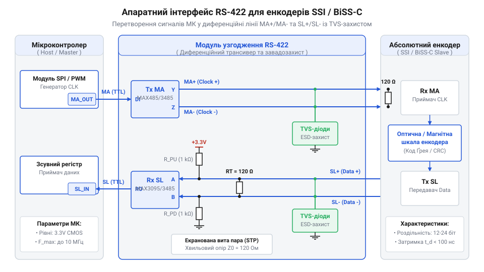
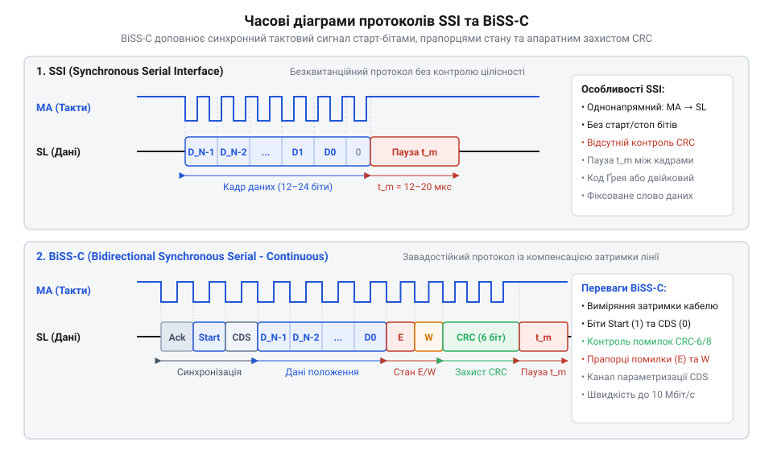

# Інтерфейсний модуль читання абсолютного магнітного/оптичного енкодера через протокол BiSS-C / SSI

<preknowlist>
- [Датчики кутового положення сервоприводів: потенціометри та магнітні енкодери](root:cat-hw-sensors/servo-feedback-potentiometers-and-magnetic-encoders) — загальні принципи вимірювання кута та роль зворотного зв'язку у серводвигунах
- [Магнітний енкодер кута AS5048](root:cat-hw-sensors/as5048-magnetic-encoder) — фізичні принципи визначення абсолютного кута магнітною матрицею та первинна оцифровка
</preknowlist>

## Проблема втрати положення в сервоприводах

Коли промисловий сервопривод починає рух після ввімкнення живлення, керувальна система повинна миттєво знати точне кутове положення вала. Якщо використовуються традиційні інкрементальні енкодери, які генерують лише послідовність імпульсів під час обертання, контролер бачить лише відносні прирісти кута, але не абсолютне положення в межах повного оберту. У разі виникнення імпульсної завади в лініях зв'язку, короткочасного просідання напруги чи випадкового перезапуску мікроконтролера лічильник імпульсів скидається або накопичує похибку. Це призводить до катастрофічної втрати абсолютного нуля: робочий орган верстата чи маніпулятора втрачає орієнтацію в провулку, вдаряється об механічні упори та ламається. Щоб уникнути цього, у прецизійних механізмах застосовуються абсолютні енкодери, які видають унікальний цифровий код для кожної точки кута. Проте передавання цього коду на великі відстані в умовах потужних електромагнітних завад від інверторів двигуна вимагає надійного послідовного синхронного інтерфейсу.

Для реалізації такого зв'язку використовують спеціалізовані цифрові послідовні інтерфейси енкодерів SSI та BiSS-C, які дозволяють зчитувати багатобітне значення положення безпосередньо після подачі живлення, забезпечуючи високу завадостійкість завдяки диференційній передачі сигналів.

## Апаратний тракт RS-422 та захист

Через те, що промислові приводи створюють величезні електромагнітні перешкоди від комутації силових транзисторів, просте передавання сигналів у вигляді однокінцевих TTL-рівнів неминуче призведе до спотворення даних. Для захисту інформації лінії тактування та даних переносяться за допомогою диференційних сигналів стандарту @@en|RS-422@@. У такій схемі інформація передається не відносно спільної землі, а як різниця потенціалів між двома провідниками кожної лінії: тактової MA та лінії даних SL. Синфазні завади, які наводяться на обидва дроти кабелю однаково, успішно подавляються на вході приймача завдяки високому коефіцієнту ослаблення синфазного сигналу.

 

Схема апаратного узгоджувача RS-422 між МК та енкодером із трансивером, TVS-діодами захисту та термінаційними резисторами.

Для реалізації фізичного рівня на платі мікроконтролера встановлюються спеціалізовані диференційні прийомопередавачі, які перетворюють однокінцеві сигнали периферії у дводиференційні рівні RS-422. На кінцях лінії зв'язку обов'язково встановлюються термінаційні резистори з номіналом, що дорівнює хвильовому опору кабелю (зазвичай сто двадцять ом), а для захисту від високовольтних імпульсів та електростатичних розрядів застосовуються швидкодіючі напівпровідникові супресори TVS-діоди. Це дозволяє побудувати надійний апаратний тракт узгодження рівнів між мікроконтролером і датчиком.

Для реалізації фізичного рівня на платі мікроконтролера встановлюються спеціалізовані диференційні прийомопередавачі, які перетворюють однокінцеві сигнали периферії у дводиференційні рівні @@en|RS-422@@. На кінцях лінії зв'язку обов'язково встановлюються термінаційні резистори з номіналом сто двадцять ом, що точно відповідає хвильовому опору стандартної витої пари. Неузгодженість хвильового опору та номіналу резисторів викликає зворотне відбиття високочастотних фронтів сигналу тактування та даних, що призводить до хибних спрацьовувань та втрати бітів у довгих кабелях промислових систем. Для захисту від високовольтних імпульсів, електростатичних розрядів та наведених перенапруг додатково застосовуються швидкодіючі напівпровідникові супресори @@en|TVS@@-діоди. Це дозволяє побудувати надійний апаратний тракт узгодження рівнів між мікроконтролером і датчиком.

## Часові діаграми протоколів SSI та BiSS-C

Отримавши захищений фізичний рівень, необхідно узгодити часові протоколи обміну даними між мікроконтролером та датчиком. У синхронному послідовному інтерфейсі SSI мікроконтролер подає пачку тактових імпульсів на лінії MA, на які датчик відповідає видачею бітів абсолютного положення синхронно з кожним фронтом тактового сигналу, починаючи зі старшого біта. Після завершення передавання кадру лінія залишається у стані високого рівня протягом часу моностабільного таймера, після чого цикл може повторитися.

 

Часові діаграми сигналів MA та SL для протоколів SSI та BiSS-C під час одного циклу зчитування.

На відміну від простого SSI, протокол BiSS-C є двонаправленим і розширеним, що дозволяє не лише зчитувати дані про положення, але й передавати службові біти, прапорці помилок та попереджень, а також здійснювати синхронізацію у реальному часі за допомогою зворотного тактування від датчика. Знання часових діаграм дозволяє правильно налаштувати апаратні модулі SPI або таймери GPIO мікроконтролера для безпомилкового прийому кадру.

## Драйвер формування такту та прийому даних

Для зчитування абсолютного положення з енкодера мікроконтролер мусить гарантувати чітке дотримання часових інтервалів синхронізації та безпомилкове захоплення бітового потоку. Оскільки лінії зв'язку працюють на високих частотах, звичайна програмна генерація імпульсів через перемикання ніжок введення-виведення призводить до джиттеру та збоїв синхронізації. Тому драйвер апаратного інтерфейсу будується на базі периферійних модулів synchronous peripheral interface @@en|SPI@@ або таймерів із прямим доступом до пам'яті @@en|DMA@@.

Під час ініціалізації сеансу зв'язку master-пристрій генерує серію тактових імпульсів на лінії MA (Master Clock). У протоколі SSI (Synchronous Serial Interface) початковий спад тактового сигналу запускає моностабільний таймер @@en|monostable timer@@ в енкодері, який фіксує поточне положення паралельного регістру і починає виштовхувати біти на лінію SL (Slave Data) за кожним наступним фронтом. У протоколі BiSS-C (Bi-directional/Serial Synchronous - Continuous) цикл синхронізації ініціюється вищим рівнем master-контролера, причому тактування узгоджується у реальному часі для забезпечення двостороннього обміну службовими пакетами.

Для реалізації цього процесу без завантаження центрального процесора використовується апаратний SPI у режимі RX-only або повнодуплексному режимі з тактуванням від внутрішнього таймера. Конфігурація периферії вимагає налаштування полярності тактування CPOL та фази CPHA відповідно до специфікації датчика, щоб захоплення бітів на лінії SL відбувалося у стабільній фазі імпульсу MA. Якщо полярність CPOL встановлена у нуль, тактовий сигнал у стані спокою має низький рівень, а активний фронт для зсуву даних обирається за фазою CPHA (наприклад, захоплення за першим переходом із низького рівня на високий). Налаштування тактового подільника SPI визначає частоту лінії MA, яка не повинна перевищувати максимальну смугу пропускання приймача енкодера, інакше виникає фазовий зсув та спотворення фронтів диференційних сигналів RS-422, розгорнутих у матеріалі про [апаратний тракт RS-422](root:cat-hw-sensors/ssi-bissc-digital-interfaces).

Щоб повністю усунути джиттер, який виникає при програмному читанні регістрів через переривання, використовується прямий доступ до пам'яті DMA. Контролер DMA налаштовується на автоматичне перенесення прийнятих байтів із буфера периферійного модулю SPI без участі ядра процесора, що гарантує сталість інтервалів та запобігає переповненню черги під час високих частот обертання вала в [датчиках кутового положення сервоприводів](root:cat-hw-sensors/servo-feedback-potentiometers-and-magnetic-encoders).

```c|stm32f4xx
#include "stm32f4xx_hal.h"

#define ENCODER_BUFFER_SIZE 3

typedef struct {
    SPI_HandleTypeDef *hspi;
    GPIO_TypeDef *cs_port;
    uint16_t cs_pin;
    uint8_t raw_data[ENCODER_BUFFER_SIZE];
} EncoderDriver_t;

HAL_StatusTypeDef Encoder_ReadFrame(EncoderDriver_t *dev) {
    return HAL_SPI_Receive_DMA(dev->hspi, dev->raw_data, ENCODER_BUFFER_SIZE);
}
```

:::code proj-absolute-encoder-biss-ssi-reader/cpp/stm32/biss-ssi-driver.cpp

Отриманий таким чином сирий бітовий масив передається далі на рівень математичної обробки та перевірки цілісності, де відбувається розпакування кадру, конвертація коду та верифікація контрольної суми.

У цьому розділі розкрито налаштування апаратного SPI (CPOL, CPHA) та інтеграцію DMA для стабільного прийому кадру без джиттеру, а також введено терміни: @@en|CPOL@@, @@en|CPHA@@, @@en|DMA@@, @@en|monostable timer@@.

## Перетворення коду Ґрея та перевірка CRC

Сирий двійковий потік, що надходить з оптичного чи магнітного диска енкодера, зазвичай закодований у форматі коду Ґрея @@en|Gray code@@. Використання коду Ґрея є критично важливим для уникнення хибних стрибків показників під час переходу між сусідніми сектором і позицією, оскільки при зміні стану змінюється лише один біт. Проте для подальших розрахунків у контурах керування та відображення кута цей код необхідно перетворити на класичний двійковий формат @@en|binary format@@.

Математична процедура перетворення коду Ґрея G у двійкове число B виконується послідовним застосуванням побітової операції виключного АБО @@en|exclusive OR@@ (XOR) від старшого біта до молодшого. Для 24-бітного слова перетворення реалізується через зсув та накопичення.

Після отримання двійкового значення позиції критично необхідно перевірити цілісність отриманого кадру за допомогою поліноміального контрольного сумування @@en|Cyclic Redundancy Check, CRC@@. Протокол BiSS-C зазвичай містить у кінці кадру CRC (наприклад, 6-бітний CRC для даних положення з поліномом x⁶ + x¹ + x⁰ або 0x43), а також 4-бітний CRC для контрольних даних з поліномом x⁴ + x¹ + x⁰ (0x13). Якщо обчислена контрольна сума не збігається з прийнятою, кадр відкидається як пошкоджений завадами.

:::code proj-absolute-encoder-biss-ssi-reader/c/snippet-2.c

:::code proj-absolute-encoder-biss-ssi-reader/cpp/encoderdecoder.cpp

Окрім позиції та CRC, в кінці кадру передаються службові прапорці діагностики @@en|status flags@@ (наприклад, попередження про магнітне насичення, помилку зчитування чи перегрів кристала датчика), парсинг яких дозволяє системі керування вчасно зупинити привід або перейти на аварійний режим до виникнення аварії.