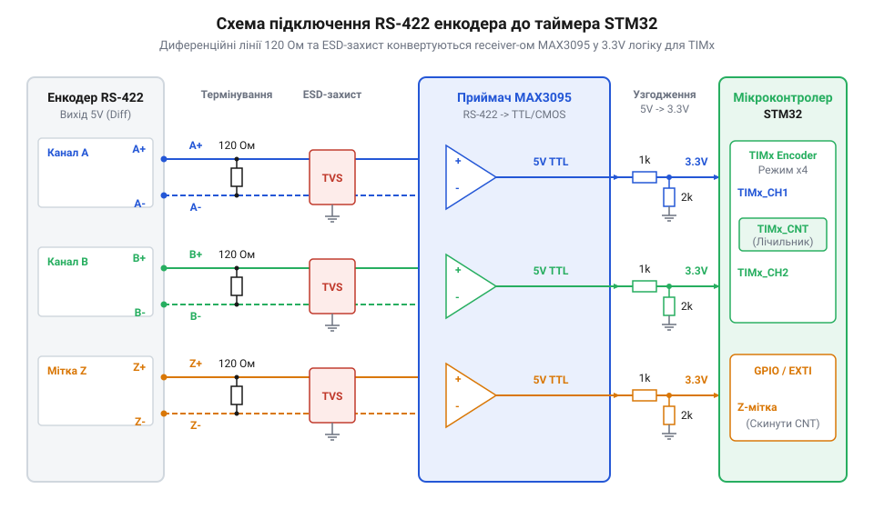
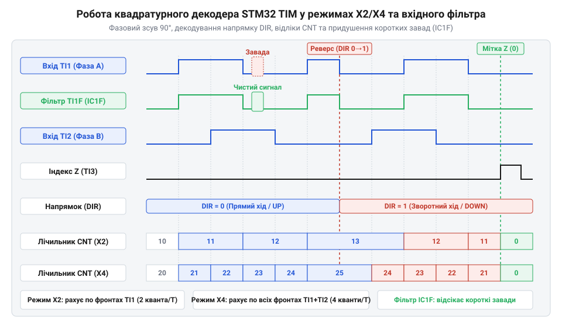

# Зчитування інкрементального квадратурного енкодера через апаратний таймер мікроконтролера STM32

<preknowlist>
- [Датчики кутового положення сервоприводів: потенціометри та магнітні енкодери](root:cat-hw-sensors/servo-feedback-potentiometers-and-magnetic-encoders) — загальні принципи вимірювання кутового положення та відмінності між абсолютними та інкрементальними датчиками зчитування
</preknowlist>

## Проблема програмного опитування швидкохідних енкодерів

Під час роботи з інкрементальними квадратурними енкодерами на високих швидкостях обертання вала виникає серйозна проблема: програмне опитування сигналів фаз A та B стає неефективним. Коли мікроконтролер намагається відслідковувати зміни стану ліній через переривання GPIO, частота імпульсів може перевищити можливості процесора. Для більшості мікроконтролерів (зокрема STM32) частота переривань понад 50–100 кГц стає критичною межею: процесор починає витрачати весь свій час виключно на вхід і вихід з обробників переривань, не залишаючи ресурсів на основну програму. Це призводить до пропуску імпульсів, хибних спрацьовувань від завад і, як наслідок, втрати точної позиції. На високих швидкостях процесор просто не встигає обробляти кожне переривання, що робить програмне декодування ненадійним у промислових умовах. Тому виникає критична необхідність апаратного декодування сигналів і фізичного захисту ліній зв'язку.

## Схемотехніка узгодження ліній та придушення завад

Промислові енкодери часто працюють в умовах сильних електромагнітних завад і використовують довгі кабельні лінії. Для надійної передачі сигналів застосовують диференційний стандарт @@en|RS-422@@ з напругою 5V або 24V. У цьому стандарті кожен сигнал передається двома проводами — прямим і зворотним. Завада від зовнішніх полів наводиться на обидва проводи однаково, утворюючи синфазну заваду, яку диференційна лінія дозволяє відсікти.

Оскільки входи @@en|STM32@@ працюють із логічними рівнями 3.3V, пряме підключення неможливе. Вирішенням є використання диференційних приймачів, таких як @@en|MAX3095@@ або @@en|AM26LS32@@, які не лише узгоджують рівні напруги, але й забезпечують високу завадостійкість. Мікросхема-приймач порівнює різницю потенціалів між входами кожної пари: якщо прямий вхід має більшу напругу за зворотний, приймач формує на своєму виході логічну одиницю з напругою 3.3V; якщо меншу — логічний нуль. Таким чином диференційні лінії перетворюються на звичайні несиметричні цифрові сигнали.

*Принципова схема підключення інкрементального енкодера через диференційний приймач MAX3095 з термінуванням ліній 120 Ом, захисними діодами та узгодженням 5V/3.3V.*

Отримані звичайні 3.3V сигнали каналів A, B та мітки Z підключаються безпосередньо до цифрових пінів мікроконтролера. Канали A та B заводяться на входи таймера (наприклад, @@en|TI1@@ та @@en|TI2@@), який апаратно обробляє квадратурні імпульси, а мітка Z підключається до виводу зовнішнього переривання (@@en|EXTI@@) для точного калібрування нуля.

Для запобігання відбиттю сигналів у довгих лініях встановлюють термінальні резистори 120 Ом, а для захисту входів від перенапруг — захисні діоди. Термінальні резистори ставляться між прямим і зворотним проводами кожної пари безпосередньо перед мікросхемою-приймачем. Така схемотехнічна обв'язка гарантує стабільну передачу квадратурних сигналів до мікроконтролера.

## Налаштування квадратурного декодера таймера STM32

Мікроконтролери STM32 мають вбудований апаратний квадратурний декодер (TIM Encoder Mode), який бере на себе всю роботу з підрахунку імпульсів. Це дозволяє розвантажити процесор: таймер автоматично відслідковує зміни фаз A і B, визначає напрямок обертання та рахує кванти X2 або X4.

*Часова діаграма фаз A і B із відліками квадратурного декодера у режимах X2 і X4, а також робота цифрового вхідного фільтра.*

Для відсікання брязкоту контактів і короткочасних завад налаштовуються цифрові вхідні фільтри таймера.

:::tabs
:::code proj-stm32-hardware-quadrature-decoder/c/include/encoder.h
:::code proj-stm32-hardware-quadrature-decoder/c/include/stm32_timer_hal.h
:::code proj-stm32-hardware-quadrature-decoder/c/src/encoder.c
:::code proj-stm32-hardware-quadrature-decoder/c/src/main.c
:::code proj-stm32-hardware-quadrature-decoder/c/src/stm32_timer_hal.c
:::code proj-stm32-hardware-quadrature-decoder/cpp/include/encoder.hpp
:::code proj-stm32-hardware-quadrature-decoder/cpp/include/stm32_timer_hal.hpp
:::code proj-stm32-hardware-quadrature-decoder/cpp/src/encoder.cpp
:::code proj-stm32-hardware-quadrature-decoder/cpp/src/main.cpp
:::code proj-stm32-hardware-quadrature-decoder/cpp/src/stm32_timer_hal.cpp
:::

Апаратний таймер забезпечує автоматичний підрахунок, а обробка переповнення розширює розрядність лічильника, що необхідно для довготривалого відстеження позиції.

## Обробка переповнення та індексу Z

Апаратний таймер мікроконтролера STM32 у режимі квадратурного декодера чудово справляється з підрахунком імпульсів, але його лічильник (`TIMx->CNT`) зазвичай обмежений 16 бітами. При довготривалому обертанні неминуче відбувається переповнення (перехід від 65535 до 0) або підповнення (від 0 до 65535). Щоб відстежувати позицію безперервно, необхідно програмно розширити розрядність до 32 або 64 біт.

Для цього використовується переривання оновлення (Update Interrupt), яке спрацьовує при кожному переповненні. В обробнику переривання ми перевіряємо напрямок рахунку в момент події через біт `DIR` регістра `CR1`. Якщо таймер рахував вгору — ми збільшуємо старше слово нашої розширеної позиції, якщо вниз — зменшуємо. Це дозволяє акумулювати повну кількість пройдених відліків в окремій змінній.

    :::code proj-stm32-hardware-quadrature-decoder/c/src/encoder.c 36-54

Окрім відстеження відносної зміни, енкодери часто мають індексну мітку Z — один імпульс на оберт, що фіксує абсолютно нульове положення вала. Для її обробки мітка заводиться на вивід мікроконтролера, налаштований як зовнішнє переривання (EXTI). Коли спрацьовує переривання за фронтом Z-імпульсу, поточна абсолютна позиція зберігається як зсув нуля.

    :::code proj-stm32-hardware-quadrature-decoder/c/src/encoder.c 56-65

Надалі відкалібрована позиція обчислюється простою різницею між поточною розширеною координатою та збереженим зсувом нуля. Це гарантує точну прив'язку навіть після тривалої роботи.

## Розрахунок швидкості та програмний драйвер

Отримавши надійне джерело поточної координати, наступним кроком є розрахунок кутової швидкості обертання. Класичний підхід полягає в диференціюванні позиції за часом: вимірюється приріст кількості відліків (дельта) за фіксований квант часу.

Програмний драйвер періодично викликає функцію оновлення швидкості. Різниця між поточною і попередньою позиціями дає кількість пройдених відліків. Знаючи роздільну здатність енкодера (PPR), режим декодування (x4) та передавальне число редуктора, ми переводимо ці відліки в радіани на секунду або оберти на хвилину (RPM).

    :::code proj-stm32-hardware-quadrature-decoder/c/src/encoder.c 142-169

Цей алгоритм реалізовано в C/C++ класі драйвера, який також інкапсулює стан і захищає атомарність зчитування позиції.

Такий підхід забезпечує стабільні показники для контурів керування сервоприводами, поєднуючи апаратну точність з гнучкістю програмної обробки.