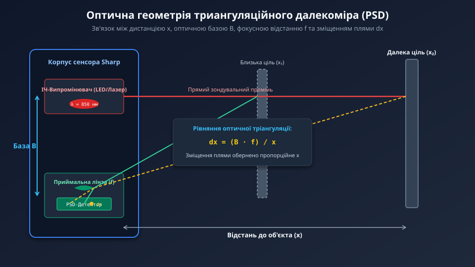
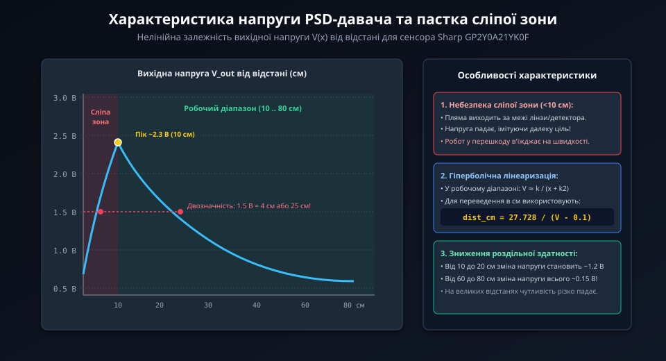
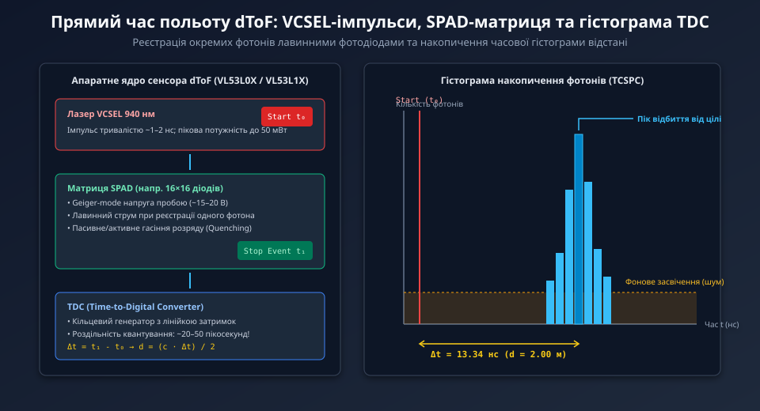
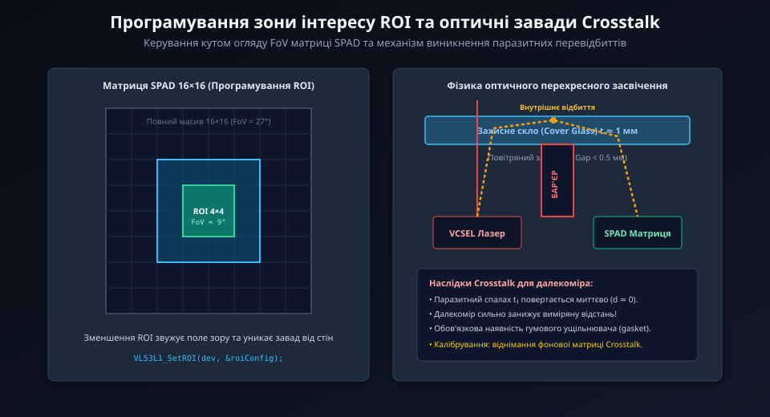
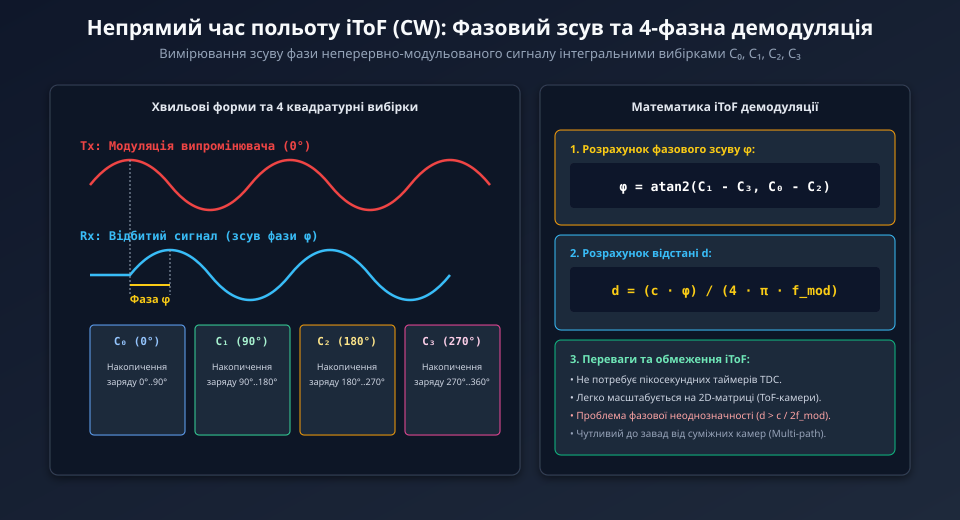

# Оптичні далекоміри: триангуляційні, ToF та амплітудні

<preknowlist>
- [HC-SR04 — ультразвуковий далекомір](root:cat-hw-sensors/hc-sr04) — базові принципи акустичного локаційного вимірювання відстані та обмеження акустичної хвилі у робототехніці
- [Sharp GP2Y0A21YK0F — ІЧ-далекомір (10–80 см)](root:cat-hw-sensors/sharp-gp2y0a21) — принципи роботи триангуляційних ІЧ-сенсорів із аналоговим виходом та нелінійною характеристикою
</preknowlist>

## Чому оптичне вимірювання відстані неминуче

Уявімо автономний мобільний робот або промисловий маніпулятор, який виконує точне позиціонування всередині складського приміщення чи виробничого цеху. У процесі руху перед роботом постає завдання: виміряти точну відстань до м'якої світлопоглинальної перешкоди (наприклад, звукопоглинальної тканини, повстяної шторки або пористого пінопластового блоку) або зняти показання дистанції до об'єкта, розташованого за вузькою вертикальною щілиною шириною у півтора сантиметра.

Якщо розробник оснастить таку систему виключно акустичними локаційними засобами, такими як [ультразвукових далекомірних датчиках](root:cat-hw-sensors/hc-sr04), робототехнічний комплекс зазнає негайного системного збою з трьох фундаментальних фізичних причин:

1. **Просторова апертура та кутова діаграма спрямованості.** П'єзоелектричний випромінювач ультразвукового сенсора генерує акустичну хвилю, яка розповсюджується у повітрі у вигляді розширеного конуса з кутом розходження від 15° до 30°. При спробі зондування через вузьку щілину акустичний фронт відбивається від бічних країв отвору значно раніше, ніж досягає цільового об'єкта за ними. Сенсор фіксує хибне відбиття від перешкоди прямо перед собою, унеможливлюючи вимірювання всередині обмеженого простору. 2. **Акустичне поглинання та опір матеріалу.** Звукова хвиля є механічним коливанням пружного середовища. М'які, пористі, ворсисті або нахилені під гострим кутом поверхні не мають високого акустичного імпедансу. Замість відбиття механічної енергії вони ефективно поглинають її (@@en|acoustic absorption@@), що призводить до повного згасання луни. Ультразвуковий приймач не отримує відбитого імпульсу і повертає граничне значення тайм-ауту (наприклад, 4 метри), створюючи ілюзію вільного простору там, де насправді розташована перешкода. 3. **Швидкість розповсюдження та часова затримка.** Швидкість звуку в сухому повітрі за нормальних умов становить приблизно 343 м/с. Для вимірювання відстані в 1 метр акустичний імпульс має подолати шлях у 2 метри (туди й назад), що займає близько 5.83 мілісекунди. Цей фізичний бар'єр обмежує максимальну частоту оновлення даних кількома десятками герц. Крім того, швидкість звуку суттєво залежить від температури повітря, тиску, вологості та конвекційних потоків, а акустичні шуми від працюючих електродвигунів створюють значні завади.

Для подолання цих обмежень вимірювальна техніка переходить у діапазон електромагнітних хвиль оптичного спектра — від видимого світла (довжина хвилі ~400–700 нм) до ближнього інфрачервоного діапазону (@@en|NIR@@, від англійського @@en|Near-Infrared@@ — ближній інфрачервоний, довжина хвилі ~850–940 нм).

Світло розповсюджується зі швидкістю:

```
c ≈ 3 · 10⁸ м/с
```

Завдяки такій швидкості часова затримка проходження метрів дистанції вимірюється наносекундами, що дозволяє виконувати десятки тисяч вимірювань за секунду без затримок у контурі керування роботом.

Головною геометричною перевагою оптичного випромінювання є можливість його прецизійної колімації (від латинського @@la|collimo@@ — спрямовую по прямій). За допомогою лінз або лазерних напівпровідникових резонаторів світловий промінь можна сформувати у вузький пучок з кутом розходження менше 1°, створивши пляму діаметром усього 1–2 міліметри. Такий промінь легко проходить через вузькі щілини, отвори та апертури (від латинського @@la|apertura@@ — отвір), не зачіпаючи стінок і зондуючи лише необхідну точку.

Взаємодія оптичного випромінювання з речовиною визначається поверхневим розсіюванням (@@en|albedo@@, від латинського @@la|albedo@@ — білизна). Навіть пористі та ворсисті матеріали, які повністю поглинають акустичні хвилі, розсіюють достатню кількість фотонів інфрачервоного діапазону. Це забезпечує надійну реєстрацію відбитого сигналу приймальною оптикою.

Історичний шлях пристроїв вимірювання відстані на основі оптичного випромінювання розпочався з адаптації триангуляційних принципів у масовій мікроелектроніці. На початку 1980-х років технологія аналогової триангуляції на позиційно-чутливих детекторах (@@en|PSD@@, від англійського @@en|Position Sensitive Detector@@) дозволила випустити перші доступні монолітні датчики, яскраві представники яких, такі як [триангуляційні далекоміри Sharp](root:cat-hw-sensors/sharp-gp2y0a21), стали стандартом у побутовій та робототехнічній автоматизації. Подальший розвиток напівпровідникової індустрії забезпечив перехід від одновимірних аналогових PSD-пластин до дискретних фотодіодних матриць (@@en|CMOS@@ та @@en|CCD@@), що суттєво розширило динамічний діапазон, підвищило просторову роздільну здатність та дозволило ефективніше компенсувати оптичні завади. Згодом вимірювальна техніка здійснила перехід до фазових амплітудно-модульованих систем, а справжній квантовий стрибок відбувся з впровадженням інтегральних напівпровідникових випромінювачів типу @@en|VCSEL@@ (від англійського @@en|Vertical-Cavity Surface-Emitting Laser@@ — поверхнево-випромінювальний лазер із вертикальним резонатором) та масивів однофотонних лавинних фотодіодів (@@en|SPAD@@, від англійського @@en|Single-Photon Avalanche Diode@@). Мініатюризація кремнієвих кристалів та інтеграція високошвидкісних цифрових таймерів — перетворювачів часу в цифровий код (@@en|TDC@@, від англійського @@en|Time-to-Digital Converter@@) — уможливили появу сучасних часопролітних сенсорів другого покоління, таких як [ToF-сенсора VL53L1X](root:cat-hw-sensors/vl53l1x-tof-sensor), здатних вимірювати час польоту окремих фотонів із пікосекундною точністю.

## Геометрична триангуляція та аналогова нелінійність

Найбільш прямолінійним способом фізичного вимірювання відстані за допомогою світла є оптична триангуляція (@@en|triangulation@@, від грецького @@el|тригонон@@ — трикутник та @@el|метрео@@ — вимірюю). Цей метод ґрунтується на побудові замкненого оптико-геометричного трикутника, вершинами якого є випромінювач світла, точка відбиття на поверхні досліджуваного об'єкта та приймальний детектор.

Конструктивно триангуляційний оптичний далекомір складається з трьох ключових елементів:
1. **Джерело випромінювання** — світлодіод або інфрачервоний лазерний діод з коліматорною лінзою, який формує вузький зондувальний промінь, спрямований перпендикулярно (або під фіксованим кутом) до конструктивної осі пристрою. 2. **Приймальна лінза** — оптичний елемент із фокусною відстанню `f`, розташований на жорстко зафіксованій відстані `B` від осі випромінювача. Відстань `B` називається оптичною базою (@@en|baseline@@). 3. **Позиційно-чутливий детектор** — полупровідниковий сенсор (пластина @@en|PSD@@ або фотодіодна лінійка @@en|CMOS@@/@@en|CCD@@), розміщений у фокальній площині приймальної лінзи.

Зондувальний промінь поширюється вздовж своєї оптичної осі й падає на об'єкт, розташований на відстані `x`. Світлова пляма диффузно розсіюється поверхнею об'єкта, і частина відбитих фотонів потрапляє у вхідну апертуру приймальної лінзи. Оскільки лінза зміщена відносно випромінювача на оптичну базу `B`, відбиті промені входять у лінзу під кутом, який безпосередньо залежить від дистанції `x`.

Приймальна лінза фокусує відбите світло на поверхні PSD-детектора у вигляді точки. Зміна відстані `x` спричиняє пропорційне зміщення плями `dx` уздовж робочої поверхні детектора відносно його оптичного центра.


*Геометрія оптичної триангуляції: залежність між відстанню до об'єкта x, оптичною базою B, фокусною відстанню лінзи f та зміщенням світлової плями dx на поверхні PSD-детектора.*

З подібності прямокутних трикутників, утворених оптичною базою `B` та відстанню `x` з одного боку, та фокусною відстанню `f` і зміщенням плями `dx` з іншого боку, випливає фундаментальне геометричне співвідношення:

```
dx / f = B / x
```

Виразимо лінійне зміщення плями `dx` та шукану відстань `x`:

```
dx = (B · f) / x           [формула зміщення світлової плями]
= (B · f) · x⁻¹            [обернена пропорційність]

x = (B · f) / dx           [розрахунок відстані до об'єкта]
```

Де:
- `x` — відстань від оптичної бази далекоміра до поверхні об'єкта (мм);
- `B` — довжина оптичної бази між осями випромінювача та приймача (мм);
- `f` — фокусна відстань приймальної лінзи (мм);
- `dx` — зміщення світлової плями відносно центральної осі детектора (мм).

У класичних аналогових далекомірах, таких як [далекоміра Sharp GP2Y0A21YK0F](root:cat-hw-sensors/sharp-gp2y0a21), як детектор використовується монолітна напівпровідникова пластина PSD. Вона являє собою одновимірний P-I-N фотодіод із двома крайовими електродами. Потрапляння світлової плями на поверхню викликає генерацію фотоносіїв. Сгенерований фотострум розділяється між двома електродами у відношенні, обернено пропорційному опору ділянок напівпровідника від точки падіння до відповідного електрода.

Внутрішня аналогова схема датчика нормалізує різницю струмів і формує вихідну напругу `V_out`, яка прямо пропорційна позиції плями `dx`:

```
V_out = k_p · dx + V_zero
```

Підставивши вираз для `dx = (B · f) / x` у формулу напруги, отримуємо передавальну функцію аналогового триангуляційного далекоміра:

```
V_out = (k_p · B · f / x) + V_zero
      = (k_a / x) + V_zero
```

Де `k_a = k_p · B · f` — підсумковий оптико-електричний коефіціент масштабного перетворення, а `V_zero` — напруга зсуву нуля.

З цієї математичної моделі чітко видно причинний зв'язок гіперболічної нелінійності. Вихідна напруга є обернено пропорційною відстані `x`. Це призводить до двох критичних наслідків для вимірювального каналу:

1. **Нерівномірна роздільна здатність і втрата чутливості на великих дистанціях.** На малих відстанях (наприклад, від 10 до 20 см) зміна відстані на 1 см викликає значне переміщення плями `dx` і, відповідно, велику зміну напруги ΔV (сотні мілівольт). Проте при наближенні до верхнього порогу вимірювання (70–80 см) зміна відстані на той самий 1 см викликає мізерне зміщення плями, а зміна напруги становить лише кілька мілівольт. Це зміщення стає порівнянним із рівнями електричних шумів аналогово-цифрового перетворювача (@@en|ADC@@, від англійського @@en|Analog-to-Digital Converter@@), що різко погіршує точність сенсора на далеких дистанціях. 2. **Феномен неробочої «сліпої» зони на малих дистанціях.** Що відбувається, коли об'єкт наближається до сенсора ближче за мінімально допустиму межу `x_min` (для Sharp GP2Y0A21YK0F це менше 10 см)? При зменшенні `x` кут входу відбитого променя в приймальну лінзу зростає понад розрахункові межі. Світлова пляма `dx` зміщується за край активної напівпровідникової зони PSD-пластини або частково перекривається конструктивною оправою оптичної системи. Внаслідок втрати світлового потоку вихідна напруга `V_out` замість подальшого зростання починає стрімко падати.

Це створює небезпечну двозначність (@@en|ambiguity@@): напруга 1.5 В може відповідати як реальній відстані 35 см, так і критично близькій відстані 3 см. Якщо автономний робот потрапляє у сліпу зону, його контроллер сприймає спад напруги як віддалення від стіни і продовжує розгін, що призводить до фізичного зіткнення.


*Графік залежності вихідної напруги @@en|PSD@@-сенсора від відстані демонструє нелінійну спадну характеристику робочого діапазону та спад сигналу в неробочій сліпій зоні при відстані менше 10 см, що спричиняє двозначність показань.*

Детальне математичне виведення геометрії та розрахунок похибок нелінійності висвітлено у матеріалі [геометричне моделювання нелінійності](root:cat-hw-sensors/optical-distance-sensors-overview/math-triangulation-optical-geometry-and-nonlinearity.md).

Для компенсації нелінійності вихідного сигналу та первинної обробки даних застосовують табличну лінеаризацію (@@en|Look-Up Table@@, @@en|LUT@@) або розрахунок оберненої поліноміальної функції. Практична розробка завадостійкого вимірювального вузла наведено у матеріалі [табличної лінеаризації Sharp](root:cat-hw-sensors/optical-distance-sensors-overview/proj-sharp-analog-distance-sensor-linearization-node.md), а специфікації електричних рівнів та схемотехніка підключення деталізовані у довіднику [залізного інтерфейсу далекомірів](root:cat-hw-sensors/optical-distance-sensors-overview/api-optical-distance-sensors-hardware-interface.md).

Нижче наведено приклад реалізації драйвера первинного зчитування, експоненційного фільтрування та лінеаризації даних для триангуляційного аналогового сенсора з урахуванням розрахунку [програмного API Sharp](root:cat-hw-sensors/gp2y0a21-sw-api).

:::tabs
@tab C (ESP-IDF)
:::code optical-distance-sensors-overview-d/c/esp-idf/sharp-calculate-distance.c
@tab C++ (Arduino)
:::code optical-distance-sensors-overview-d/cpp/arduino/sharptriangulationsensor.cpp
:::

## Прямий часопролітний метод і однофотоніка

Вимірювання відстані геометричним методом оптичної триангуляції на позиційно-чутливих детекторах @@en|PSD@@ стикається з фізичною перепоною, коли дистанція до об'єкта перевищує один-два метри. Оскільки зміщення світлової плями на фотоприймачі зменшується обернено пропорційно квадрату відстані, для збереження точності на відстанях у п'ять чи десять метрів довелося б збільшувати оптичну базу пристрою до кількох десятків сантиметрів. Це робить триангуляційний далекомір громіздким та непридатним для компактної робототехніки. Щоб вимірювати великі відстані без збільшення габаритів сенсора, необхідно перейти від вимірювання кута відбитого променя до вимірювання часу його прольоту.

Метод прямого вимірювання часу прольоту (від англійського @@en|Time-of-Flight@@ — час прольоту, @@en|dToF@@) базується на прямому вимірюванні часового інтервалу між моментом випромінювання короткого світлового імпульсу та моментом його повернення після відбиття від перешкоди. Світлове випромінювання поширюється в повітряному середовищі зі швидкістю `c ≈ 299 792 458` м/с, що відповідає приблизно 30 сантиметрам за одну наносекунду. Для розрахунку відстані `d` між сенсором і об'єктом використовують виміряну затримку `Δt`, враховуючи, що світловий імпульс долає дистанцію двічі — до цілі та назад.

Загальне рівняння прямого часу прольоту формулюється так:

    d = (c × Δt) / 2      [рівняння прямого часу прольоту]

тут `c` — швидкість світла в повітрі, `Δt` — повна часова затримка імпульсу, `d` — шукана відстань до об'єкта.

Головна технічна складність методу @@en|dToF@@ полягає в надзвичайно високих вимогах до часової роздільної здатності електронних вузлів. Якщо робототехнічна система вимагає точного вимірювання відстані з точністю до 1 міліметра, відповідна зміна шляху оптичного імпульсу становить 2 міліметри. Затримка світла на цій дистанції обчислюється так:

    Δt = (2 × 0.001) / 299 792 458      [підстановка відстані в рівняння затримки]
    = 6.671 × 10⁻¹² s                   [обчислення часового інтервалу]
    ≈ 6.67 ps                           [переведення у пикосекунди]

Вимірювання тривалості інтервалів порядку одиниць пикосекунд вимагає створення спеціалізованих оптоелектронних компонентів, здатних генерувати короткі лазерні спалахи та фіксувати поодинокі фотони.

Напівпровідниковим джерелом світла у сучасних dToF-системах є вертикально-випромінювальний лазер (від англійського @@en|Vertical-Cavity Surface-Emitting Laser@@ — вертикально-випромінювальний лазер, @@en|VCSEL@@). На відміну від класичних крайових напівпровідникових лазерів, @@en|VCSEL@@ формує круговий колімований пучок світла перпендикулярно до поверхні кристала. Оптичне випромінювання формується в інфрачервоному діапазоні (зазвичай на довжині хвилі 940 нм), що робить його непомітним для людського ока та безпечним для зору при обмеженій випромінювальній потужності. Драйвер лазера генерує імпульси накачки тривалістю менше 1 наносекунди з високою частотою повторення.

Детектування відбитого фотонного потоку здійснюється матрицею однофотонних лавинних фотодіодів (від англійського @@en|Single-Photon Avalanche Diode@@ — однофотонний лавинний фотодіод, @@en|SPAD@@). Фотодіод @@en|SPAD@@ зміщується зворотною напругою, яка перевищує напругу пробою, працюючи у так званому режимі Гейгера (англ. @@en|Geiger mode@@ від прізвища фізика Ганса Гейгера). У цьому стані pn-перехід перебуває у метастабільному режимі: поглинання навіть одного фотона світла викликає лавинну іонізацію носіїв заряду, створюючи стрімкий сплеск струму з пікосекундним фронтом наростання.

Для перетворення затримки між стартовим електричним імпульсом лазера @@en|VCSEL@@ та лавинним відгуком @@en|SPAD@@ у цифровий код застосовують перетворювач часу в цифровий код (від англійського @@en|Time-to-Digital Converter@@ — перетворювач часу в цифровий код, @@en|TDC@@). Вузол @@en|TDC@@ будується на базі кільцевих генераторів та лінії затримки з дискретними логічними елементами, що дозволяє підраховувати кількість пройдених елементарних фазових зсувів із дискретністю від 5 до 10 пікосекунд.

Історичний шлях розвитку далекомірів пролягає від масових аналогових триангуляційних пристроїв 1980-х років, таких як [триангуляційний далекомір Sharp](root:cat-hw-sensors/sharp-gp2y0a21), до сучасних інтегральних однофотонних систем. Еволюція від аналогових позиційно-чутливих матриць до цифрових фотодіодних структур @@en|CMOS@@ та @@en|CCD@@ забезпечила покращення динамічного діапазону. Втім, справжній технологічний стрибок відбувся з появою напівпровідникових випромінювачів @@en|VCSEL@@ та лавинних фотодіодів @@en|SPAD@@. Мініатюризація кристалів і розробка високошвидкісних залізових лічильників @@en|TDC@@ дозволили втілити квантовий рахунок фотонів у мікросхемах другого покоління, прикладом яких є [датчик нового покоління VL53L1X](root:cat-hw-sensors/vl53l1x-tof-sensor).


*Діаграма ілюструє синхронізацію між стартовим імпульсом накачки VCSEL, лавинним пробоєм одиничних SPAD-діодів та формуванням гістограми відліків перетворювача TDC для виділення корисного сигналу на тлі фонового зашумлення.*

У реальних умовах вимірювання поодинокий фотон не дозволяє достовірно обчислити відстань. Зовнішнє фонове засвічення від сонячного випромінювання чи ламп освітлення створює паразитно зареєстровані фотони, які викликають випадкові спрацьвування діодів @@en|SPAD@@. Крім того, коефіцієнт відбиття поверхні (від латинського @@la|albedo@@ — білість) визначає частку випромінювання, що повертається до сенсора: темні матові матеріали відбивають лише кілька відсотків фотонів.

Для подолання фонового шуму сенсор реалізує статистичний метод гістограмування. Протягом одного циклу вимірювання лазер @@en|VCSEL@@ випромінює серію з кількох тисяч послідовних імпульсів. Перетворювач @@en|TDC@@ накопичує значення часових затримок для кожного зареєстрованого пробою діодів @@en|SPAD@@ у пам'яті гістограми. Фонові фотони розподіляються по часових інтервалах рівномірно, тоді як фотони, відбиті від реального об'єкта, утворюють чіткий пік у конкретному часовому вікні. Процесор сенсора знаходить координату цього піку, відокремлюючи корисний сигнал від фонового шуму.

При практичному застосуванні далекомірів у робототехнічних пристроях модуль часто закривають захисним склом. Частина випромінюваного лазерного пучка відбивається від внутрішньої та зовнішньої поверхонь прозорого вікна безпосередньо у приймальну оптику сенсора, взагалі не досягаючи зовнішнього об'єкта. Це явище називається перехресними оптичними наводками (від англійського @@en|optical crosstalk@@ — оптичні перехресні наводки). Оптична паразитне відбиття створює фальшивий часовий пік у гістограмі біля позначки `t = 0`, спотворюючи виміряне значення відстані. Для його усунення проводять калібрування зсуву та віднімають постійний рівень завади захисного вікна.

Важливим параметром оптичного далекоміра є кут огляду (англ. @@en|Field of View, FoV@@ від @@en|field@@ — поле та @@en|view@@ — огляд), який визначається геометрією випромінювального конуса та приймальної лінзи. У першому поколінні інтегральних далекомірів, таких як [лазерний ToF-далекомір VL53L0X](root:cat-hw-sensors/vl53l0x), кут огляду є фіксованим і становить близько 25 градусів. Це створює труднощі під час вимірювання відстані крізь вузькі отвори або труби, оскільки сенсор "бачить" бокові стінки.

У сенсорах другого покоління, таких як [датчик нового покоління VL53L1X](root:cat-hw-sensors/vl53l1x-tof-sensor), приймальна матриця @@en|SPAD@@ розділена на програмно керовані сектори — зони зацікавленості (англ. @@en|Region of Interest, ROI@@ від @@en|region@@ — область та @@en|interest@@ — інтерес). Шляхом активації лише вибраної підматриці фотодіодів (наприклад, 4×4 пікселі замість 16×16) можна програмно звужувати кут огляду @@en|FoV@@ до 15 градусів або зміщувати його центр, що дозволяє сканувати простір без механічного повертання датчика.


*Схема показує механізм паразитних оптичних відбитків від прозорого захисного екрану та метод програмування активних секторів SPAD-матриці для звуження кута огляду та компенсації внутрішнього засвічування.*

Детальні физико-математичні виведення часових гістограм та імовірнісного розподілу вибірок наведено у матеріалі [моделі прямого та непрямого ToF](root:cat-hw-sensors/optical-distance-sensors-overview/math-tof-phase-shift-and-direct-photon-counting.md). Практичні прийоми апаратного монтажу та калібрування захисного вікна описано у проєкті [калібрування оптичного скла](root:cat-hw-sensors/optical-distance-sensors-overview/proj-tof-laser-ranging-system-with-crosstalk-calibration.md), а параметри принципової схеми обв'язки — у довіднику [структура схемотехніки VL53L0X](root:cat-hw-sensors/vl53l0x-hardware) та посібнику [електричний інтерфейс оптичних сенсорів](root:cat-hw-sensors/optical-distance-sensors-overview/api-optical-distance-sensors-hardware-interface.md).

## Фазова модуляція та непрямий ToF

Хоча метод прямого вимірювання часу прольоту @@en|dToF@@ забезпечує високу точність, реалізація пикосекундних таймерів @@en|TDC@@ та лавинних фотодіодів @@en|SPAD@@ на одному кремнієвому кристалі вимагає складних технологічних процесів. Альтернативним підходом, який дозволяє обходитися без надвисокочастотних цифрових лічильників часу, є метод непрямого часопролітного вимірювання (від англійського @@en|indirect Time-of-Flight@@ — непрямий час прольоту, @@en|iToF@@).

Замість формування надкоротких поодиноких імпульсів, випромінювач сенсора працює в режимі безперервної високочастотної модуляції світлового потоку. Оптична потужність випромінювання модулюється гармонійним (синусоїдальним) або прямокутним сигналом із частотою модуляції `f_m`, яка зазвичай становить від 10 до 100 МГц. Потрапляючи на об'єкт, розташований на відстані `d`, світлова хвиля відбивається та повертається до приймача із часовою затримкою `Δt = 2 · d / c`.

Оскільки світловий потік є періодичним сигналом, часова затримка `Δt` проявляється як кутовий зсув фази `Δφ` між обвідною гармонійної хвилі випромінюваного та відбитого світла. Зв'язок між часовою затримкою та фазовим зсувом описується так:

    Δφ = 2 × π × f_m × Δt      [зв'язок фазового зсуву з часовою затримкою]

Підставляючи вираз часової затримки `Δt = (2 × d) / c`, отримуємо залежність фазового зсуву від відстані:

    Δφ = 2 × π × f_m × (2 × d / c)      [підстановка затримки у вираз фази]
    = (4 × π × f_m × d) / c            [спрощення математичного виразу]

Звідси шукана відстань `d` обчислюється безпосередньо з виміряного значення фазового кута `Δφ`:

    d = (c × Δφ) / (4 × π × f_m)      [формула обчислення відстані за фазовим зсувом]

де `c` — швидкість світла у повітрі, `f_m` — частота модуляції оптичного випромінювача, `Δφ` — виміряна різниця фаз у радіанах.

Для вимірювання фазового зсуву `Δφ` у схемотехніці iToF-сенсорів застосовують метод квадратурної демодуляції. Фотоприймач накопичує фотогенерований електричний заряд у чотирьох дискретних фазових вікнах (вибірках), зміщених відносно випромінюваного сигналу на кути 0°, 90°, 180° та 270°. Отримані значення накопиченого заряду позначимо як `A₀`, `A₁`, `A₂` та `A₃`.

Зсув фази `Δφ` та амплітуда відбитого сигналу `A` обчислюються з чотирьох фазових вибірок за формулами:

    Δφ = arctan2(A₃ - A₁, A₀ - A₂)      [обчислення фазового кута зсуву]

    A = √((A₀ - A₂)² + (A₃ - A₁)²)      [амплітуда відбитого світлового сигналу]

Значення амплітуди `A` прямо залежить від коефіцієнта відбиття поверхні @@en|albedo@@. Якщо об'єкт має низьку відбивну здатність або знаходиться на великій відстані, амплітуда `A` зменшується, що призводить до зростання відносного рівня шумів та зниження точності вимірювання фази.


*Схема демонструє випромінювання гармонійно модульованого лазерного потоку, часове зміщення відбитої хвилі та накопичення фотогенерованого заряду у чотирьох квадратурних фазових вікнах для розрахунку кута зсуву.*

Фундаментальним фізичним обмеженням непрямого методу @@en|iToF@@ є явище фазової невизначеності. Оскільки фазовий кут `Δφ` є періодичною функцією з періодом `2 · π` радіан (або 360 градусів), відстані, що викликають зміщення фази на повний період і більше, стають невідрізними від малих відстаней.

Максимальна однозначна відстань вимірювання `d_max` відповідає зсуву фази `Δφ = 2 · π` і обчислюється за формулою:

    d_max = c / (2 × f_m)      [максимальна однозначна відстань модуляції]

Приклад обчислення граничної відстані для модуляційної частоти `f_m = 20` МГц:

    d_max = 299 792 458 / (2 × 20 000 000)      [підстановка частоти 20 МГц]
    = 299 792 458 / 40 000 000                   [обчислення знаменника]
    ≈ 7.495 m                                    [максимальна беззаперечна дистанція]

Якщо об'єкт знаходиться на відстані 8.0 метрів від сенсора, фазовий зсув складе `2 · π + Δφ'`, і сенсор помилково обчислить відстань як 0.505 метра. Для подолання цієї невизначеності в промислових далекомірах застосовують двочастотну модуляцію (наприклад, на частотах 20 МГц та 25 МГц), порівнюючи фазові зсуви на двох частотах за допомогою китайської теореми про залишки.

Прикладами реалізації непрямого часопролітного вимірювання є [компактний модуль TOF10120](root:cat-hw-sensors/tof10120), який використовується у робототехніці на відстанях до 1.8 метра з інтерфейсами @@en|I2C@@ та @@en|UART@@, а також [лазерний далекомір TOF250](root:cat-hw-sensors/tof250), призначений для промислових вимірювань на відстанях до 25 метрів.

На відміну від таких пристроїв, як [ультразвуковий далекомір HC-SR04](root:cat-hw-sensors/hc-sr04), де швидкість акустичної хвилі (343 м/с) суттєво залежить від температури повітря, вологості й протягів, оптичні ToF-сенсори не чутливі до руху повітряних мас і забезпечують вузьку просторову спрямованість променя.

Первинні дані вимірювання відстані, отримані від оптичного сенсора, містять два типи завад: поодинокі вихідні імпульсні викиди (викликані дзеркальними відблисками або збоями передачі по шині @@en|I2C@@) та флуктуаційний гауссів шум. Для їх усунення в мікроконтролері застосовують комбіновану фільтрацію: спочатку медіанний фільтр вилучає аномальні викиди з рухомого вікна вибірок, після чого експоненційне ковзне середнє (англ. @@en|Exponential Moving Average, EMA@@ від @@en|exponential@@ — показниковий) згладжує дрібні флуктуації.

Формула експоненційного згладжування має вигляд:

    yₖ = α × xₖ + (1 - α) × yₖ₋₁      [експоненційне ковзне середнє]

де `xₖ` — поточне значення після медіанної фільтрації, `yₖ₋₁` — попередній відфільтрований стан, `α` — коефіцієнт згладжування в інтервалі від 0 до 1.

Нижче наведено практичну реалізацію алгоритму первинного зчитування даних та комбінованої фільтрації для мікроконтролерів. Інтерфейсні лінії керування живленням @@en|XSHUT@@ та переривань @@en|GPIO1@@ дозволяють апаратно переводити сенсор у сплячий режим та зчитувати дані лише за готовністю.

:::tabs
:::code optical-distance-sensors-overview-d/c/esp-idf/tof-filter-init.c
:::code optical-distance-sensors-overview-d/cpp/arduino/toffilter.cpp
:::

Докладніші інструкції з конфігурування I2C-регістрів та режимів вимірювання наведено в довіднику [драйвер системних регістрів ToF](root:cat-hw-sensors/optical-distance-sensors-overview/api-tof-sensor-i2c-register-and-driver-interface.md).

## Завади, калібрування та вибір далекоміра

Робота оптичного далекоміра у лабораторних умовах суттєво відрізняється від його експлуатації у реальному робототехнічному чи промисловому середовищі. У лабораторних тестах випромінювання падає на матову білу поверхню за стабільного кімнатного освітлення, проте у реальних умовах пристрій стикається з трьома критичними завадами: фоновим світловим засвіченням, варіацією коефіцієнта відбиття поверхні та паразитними внутрішньо-віконними відбиттями. Сонячне світло містить потужне інфрачервоне випромінювання у спектральному діапазоні від 850 до 940 нм, яке викликає постійний засвіт на фотоприймачах. Це призводить до насичення фотодіодів та виникнення дробового шуму (англ. @@en|shot noise@@ від @@en|shot@@ — дріб), який маскує корисний відбитий сигнал. Для захисту від зовнішнього освітлення оптичні сенсори оснащують вузькосмуговими оптичними фільтрами (англ. @@en|bandpass filter@@ від @@en|band@@ — смуга та @@en|pass@@ — пропускання), а випромінювачі працюють у високочастотному імпульсному режимі, що дозволяє відокремити корисний відгук від постійного фону.

Відбивальна здатність поверхні цільового об'єкта — альбедо (від лат. @@la|albedo@@ — білизна) — безпосередньо визначає частку фотонів, яка повертається до оптичної системи сенсора. Світла матова поверхня з високим альбедо (близько 90%) повертає потужний потік світла, забезпечуючи високе співвідношення сигнал/шум та максимальну точність. Натомість темні об'єкти (чорна гума або оксамит з альбедо 3–5%) відбивають лише мізерну частку випромінювання. У триангуляційних датчиках, таких як [триангуляційний далекомір Sharp](root:cat-hw-sensors/sharp-gp2y0a21), слабке відбиття знижує амплітуду фотоструму на позиційно-чутливому детекторі (англ. @@en|PSD@@ від @@en|Position Sensitive Detector@@), через що шум аналогово-цифрового перетворювача викликає значну похибку розрахунку координати світлової плями. У часопролітних пристроях, наприклад під підключенням з [давачем VL53L0X](root:cat-hw-sensors/vl53l0x), низьке альбедо вимагає збільшення часу інтегрування фотонів, що зменшує максимальну частоту опитування. Математичний аналіз згасання фотонного потоку від поверхні викладено у [моделі прямого ToF](root:cat-hw-sensors/optical-distance-sensors-overview/math-tof-phase-shift-and-direct-photon-counting.md).

Окремою критичною завадою є оптичне перехресне засвічення (англ. @@en|optical crosstalk@@ від @@en|cross@@ — перехресний та @@en|talk@@ — наводка), яке виникає при встановленні далекоміра за прозорим захисним вікном із матеріалів на зразок акрилу або скла. Коли імпульс лазера (англ. @@en|VCSEL@@ від @@en|Vertical-Cavity Surface-Emitting Laser@@) проходить крізь захисне вікно, частина світла відбивається від його внутрішньої та зовнішньої граней безпосередньо у приймальну матрицю на основі однофотонних лавинних діодів (англ. @@en|SPAD@@ від @@en|Single-Photon Avalanche Diode@@). Оскільки довжина цього паразитного шляху є мінімальною, сенсор фіксує хибний високий сплеск фотонів на коротких часових інтервалах, що спричиняє заниження виміряної відстані або появу неробочих зон.


*Механізм оптичного перехресного засвічення (crosstalk) у захисному вікні сенсора та обмеження зони огляду (FoV).*

Для усунення паразитного відбиття від захисного вікна застосовують процедуру калібрування оптичного перехресного засвічення (англ. @@en|crosstalk calibration@@). Під час калібрування мікроконтролер вимірює інтенсивність паразитного світлового потоку за відсутності перешкод у зоні бачення сенсора. Отримане значення інтенсивності у мега-відліках на секунду (англ. @@en|MCPS@@ від @@en|Mega Count Per Second@@) зберігається у конфігураційних регістрах. Під час подальшої роботи сенсор автоматично віднімає це калібрувальне значення від поточного фотонного потоку перед обчисленням гістограми часу прольоту. Повний практичний алгоритм налаштування захисного скла описано у матеріалі про [компенсацію захисного скла](root:cat-hw-sensors/optical-distance-sensors-overview/proj-tof-laser-ranging-system-with-crosstalk-calibration.md), а специфікацію регістрів розкрито у довіднику на [драйвер ToF-сенсорів](root:cat-hw-sensors/optical-distance-sensors-overview/api-tof-sensor-i2c-register-and-driver-interface.md).

Окрім компенсації скла, важливим є конфігурування геометричних параметрів прийому випромінювання — зони огляду (англ. @@en|Field of View, FoV@@ від @@en|field@@ — поле та @@en|view@@ — огляд) та регіону інтересу (англ. @@en|Region of Interest, ROI@@ від @@en|region@@ — область та @@en|interest@@ — інтерес). Сенсори другого покоління, такі як [сенсора VL53L1X](root:cat-hw-sensors/vl53l1x-tof-sensor), мають матрицю @@en|SPAD@@ розміром 16×16 елементів. Програмно обираючи активну підматрицю (наприклад, розміром 4×4 елементи), розробник може звузити кут огляду далекоміра з конусних 27° до 15°, що унеможливлює паразиторні відбиття від внутрішніх стінок вузьких корпусних каналів. Електричні схеми підключення, сигнали скидання (англ. @@en|XSHUT@@) та лінії переривань (англ. @@en|GPIO1@@) висвітлені у довіднику про [залізний інтерфейс далекомірів](root:cat-hw-sensors/optical-distance-sensors-overview/api-optical-distance-sensors-hardware-interface.md) та у матеріалах з [апаратної структури VL53L0X](root:cat-hw-sensors/vl53l0x-hardware).

Первинна обробка цифрових та аналогових вихідних сигналів вимагає двокаскадної програмної фільтрації. Першим етапом є застосування медіанного фільтра (англ. @@en|Median Filter@@ від @@en|median@@ — середина), який відсікає поодинокі імпульсні викиди, викликані відблисками або прольотом дрібних частинок пилу. Медіанний фільтр зберігає буфер останніх вибірок, сортує їх і обирає центральний елемент масиву. Другим етапом є застосування експоненційного ковзного середнього (англ. @@en|Exponential Moving Average, EMA@@ від @@en|exponential@@ — показниковий), яке виконує рекурсивне згладжування високочастотного шуму.

Ми обчислюємо нове згладжене значення відстані `y[k]` для поточного вимірювального кроку `k`, поєднуючи поточну вибірку `x[k]` після медіанного фільтра та попередній стан `y[k - 1]` з ваговим коефіцієнтом `α`:

```
        y[k]
        = α · x[k] + (1 - α) · y[k - 1]      [формула рекурсивного експоненційного згладжування]
```

Тут символ `α` означає коефіцієнт згладжування у діапазоні від 0 до 1, `x[k]` відповідає відфільтрованій напрузі або дистанції на поточному кроці `k`, а `y[k - 1]` зберігає попередній усереднений результат. При виборі малого значення `α` система ефективно пригнічує високочастотний флуктуаційний шум, проте збільшує затримку відгуку на різку зміну відстані.

Практична побудова вимірювального вузла з аналоговою лінеаризацією сигналу представлена у проєкті [вузол лінеаризації Sharp](root:cat-hw-sensors/optical-distance-sensors-overview/proj-sharp-analog-distance-sensor-linearization-node.md), а розрахунок табличного перетворення описує [програмним API Sharp](root:cat-hw-sensors/gp2y0a21-sw-api). Математичне обґрунтування геометрії PSD-триангуляції наведено у статті [геометричну триангуляцію променя](root:cat-hw-sensors/optical-distance-sensors-overview/math-triangulation-optical-geometry-and-nonlinearity.md).

:::tabs
:::code optical-distance-sensors-overview-d/c/esp-idf/cascade-filter-init.c
:::code optical-distance-sensors-overview-d/cpp/arduino/cascadefilter.cpp
:::

Для підсумкового вибору сенсора під конкретні вимоги розроблюваної вимірювальної системи необхідно порівняти їхні фізичні й експлуатаційні характеристики.

| Модель сенсора | Технологія вимірювання | Робочий діапазон | Точність | Кут огляду (FoV) | Інтерфейс | Стійкість до альбедо й сонця | Основне призначення |
| :--- | :--- | :--- | :--- | :--- | :--- | :--- | :--- |
| Sharp GP2Y0A21YK0F | Оптична триангуляція (PSD) | 10–80 см | Низька (±10–15 мм) | Вузький (3–5°) | Аналоговий (напруга) | Низька (чутливий до кольору й сонця) | Бюджетні аналоги, детектори наявності об'єкта |
| VL53L0X | Непрямий ToF (iToF / SPAD) | 3–200 см | Середня (±3–5%) | Конус 25° | Цифровий I2C | Висока (стійкий до коліру поверхні) | Мобільні роботи, безконтактні вимикачі у приміщенні |
| VL53L1X | Прямий ToF 2-го покоління (dToF) | 4–400 см | Висока (±1–2%) | Налаштовуваний 15–27° | Цифровий I2C | Дуже висока (програмований ROI) | Навігація в приміщеннях, омінання перешкод, сканування |
| TOF10120 / TOF250 | ToF з вбудованим MCU | 10–200 см / до 25 м | Висока (±1–3 мм) | Вузький колімований (1–2°) | UART / I2C | Висока (вбудована фільтрація) | Промислові далекоміри, безпілотні літальні апарати |
| HC-SR04 | Акустичний ToF (ультразвук) | 2–400 см | Середня (±3 мм) | Широкий конус (15–30°) | Цифровий (GPIO Echo/Trig) | Абсолютна до альбедо (критичний кут падіння) | Омінання великих перешкод, прозорі перегородки та скло |

Інженерний вибір далекоміра будується на специфіці середовища та геометрії задачі. Для мобільних роботизованих платформ, що пересуваються у приміщеннях з вузькими коридорами, оптимальними є ToF-сенсори на зразок тих, що реалізовані під підключення з [давачем VL53L0X](root:cat-hw-sensors/vl53l0x) або [сенсора VL53L1X](root:cat-hw-sensors/vl53l1x-tof-sensor). Вони забезпечують високу швидкість опитування, незалежність вимірювань від кольору стін та можливість програмного звуження зони огляду для виключення паразиторних відбитків від підлоги.

Якщо вимірювання здійснюються на відкритому просторі або вимагають дистанцій понад два метри, перевагу надають модулям із колімованою оптикою, таким як [модуль TOF250](root:cat-hw-sensors/tof250) або [лазерний далекомір TOF10120](root:cat-hw-sensors/tof10120). У бюджетних пристроях із простими вимогами щодо наявності перешкоди у зоні видимості доцільно використовувати [триангуляційний далекомір Sharp](root:cat-hw-sensors/sharp-gp2y0a21). Нарешті, у випадках, коли цільові поверхні є прозорими (наприклад, скляні двері чи акрилові перегородки) або мають дзеркальне відбиття, оптичні далекоміри перестають функціонувати через проходження або дзеркальне відхилення променя. У таких сценаріях єдиним надійним розв'язком є застосування порівняння з [ультразвуковими далекомірами HC-SR04](root:cat-hw-sensors/hc-sr04), для яких прозорість матеріалу не є перешкодою.