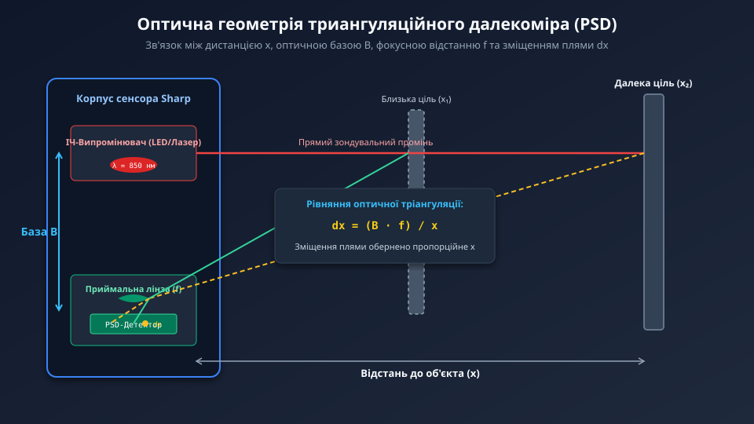
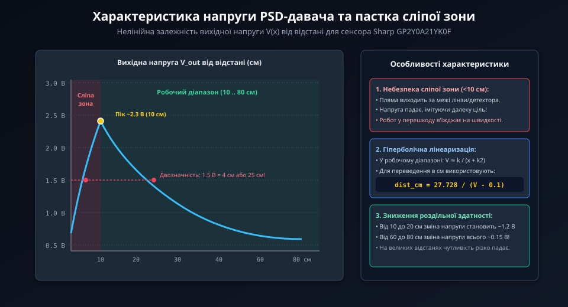
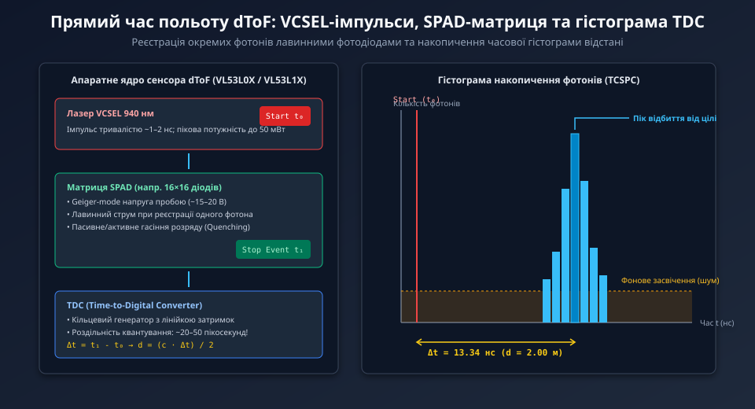
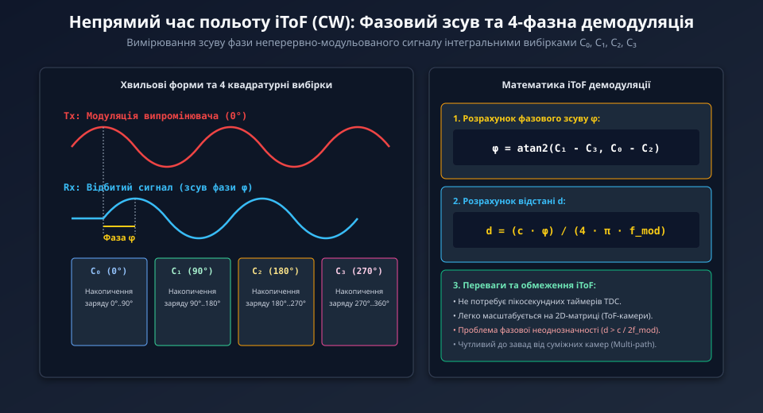
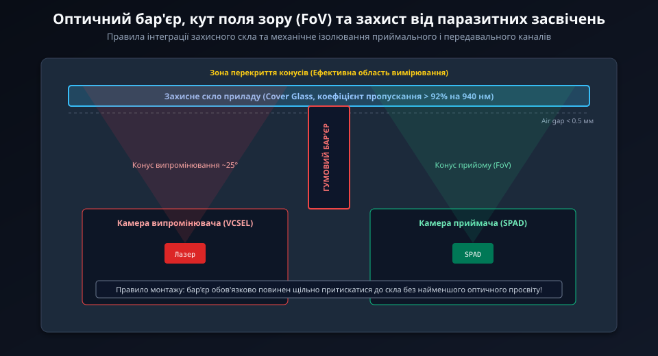

# Оптичні далекоміри: триангуляційні, ToF та амплітудні

Оптичні далекоміри є ключовим класом вимірювальних перетворювачів у робототехніці, безпілотному транспорті та промисловій автоматизації. На відміну від акустичних систем, оптичні прилади оперують електромагнітними хвилями оптичного спектра (переважно ближнього інфрачервоного діапазону NIR 850–940 нм), що забезпечує мінімальну кутову розбіжність променя, надвисоку швидкість вимірювання та здатність працювати з вузькими апертурами.

## 1. Фізичні засади та класифікація оптичних далекомірів

Вимірювання дистанції оптичними методами базується на трьох принципово різних фізико-математичних підходах:

1. **Амплітудний метод (дифузне відбиття):** вимірювання інтенсивності поверненого світлового потоку. Метод надзвичайно простий та дешевий, але фатально залежить від відбивної здатності цілі (альбедо) та кольору поверхні.
2. **Геометрична триангуляція:** визначення відстані за зміщенням зображення світлової плями на просторово-чутливому приймачі (PSD або лінійці CMOS). Забезпечує високу точність на малих відстанях (до 1–1.5 м).
3. **Часопролітний метод (Time-of-Flight, ToF):** базується на часовій затримці розповсюдження фотонів зі швидкістю світла `c ≈ 300 000` км/с. Поділяється на прямий (dToF, вимірювання часу польоту імпульсу) та непрямий (iToF, визначення фазового зсуву гармонійно модульованого світла).

Завдяки прецизійній колімації оптичний промінь має кут розходження менше 1°, що дозволяє виконувати зондування через отвори діаметром лише кілька міліметрів, де ультразвуковий датчик спрацьовує на краї отвору.

## 2. Оптична триангуляція: геометрична основа та гіперболічна нелінійність

В основі триангуляційного далекоміра (типовими представниками якого є модулі серії Sharp GP2Y0A) лежить оптичний трикутник, утворений віссю випромінювача, об'єктом та приймальною лінзою.



Відбите від поверхні світло фокусується лінзою з фокусною відстанню `f` на позиційно-чутливому детекторі (PSD), зміщеному на базову відстань `B` (оптична база):
```
dx / f = B / x
```
Звідси дистанція до об'єкта обчислюється як:
```
x = (B * f) / dx
```

Оскільки вихідний електричний сигнал напруги `V_out` пропорційний лінійному зміщенню плями `dx`, передавальна характеристика сенсора описується гіперболою:
```
V_out ≈ (k / x) + V_0
```

Це викликає дві суттєві інженерні особливості:
- **Нерівномірна роздільна здатність:** висока точність на малих дистанціях різко падає при віддаленні цілі, де зміщення плями співмірне з шумами АЦП.
- **Небезпечна «сліпа зона»:** на відстанях, менших за розрахункову межу (для GP2Y0A21 це 10 см), світлова пляма виходить за край активної зони PSD, і напруга починає різко спадати.



Спад напруги у зоні `x < 10 см` створює двозначність: однаковий рівень напруги спостерігається і на відстані 4 см, і на 30 см, що вимагає апаратного або системного захисту робота від входження у сліпу зону.

## 3. Прямий часопролітний метод (dToF, VCSEL, SPAD, TDC)

Прямий метод часу польоту (Direct Time-of-Flight, dToF) безпосередньо фіксує часовий інтервал `Δt` між лазерним імпульсом та поверненням фотонів:
```
d = (c * Δt) / 2
```
Для досягнення міліметрової роздільної здатності електронний тракт повинен вимірювати інтервали порядку 6.67 пікосекунд (шлях 2 мм).



Сучасні інтегральні dToF-сенсори (наприклад, STMicroelectronics VL53L1X) поєднують три ключові технології:
1. **VCSEL (лазер з вертикальним резонатором):** випромінює імпульси тривалістю менше 1 нс на безпечній для очей довжині хвилі 940 нм.
2. **SPAD (однофотонні лавинні фотодіоди):** працюють у режимі Гейгера при зворотній напрузі, вищій за напругу пробою, генеруючи потужний пікосекундний лавинний імпульс від прильоту поодиноких фотонів.
3. **TDC (перетворювач часу в цифровий код):** високошвидкісна лінія логічних затримок, що фіксує часові позначки прильоту з дискретністю до 10 пс.

Накопичення тисяч відліків у вигляді статистичної часової гістограми дозволяє надійно відокремлювати пік відбиття від цілі від рівномірного фонового сонячного засвічення.

## 4. Непрямий часопролітний метод (iToF) та фазова демодуляція

У сенсорах непрямого часу польоту (Indirect ToF, iToF) лазерний потік модулюється безперервним гармонійним сигналом з частотою `f_m` (зазвичай 10–100 МГц). Часова затримка відбитої хвилі вимірюється через фазовий зсув `Δφ`:
```
Δφ = (4 * π * f_m * d) / c
```
Відстань розраховується за формулою:
```
d = (c * Δφ) / (4 * π * f_m)
```



Для детектування фази використовується квадратурне інтегрування заряду у чотирьох фазових вікнах (0°, 90°, 180°, 270°), де фазовий зсув визначається функцією `arctan2`.

Головним обмеженням iToF є період неоднозначності: максимальна безпомилкова дистанція становить `d_max = c / (2 * f_m)`. Наприклад, для частоти 20 МГц відстань `d_max` дорівнює 7.5 м; будь-який віддаленіший об'єкт створює фазове циклічне накладення.

## 5. Оптичні завади, оптичний кростолк та вибір сенсора

При експлуатації оптичних далекомірів у реальних конструкціях виникають оптичні завади:
- **Фонове сонячне засвічення:** сонячне світло містить потужний інфрачервоний спектр, що спричиняє дробовий шум і насичення фотодетекторів. Застосовують селективні оптичні інтерференційні фільтри 940 нм.
- **Оптичний кростолк (Optical Crosstalk):** паразитарне відбиття частини лазерного випромінювання від захисного скла безпосередньо у приймальну апертуру. Призводить до хибного заниження дистанції. Усувається процедурою калібрування з відніманням рівня кростолку.
- **Поле зору (FoV) та область інтересу (ROI):** можливість програмного вибору підматриці SPAD (наприклад, 4×4 пікселі замість 16×16) для звуження кута огляду та запобігання відбиттям від внутрішніх стінок робототехнічних отворів.



| Параметр / Далекомір | Sharp GP2Y0A21 | VL53L0X | VL53L1X | TOF250 |
| :--- | :--- | :--- | :--- | :--- |
| **Принцип вимірювання** | Оптична триангуляція | Непрямий ToF (iToF) | Прямий ToF (dToF) | ToF з інтегрованим MCU |
| **Робочий діапазон** | 10–80 см | 3–200 см | 4–400 см | 5–250 см |
| **Точність** | ±10–15 мм | ±3–5% | ±1–2% | ±1–3 мм |
| **Вихідний інтерфейс** | Аналогова напруга | Цифровий I2C | Цифровий I2C | UART / I2C |
| **Кут огляду (FoV)** | 3–5° | 25° (фіксований) | 15–27° (налаштовуваний ROI)| 1–2° (колімований) |
| **Стійкість до кольору**| Низька | Висока | Дуже висока | Дуже висока |
