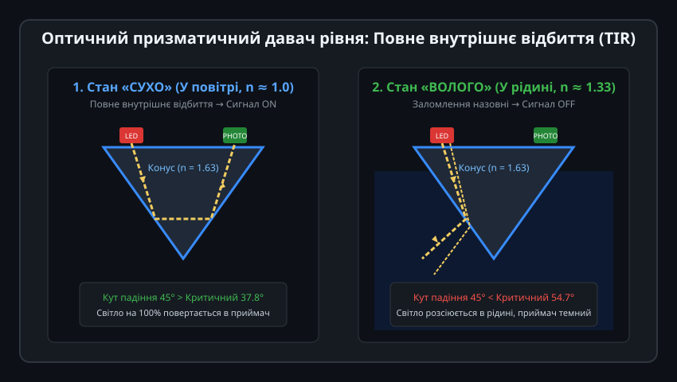
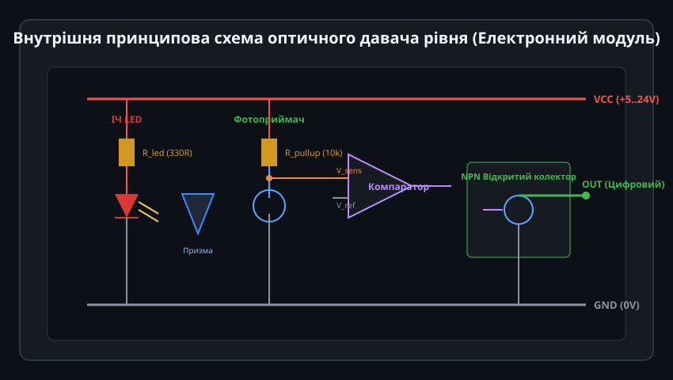
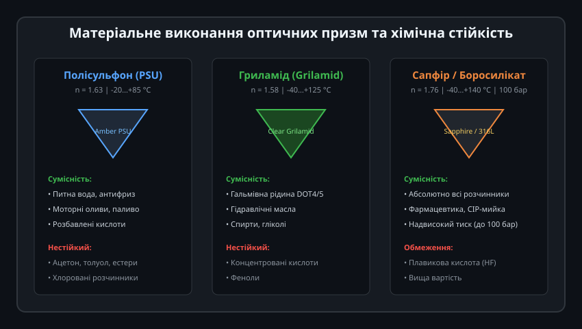
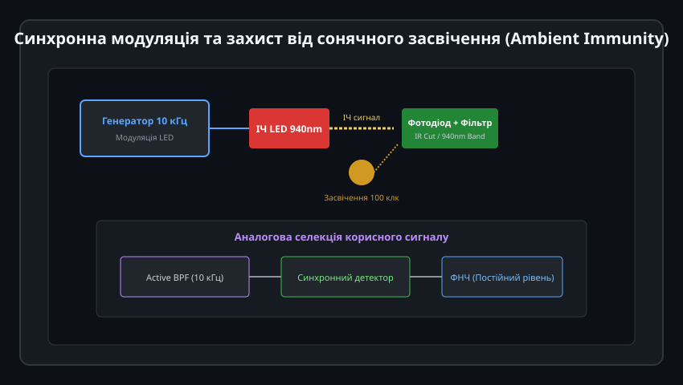
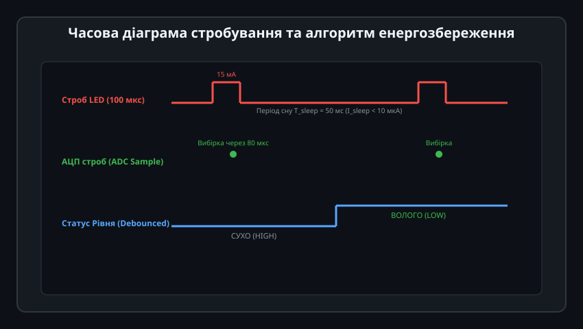

# Поглиблений інженерний аналіз та оптоелектроніка призматичних давачів рівня

Оптичні призматичні сигналізатори рівня є критично важливими компонентами сучасних автоматизованих комплексів, де неприпустима наявність рухомих елементів через ризик заклинювання від накипу, полімеризації середовища або механічного зносу. Висока надійність таких датчиків спирається на точний розрахунок кутової апертури променя, термодинаміку змочування конічної поверхні та цифрову селекцію корисного сигналу.

---

## 1. Хвильова оптика та променевий розрахунок конічного рефлектора

Геометрія випромінювача розраховується з урахуванням діаграми спрямованості світлодіода та розсіювання на криволінійній поверхні конуса:



### Математичний апарат внутрішнього відбиття:
1. **Критичний кут та кутовий розподіл:**
   Для оптичного матеріалу з показником заломлення `n_tip` та зовнішнього середовища з `n_ext`:
   
   sin(theta_c) = n_ext / n_tip

   - Для полісульфону (PSU, `n_tip = 1.633` при довжині хвилі 940 нм) у сухому повітрі (`n_ext = 1.0003`):
     
     theta_c_air = arcsin(1.0003 / 1.633) = 37.77°
     
     Оскільки центральний промінь падає під кутом 45.0°, запас до критичного кута становить `delta_theta = 45.0° - 37.77° = 7.23°`. Навіть промені зі світлодіода з розбіжністю апертури до ±7° зазнають 100% повного внутрішнього відбиття на обох конічних гранях.

   - Для води (`n_ext = 1.328` при 940 нм):
     
     theta_c_water = arcsin(1.328 / 1.633) = 54.41°
     
     Запас кута стає від'ємним: `45.0° < 54.41°`. Повне відбиття неможливе для всього робочого пучка світла.

2. **Енергетичний розрахунок за формулами Френеля:**
   Коефіцієнт відбиття потужності неполяризованого випромінювання на межі призма–вода:
   
   R = 0.5 * [ (sin^2(alpha - beta) / sin^2(alpha + beta)) + (tan^2(alpha - beta) / tan^2(alpha + beta)) ]

   де `alpha = 45°`, а кут заломлення `beta = arcsin((n_tip / n_ext) * sin(45°)) = arcsin(1.229 * 0.7071) ≈ 60.3°`.
   Підставляючи значення, отримуємо `R ≈ 0.018` (лише 1.8% потужності відбивається на першій грані). Після другого відбиття в приймач повертається лише `R^2 ≈ 0.00032` (менше 0.03% початкового світлового потоку).
   Оптичний коефіцієнт контрасту між станами «СУХО» та «ВОЛОГО» перевищує `3000:1`.

---

## 2. Аналоговий інтерфейс (AFE) та схемотехніка компаратора

Перетворення слабкого фотоструму у стабільний логічний сигнал вимагає надійного вхідного підсилювача з температурною стабілізацією:



### Розрахунок порогів перемикання тригера Шмітта:
1. **Струм фототранзистора:**
   - У стані «СУХО»: `I_photo_dry = 0.8...2.5 мА` (насичення).
   - У стані «ВОЛОГО»: `I_photo_wet = 0.5...2.0 мкА` (темновий струм плюс паразитні перевідбиття).
2. **Падіння напруги на навантаженні R_load = 4.7 кОм:**
   - `V_sense_dry = VCC - I_photo_dry * R_load ≈ 0.2...0.8 В` (активний LOW на колекторі).
   - `V_sense_wet = VCC - I_photo_wet * R_load ≈ VCC - 0.01 В` (HIGH).
3. **Гістерезис компаратора:**
   Для запобігання деренчанню від коливань рідини резистивний подільник позитивного зворотного зв'язку встановлює поріг увімкнення `V_th_high = 0.65 * VCC` та поріг вимкнення `V_th_low = 0.45 * VCC`. Ширина петлі гістерезису становить:
   
   V_hyst = V_th_high - V_th_low = 0.20 * VCC (1.0 В за живлення 5 В)

---

## 3. Гідродинаміка краплевідведення та поверхневий натяг

Найскладнішим технологічним викликом для оптичних датчиків є ефект «залипання краплі» (Droplet Clinging) на вершині конуса після різкого спорожнення бака:



### Фізика утримання краплі:
Крапля утримується на конусі за рахунок капілярних сил, описуваних рівнянням Юнга-Дюпре:

F_capillary = pi * D_drop * gamma_liquid * cos(theta_contact)

де:
- `gamma_liquid` — питомий поверхневий натяг (для води `0.0728 Н/м`, для олив `0.025–0.035 Н/м`),
- `theta_contact` — крайовий кут змочування матеріалу призми.

### Методи ліквідації краплинного залипання:
1. **Гідрофобізація поверхні:** Нанесення фторполімерного покриття (Teflon AF) збільшує кут змочування `theta_contact > 115°`. Вода скочується з конуса під дією власної ваги за соті частки секунди.
2. **Геометрія вершини:** Вершина конуса виконується гострою з радіусом скруглення `R_tip < 0.15 мм`. Це мінімізує площу горизонтальної контактної площадки, на якій могла б зависнути мікрокрапля.
3. **Орієнтація при монтажі:**
   - *Ідеально:* Горизонтальний монтаж у стінку бака або вертикальний монтаж конусом строго донизу.
   - *Заборонено:* Вертикальний монтаж конусом догори (у заглибині конуса гарантовано збережеться калюжка конденсату).

---

## 4. Синхронна модуляція та оптична селекція сигналу

Для захисту від сонячного засвічення (до 100 000 лк) та випромінювання нагрівачів застосовують апаратну фазову селекцію:



### Архітектура синхронного детектора:
1. Світлодіод модулюється прямокутними імпульсами частотою `f_mod = 10 кГц` зі шпаруватістю 50%.
2. Фотоприймач сприймає сумарне випромінювання:
   
   S_total(t) = S_signal * square(2*pi*f_mod*t) + S_sun(t) + S_lamp(100Hz)

3. Вхідний активний смуговий фільтр 2-го порядку (Multiple Feedback Bandpass) налаштований на центральну частоту 10 кГц із добротністю `Q = 8`. Він пригнічує постійну складову сонця та фонову пульсацію 100 Гц штучного освітлення на 60–80 дБ.
4. Синхронний аналоговий комутатор перемножує відфільтрований сигнал на опорний сигнал модуляції, виділяючи чистий постійний рівень корисної амплітуди.

---

## 5. Промисловий C++ драйвер: енергозбереження, стробування та самодіагностика

Для інтеграції в низькоспоживаючі мікроконтролерні пристрої (ESP32, STM32, Nordic nRF) розроблено клас `OpticalPrismLevelSensor`.



### Архітектура драйвера:
Драйвер керує піном живлення світлодіода (Strobe Pin), виконує затримку встановлення фотоструму, зчитує аналоговий рівень АЦП, проводить діагностику старіння випромінювача та фільтрує випадкові бризки за допомогою лічильника збігів (Debounce Counter).

```cpp
/**
 * @file OpticalPrismLevelSensor.hpp
 * @brief Драйвер електрооптичного призматичного давача рівня з імпульсним стробуванням
 */

#pragma once

#include <stdint.h>
#include <stddef.h>

enum class LiquidState : uint8_t {
    DRY = 0,         ///< Сухий наконечник (рідина нижче рівня)
    WET,             ///< Занурений у рідину (рівень досягнуто)
    ERROR_LED_FAIL,  ///< Аварія: деградація або обрив світлодіода (занадто малий струм у повітрі)
    ERROR_PRISM_FOUL ///< Аварія: сильне оптичне забруднення / осад на конусі
};

class OpticalPrismLevelSensor {
public:
    /**
     * @param debounce_samples Кількість послідовних збігів для підтвердження зміни стану
     * @param adc_wet_threshold_mv Поріг напруги (мВ) нижче якого фіксується занурення
     */
    OpticalPrismLevelSensor(uint8_t debounce_samples = 4, uint16_t adc_wet_threshold_mv = 1200)
        : debounce_threshold_(debounce_samples),
          wet_threshold_mv_(adc_wet_threshold_mv),
          current_state_(LiquidState::DRY),
          consecutive_wet_count_(0),
          consecutive_dry_count_(0),
          last_raw_voltage_mv_(0) {}

    /**
     * @brief Крок стробування та вимірювання (викликається періодично, наприклад раз на 100 мс)
     * @param raw_adc_mv Напруга фотоприймача у мілівольтах після включення стробу
     */
    void processStrobeSample(uint16_t raw_adc_mv) {
        last_raw_voltage_mv_ = raw_adc_mv;

        // Діагностика працездатності сенсора (Self-test)
        // Якщо напруга в повітрі аномально низька (наприклад, LED перегорів або забруднення)
        if (raw_adc_mv < 150) {
            current_state_ = LiquidState::ERROR_LED_FAIL;
            return;
        }

        // Класифікація поточного миттєвого відліку
        if (raw_adc_mv < wet_threshold_mv_) {
            // Фототранзистор відкритий менше -> світло розсіялося в рідині
            consecutive_wet_count_++;
            consecutive_dry_count_ = 0;

            if (consecutive_wet_count_ >= debounce_threshold_) {
                current_state_ = LiquidState::WET;
            }
        } else {
            // Повне внутрішнє відбиття в повітрі -> високий фотострум
            consecutive_dry_count_++;
            consecutive_wet_count_ = 0;

            if (consecutive_dry_count_ >= debounce_threshold_) {
                current_state_ = LiquidState::DRY;
            }
        }
    }

    LiquidState getState() const { return current_state_; }
    bool isLiquidPresent() const { return current_state_ == LiquidState::WET; }
    uint16_t getLastVoltageMv() const { return last_raw_voltage_mv_; }

    /**
     * @brief Перевірка дрейфу оптичної системи (діагностика старіння LED)
     * @return true якщо коефіцієнт відбиття в повітрі знизився більш ніж на 35%
     */
    bool checkAgingWarning(uint16_t baseline_dry_mv) const {
        if (current_state_ == LiquidState::DRY && baseline_dry_mv > 0) {
            return (last_raw_voltage_mv_ < (baseline_dry_mv * 65 / 100));
        }
        return false;
    }

private:
    uint8_t debounce_threshold_;
    uint16_t wet_threshold_mv_;
    LiquidState current_state_;
    uint8_t consecutive_wet_count_;
    uint8_t consecutive_dry_count_;
    uint16_t last_raw_voltage_mv_;
};
```

Такий підхід забезпечує довготривалу стабільність вимірювання, виключає хибні тривоги від кавітаційних бульбашок у рідині та попереджає оператора про необхідність профілактичного очищення призми задовго до настання критичної відмови.
