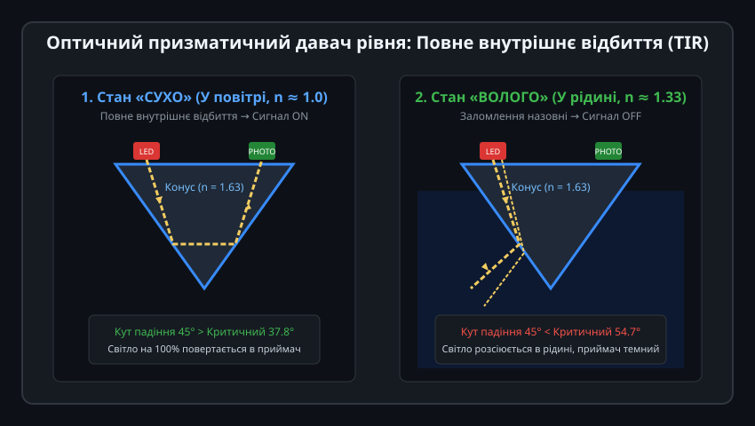
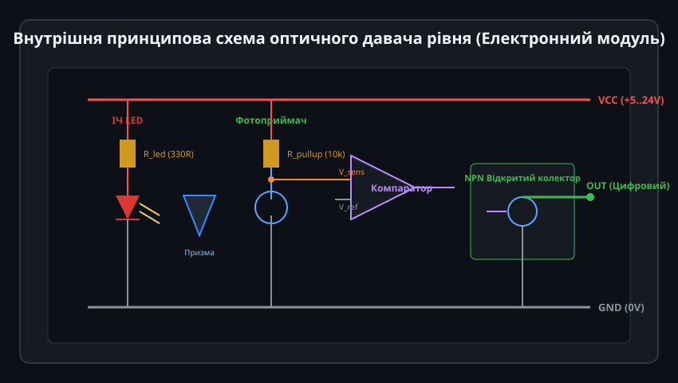
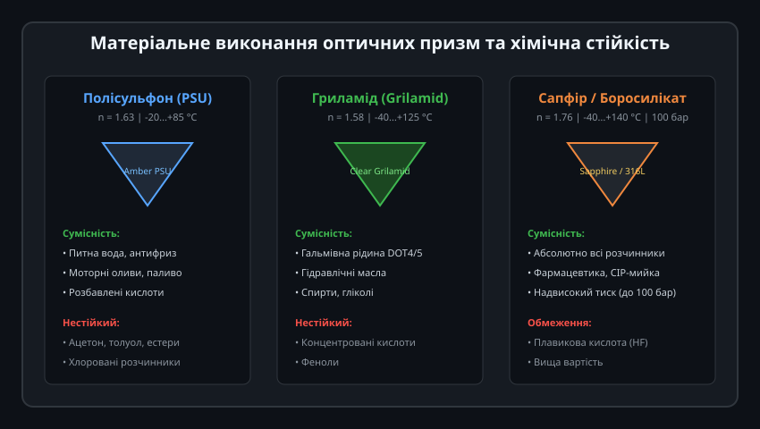
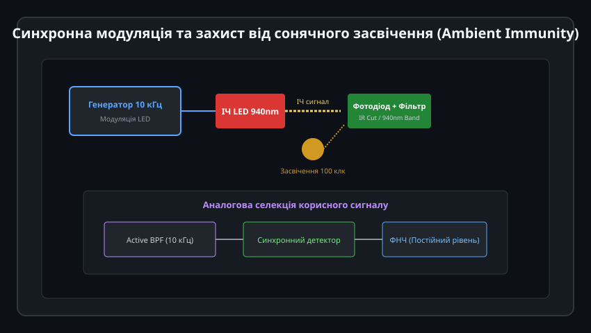
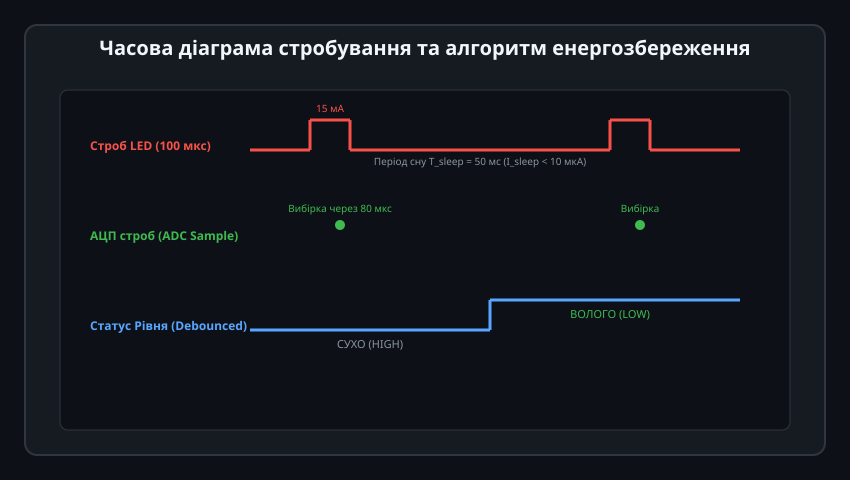

# Оптичний призматичний давач рівня

Оптичні призматичні (електрооптичні) давачі рівня — це надкомпактні твердотільні прилади, призначені для швидкого та високоточного визначення наявності або відсутності рідини в точці монтажу. Завдяки відсутності рухомих механічних деталей (поплавків, важелів, пружин) вони мають практично необмежений ресурс комутацій, не бояться вібрацій, турбулентності та налипання осаду, що робить їх незамінними в медичній апаратурі, автомобільних системах та компактних промислових резервуарах.

---

## 1. Фізичний принцип повного внутрішнього відбиття у конічній призмі

Робота давача базується на явищі порушення повного внутрішнього відбиття (Total Internal Reflection, TIR) при зміні оптичної густини зовнішнього середовища:

### Оптичний шлях у конусі:
Чутливий наконечник давача є прозорою конічною призмою з кутом при вершині рівно 90°. Усередині герметичного корпусу безпосередньо над призмою встановлені мініатюрний інфрачервоний світлодіод (довжина хвилі 850–940 нм) та кремнієвий фототранзистор.

1. **Сухий стан (у повітрі, n_повітря ≈ 1.00):**
   - Показник заломлення матеріалу призми (полісульфону або скла) становить `n_призма ≈ 1.63`.
   - За законом Снеліуса критичний кут повного внутрішнього відбиття дорівнює:
     
     theta_c = arcsin(1.00 / 1.63) ≈ 37.8°

   - Промінь від світлодіода падає на внутрішню похилу грань конуса під кутом 45°. Оскільки 45° > 37.8°, світло повністю відбивається на 90°, прямує до протилежної грані конуса, повторно відбивається під кутом 45° і фокусується точно на чутливу площадку фототранзистора.
   - Фототранзистор відкривається, формуючи високий логічний рівень сигналу на внутрішньому підсилювачі.

2. **Занурений стан (у рідині: вода n ≈ 1.33, масло n ≈ 1.42...1.48):**
   - Оптична густина рідини наближається до густини матеріалу призми, тому критичний кут значно зростає:
     
     theta_c = arcsin(1.33 / 1.63) ≈ 54.7°

   - Тепер кут падіння 45° стає меншим за критичний кут (45° < 54.7°). Умови повного відбиття порушуються: промінь світла заломлюється назовні крізь поверхню конуса і розсіюється в об'ємі рідини.
   - Фототранзистор залишається закритим, і вихідний сигнал датчика перемикається в протилежний логічний стан.

---

## 2. Схемотехніка та внутрішня електроніка

Сучасний оптоелектронний датчик рівня об'єднує в єдиному мініатюрному корпусі оптичні компоненти, стабілізатор струму та вихідний ключ:

### Функціональні вузли схеми:
- **Драйвер ІЧ-світлодіода:** Живить випромінювач стабільним струмом 10–20 мА незалежно від флуктуацій напруги живлення в діапазоні від 4.5 В до 24 В постійного струму.
- **Фотоприймач із навантажувальним резистором:** Перетворює оптичний потік відбитого світла у падіння напруги `V_sense`.
- **Компаратор із гістерезисом (тригер Шмітта):** Порівнює напругу сенсора з фіксованим порогом `V_ref`. Гістерезис 50–100 мВ запобігає деренчанню вихідного сигналу при виникненні хвиль, бризок або піни на поверхні рідини.
- **Вихідний каскад:** Зазвичай виконується за схемою NPN або PNP з відкритим колектором (Open Collector), що дозволяє безпосередньо комутувати котушки реле, лампи сигналізації або входи промислових контролерів PLC (до 100–200 мА).

---

## 3. Матеріальне виконання та хімічна сумісність

Надійність роботи давача визначається правильним підбором матеріалу прозорого конуса та корпусу під конкретне хімічне середовище:

| Матеріал наконечника | Показник n | Діапазон температур | Максимальний тиск | Сумісні рідини |
| :--- | :--- | :--- | :--- | :--- |
| **Полісульфон (PSU)** | 1.63 | -20...+85 °C | До 10 бар | Вода, антифриз, моторні оливи, паливо, соки |
| **Гриламід (Grilamid TR55)** | 1.58 | -40...+125 °C | До 25 бар | Гальмівна рідина DOT4/5, гідравлічні масла, гліколь |
| **Боросилікатне скло / Сапфір** | 1.76 | -40...+140 °C | До 100 бар | Агресивні кислоти, розчинники, фармацевтичні препарати |

- **Краплеутворення та гідрофобність:** Якщо рідина високов'язка (наприклад, сироп або мастило), після зниження рівня на кінчику конуса може залишитися висяча крапля, що призведе до затримки спрацьовування. Для боротьби з цим застосовують гідрофобні фторполімерні нанопокриття або вертикальну орієнтацію сенсора конусом донизу.

---

## 4. Захист від оптичних завад та синхронна модуляція

Пряме сонячне світло, люмінесцентні лампи або зварювальні дуги можуть засвічувати фотоприймач крізь напівпрозору стінку бака, спричиняючи хибне спрацьовування датчика.

### Методи підвищення завадостійкості:
1. **Оптична фільтрація:** Фототранзистор оснащується вбудованим оптичним світлофільтром денного світла (Black Epoxy Daylight Filter), який відсікає видимий спектр світла (400–700 нм) і пропускає лише вузьку смугу інфрачервоного діапазону (880–950 нм).
2. **Синхронна модуляція:**
   - Замість постійного горіння ІЧ-світлодіод живиться пачками коротких імпульсів високої частоти (наприклад, 10 кГц).
   - Сигнал із фотоприймача проходить через активний смуговий фільтр (Bandpass Filter) і надходить на синхронний демодулятор.
   - Постійна складова від сонячного освітлення (навіть 100 000 люкс) повністю ігнорується приймальним трактом.

---

## 5. Програмне керування та стробування для енергозбереження

У бездротових автономних пристроях моніторингу (батарейні рівнеміри з передачею по LoRaWAN або NB-IoT) неперервна робота світлодіода зі струмом 15 мА швидко розряджає батарею. Для оптимізації застосовують імпульсне стробування живлення:

### Принцип стробування:
1. Контролер перебуває в режимі глибокого сну (Deep Sleep, споживання < 5 мкА).
2. За таймером (наприклад, раз на секунду або раз на 50 мс) контролер прокидається і подає короткий імпульс живлення на сенсор тривалістю всього 100 мкс.
3. Через 80 мкс (після стабілізації перехідних процесів фототранзистора) здійснюється швидке зчитування логічного рівня або оцифровка АЦП.
4. Сенсор миттєво знеструмлюється, а контролер аналізує результат.
5. **Результат:** Середній струм споживання падає з 15 мА до мізерних 15–30 мкА, забезпечуючи до 5–10 років автономної роботи датчика від одного літієвого елемента CR123A.
