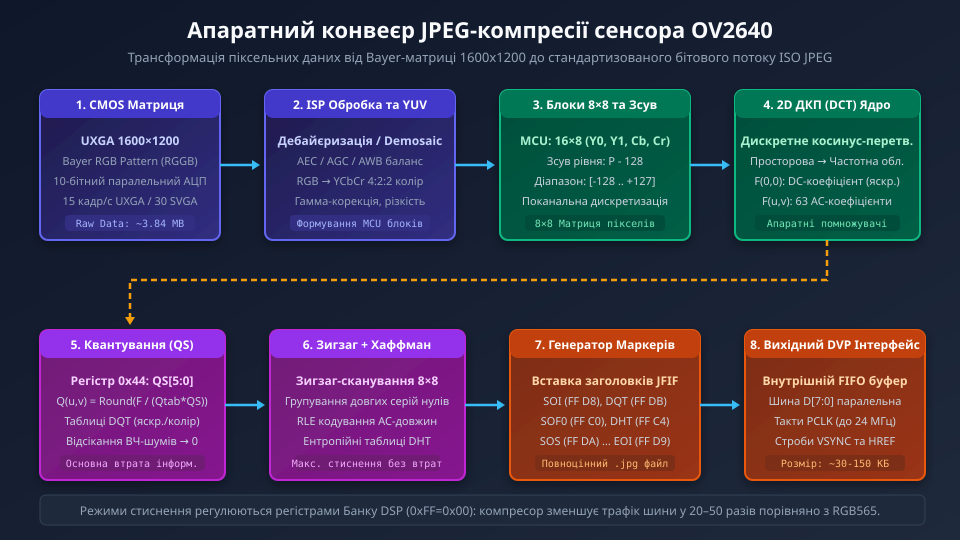
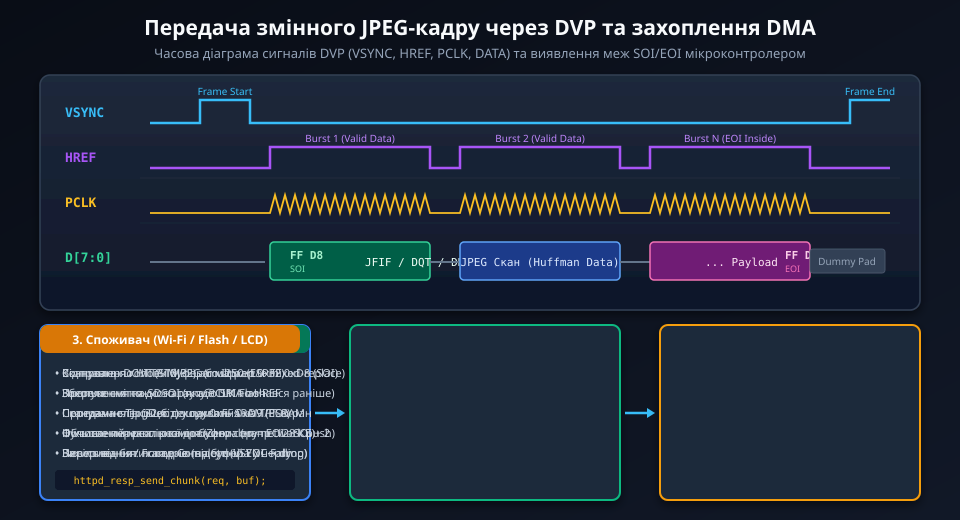
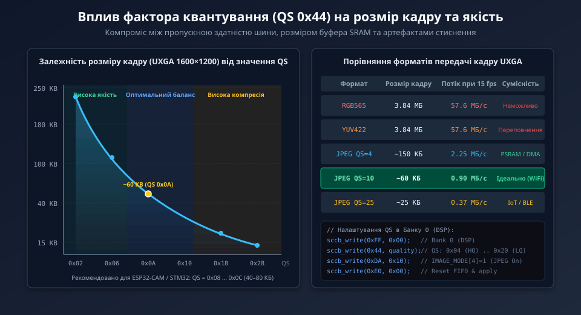

# Низькорівневе керування та архітектура JPEG-кодека OV2640

Апаратний блок стиснення сенсора OV2640 являє собою спеціалізований ASIC-співпроцесор цифрової обробки сигналів (DSP), інтегрований на один кристал з аналоговою фоточутливою матрицею та блоком аналогово-цифрових перетворювачів. Його робота вимагає точного конфігурування регістрів Банку 0, синхронізації тактових генераторів та оптимізації драйвера прийому DMA на стороні мікроконтролера.

## 1. Математичні та алгоритмічні основи апаратного кодека

Апаратне стиснення JPEG в OV2640 виконується відповідно до базового стандарту ISO/IEC 10918-1 (Baseline JPEG) з послідовним порядком сканування дискретних блоків:

1. **Колірна субдискретизація YCbCr 4:2:2:**
   Людська зорова система значно менш чутлива до просторової роздільної здатності кольору, ніж до яскравості. Сенсор виконує проріджування колірних компонентів Cb та Cr у горизонтальному напрямку. Мінімальна кодована одиниця (MCU) розміром 16x8 пікселів кодується чотирма блоками 8x8: два блоки яскравості Y0 та Y1, один спільний блок різниці синього Cb та один спільний блок різниці червоного Cr.

2. **Двовимірне дискретне косинусне перетворення (2D-DCT):**
   Кожен блок пікселів 8x8 зі зміщеним рівнем яскравості f(x, y) у діапазоні [-128 .. +127] перетворюється у частотну матрицю F(u, v) розміром 8x8:
   ```
   F(u, v) = 0.25 * C(u) * C(v) * SUM_{x=0..7} SUM_{y=0..7} [ f(x, y) * cos((2x + 1)*u*pi / 16) * cos((2y + 1)*v*pi / 16) ]
   де C(k) = 1/sqrt(2) при k = 0, та C(k) = 1 при k > 0.
   ```
   У кремнієвому ядрі сенсора обчислення DCT оптимізовано за модифікованим швидким алгоритмом Арая, Агіллара та Оукі (AAN), де замість повнорозмірних ділень з рухомою комою використовуються фіксовані цілочисельні зсуви та конвеєрні апаратні адитивні помножувачі.

3. **Квантування та нормалізація:**
   Отримані частотні коефіцієнти діляться на елементи стандартної психовізуальної таблиці квантування Q(u, v), помноженої на глобальний коефіцієнт якості QS:
   ```
   F_quant(u, v) = Round( F(u, v) / (Q_table(u, v) * QS) )
   ```
   Оскільки більшість високочастотних складових після квантування стають нульовими, інформація суттєво стискається при збереженні ключових візуальних контурів зображення.



## 2. Карта регістрів Банку 0 (DSP) для ініціалізації JPEG

Сенсор OV2640 має дворівневу карту регістрів, розділену на Банк 1 (Sensor Core) та Банк 0 (DSP / Image Pipeline). Перемикання між ними здійснюється записом адреси банку в спільний регістр `0xFF` (`RA_DLMT`). Всі регістри, відповідальні за компресію JPEG, розташовані у Банку 0.

| Адреса (Bank 0) | Назва регістру | Біти / Поле | Опис та функціональне призначення |
| :--- | :--- | :--- | :--- |
| **0xFF** | `RA_DLMT` | `[0]` | Перемикання банків: `0x00` вибирає Банк 0 (DSP), `0x01` вибирає Банк 1. |
| **0xDA** | `IMAGE_MODE` | `[4]` | `JPEG_EN`: біт 4 активує вихідний потік апаратного JPEG. `0x10` вмикає компресор. |
| **0x44** | `QS` | `[5:0]` | `QUANT_SCALE`: фактор масштабування квантування. Значення 0x01..0x3F. |
| **0xD7** | `CODEC_CTRL` | `[7:0]` | Керування вбудованим кодеком: увімкнення енкодера та синхронізації FIFO (`0x03`). |
| **0xE0** | `RESET` | `[2:0]` | Програмне скидання та оновлення конфігурації: біт 2 скидає FIFO, запис `0x00` очищає прапорці. |
| **0x05** | `CTRL0` | `[7:0]` | Керування тактовим трактом DSP: множники частоти обчислювального блоку. |
| **0x5A** | `BYPASS0` | `[7:0]` | Обхід внутрішніх блоків корекції при прямій подачі YUV на компресор. |

Конфігураційна послідовність для активації виходу JPEG:
1. Запис `0xFF = 0x00` — активація банку DSP.
2. Запис масиву коефіцієнтів масштабування та таблиць роздільної здатності (UXGA, SVGA, VGA, QVGA).
3. Налаштування регістру `0xDA = 0x10` для перемикання мультиплексора вихідного формату на потік JPEG.
4. Встановлення бажаного фактора стиснення у регістр `0x44` (наприклад, `0x0A` для збалансованої якості).
5. Скидання та ініціалізація внутрішнього буфера FIFO через регістр `0xE0`.

## 3. Часова організація шини DVP та сигнальні обмеження

Шина DVP (Digital Video Port) сенсора при видачі JPEG-кадру істотно змінює логіку поведінки стробів порівняно зі стандартним нестисненим режимом:



- **Пакетний режим стробу HREF:**
  У режимі JPEG сигнал HREF більше не позначає фіксовані рядки пікселів матриці. Замість цього HREF виступає стробом валідності пакета (Burst Data Valid). Поки внутрішній буфер FIFO сенсора містить скомпресовані байти бітового потоку, HREF утримується у високому рівні, і на кожен перепад тактового сигналу PCLK на шині D[7:0] видається 1 байт. Коли FIFO вичерпується або кодек чекає завершення обчислення наступного блоку MCU, HREF опускається в логічний нуль.

- **Синхронізація кадру за сигналом VSYNC:**
  Початок передачі нового кадру завжди позначається наростаючим фронтом VSYNC. Після завершення кадру VSYNC спадає в логічний нуль. Тривалість активного стану VSYNC відповідає всьому процесу видачі стисненого файлу.

- **Формування та пошук обов'язкових маркерів JFIF:**
  Сенсор формує легітимний заголовок та маркери структури JPEG:
  - `0xFF 0xD8` — **SOI (Start of Image):** позначає точний початок корисних даних.
  - `0xFF 0xDB` — **DQT (Define Quantization Table):** таблиці квантування яскравості та хроматичності.
  - `0xFF 0xC0` — **SOF0 (Start of Frame, Baseline DCT):** розміри зображення у пікселях, глибина кольору та кількість компонентів (3 компоненти: Y, Cb, Cr).
  - `0xFF 0xC4` — **DHT (Define Huffman Table):** таблиці кодів Хаффмана змінної довжини.
  - `0xFF 0xDA` — **SOS (Start of Scan):** заголовок ентропійного скану, після якого йде стиснений потік байтів.
  - `0xFF 0xD9` — **EOI (End of Image):** обов'язковий маркер завершення зображення. За цим маркером обчислюється точний розмір прийнятого файлу.

## 4. Оптимізація фактора квантування (QS) та керування пропускною здатністю

Регістр `0x44` (`QS`) безпосередньо впливає на компресію: чим більше значення, тим сильніше квантування, менший розмір файлу та помітніші артефакти.



Для систем на мікроконтролерах вибір значення QS визначається фізичними обмеженнями каналу передачі та обсягом доступної оперативної пам'яті:

```
+-----------+---------------+------------------+-------------------+----------------------------+
|  QS (hex) |  Якість (Q)   | UXGA Розмір (КБ) | Піковий бітрейт   | Рекомендоване застосування |
+-----------+---------------+------------------+-------------------+----------------------------+
|  0x02..05 | Дуже висока   | 140 .. 220 КБ    | > 3.0 МБ/с        | Фотофіксація на SD-карту   |
|  0x06..0C | Збалансована  | 50 .. 90 КБ      | 0.8 .. 1.4 МБ/с   | Wi-Fi MJPEG стримінг 15fps |
|  0x0D..18 | Помірна       | 30 .. 50 КБ      | 0.4 .. 0.7 МБ/с   | Хмарна телеметрія, Web     |
|  0x19..3F | Низька        | 12 .. 25 КБ      | < 0.3 МБ/с        | BLE / Cellular IoT канали  |
+-----------+---------------+------------------+-------------------+----------------------------+
```

Для запобігання переповненню буфера пам'яті (Buffer Overflow) у динамічних сценах з великою кількістю дрібних високочастотних деталей (наприклад, листя дерев або вода) прошивка мікроконтролера може реалізовувати алгоритм динамічного керування бітрейтом (Rate Control): якщо розмір попереднього кадру перевищив 80 КБ, значення регістра QS збільшується на 2 одиниці; якщо впав нижче 40 КБ — зменшується.

## 5. Драйвер захоплення та валідації JPEG на мові C

Нижче наведено практичну реалізацію драйвера на мові C для ініціалізації режиму JPEG в OV2640, прийому кадру через контролер DMA та безпечного виділення чистого JPEG-файлу з пошуком маркерів SOI та EOI.

```c
#include <stdint.h>
#include <stdbool.h>
#include <string.h>

/* Базові константи та маркери JPEG */
#define OV2640_SCCB_ADDR       0x60
#define OV2640_BANK_REG        0xFF
#define OV2640_BANK_DSP        0x00
#define OV2640_BANK_SENSOR     0x01

#define REG_DSP_QS             0x44
#define REG_DSP_IMAGE_MODE     0xDA
#define REG_DSP_RESET          0xE0

#define JPEG_MARKER_PREFIX     0xFF
#define JPEG_MARKER_SOI        0xD8
#define JPEG_MARKER_EOI        0xD9

/* Структура результату захоплення кадру */
typedef struct {
    uint8_t  *data_ptr;     /* Вказівник на початок валідного кадру (SOI) */
    uint32_t  data_length;  /* Точна довжина JPEG файлу в байтах */
    bool      is_valid;     /* Ознака успішного знаходження SOI та EOI */
} jpeg_frame_desc_t;

/* Прототипи апаратних функцій шини SCCB/I2C */
extern bool sccb_write_byte(uint8_t dev_addr, uint8_t reg_addr, uint8_t val);

/**
 * @brief  Ініціалізація та налаштування коефіцієнта стиснення JPEG
 * @param  quality_scale: значення квантування QS (0x02 - макс. якість, 0x20 - макс. стиснення)
 * @retval true при успішній конфігурації
 */
bool ov2640_set_jpeg_quality(uint8_t quality_scale)
{
    /* 1. Перемикаємося на Банк 0 (DSP) */
    if (!sccb_write_byte(OV2640_SCCB_ADDR, OV2640_BANK_REG, OV2640_BANK_DSP)) {
        return false;
    }

    /* 2. Записуємо бажаний фактор квантування у регістр QS */
    if (!sccb_write_byte(OV2640_SCCB_ADDR, REG_DSP_QS, quality_scale)) {
        return false;
    }

    /* 3. Переконуємося, що прапорець JPEG активний у регістрі IMAGE_MODE */
    if (!sccb_write_byte(OV2640_SCCB_ADDR, REG_DSP_IMAGE_MODE, 0x10)) {
        return false;
    }

    /* 4. Скидаємо вбудований FIFO буфер для запобігання артефактам */
    sccb_write_byte(OV2640_SCCB_ADDR, REG_DSP_RESET, 0x04);
    sccb_write_byte(OV2640_SCCB_ADDR, REG_DSP_RESET, 0x00);

    return true;
}

/**
 * @brief  Парсинг та верифікація JPEG-буфера, отриманого від DMA
 * @param  raw_dma_buffer: вказівник на вирівняний буфер прийому DMA
 * @param  max_captured_bytes: кількість байтів, перенесена DMA за час кадру
 * @param  out_frame: вихідний дескриптор з точними координатами кадру
 * @retval true якщо знайдено цілісний кадр з маркерами SOI та EOI
 */
bool ov2640_parse_jpeg_stream(uint8_t *raw_dma_buffer, 
                              uint32_t max_captured_bytes, 
                              jpeg_frame_desc_t *out_frame)
{
    if (raw_dma_buffer == NULL || max_captured_bytes < 128 || out_frame == NULL) {
        return false;
    }

    out_frame->data_ptr = NULL;
    out_frame->data_length = 0;
    out_frame->is_valid = false;

    /* 1. Пошук маркера початку кадру SOI (0xFF, 0xD8) у перших 256 байтах */
    uint32_t soi_idx = 0;
    bool soi_found = false;
    uint32_t search_limit = (max_captured_bytes > 512) ? 512 : max_captured_bytes - 1;

    for (uint32_t i = 0; i < search_limit; i++) {
        if (raw_dma_buffer[i] == JPEG_MARKER_PREFIX && raw_dma_buffer[i + 1] == JPEG_MARKER_SOI) {
            soi_idx = i;
            soi_found = true;
            break;
        }
    }

    if (!soi_found) {
        return false; /* Кадр пошкоджено або захоплення почалося невчасно */
    }

    /* 2. Пошук маркера кінця кадру EOI (0xFF, 0xD9) від кінця буфера назад */
    uint32_t eoi_idx = 0;
    bool eoi_found = false;

    for (int32_t i = (int32_t)(max_captured_bytes - 2); i >= (int32_t)soi_idx; i--) {
        if (raw_dma_buffer[i] == JPEG_MARKER_PREFIX && raw_dma_buffer[i + 1] == JPEG_MARKER_EOI) {
            eoi_idx = (uint32_t)i;
            eoi_found = true;
            break;
        }
    }

    if (!eoi_found) {
        return false; /* Передача перервана, EOI відсутній */
    }

    /* 3. Формуємо валідний дескриптор кадру */
    out_frame->data_ptr = &raw_dma_buffer[soi_idx];
    out_frame->data_length = (eoi_idx - soi_idx) + 2; /* Довжина включає байти 0xFF 0xD9 */
    out_frame->is_valid = true;

    return true;
}
```
