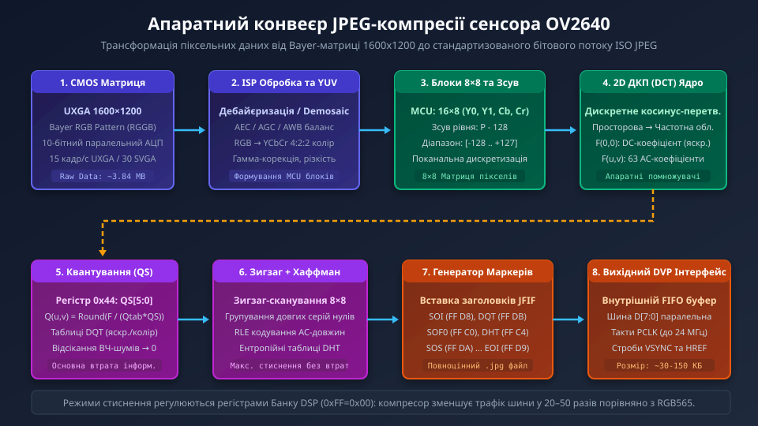
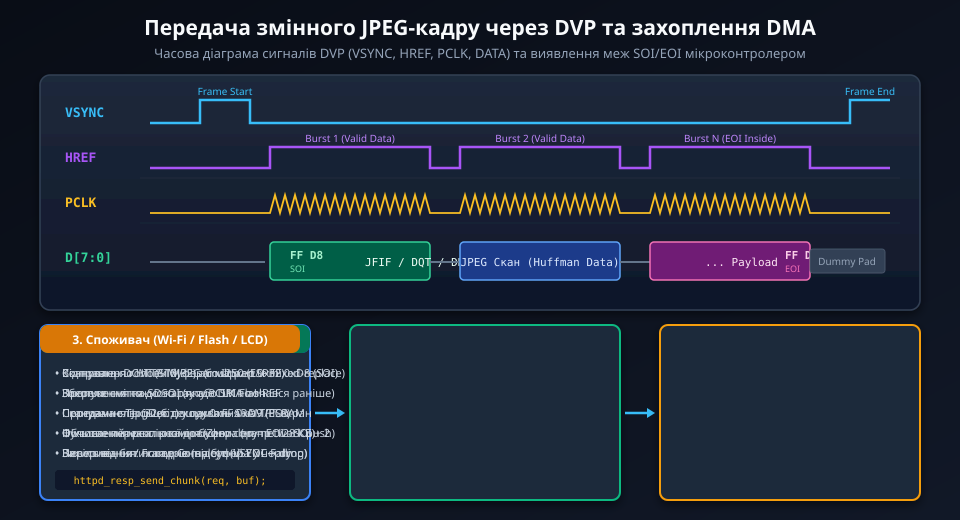
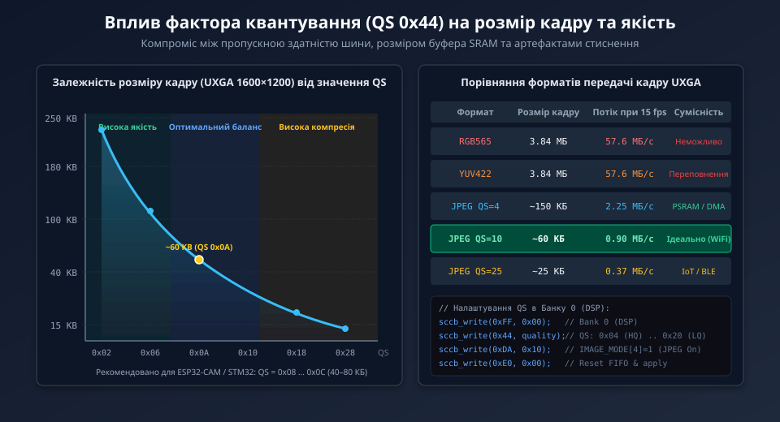

# Апаратний JPEG-компресор сенсора OV2640

Сенсор OmniVision OV2640 містить інтегрований апаратний кодек JPEG, що революціонізував вбудовані системи комп'ютерного зору на мікроконтролерах. Замість передачі гігантських нестиснених потоків RGB565 чи YUV422, сенсор здійснює компресію кадру безпосередньо на кристалі та видає готовий стандартизований потік ISO JPEG через паралельну шину DVP.

## 1. Архітектура та призначення апаратного компресора

У класичних мікроконтролерних системах без зовнішньої швидкісної шини пам'яті отримання якісного фотографічного зображення високої роздільної здатності є критичною апаратною проблемою. Нестиснений кадр роздільної здатності UXGA (1600x1200 пікселів) у 16-бітному форматі RGB565 займає 3.84 МБ пам'яті. Жоден стандартний мікроконтролер (ESP32, STM32F4/F7) не має такого обсягу внутрішнього SRAM, а пропускна здатність шин не дозволяє перекачувати десятки мегабайтів щосекунди.

Інтеграція ядра JPEG безпосередньо у кристал OV2640 вирішує цю проблему на апаратному рівні:
- **Зменшення обсягу даних у 20–50 разів:** стиснений UXGA кадр займає від 30 до 150 КБ залежно від складності сцени та обраного коефіцієнта квантування.
- **Звільнення ядра мікроконтролера:** процесор позбавляється необхідності виконувати ресурсоємні матричні операції дискретного косинусного перетворення (DCT) та кодування Хаффмана.
- **Пряма трансляція у мережу:** сформований бітовий потік вже містить усі стандартні маркери заголовка JFIF (SOI, DQT, DHT, SOF0, SOS, EOI) і може передаватися клієнтам по Wi-Fi або зберігатися на SD-карту без додаткової конвертації.

## 2. Етапи апаратного конвеєра стиснення

Апаратний конвеєр стиснення всередині OV2640 працює потоково, обробляючи пікселі синхронно зі зчитуванням з матриці:

1. **Колірна інтерполяція та трансформація в YCbCr:** сирі дані пікселів з кольорового фільтра Байєра (RGGB) проходять внутрішній процесор сигналів зображення (ISP), де виконується дебайєризація, корекція гами та перетворення у колірний простір YCbCr (4:2:2).
2. **Формування мінімальних кодованих одиниць (MCU):** зображення розбивається на блоки 8x8 пікселів. Для субдискретизації 4:2:2 базова одиниця MCU складається з двох блоків яскравості (Y0, Y1) та двох блоків колірності (Cb, Cr).
3. **Двовимірне дискретне косинусне перетворення (2D-DCT):** матриця просторових значень кожного блоку 8x8 трансформується у частотну область. Нижні частоти (основний колір та плавні переходи) групуються у лівому верхньому кутку матриці (коефіцієнт DC), тоді як високочастотні деталі та шум розташовуються у правій нижній частині (коефіцієнти AC).
4. **Квантування за таблицями DQT:** коефіцієнти DCT діляться на значення матриці квантування та заокруглюються до найближчого цілого. На цьому етапі відбувається керована втрата інформації: малопомітні людському оку високі частоти обнуляються.
5. **Зигзаг-сканування та ентропійне кодування:** ненульові та нульові коефіцієнти обходяться за зигзагоподібною траєкторією, кодуються довжинами серій нулів (RLE) та стискаються статичними таблицями Хаффмана (DHT).
6. **Упаковка бітового потоку у FIFO:** сформовані байти кадру з маркерами оформлюються у вихідний буфер FIFO та виставляються на такти PCLK паралельної шини.

## 3. Часові діаграми DVP та захоплення змінного кадру

На відміну від передачі нестисненого відео (де кожен рядок має суворо фіксовану кількість тактів PCLK і байтів), розмір JPEG-кадру є динамічним і змінюється від кадру до кадру залежно від деталізації сцени.

Сенсор формує кадр через цифрову шину DVP наступним чином:
- **VSYNC (Vertical Sync):** строб кадру сигналізує початок та завершення передачі. Високий імпульс ініціює новий кадр.
- **HREF (Horizontal Reference):** активний рівень стробу вказує на передачу валідного пакета даних. Між пакетами HREF падає в нуль, доки внутрішній компресор готує наступну порцію даних.
- **PCLK (Pixel Clock):** тактовий сигнал, за спадним або фронтальним перепадом якого мікроконтролер фіксує дані на шині D[7:0]. Під час пауз компресора такти PCLK можуть або призупинятися (gated clock), або супроводжуватися низьким рівнем HREF.

Мікроконтролер налаштовує контролер DMA на прийом у буфер максимального очікуваного розміру. За спадом VSYNC генерується переривання закінчення кадру, після чого прошивка шукає маркер завершення кадру `0xFF 0xD9` (EOI) для визначення точної довжини отриманого JPEG-файлу.

## 4. Фактор квантування (QS) та компроміси якості

Головним важелем керування ступенем стиснення та якістю зображення є регістр масштабування квантування (Quantization Scale, QS), розташований у банку регістрів DSP сенсора (адреса 0x44).

Значення регістру QS змінюється в межах від 0x00 до 0x3F:
- **Низькі значення QS (0x02–0x06):** висока якість зображення, відсутність видимих блокових артефактів, але розмір файлу UXGA досягає 120–200 КБ. Вимагає наявності зовнішньої пам'яті PSRAM або великого буфера DMA.
- **Оптимальний баланс (0x08–0x12):** рекомендований робочий діапазон для систем на базі ESP32-CAM та STM32. Розмір файлу становить 40–80 КБ, що забезпечує стабільну передачу відеопотоку MJPEG зі швидкістю 10–15 кадрів/с через мережу Wi-Fi.
- **Висока компресія (0x14–0x28):** мінімальний розмір файлу (15–30 КБ), але на різких контрастних переходах з'являються характерні ореоли (звон) та блочність 8x8 пікселів. Підходить для передачі через вузькосмугові канали зв'язку (BLE, LoRa або стільникові мережі 2G/NB-IoT).

## 5. Практичні аспекти інтеграції та типові помилки

Під час роботи з апаратним JPEG-компресором розробники найчастіше стикаються з такими апаратними та програмними нюансами:

1. **Необхідність перемикання банків регістрів:** конфігурація компресора та регістру якості 0x44 знаходиться виключно в Банку 0 (DSP). Спроба записати регістр 0x44 без попередньої команди вибору банку `0xFF = 0x00` призведе до перезапису абсолютно іншого системного регістру ядра сенсора (Банк 1).
2. **Артефакти переповнення буфера (FIFO Overrun):** якщо частота PCLK занадто висока або контролер DMA мікроконтролера блокується іншими процесами шини, частина байтів губиться. Втрата навіть одного байта всередині ентропійного потоку Хаффмана призводить до зміщення всіх наступних бітів, через що нижня частина зображення заливається сірим або смугастим шумом.
3. **Наявність сміттєвих байтів перед маркером SOI:** при рестарті захоплення DMA може зафіксувати залишкові байти попереднього кадру. Прошивка завжди повинна перевіряти перші два байти буфера на збіг з маркером початку `0xFF 0xD8`. Якщо маркер знаходиться зі зміщенням, вказівник початку файлу необхідно скоригувати.
4. **Падіння напруги живлення при імпульсному струмі:** робота вбудованого матричного обчислювача DCT різко збільшує споживання струму цифровим ядром сенсора (DVDD 1.2 В та DOVDD 2.8 В). Відсутність якісних блокувальних керамічних конденсаторів ємністю 0.1 мкФ та 10 мкФ безпосередньо біля виводів модуля викликає збої синтезатора частоти та зависання компресора.
