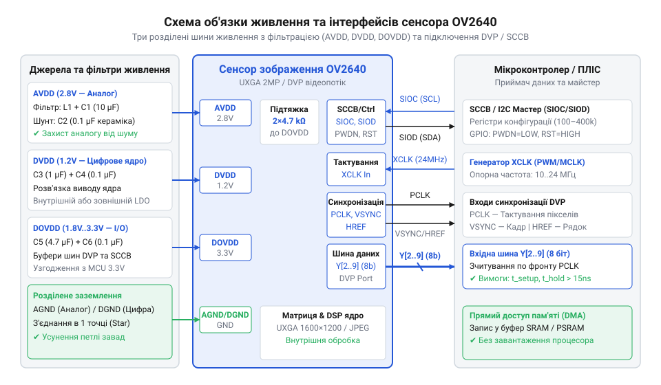
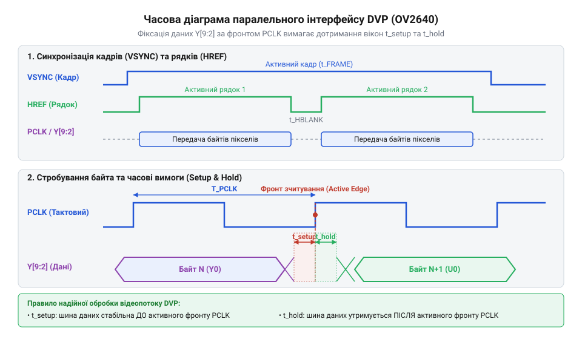

# Апаратний інтерфейс OV2640: цокольовка, електричні характеристики та часові діаграми DVP

## Проблема некоректного заходу цифрового відеопотоку

Розробка систем зчитування даних із цифрових сенсорів навколишнього середовища (температури, тиску чи прискорення) зазвичай спирається на опитування повільних шин зв'язку. У таких сценаріях розробник надсилає запит і отримує кілька байтів результату у зручний для процесора момент. Проте спроба застосувати аналогічний підхід до цифрового @@en|сенсора зображення@@ (від @@la|sensio@@ — відчуття) @@en|OV2640@@ призводить до повної непрацездатності системи. Кристал @@en|OV2640@@ є високошвидкісним джерелом даних, яке безперервно генерує мільйони піксельних байтів на секунду незалежно від готовності керівного контролера.

Під час передачі відеопотоку з роздільною здатністю SVGA (`800 × 600`) із частотою `15` кадрів на секунду обсяг даних перевищує `14` мегабайтів за секунду. Якщо спробувати зчитувати лінії даних сенсора за допомогою звичайного програмного опитування виводів @@en|GPIO@@ (від @@en|General-Purpose Input/Output@@ — входи-виходи загального призначення), процесор просто не встигатиме обробляти кожен тактовий імпульс. У результаті виникає низка типових апаратних та системних збоїв:
1. Спотворення кольоропередачі та зсув байтів. У кодованих форматах, таких як @@en|RGB565@@, кожен піксель передається двома послідовними байтами. Пропуск навіть одного тактового імпульсу зміщує межі байтів місцями. Старший байт червоного та зеленого кольорів зчитується як молодший байт синього, через що зображення набуває кислотно-фіолетових або зелених відтінків. 2. Втрата кадрової синхронізації. Некоректне зчитування сигналів кадрового стробування @@en|VSYNC@@ (від @@gr|synchronos@@ — одночасний) та рядкового стробування @@en|HREF@@ призводить до так званого «зсуву кадру» (@@en|rolling frame@@) або розриву зображення по горизонталі. 3. Апаратне зависання матриці. Випадкові наведення на лініях скидання або відсутність стабільного опорного тактового сигналу @@en|XCLK@@ порушують роботу внутрішнього автомата станів сенсора, після чого пристрій перестає реагувати на будь-які команди й потребує повного перезапуску живлення.

Головна причина цих проблем полягає у відсутності апаратної синхронізації між сенсором та обчислювачем. Оскільки сенсор @@en|OV2640@@ самостійно задає темп передачі за допомогою вихідного тактового сигналу @@en|PCLK@@, керівний пристрій повинен мати спеціалізований апаратний @@en|інтерфейс@@ (від @@en|interface@@ — міжповерхня) паралельного заходу даних @@en|DVP@@ (від @@en|Digital Video Port@@ — цифровий відеопорт) та використовувати [контролери прямого доступу DMA](root:hw-arch/dma). Щоб побудувати надійну систему без втрати кадрів, необхідно детально розібрати фізичну призначеність кожного виводу та електричні умови живлення сенсора.

## Призначення виводів та тришине живлення

Для забезпечення цілісності сигналів та стабільної роботи сенсора @@en|OV2640@@ його апаратний інтерфейс розділено на чотири функціональні групи: шину даних, лінії тактування й синхронізації, командну шину керування та розділені лінії живлення.

Основний відеопотік передається через 8-бітну паралельну шину даних `Y2`–`Y9`. Внутрішній аналого-цифровий перетворювач (@@en|АЦП@@) матриці має 10-бітну розрядність, однак у режимі @@en|DVP@@ використовуються 8 старших розрядів (`Y2`–`Y9`), що відповідає стандартній байтовій орієнтації цифровізації. Сигнали синхронізації охоплюють вихід кадрового стробу @@en|VSYNC@@, вихід стробу активного рядка @@en|HREF@@ та вихід піксельного тактування @@en|PCLK@@. Джерелом тактування для внутрішньої логіки сенсора є вхідний опорний сигнал @@en|XCLK@@, який подається від зовнішнього генератора або шпильки мікроконтролера.


*Принципова схема підключення сенсора OV2640 із трьома ізольованими шинами живлення AVDD, DVDD, DOVDD, фільтруючими конденсаторами та 8-бітною шиною даних Y2–Y9.*

Найважливішою схемотехнічною особливістю @@en|OV2640@@ є використання трьох розділених шин живлення:
1. `AVDD` (`2.8` В) — живлення аналогового ядра та фоточутливої матриці. Аналогова частина край чутлива до високочастотних завад. Навіть незначна пульсація напруги амплітудою понад `10` мВ викликає візуальний шум, горизонтальні смуги та сніжіння на підсумковому кадрі. Джерелом `AVDD` має бути окремий [лінійний регулятор LDO](root:hw-power/ldo) з низьким рівнем власних шумів. 2. `DVDD` (`1.3` В) — живлення внутрішньої цифрової логіки та процесора обробки сигналів (@@en|DSP@@). Цифрове ядро створює імпульсні кидки струму під час перемикання вентилів, тому його шина мусить бути повністю ізольована від аналогової `AVDD`. 3. `DOVDD` (`1.8` В – `3.3` В) — живлення вихідних буферів вводу-виводу (@@en|I/O pad@@). Ця шина визначає амплітуду вихідних логічних сигналів `Y2`–`Y9`, `PCLK`, `VSYNC` та `HREF`. Подача на `DOVDD` напруги `3.3` В дозволяє підключати @@en|OV2640@@ безпосередньо до 3.3-вольтових мікроконтролерів без застосування зовнішніх перетворювачів логічних рівнів.

Біля кожного виводу живлення мікросхеми обов'язково встановлюють керамічний фільтруючий конденсатор ємністю `0.1` мкФ (`100` нФ) з мінімальною довжиною провідників до заземлення (GND). Додатково кожну лінію живлення шунтують паралельним конденсатором ємністю `10` мкФ для згладжування низькочастотних коливань.

Електричні та температурні межі експлуатації вимагають суворого дотримання допусків: напруга `AVDD` повинна перебувати в межах `2.8` В ±`5`%, `DVDD` — `1.3` В ±`5`%, а `DOVDD` — від `1.71` В до `3.6` В. Робочий температурний діапазон становить від `-30` °C до `+70` °C, причому стабільні параметри передачі кольору зберігаються при температурі від `0` °C до `+50` °C. Струм споживання в активному режимі становить орієнтовно від `30` до `40` мА, а в режимі глибокого сну (@@en|Standby@@) знижується до величини менше `20` мкА.

## Часові діаграми та стробування DVP

Передача цифрового відеопотоку через паралельний @@en|інтерфейс@@ @@en|DVP@@ здійснюється шляхом суворо стробованої вибірки даних на кожному тактовому імпульсі. Для правильного заходу інформації периферійний контролер повинен орієнтуватися на часові співвідношення між чотирма основними сигналами: `VSYNC`, `HREF`, `PCLK` та шиною `Y2`–`Y9`.

Сигнал кадрової синхронізації `VSYNC` позначає початок і завершення нового кадру. При високому логічному рівні `VSYNC` контролер обнуляє адреси в буфері пам'яті. Сигнал `HREF` позначає інтервал передачі активного рядка пікселів. Дані на шині `Y2`–`Y9` вважаються дійсними лише тоді, коли `HREF` перебуває у високому стані. Під час низького рівня `HREF` відбувається так званий гасильний інтервал рядка (@@en|horizontal blanking@@), під час якого сенсор готується до зчитування наступного рядка фотодіодів.


*Часова діаграма взаємодії сигналів кадрової VSYNC та рядкової HREF синхронізації, піксельного тактування PCLK та шини даних Y2–Y9 із затримками Setup t_s та Hold t_h.*

Тактування кожного окремого байта виконується сигналом `PCLK`. При кожному наростаючому фронті `PCLK` сенсор виставляє новий байт даних на лінії `Y2`–`Y9`. Формат упаковки даних залежить від обраного режиму:
- У форматі @@en|RGB565@@ один піксель передається за два тактові імпульси `PCLK`. Перший байт містить розряди `R4–R0` та `G5–G3`, а другий — розряди `G2–G0` та `B4–B0`. - У форматі @@en|YUV422@@ пара сусідніх пікселів передається чотирма байтами у послідовності `Y0`, `U0`, `Y1`, `V0`. - У режимі стиснення @@en|JPEG@@ сенсор виводить потік байтів стиснутого файлу, супроводжуючи їх імпульсами `PCLK` та `HREF`.

Надійність зчитування байта визначається дотриманням часових затримок встановлення (@@en|Setup time@@, `t_s`) та утримання (@@en|Hold time@@, `t_h`). Час встановлення `t_s` — це мінімальний інтервал, протягом якого рівні на шині `Y2`–`Y9` повинні залишатися стабільними ДО появи активного фронту `PCLK`. Час утримання `t_h` — це інтервал, протягом якого дані повинні зберігатися незмінними ПІСЛЯ фронту `PCLK`.

Для сенсора @@en|OV2640@@ мінімальне значення `t_s` становить `15` нс, а `t_h` — `8` нс. Якщо довжина трас шини даних на друкованій платі відрізняється від довжини лінії `PCLK` (виникає фазовий зсув), або якщо паразитна ємність завалює фронти сигналу, вікно стабільності порушується. Мікроконтролер стробує сигнал у момент перехідного процесу, що призводить до спотворення окремих бітів у байті та виникнення випадкового кольорового шуму («живих пікселів»). Для усунення цього ефекту в налаштуваннях периферійного контролера DVP можна інвертувати активний фронт зчитування `PCLK` (переключаючи стробування з наростаючого фронту на спадний).

## Шина SCCB та лінії керування

Налаштування режимів роботи, роздільної здатності, частоти кадрів та параметрів фотоматриці @@en|OV2640@@ здійснюється через послідовну шину керування @@en|SCCB@@ (від @@en|Serial Camera Control Bus@@ — послідовна шина керування камерою). Фізично шина складається з двох ліній: тактування `SIOC` (від @@en|Serial Input Clock@@) та даних `SIOD` (від @@en|Serial Input/Output Data@@).

Електрично шина @@en|SCCB@@ [сумісна з протоколом I2C](root:com-devices/i2c-bus). Виводи `SIOC` та `SIOD` виготовлені за схемою з відкритим стоком (@@en|open-drain@@), тому вони вимагають обов'язкового підключення зовнішніх підтягуючих резисторів `R_{pull-up}` номіналом `4.7` кОм до лінії живлення `DOVDD`. Стандартна 7-бітна адреса пристрою @@en|OV2640@@ на шині дорівнює `0x30`. При формуванні 8-бітного байта адреси з урахуванням біта читання/запису байт запису становить `0x60`, а байт читання — `0x61`.

Окрім шини @@en|SCCB@@, апаратний інтерфейс містить дві критично важливі лінії керування станом:
1. `RESET` (вхід апаратного скидання). Низький логічний рівень на цій лінії скидає всі внутрішні @@en|регістри@@ (від @@la|registrum@@ — внесений список) до початкових заводських значень та обнуляє внутрішні автомати станів. 2. `PWDN` (вхід переведення в режим зниженого енергоспоживання, @@en|Power Down@@). Високий логічний рівень на лінії `PWDN` вимикає внутрішні генератори, зупиняє видачу `PCLK` та вимикає вихідні буфери, переводячи сенсор у режим сну. Для нормальної роботи на лінію `PWDN` слід подати низький логічний рівень (0 В).

Для запобігання апаратним збоям під час включення живлення необхідно дотримуватися суворої послідовності подачі сигналів (@@en|Power-up sequence@@):
1. Подати напруги живлення `DOVDD`, `AVDD` та `DVDD`. 2. Подати стабільний зовнішній тактовий сигнал `XCLK` частотою від `10` до `24` МГц. 3. Під час наростання напруг утримувати лінію `PWDN` у високому стані (1), а лінію `RESET` — у низькому стані (0) протягом щонайменше `5` мс. 4. Перевести лінію `PWDN` у низький стан (0). 5. Через `2` мс відпустити лінію `RESET` у високий стан (1). 6. Зачекати затримку готовності `t_{ready}` тривалістю `5`–`10` мс перед першим зверненням по шині @@en|SCCB@@.

Якщо виводи `RESET` або `PWDN` залишаються підвішеними в повітрі (без зовнішньої підтяжки), завади на платі викликають довільне скидання або зависання сенсора безпосередньо під час зйомок.

## Конфігурація регістрів тактування та стану

Після завершення апаратного скидання та стабілізації живлення сенсор @@en|OV2640@@ перебуває в базовому стані й вимагає програмної конфігурації. Внутрішній простір регістрів пристрою розділено на два банки: банк обробки сигналів @@en|DSP Bank@@ (адреса `0xFF = 0x00`) та банк сенсорного ядра @@en|Sensor Bank@@ (адреса `0xFF = 0x01`).

Перемикання між банками здійснюється шляхом запису значення `0x00` або `0x01` у спеціальний регістр вибору банку (@@en|Bank Select Register@@) за адресою `0xFF`. Запис параметрів тактування виконується в банку сенсорного ядра (@@en|Sensor Bank@@).

Частота вихідного піксельного тактування `PCLK` та швидкість обробки кадрів задаються внутрішньою системою фазового автопідлаштування частоти (@@en|PLL@@, від @@en|Phase-Locked Loop@@) та дільниками вхідної частоти `XCLK`. Головним регістром керування тактуванням є `CLKRC` (адреса `0x11` у банку `0x01`). Молодші біти `CLKRC[5:0]` визначають коефіцієнт ділення вхідної частоти `XCLK`. Якщо включено внутрішній подвоювач частоти `PLL` (біт `CLKRC[7]`), підсумкова частота `f_{PCLK}` обчислюється за формулою:

```
f_{PCLK} = F_{XCLK} ÷ (CLKRC[5:0] + 1)
= 24 × 2 ÷ (1 + 1)      [підстановка частоти XCLK 24 МГц та дільника CLKRC 1]
= 48 ÷ 2                [множення на коефіцієнт PLL]
= 24                    [вихідна частота PCLK у МГц]
```

При подачі `F_{XCLK} = 24` МГц та значення `CLKRC = 0x01` частота піксельного тактування `f_{PCLK}` дорівнює `24` МГц. Якщо керівний мікроконтролер має обмежену пропускну здатність шини @@en|DMA@@, значення `CLKRC[5:0]` збільшують, що пропорційно знижує частоту `PCLK` та частоту кадрів, усуваючи переповнення буфера пам'яті.

Програмне скидання сенсора можна виконати без смикання фізичної ніжки `RESET` за допомогою запису значення `0x80` у регістр `COM7` (адреса `0x12` у банку `0x01`). Нижче наведено приклад мовою C для базової ініціалізації банків та регістрів тактування @@en|OV2640@@:

:::code api-ov2640-hardware-interface/c/esp-idf/ov2640-clock-init.c

Діагностика апаратних збоїв тактування:
- Якщо на виході `PCLK` відсутній будь-який сигнал (замір проводиться за допомогою приладу [осцилограф](root:hw-sensing/oscilloscope) (від @@la|oscillare@@ — гойдатися та @@gr|grapho@@ — писати)), необхідно перевірити наявність вхідного сигналу `XCLK`, переконатися, що лінія `PWDN` перебуває в низькому стані, та перевірити правильність вибору банку `0x01` під час запису `CLKRC`. - Якщо кадр передається з розривами або спотвореною геометрією, це свідчить про перевищення максимально припустимої частоти `PCLK` для використовуваного контролера @@en|DMA@@. Збільшення дільника в регістрі `CLKRC` дозволяє стабілізувати захід відеопотоку.