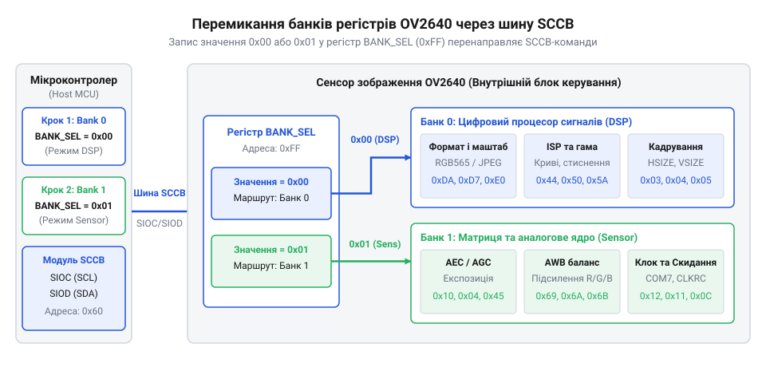
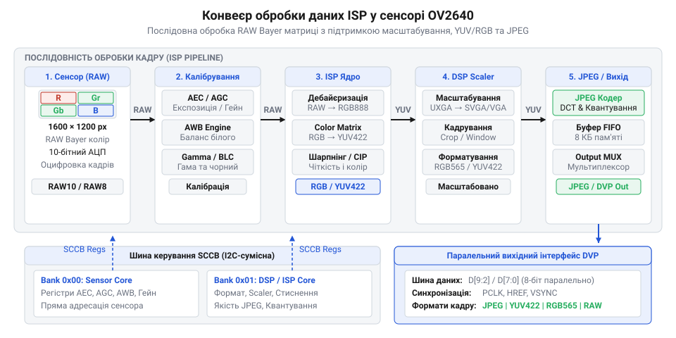

# Програмний інтерфейс драйвера OV2640: регістрове керування через SCCB та налаштування ISP

## Помилки конфігурування та банківська адресація

При першій спробі вичитати ідентифікатор сенсора зображення OV2640 або змінити параметри роздільної здатності кадру розробник часто зіштовхується із симуляцією повністю непрацездатного пристрою: регістри повертають виключно значення `0x00` або `0xFF`, а будь-які виклики функцій конфігурування призводять до викривлення кольорів чи повного зникнення вихідних синхросигналів. Причина такої поведінки криється у специфіці внутрішньої адресації сенсора: 8-бітна адресація шини @@en|SCCB@@ (від англ. *Serial Camera Control Bus* — послідовна шина керування камерою) фізично здатна адресувати лише 256 осередків пам'яті (від `0x00` до `0xFF`), тоді як OV2640 містить понад чотири сотні керованих системних параметрів. Щоб помістити такий обсяг налаштувань у рамки стандартного протоколу обміну, інженери компанії OmniVision розділили внутрішню регістрову карту сенсора на дві окремі зони — банк аналогової матриці @@en|Sensor bank@@ та банк цифрового процесора обробки сигналів @@en|DSP bank@@.

Головна пастка для розробника полягає в тому, що обидва банки використовують абсолютно однакові 8-бітні адреси осередків. Наприклад, адреса `0x12` у банку @@en|Sensor bank@@ відповідає за регістр системного керування `COM7` (який задає вихідний формат даних та виконує програмне скидання), тоді як та сама адреса `0x12` у банку @@en|DSP bank@@ керує аналоговим підсилюванням та вибором кольорового фільтра матриці `REG12`. Якщо перед виконанням команд запису не переконатися, у якому саме банку перебуває шина, спроба конфігурування вихідних форматів запише дані у банк сенсора, безповоротно викрививши аналогові параметри зчитування пікселів і спричинивши хаотичні збої або повний зрив відеопотоку.

Вибір активного контексту виконується за допомогою виділеного службового регістру @@en|BANK_SEL@@, який розташовано за адресою `0xFF`. Цей осередок є єдиним спільним регістром, що доступний незалежно від того, який банк наразі вибрано. Запис значення `0x00` у регістр `0xFF` переключає шину на роботу з регістрами цифрового процесора обробки сигналів @@en|DSP@@ (від англ. *Digital Signal Processor*), де знаходяться алгоритми масштабування, квантування, формування колірних просторів та геометрії. Запис значення `0x01` активує банк @@en|Sensor bank@@, який надає доступ до управління аналогово-цифровими перетворювачами, таймінгами зчитування рядків кадру та первинним підсиленням світлочутливої матриці.


*Перемикання банків регістрів DSP (0x00) та Sensor (0x01) через регістр BANK_SEL (0xFF) для доступу до розділеного простору адресації.*

Для забезпечення надійної роботи драйвера рекомендується обгортати кожну групу операцій зчитування чи запису функцією явного перевіряння та встановлення поточного банку. Це відсікає зайві повторні транзакції по шині, якщо потрібний банк уже є активним, але гарантує точний контекст адресації при зміні цільового модуля. Нижче наведено ідіоматичні реалізації драйверного рівня перемикання банків та безпечного запису регістрів на мовах C та C++.

:::tabs
@tab C (ESP-IDF)
:::code api-ov2640-sccb-driver/c/esp-idf/ov2640-set-bank.c
@tab C++ (Arduino)
:::code api-ov2640-sccb-driver/cpp/arduino/ov2640driver.cpp
:::

Для глибокого розуміння фізичного рівня обміну варто опрацювати [протокол послідовної шини SCCB](root:com-devices/sccb-bus-protocol-architecture), який задає часові діаграми старт-стопових умов та стробування даних.

## Налаштування ISP та вихідного формату

Здобувши надійний доступ до банків регістрів, розробник опиняється перед жорстким обмеженням пропускної здатності вбудованої системи: світлочутлива матриця OV2640 формує первинний кадр повної роздільної здатності UXGA (`1600 × 1200` пікселів). У нестиснутому 16-бітному колірному форматі RGB565 один такий кадр займає `3.84 МБ` оперативної пам'яті, що в десятки разів перевищує весь обсяг ОЗП середнього мікроконтролера. При спробі передати подібний масив через паралельний DVP-інтерфейс на частоті 15–30 кадрів за секунду шина даних переповнюється, викликаючи втрату синхронізації та збої DMA-буферів.

Розв'язанням цієї фундаментальної проблеми є використання внутрішнього процесора обробки сигналів @@en|ISP@@ (від англ. *Image Signal Processor*). Конвеєр ISP отримує первинний потік даних @@en|RAW Bayer@@ безпосередньо з світлочутливих фотодіодів матриці та виконує послідовність апаратних перетворень: интерполяцію кольорів (демозаїку), корекцію колірної матриці, масштабування зображення та апаратне стиснення.


*Послідовний конвеєр перетворення первинного RAW Bayer потоку матриці через модуль ISP, масштабування та JPEG-кодер до вихідних пінів DVP.*

Залежно від цільових завдань пристрою, драйвер може зконфігурувати конвеєр ISP на вихід одного з чотирьох основних форматів даних:
1. **RAW Bayer**: первинні необроблені цифрові значення з матриці. Формат вимагає мінімальних обчислень усередині сенсора, проте покладає складне завдання інтерполяції кольорів на зовнішній процесор. 2. **RGB565**: 16-бітне представлення (5 біт червоний, 6 біт зелений, 5 біт синій), що дає 2 байти на піксель. Зручно для прямого виведення зображення на малогабаритні TFT-екрани без попереднього розпакування. 3. **YUV422**: колірний простір із розділенням компонентів яскравості (`Y`) та колірності (`U, V`). На кожні два сусідніх пікселі припадає два байти яскравості та по одному байту кожного колірно-різницевого сигналу. Саме цей формат використовується в алгоритмах детекції руху та комп'ютерного зору. 4. **JPEG**: інтегрований кодер стискає потік YUV422 у бінарний потік JPEG з маркерами початку кадру `0xFFD8` та кінця кадру `0xFFD9`. Коефіцієнт стиснення зменшує розмір кадру UXGA з `3.84 МБ` до `30–150 КБ`, дозволяючи транслювати якісний відеопотік через повільні бездротові канали (Wi-Fi або Bluetooth).

Вибір вихідного формату та налаштування параметрів стиснення здійснюються в банку @@en|DSP bank@@. За включення стиснення та вибір базового режиму відповідає регістр `IMAGE_MODE` (`0xDA`), тоді як геометрія кадру задається регістрами масштабування `ZMOW` (`0x5A`), `ZMOH` (`0x5B`) та `ZMMS` (`0x5C`). Рівень стиснення JPEG регулюється коефіцієнтом квантування в регістрі `QS` (`0x44`, значення від `0x00` до `0x3F`): чим менше значення `QS`, тим менші втрати деталей і більший розмір файлу.

Приклад конфігурування драйвера для виведення зображення у форматі JPEG із роздільною здатністю SVGA (\(800 \times 600\) пікселів):

:::tabs
@tab C (ESP-IDF)
:::code api-ov2640-sccb-driver/c/esp-idf/ov2640-config-jpeg-svga.c
@tab C++ (Arduino)
:::code api-ov2640-sccb-driver/cpp/arduino/configjpegsvga.cpp
:::

Докладну структуру підключення апаратних ліній синхронізації та [паралельного DVP-інтерфейсу](root:com-devices/dvp-parallel-video-interface) розглянуто у відповідній специфікації апаратного узгодження.

## Автоматична адаптація освітлення та гами

Навіть ідеально налаштований вихідний формат JPEG або YUV стає повністю марним, якщо об'єкт зйомки зміщується з тіні на яскраве сонячне світло: зображення миттєво стає суцільно білим через переекспонування або тоне в темряві через недостатній рівень фотосигналу. Без постійної апаратної корекції часу накопичення заряду та коефіцієнтів підсилення матриця видає непридатний для обробки кадр.

Для адаптації до динамічного довкілля сенсор OV2640 має три вбудовані автоматичні алгоритми з замкненим контуром регулювання:
1. **AEC** (від англ. *Auto Exposure Control* — автоматичне керування експозицією): змінює тривалість накопичення заряду у фотодіодах (час електронного затвора). Конфігурується в банку @@en|Sensor bank@@ через регістри `AEC` (`0x10`), `AECH` (`0x45`) та `COM1` (`0x03`). 2. **AGC** (від англ. *Auto Gain Control* — автоматичне підсилення): коригує коефіцієнт аналогового підсилювача сигналів перед входженням в АЦП. Керується в банку @@en|Sensor bank@@ регістрами `GAIN` (`0x00`) та `COM9` (`0x14`). 3. **AWB** (від англ. *Auto White Balance* — автоматичний баланс білого): вимірює спектральний склад освітлення та регулює коефіцієнти підсилення червоного (\(R\)) і синього (\(B\)) каналів відносно зеленого (\(G\)) у банку @@en|DSP bank@@ через регістри `AWBR_GAIN` (`0x70`), `AWBB_GAIN` (`0x71`) та `AWB_CTRL0` (`0x6E`).

Контур AEC/AGC працює за принципом підтримки заданої середньої яскравості кадру \(Y_{avg}\), яка розраховується модулем статистичного аналізу ISP за формулою:

$$Y_{avg} = \frac{1}{N} \sum_{i=1}^{N} Y_i$$

Отримане значення порівнюється з допустимим віконним діапазоном, заданим у регістрах `AEW` (верхня межа) та `AEB` (нижня межа):

```
[Поточний виміряний кадр Y_avg]
  ├── Якщо Y_avg < AEB (недостатня яскравість):
  │     1. Збільшити час експозиції (AEC) до максимуму тривалості кадру.
  │     2. Якщо AEC сягнув максимуму — нарощувати аналогове підсилення (AGC).
  └── Якщо Y_avg > AEW (переекспонування):
        1. Зменшити аналогове підсилення (AGC) до мінімальних 0 dB.
        2. Зменшити час експозиції (AEC).
```

Окрім інтегральних алгоритмів експозиції, передача півтонів та контрастність зображення регулюються за допомогою нелінійної тонової кривої (гама-корекції). Вона описується виразом:

$$Y_{out} = Y_{in}^\gamma$$

В ISP OV2640 гама-крива задається у вигляді таблиці покажчиків @@en|LUT@@ (від англ. *Lookup Table*), що складається з 15 регістрів у банку @@en|DSP bank@@ (адреси від `0x7A` до `0x88`). Перезапис цих регістрів дозволяє розтягнути динамічний діапазон у тінях або приглушити занадто яскраві відблиски.

Приклад конфігурування меж автоматичної експозиції та встановлення стандартної гама-кривої:

:::tabs
@tab C (ESP-IDF)
:::code api-ov2640-sccb-driver/c/esp-idf/ov2640-set-auto-exposure-gamma.c
@tab C++ (Arduino)
:::code api-ov2640-sccb-driver/cpp/arduino/configureautoadaptation.cpp
:::

Математичні підвалини перетворення простірних коефіцієнтів деталізовано в матеріалі про [колірні матричні перетворення](root:sf-visual/color-matrix-conversion).

## Керування живленням та обробка помилок

Безперервна робота сенсора OV2640 в активному режимі супроводжується споживанням струму на рівні `50–90 мА`, що створює високе теплове навантаження та виснажує батарею автономного пристрою. Крім того, імпульсні перешкоди на лініях живлення або наводки під час обміну даними по SCCB можуть призвести до втрати сигналу підтвердження @@en|ACK@@ (від англ. *Acknowledge*), залишаючи шину в заблокованому стані.

Для оптимізації енергоспоживання драйвер надає можливість керувати двома енергозберігаючими станами пристрою:
1. **Standby (програмний режим очікування)**: активується встановленням біта 4 у регістрі `COM2` (`0x09`) банку @@en|Sensor bank@@. У цьому режимі припиняють роботу аналогові підсилювачі та внутрішні тактові генератори, проте значення всіх внутрішніх регістрів зберігаються. Споживання струму падає до величини менше \(600\text{ мкА}\). Повернення у робочий режим здійснюється скиданням вказаного біта. 2. **PowerDown (апаратне знеструмлення)**: керується подачею високого логічного рівня на фізичний вивід `PWDN` сенсора. Внутрішній LDO-регулятор повністю вимикає живлення ядра, а струм споживання знижується до \(10\text{ мкА}\). Після повернення виводу `PWDN` у низький стан драйвер зобов'язаний виконати системне скидання через біт 7 регістру `COM7` та зачекати не менше \(5\text{ мс}\) для стабілізації внутрішнього генератора @@en|PLL@@ (від англ. *Phase-Locked Loop* — фазове автопідлаштування частоти).

Для забезпечення стійкості до збоїв передачі драйвер мусить виконувати валідацію зв'язку. Під час ініціалізації виконується зчитування ідентифікаційних регістрів продукту в банку @@en|Sensor bank@@: регістр `PID` (`0x0A`) повинен повертати значення `0x26`, а регістр `VER` (`0x0B`) — значення `0x42`.

Якщо під час обміну шиною виникає нештатний тайм-аут або лінія SDA виявляється затиснутою в низькому стані через збій у попередній транзакції, управляючий мікроконтролер реалізує алгоритм відновлення bus-recovery: примусово генерує 9 тактових імпульсів на лінії SCL при відпущеній SDA, після чого формує умову `STOP`.

Приклад реалізації перевірки ID сенсора, керування режимом Standby та апаратної обробки живлення:

:::tabs
@tab C (ESP-IDF)
:::code api-ov2640-sccb-driver/c/esp-idf/ov2640-check-id.c
@tab C++ (Arduino)
:::code api-ov2640-sccb-driver/cpp/arduino/ov2640powermanager.cpp
:::

Рекомендації щодо проектування кіл живлення та [фільтрації завад для CMOS-сенсорів](root:hw-power/cmos-power-filtering) наведені у спеціалізованій статті з апаратної розводки плати.