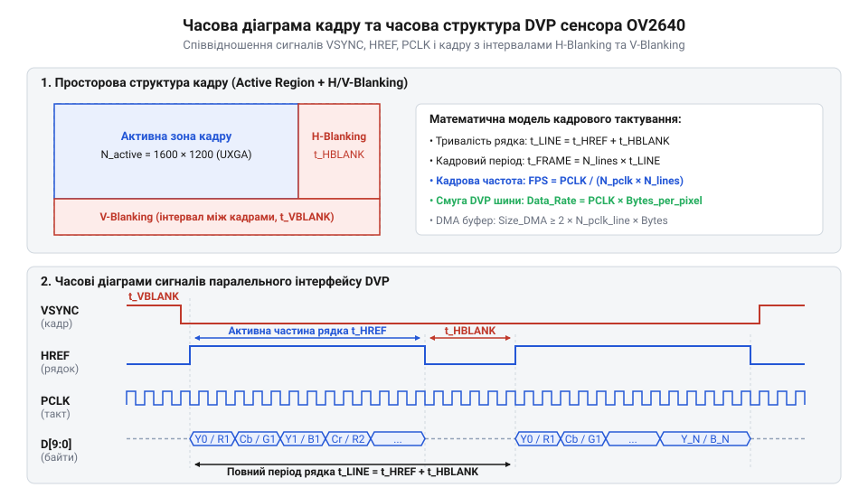

# Математика обчислення пропускної здатності DVP, частот PLL та обсягу буферів DMA

## Втрата кадрів і переповнення буфера

Передача відеопотоку з сенсора OV2640 на мікроконтролер через паралельну шину @@en|Digital Video Port@@ (від англ. *digital* — цифровий, *video* — відео, *port* — порт; далі — @@en|DVP@@) вимагає суворого узгодження тактування. Сенсор формує потік байтів і синхронізує його сигналом `PCLK` (від англ. @@en|pixel clock@@), а периферійний модуль мікроконтролера приймає дані та перенаправляє їх у оперативну пам'ять @@en|Static Random-Access Memory@@ (від грец. *statikos* — нерухомий, англ. *memory* — пам'ять; далі — @@en|SRAM@@) через контролер прямого доступу @@en|Direct Memory Access@@ (від англ. *direct* — прямий, *memory* — пам'ять, *access* — доступ; далі — @@en|DMA@@).

Приймальне вікно мікроконтролера містить буфер @@en|First In, First Out@@ (від англ. *first* — перший, *in* — всередину, *out* — назовні; далі — @@en|FIFO@@) місткістю `N_FIFO` (зазвичай 4–16 байтів). Сенсор виставляє байт на лініях `D[7:0]` і за імпульсом `PCLK` записує його у @@en|FIFO@@, звідки контролер @@en|DMA@@ має перенести дані в @@en|SRAM@@. Якщо затримка арбітражу шини @@en|bus latency@@ (від англ. *bus* — шина, *latency* — затримка) блокує доступ @@en|DMA@@ до пам'яті, буфер переповнюється зі швидкістю `PCLK`. Детальніше про механізм затримок дивіться у [затримках арбітражу шини DMA](root:new/cat-hw-microcontrollers_dma-bus-arbitration-latency). Детальніше про механізм затримок дивіться у [затримках арбітражу шини DMA](root:hw-arch/dma-arbitration).

При перевищенні місткості `N_FIFO` виникає переповнення @@en|overrun@@ (від англ. *over* — понад, *run* — бігти), і нові байти втрачаються. У нестиснених форматах @@en|RGB565@@ чи @@en|YUV422@@ (два байти на піксель) втрата одного байта змінює місцями старшу та молодшу частини наступних пікселів, що спричиняє спотворення кольорів та зсув рядків. У стисненому потоці @@en|JPEG@@ втрата байта руйнує маркери структури файлу і зависає декодер. Щоб уникнути цього, розраховують весь часовий ланцюжок: від множника @@en|Phase-Locked Loop@@ (від англ. *phase* — фаза, *lock* — замикати, *loop* — петля; далі — @@en|PLL@@) сенсора до пропускної здатності шини та буферів.

## Синтез піксельної частоти PCLK

Сенсор зображення OV2640 отримує опорний тактовий сигнал `XCLK` (від англ. @@en|external clock@@) частотою 6–27 МГц від мікроконтролера. Для формування необхідної піксельної частоти `PCLK` шини @@en|DVP@@ використовується внутрішній блок @@en|PLL@@ із програмованими дільниками.

Спочатку опорна частота `XCLK` ділиться попереднім дільником @@en|prescaler@@ (від англ. *pre* — попередній, *scaler* — дільник) на `N_div = K + 1`, де `K` задається бітами `CLKRC[5:0]` (при `CLKRC[7] = 1` ділення вимкнено, `N_div = 1`). Потім сигнал помножується у блоці @@en|PLL@@ у `M_mult` разів (`M_mult ∈ {2, 4}`), утворюючи системну частоту `f_sys`.

На фінальному етапі `f_sys` ділиться вихідним дільником `P_div ∈ {1, 2, 4, 8}`. Розрахунок підсумкової піксельної частоти `f_PCLK` здійснюється за рівнянням:

```
f_sys = (XCLK ÷ N_div) × M_mult
f_PCLK = f_sys ÷ P_div
= ((XCLK ÷ N_div) × M_mult) ÷ P_div       [підстановка внутрішньої системної частоти f_sys]
= (XCLK × M_mult) ÷ (N_div × P_div)          [згрупування коефіцієнтів множення та ділення]
```

Отримане значення `f_PCLK` визначає частоту стробування даних на шині @@en|DVP@@.

**Обчислення на прикладі**

Для `XCLK = 24` МГц, `CLKRC = 0x01` (`K = 1`, `N_div = 2`), `M_mult = 4` та `P_div = 2`:

```
f_input_pll = 24 000 000 ÷ 2 = 12 000 000 Гц [ділення вхідної частоти XCLK на прескалер N_div]
f_sys = 12 000 000 × 4 = 48 000 000 Гц      [множення частоти у блоці PLL]
f_PCLK = 48 000 000 ÷ 2 = 24 000 000 Гц     [остаточне ділення для піксельної частоти PCLK]
```

Завищена частота `f_PCLK` призводить до збоїв зчитування шини @@en|DVP@@ мікроконтролером, а занижена — зменшує кадрову частоту. Детальний опис запису конфігураційних бітів у регістри сенсора наведено у [налаштуванні регістрів SCCB OV2640](root:new/cat-hw-sensors_ov2640-sccb-register-configuration). Детальний опис запису конфігураційних бітів у регістри сенсора наведено у [налаштуванні регістрів SCCB OV2640](root:cat-hw-sensors/ov2640-register-map-config).

## Обчислення кадрової частоти та гасіння

Частота пікселів `PCLK` визначає загальну кількість тактів за секунду, але не всі такти передають корисні дані. Матриця сенсора @@en|OV2640@@ зчитується порядно, а між рядками та кадрами необхідні технологічні паузи. Для перезаряду ємностей рядка й синхронізації імпульсом `HREF`/`HSYNC` слугує інтервал горизонтального гасіння @@en|horizontal blanking@@ (`H_blank`). Для скидання заряду всієї матриці та синхронізації імпульсом `VSYNC` слугує інтервал вертикального гасіння @@en|vertical blanking@@ (`V_blank`). Ці паузи називають гасінням @@en|blanking@@ (від англ. *blanking* — затемнення, пауза).

Ширина `W_active` у пікселях та висота `H_active` у рядках визначають активну зону кадру. Передача одного пікселя вимагає `B_pixel` байтів (наприклад, `B_pixel = 2` для @@en|RGB565@@ на 8-бітовій шині), що відповідає `B_pixel` тактів `PCLK`. Активна частина рядка триває `W_active × B_pixel` тактів. Додавши паузу `H_blank` у тактах `PCLK`, отримуємо повну тривалість рядка `T_line`:

```
T_line = (W_active × B_pixel) + H_blank
```

Вираз показує сумарний час передачі одного рядка у тактах піксельної частоти. Додаючи паузові рядки вертикального гасіння `V_blank` до `H_active`, обчислюємо повну висоту кадрового розгортання `T_frame_lines`:

```
T_frame_lines = H_active + V_blank
```

Отримана величина виражає тривалість кадру в рядкових інтервалах. Перемноживши тривалість рядка `T_line` на кількість рядків `T_frame_lines`, дістаємо загальну кількість тактів `N_total_pclk` на кадр. Відношення піксельної частоти `f_PCLK` до `N_total_pclk` визначає підсумкову кадрову частоту @@en|frame rate@@ (від англ. *frame* — кадр, *rate* — частота, далі — @@en|FPS@@):

```
N_total_pclk = T_line × T_frame_lines
= ((W_active × B_pixel) + H_blank) × (H_active + V_blank) [обчислення сумарної кількості тактів PCLK на кадр]
FPS = f_PCLK ÷ N_total_pclk
= f_PCLK ÷ (((W_active × B_pixel) + H_blank) × (H_active + V_blank)) [розгортання підсумкового рівняння кадрової частоти]
```

Отримане рівняння пов'язує фізичні паузи гасіння з реальною частотою оновлення кадрів.


*Часова діаграма формування кадру: співвідношення активних тактів передачі пікселів та пауз гасіння HSYNC і VSYNC, що визначають підсумковий FPS.*

**Обчислення на прикладі**

Розглянемо режим @@en|SVGA@@ (`W_active = 800`, `H_active = 600`) у форматі @@en|RGB565@@ (`B_pixel = 2`), з налаштуваннями `H_blank = 320` тактів `PCLK`, `V_blank = 25` рядків та частотою `f_PCLK = 24.0` МГц (`24 000 000` Гц):

```
T_line = (800 × 2) + 320 = 1920 тактів [обчислення повної довжини рядка в тактах PCLK]
T_frame_lines = 600 + 25 = 625 рядків   [обчислення повної кількості рядків у кадрі]
N_total_pclk = 1920 × 625 = 1 200 000 тактів [сумарні такти PCLK на один кадр]
FPS = 24 000 000 ÷ 1 200 000 = 20 Гц    [підсумкова кадрова частота]
```

Обчислення підтверджує, що реальна кадрова частота становить 20 кадрів за секунду. Зміна `H_blank` або `V_blank` у регістрах сенсора дозволяє регулювати `FPS` без зміни частоти `PLL`.

## Пропускна здатність паралельної шини DVP

Шина @@en|DVP@@ передає байти даних по 8 паралельних лініях `D[7:0]`. Для розрахунку системи розрізняють миттєву (пікову) та середню пропускну здатність.

Пікова байтова швидкість `R_peak` виникає під час активного інтервалу рядка. Оскільки кожен такт `PCLK` стробує один байт, пікова швидкість чисельно дорівнює піксельній частоті `f_PCLK`:

```
R_peak = f_PCLK
```

При `f_PCLK = 24` МГц пікова швидкість на шині становить 24 МБ/с (`24 000 000` байт/с). На цю швидкість розраховують реакцію буфера @@en|FIFO@@ та каналу @@en|DMA@@.

Середня пропускна здатність `R_avg` враховує паузи гасіння. Для нестиснених форматів (RGB565, YUV422) середня швидкість `R_avg_raw` становить:

```
R_avg_raw = W_active × H_active × B_pixel × FPS
```

У режимі стиснення @@en|JPEG@@ розмір кадру `S_JPEG` є змінним. Середня швидкість `R_avg_jpeg` обчислюється за рівнянням: Деталі кодера описує [стаття про апаратний модуль JPEG OV2640](root:cat-hw-sensors/ov2640-hardware-jpeg-engine).

```
R_avg_jpeg = S_JPEG × FPS
```

Деталі кодера описує [стаття про апаратний модуль JPEG OV2640](root:new/cat-hw-sensors_ov2640-hardware-jpeg-engine).

**Обчислення на прикладі**

Порівняємо середнє навантаження при `FPS = 15` кадрів/с для двох режимів:
1. SVGA (`800 × 600`), RGB565 (`B_pixel = 2` байти/піксель). 2. UXGA (`1600 × 1200`), @@en|JPEG@@ із середнім розміром кадру `S_JPEG = 200` КБ (`204 800` байтів).

Обчислення для нестисненого кадру SVGA:
```
R_avg_raw = 800 × 600 × 2 × 15
= 14 400 000 байт/с                          [обчислення середнього байтового потоку SVGA RGB565]
= 14.4 МБ/с                                   [переведення у мегабайти за секунду]
```

Обчислення для стисненого кадру UXGA @@en|JPEG@@:
```
R_avg_jpeg = 204 800 × 15
= 3 072 000 байт/с                            [обчислення середнього байтового потоку UXGA JPEG]
≈ 3.07 МБ/с                                   [переведення у мегабайти за секунду]
```

Використання @@en|JPEG@@ зменшує середнє навантаження з 14.4 МБ/с до 3.07 МБ/с. Проте під час передачі спалаху даних @@en|burst transfer@@ (від англ. *burst* — спалах) пікова швидкість на шині @@en|DVP@@ залишається рівною `R_peak = f_PCLK`.

## Розрахунок обсягу кільцевих буферів DMA

Прийом відеопотоку через шину @@en|DVP@@ вимагає безперервної роботи контролера @@en|DMA@@ з перенесення даних з апаратного буфера @@en|FIFO@@ приймача в оперативну пам'ять @@en|SRAM@@. Оскільки шина пам'яті є спільним ресурсом, контролер @@en|DMA@@ чекає на її звільнення протягом часу латентності `t_lat`.

Щоб буфер `N_FIFO` не переповнився під час затримки шини, максимальна допустима латентність арбітражу `t_lat_max` обмежується часом його заповнення:

```
t_lat ≤ t_lat_max = N_FIFO ÷ f_PCLK
```

Для забезпечення безперервного прийому даних у пам'яті організують кільцевий буфер @@en|ring buffer@@ (від англ. *ring* — кільце) з `M_sec` однакових секцій (найчастіше `M_sec = 2` у режимі подвійного буферизування). Поки контролер @@en|DMA@@ заповнює першу секцію розміром `S_section`, процесорне ядро обробляє другу.

Час заповнення секції `t_fill_section` визначає граничний час реакції та обробки переривання процесором `t_service`:

```
t_service ≤ t_fill_section = S_section ÷ f_PCLK
S_section ≥ f_PCLK × t_service
```

Загальний обсяг буфера в пам'яті @@en|SRAM@@ дорівнює `S_total_DMA = M_sec × S_section`. Для нестисненого відеопотоку розмір секції `S_section` обирають кратним довжині активного рядка кадру: `S_section = W_active × B_pixel`.

**Обчислення на прикладі**

Припустимо, сенсор працює з частотою `f_PCLK = 24` МГц (`24 000 000` Гц), `N_FIFO = 16` байтів, режим SVGA (`W_active = 800` пікселів, RGB565, `B_pixel = 2` байти), а подвійний буфер `M_sec = 2` містить по одному рядку у секції.

```
t_lat_max = 16 ÷ 24 000 000
≈ 6.67 × 10⁻⁷ с = 0.667 мкс                  [гранична допустима затримка арбітражу шини]

S_section = 800 × 2 = 1600 байт              [розмір секції DMA на один рядок]
S_total_DMA = 2 × 1600 = 3200 байт           [загальний обсяг буфера DMA в SRAM]

t_fill_section = 1600 ÷ 24 000 000
≈ 6.67 × 10⁻⁵ с = 66.7 мкс                   [максимальний час обробки переривання DMA]
```

Якщо затримка шини `t_lat ≤ 0.667` мкс, а процесор обробляє переривання за `t_service ≤ 66.7` мкс, буфер на 3200 байтів у пам'яті @@en|SRAM@@ гарантує стабільне захоплення потоку без втрат.