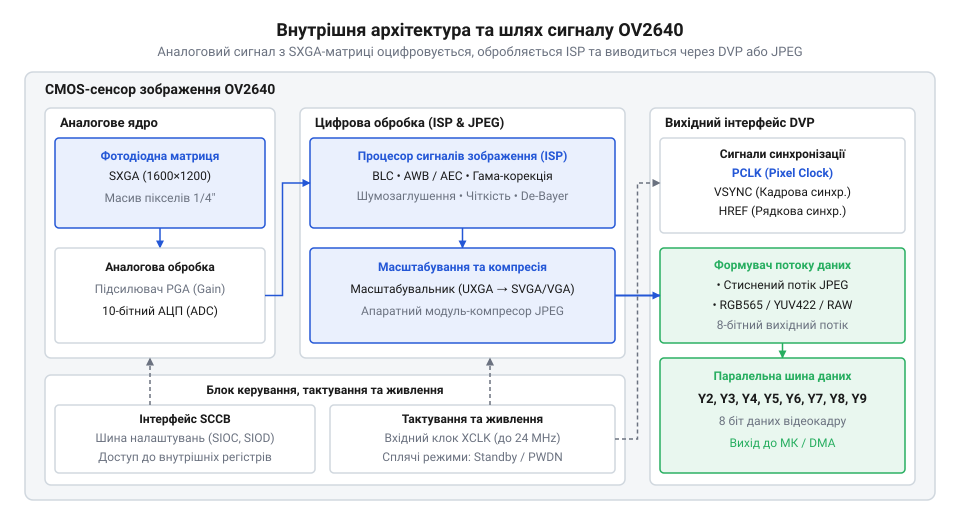
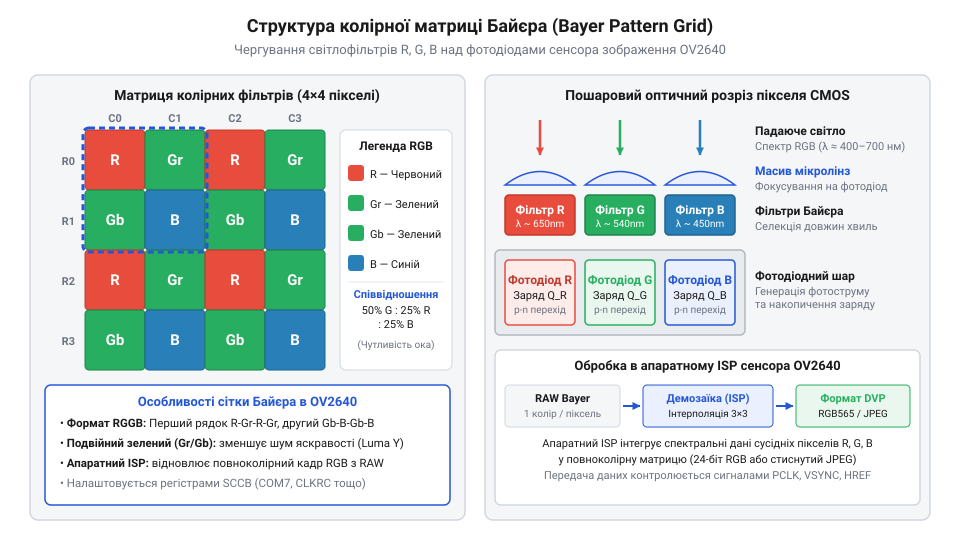
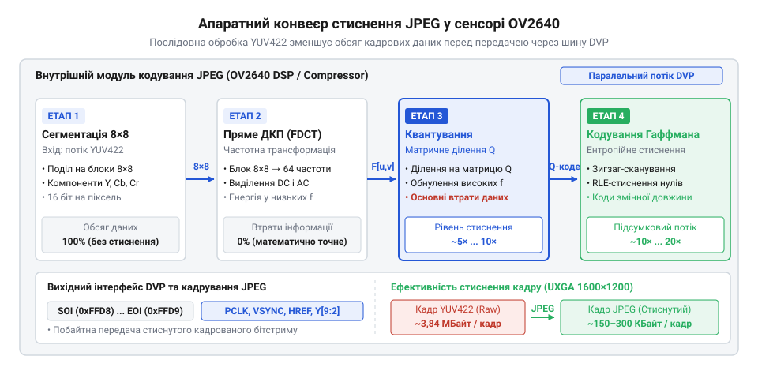
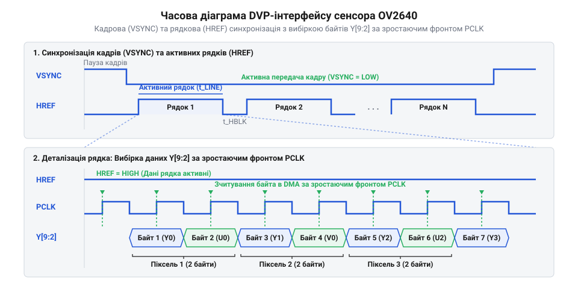
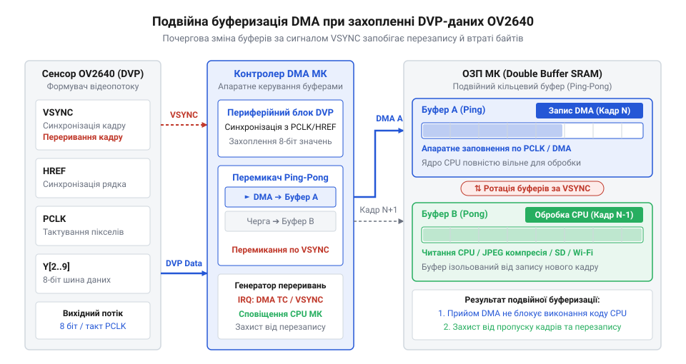
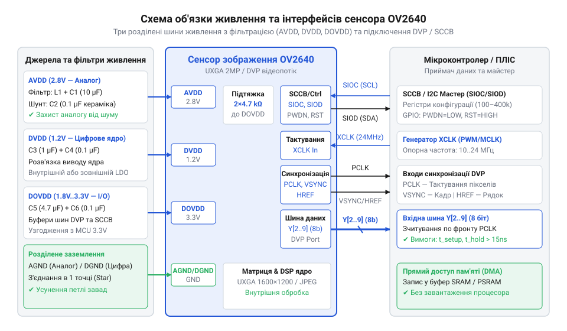

# Сенсор зображення OV2640

## Проблема передачі відеопотоків у мікроконтролерах

Захоплення цифрового відеозображення у вбудованих системах починається з фізичного перетворення світлового потоку на масив електричних сигналів. Коли фотони падають на напівпровідникову матрицю, кожен світлочутливий елемент створює електричний заряд, пропорційний інтенсивності освітлення. У сучасних цифрових камерах роздільна здатність вимірюється мільйонами таких елементів — @@en|pixel@@ (скорочення від англ. @@en|picture element@@ — елемент зображення). Проте спроба зчитати та зберегти цю інформацію за допомогою стандартного мікроконтролера миттєво зіштовхується з бар'єром пропускної здатності пам'яті та системної шини.

Розглянемо класичну світлочутливу матрицю стандарту @@en|UXGA@@ (від англ. @@en|Ultra Extended Graphics Array@@ — ультрарозширене графічне розділення) із роздільною здатністю `1600 × 1200` пікселів. Для передачі одного повноколірного кадру без стиснення у популярному форматі RGB565 або YUV422 на кожен піксель виділяється `2` байти (`16` біт) інформації. Обсяг даних одного кадру `S_frame` обчислюється як добуток ширини, висоти та глибини кольору:

S_frame = 1600 × 1200 × 2
        = 3 840 000 байт      [розмір одного несжиманого кадру SXGA]
        = 3.84 МБ             [переведення обсягу кадру в мегабайти]

Якщо відеокамера працює зі стандартною частотою оновлення `15` кадрів на секунду (від англ. @@en|fps@@, @@en|frames per second@@ — кадрів на секунду), сукупна швидкість генерації даних `D` сягає критичних значень:

D = 3 840 000 × 15
  = 57 600 000 байт/с         [обсяг первинних даних за одну секунду]
  = 57.6 МБ/с                 [необхідна пропускна здатність шини]

Типовий мікроконтролер загального призначення оперує внутрішньою статичною оперативною пам'яттю @@en|SRAM@@ (від англ. @@en|Static Random-Access Memory@@ — статична оперативна пам'ять) обсягом від `64` КБ до `512` КБ. Порівняння доступного обсягу пам'яті з розміром одного несжиманого кадру демонструє фізичну неможливість його локального збереження:

N_frames = 512 КБ ÷ 3840 КБ
         = 0.13               [частка кадру, яка вміщується у 512 КБ SRAM]

Мікроконтролер спроможний розмістити у пам'яті лише `13`% одного кадру SXGA. Навіть використання зовнішньої псевдостатичної пам'яті @@en|PSRAM@@ (від англ. @@en|Pseudo-Static Random-Access Memory@@ — псевдостатична оперативна пам'ять) не розв'язує проблеми передачі даних. Якщо мікроконтролер намагатиметься опитувати виводи загального призначення @@en|GPIO@@ (від англ. @@en|General-Purpose Input/Output@@ — виводи загального призначення) програмно або через переривання, затримка виконання інструкцій процесора унеможливить прийом потоку зі швидкістю `57.6` МБ/с. Використання прямого доступу до пам'яті @@en|DMA@@ (від англ. @@en|Direct Memory Access@@ — прямий доступ до пам'яті) дозволяє розвантажити процесор, проте безперервний потік даних повністю заблокує внутрішню системну шину, позбавляючи інші периферійні модулі доступності.

У середині 2000-х років компанія @@en|OmniVision Technologies@@ представила сенсор OV2640 як відповідь на стрімке зростання ринку мобільних пристроїв, де вимагалися компактні 2-мегапіксельні камери з низьким енергоспоживанням. Головним технологічним проривом стала інтеграція апаратного @@en|JPEG@@-компресора безпосередньо на кристал сенсора. Це зробило справжню революцію у сфері вбудованих систем: мікроконтролери звільнилися від обчислювально місткого завдання обробки й стиснення масивів піксельних даних. Перехід від аналогових @@en|CCD@@-матриць (від англ. @@en|CCD@@, @@en|Charge-Coupled Device@@ — прилад із зарядовим зв'язком) до високоінтегрованих систем-на-кристалі (від англ. @@en|SoC@@, @@en|System-on-Chip@@ — система на кристалі) дозволив поєднати фотодіодну матрицю, аналогово-цифровий перетворювач та цифровий процесор сигналів зображення на єдиному напівпровідниковому кристалі. Завдяки низькій вартості, стабільності та підтримці прямих стиснених потоків, OV2640 отримав надзвичайно тривалий життєвий цикл і пережив друге народження у масовій робототехніці та інтернеті речей завдяки популярним модулям на кшталт ESP32-CAM.

Щоб подолати вузьке місце передачі даних, обробку відеосигналу перенесли безпосередньо на напівпровідникову структуру сенсора. Вбудований процесор сигналів зображення @@en|ISP@@ (від англ. @@en|Image Signal Processor@@ — процесор сигналів зображення) виконує первинне калібрування, фільтрацію та кодування кадрів перед їх відправкою на вихідні шини.


*Загальна архітектура сенсора OV2640, що демонструє обробку вихідного світлового сигналу через аналогово-цифровий перетворювач, конвеєр ISP та компресор JPEG перед виводом на шину DVP.*

Інтегрований апаратний кодер @@en|JPEG@@ стискає повнорозмірний кадр SXGA із коефіцієнтом від `25:1` до `40:1`. Обсяг стисненого кадру `S_jpeg` зменшується до прийнятних значень:

S_jpeg = 3 840 000 ÷ 30
       = 128 000 байт         [середній розмір стисненого кадру JPEG]
       = 125 КБ               [обсяг у кілобайтах]

При частоті `15` кадрів на секунду необхідна пропускна здатність `D_jpeg` становить лише `1.92` МБ/с замість `57.6` МБ/с. Це знижує навантаження на шину даних на `96.7`%, дозволяючи навіть скромним мікроконтролерам приймати відеопотік через [паралельний відеоінтерфейс DVP](root:com-devices/dvp-parallel-video-interface).

Для передачі кадрів сенсор використовує лінії стробування: тактову частоту пікселів @@en|PCLK@@ (від англ. @@en|Pixel Clock@@ — тактовий сигнал пікселів), кадрову синхронізацію @@en|VSYNC@@ (від англ. @@en|Vertical Synchronization@@ — вертикальна синхронізація) та імпульс активності рядка @@en|HREF@@ (від англ. @@en|Horizontal Reference@@ — горизонтальний імпульс рядка). Конфігурація параметрів роботи сенсора здійснюється через [шину керування SCCB](root:com-devices/sccb-bus-protocol-architecture) (від англ. @@en|Serial Camera Control Bus@@ — послідовна шина керування камерою).

Прийоми збереження даних у пам'яті мікроконтролера вимагають мінімізації простою процесора. Якщо мікроконтролер зчитує кадр у поодинокий буфер, виникає пауза під час відправки даних у мережу або на карту пам'яті. У цей момент нові піксельні імпульси `PCLK` втрачаються, руйнуючи цілісність відеопотоку.


*Організація подвійного буферизування DMA в оперативній пам'яті мікроконтролера для безперервного зчитування кадрів без втрати вибірок.*

Розв'язанням є організація подвійного кільцевого буфера. Поки периферійний модуль DMA заповнює перший буфер `Buffer A` даними з шини DVP, центральний процесор обробляє вміст другого буфера `Buffer B`. По завершенні індикатора `HREF` або кадрового імпульсу `VSYNC` контролер DMA автоматично перемикає вказівник на `Buffer B`, викликаючи переривання для процесора.

Розрахувати часові інтервали передачі та узгодити подільники системної частоти допомагає [математика пропускної здатності DVP](root:cat-hw-sensors/ov2640-image-sensor/math-dvp-bandwidth-and-pll-clocking.md). Електричні параметри шини та цокольовку сигнальних ліній наведено в [довіднику апаратного інтерфейсу](root:cat-hw-sensors/ov2640-image-sensor/api-ov2640-hardware-interface.md), а приклад побудови безперервного тракту захоплення зображень описано у [практичному проєкті STM32](root:cat-hw-sensors/ov2640-image-sensor/proj-stm32-dcmi-dma-framebuffer.md).

## Архітектура фотодіодної матриці та ISP

Перетворення фізичного світла на цифрове зображення починається в напівпровідниковому кристалі, що містить масив кремнієвих фотодіодів. Сенсор OV2640 побудований за технологією комплементарних структур метал-оксид-напівпровідник — @@en|CMOS@@ (від англ. @@en|Complementary Metal-Oxide-Semiconductor@@). Фізичну основу кожного пікселя становить активна фотодіодна комірка @@en|APS@@ (від англ. @@en|Active-Pixel Sensor@@ — активний піксельний сенсор).

Коли фотон світла з енергією, що перевищує ширину забороненої зони кремнію, вдаряється об p-n перехід фотодіода, відбувається внутрішній фотоефект: утворюється пара електрон-дірка. Звільнені електрони накопичуються у потенціальній ямі комірки протягом часу експозиції. Сумарний накопичений електричний заряд `Q` прямо пропорційний освітленості `E` та часу накопичення `t_int`:

Q = E × t_int × k             [заряд фотодіодного накопичувача]

Проте кремнієвий кристал створює заряд навіть за повної відсутності світла. Унаслідок теплової генерації носіїв виникає темновий струм витоку `I_dark`. Цей струм додає паразитичний заряд до кожної вибірки:

Q_total = Q + I_dark × t_int  [сумарний заряд із урахуванням темнового витоку]

За підвищення температури навколишнього середовища темновий струм витоку зростає експоненціально, створюючи нерівномірний просторовий шум — @@en|FPN@@ (від англ. @@en|Fixed Pattern Noise@@ — фіксований структурований шум). На зображенні це проявляється у вигляді кольорового хаотичного зерна та "гарячих" пікселів. Для компенсації цього ефекту в OV2640 застосовується апаратне калібрування рівня чорного @@en|BLC@@ (від англ. @@en|Black Level Calibration@@ — калібрування рівня чорного). На периферії матриці розташовані закриті від світла оптичні еталонні пікселі, значення з яких віднімаються від сигналів робочої зони.

Фотодіоди самі по собі є сліпими до кольору: вони реагують лише на загальну кількість фотонів, незалежно від довжини хвилі. Щоб отримати кольорове зображення, поверх матриці наноситься мозаїчний масив світлофільтрів @@en|CFA@@ (від англ. @@en|Color Filter Array@@ — масив колірних фільтрів) за шаблоном Байєра.


*Організація мозаїчного фільтра Байєра RGGB з подвоєною щільністю зелених фотодіодів для відтворення сприйняття людського ока.*

У мозаїці Байєра @@en|Bayer pattern@@ (від прізвища винахідника @@en|Bryce Bayer@@) кожен піксель покритий фільтром одного з трьох первинних кольорів: червоного (R), зеленого (G) або синього (B). Зелені фільтри займають `50`% площі матриці, тоді як червоні й сині — по `25`%. Така пропорція зумовлена фізіологією людського ока, яке має найвищу чутливість до зеленої ділянки спектра яскравості.

Після завершення експозиції аналоговий заряд пікселя зчитується по стовпчиках і подається на модуль аналогово-цифрового перетворення @@en|ADC@@ (від англ. @@en|Analog-to-Digital Converter@@ — аналогово-цифровий перетворювач). Щоб усунути напругу зсуву та шум скидання транзисторів, застосовується метод подвійної корельованої вибірки @@en|CDS@@ (від англ. @@en|Correlated Double Sampling@@ — подвійна корельована вибірка). Схема вимірює напругу двічі: одразу після скидання комірки `V_reset` та після передачі заряду фотодіода `V_signal`. Корисний аналоговий сигнал `V_out` дорівнює їх різниці:

V_out = V_reset - V_signal   [різницевий сигнал без шуму скидання]

Отриманий аналоговий сигнал підсилюється у підсилювачі з програмованим коефіцієнтом @@en|PGA@@ (від англ. @@en|Programmable Gain Amplifier@@ — підсилювач із програмованим коефіцієнтом) і перетворюється 10-бітним АЦП на цифровий потік.

Оцифровані 10-бітні первинні дані @@en|Raw Bayer@@ надходять у конвеєр цифрового процесора сигналів зображення @@en|ISP@@. Усередині @@en|ISP@@ відбуваються наступні етапи обробки:

1. **Автоматичне регулювання експозиції та підсилення (AEC/AGC)**: алгоритм оцінює середню яскравість кадру й динамічно змінює час накопичення заряду `t_int` та коефіцієнт підсилення `PGA` для запобігання пересвітам чи затемненню (від англ. @@en|AEC@@, @@en|Automatic Exposure Control@@ та @@en|AGC@@, @@en|Automatic Gain Control@@). 2. **Автоматичний баланс білого (AWB)**: регулює коефіцієнти підсилення червоного, зеленого та синього каналів для коректного відтворення білого кольору при різному спектральному складі освітлення (від англ. @@en|AWB@@, @@en|Automatic White Balance@@). 3. **Корекція дефектних пікселів (DPC)**: виявляє локальні аномалії (пошкоджені або заблоковані пікселі) та замінює їх значення середньоарифметичним сусідніх осередків (від англ. @@en|DPC@@, @@en|Defective Pixel Correction@@). 4. **Корекція віньєтування лінзи (LSC)**: виправляє падіння яскравості на краях кадру, спричинене оптичною геометрією об'єктива камери (від англ. @@en|LSC@@, @@en|Lens Shading Correction@@). 5. **Демозаїка (Bayer Demosaicing)**: відновлює повноцінні колірні компоненти R, G, B для кожного пікселя шляхом інтерполяції значень з сусідніх комірок (від англ. @@en|Demosaicing@@).

Після відновлення кольорів @@en|ISP@@ виконує перетворення колірного простору з RGB у YUV422. У системі YUV компонент `Y` відповідає за яскравість (люмінацію), а `U` та `V` — за колірнорізницеві сигнали (хромінацію). Оскільки людський зір менш чутливий до колірних деталей, ніж до яскравосних, колірні компоненти проріджуються у 2 рази (від англ. @@en|downsampling@@ — субдискретизація). Завдяки цьому замість `24` біт на піксель потік YUV422 займає лише `16` біт, зменшуючи пропускну здатність на `33.3`%.

Завершальним блоком конвеєра @@en|ISP@@ є цифровий масштабувальник (від англ. @@en|scaler@@ — блок масштабування). Він дозволяє виконувати цифрове пропорційне зменшення кадрового поля від початкової роздільної здатності SXGA (`1600 × 1200`) до форматів SVGA (`800 × 600`), VGA (`640 × 480`), CIF (`352 × 288`) або QVGA (`320 × 240`). Масштабування виконується до того, як дані потрапляють до вихідних регістрів або блоку компресії.

Конфігурування режимів @@en|ISP@@ та перемикання сторінок регістрів (від англ. @@en|bank switching@@) детально описані в [довіднику драйвера SCCB](root:cat-hw-sensors/ov2640-image-sensor/api-ov2640-sccb-driver.md). Приклади практичної інтеграції з масштабуванням кадрів наведені у проєкті [потокова передача JPEG-відео](root:cat-hw-sensors/ov2640-image-sensor/proj-esp32-cam-jpeg-streamer.md). Для глибшого занурення у фізику напівпровідникових фотодетекторів зверніться до статті про [принцип роботи CMOS-матриць](root:hw-sensing/cmos-sensor-pixel-architecture), а подальший шлях обробленого потоку YUV розглядається у матеріалі про [апаратне кодування JPEG](root:com-signal/cmos-sensor-hardware-jpeg-compression).

## Апаратний модуль стиснення кадрів JPEG

Обробка несжиманих масивів пікселів високої роздільної здатності створює серйозний бар'єр для вбудованих систем. Кадр роздільної здатності SXGA (1600 × 1200 пікселів) у кольоровому форматі @@en|YUV422@@ або @@en|RGB565@@ займає 3.84 МБ пам'яті. При частоті оновлення 15 кадрів на секунду потік даних сягає 57.6 МБ/с. Для переважної більшості мікроконтролерів із внутрішньою оперативною пам'яттю @@en|SRAM@@ обсягом у кілька сотень кілобайт збереження навіть одного такого кадру є фізично неможливим. Підключення зовнішньої пам'яті @@en|PSRAM@@ частково вирішує проблему зберігання, але шина даних та периферія захоплення опиняються під граничним навантаженням. Щоб розвантажити обчислювальне ядро та знизити вимоги до пропускної здатності, всередині сенсора OV2640 реалізовано [апаратне кодування зображень JPEG](root:com-signal/cmos-sensor-hardware-jpeg-compression), яке стискає вхідний потік кадрів безпосередньо на кристалі до того, як дані потраплять на вихідний інтерфейс.

Апаратний компресор @@en|JPEG@@ приймає підготовлені блоки пікселів безпосередньо з виходу конвеєра обробки зображення (ISP). На цей момент кадр вже пройшов корекцію темнового струму, відновлення кольорів та цифрове масштабування. Компресор працює з кольоровим простором YUV, оскільки людський зір набагато чутливіший до змін яскравості (компонента Y), ніж до кольорових відтінків (компоненти U та V). Вхідний кадр розбивається на кодувальні матриці розміром 8 × 8 пікселів. Для кожного такого блоку виконується пряме дискретне косинусне перетворення (від лат. *transformare* — перетворювати), або @@en|FDCT@@. Перетворення переводить просторовий розподіл яскравості пікселів у частотну область, розкладаючи матрицю 8 × 8 на 64 коефіцієнти: один постійний складник (DC), що відображає середню яскравість блоку, та 63 змінні складники (AC), які відповідають за просторові частоти різної деталізації.


*Підпис: Конвеєр апаратного кодування JPEG в OV2640 перетворює сирий потік YUV422 у стиснутий потік байтів із маркерами кадру.*

Після обчислення коефіцієнтів FDCT починається етап квантування (від лат. *quantus* — скільки), який є головним джерелом контрольованого зменшення обсягу даних. Кожен із 64 частотних коефіцієнтів ділиться на відповідне число з таблиці квантування (@@en|Quantization Matrix@@) і округлюється до найближчого цілого. Оскільки високі просторові частоти відповідають за дрібні деталі та незначний шум, які малопомітні людському оку, коефіцієнти таблиці квантування для високочастотних складників обираються значними. У результаті більшість коефіцієнтів високих частот стають нульовими. Розробник може гнучко змінювати коефіцієнт стиснення та якість підсумкового зображення за допомогою внутрішніх регістрів OV2640 через [програмний інтерфейс драйвера](root:cat-hw-sensors/ov2640-image-sensor/api-ov2640-sccb-driver.md). Збільшення значення регістра шкали квантування (QS) призводить до жорсткішого ділення коефіцієнтів: розмір файлу кадру зменшується у 10–30 разів порівняно з сирим масивом, проте на контрастних межах з'являються артефакти стиснення у вигляді блочності та кільцевого шуму.

Отримані після квантування цілочисельні коефіцієнти впорядковуються зигзагоподібним скануванням. Такий порядок згруповує всі нульові значення у довгі послідовності наприкінці масиву. Кодування довжин серій (@@en|RLE@@) згортає ланцюжки нулів у компактні пари «кількість нулів — значення наступного коефіцієнта». Далі фінальний потік піддається кодуванню Гаффмана (@@en|Huffman Coding@@), де частіше вживані значення замінюються короткими бітовими послідовностями, а рідкісні — довшими. Апаратний модуль OV2640 самостійно формує повністю валідний потік байтів стандарту JPEG, додаючи у початковий та кінцевий блоки кадру заголовочні маркери. На початку кадру вставляється маркер початку зображення SOI (`0xFFD8`), а також заголовочні секції DQT (таблиці квантування) та DHT (таблиці Гаффмана). Завершується кадр маркером кінця зображення EOI (`0xFFD9`).

Важливою особливістю апаратного JPEG-компресора є динамічна зміна розміру вихідного кадру. На відміну від несжиманого формату, де кожен кадр має фіксовану довжину в байтах, розмір JPEG-кадру залежить від насиченості деталями конкретної сцени. Зображення однотонної стіни може стиснутися до 15–20 кілобайт, тоді як деталізований пейзаж із великою кількістю дрібних текстур займатиме 80–120 кілобайт. Через це керуючий мікроконтролер не може заздалегідь знати точну кількість байтів, яка надійде під час поточного кадру. Під час проектування системи буферизації пам'ять під @@en|DMA@@ (від англ. *Direct Memory Access* — прямий доступ до пам'яті) виділяють із розрахунком на найгірший випадок мінімального стиснення, або організують кільцеві буфери з динамічним пошуком маркера EOI. Такий підхід дає змогу реалізувати [потокову передачу JPEG-відео](root:cat-hw-sensors/ov2640-image-sensor/proj-esp32-cam-jpeg-streamer.md) навіть на обмежених за ресурсами платформах, передаючи стиснуті дані безпосередньо у мережевий стек.

## Часова синхронізація паралельного інтерфейсу DVP

Передача сформованих даних від сенсора зображення до обчислювального ядра здійснюється через паралельний інтерфейс (від грец. *parallelos* — що йде поруч) DVP. Організація [паралельного відеоінтерфейсу DVP](root:com-devices/dvp-parallel-video-interface) (від англ. *Digital Video Port* — цифровий відеопорт) містить 8-бітну шину даних `Y2`–`Y9` та три лінії часової синхронізації: піксельну частоту `PCLK`, сигнал рядкової синхронізації `HREF` та сигнал кадрової синхронізації `VSYNC`. Також сенсор потребує зовнішнього системного тактування `XCLK`, яке генерується мікроконтролером або окремим кварцовим генератором. Використання старших бітів `Y2`–`Y9` замість `Y0`–`Y7` зумовлено внутрішньою архітектурою АЦП сенсора: при роботі в 8-бітному режимі молодші два біти відсікаються для зниження цифрового шуму.


*Підпис: Співвідношення часових сигналів DVP при передачі кадрового синхроімпульсу, рядкових інтервалів та стробуванні піксельних байтів.*

Часові діаграми DVP описують чітку ієрархію синхронізації передачі відеопотоку. Передача кожного нового кадру починається з імпульсу кадрової синхронізації `VSYNC`. Коли `VSYNC` переходить у активний стан, приймальний модуль мікроконтролера скидає внутрішні вказівники буфера кадру. Всередині кадрового інтервалу передача кожного окремого рядка супроводжується активним рівнем сигналу `HREF` (від англ. *Horizontal Reference* — горизонтальний орієнтир). Поки `HREF` перебуває у високому стані, кожен спадний або зростаючий фронт піксельного тактового сигналу `PCLK` стробує один байт даних на шині `Y2`–`Y9`. Під час паузи між рядками (інтервал h-blanking) сигнал `HREF` переходить у низький стан, і передача байтів припиняється. У режимі несжиманого відео @@en|RGB565@@ один піксель передається двома послідовними байтами на двох тактах `PCLK`, а у режимі JPEG шиною передається суцільний потік стиснутих байтів протягом активних фаз `HREF`.

Частота піксельного тактування `PCLK` визначає швидкість надходження байтів у периферійний модуль мікроконтролера. Вона не є фіксованою і розраховується на основі вхідного сигналу `XCLK` за допомогою внутрішнього модуля фазового автопідстроювання частоти (від грец. *phasis* — фаза), або @@en|PLL@@. Конфігурація множників та дільників `PLL` здійснюється записом у регістри `CLKRC` та `DBLC`. Налаштування внутрішніх регістрів виконується через [протокол шини керування](root:com-devices/sccb-bus-protocol-architecture) SCCB.

Загальне математичне співвідношення для обчислення системної частоти ядра ISP та вихідної частоти `PCLK` виглядає наступним чином:

SYSCLK = (XCLK × PLL_MULT) / (CLKRC_DIV + 1)
PCLK   = SYSCLK / PCLK_DIV

Розглянемо практичний приклад розрахунку часових параметрів для типової конфігурації сенсора.

**Розрахунок піксельної частоти PCLK при вхідній частоті XCLK = 24 МГц**
```
XCLK       = 24.0 МГц                   [вхідна частота тактування від мікроконтролера]
PLL_MULT   = 4                          [увімкнено внутрішній множник PLL ×4]
CLKRC_DIV  = 0                          [значення бітів CLKRC[5:0] = 0, дільник = 0 + 1 = 1]
SYSCLK     = (24.0 × 4) / 1
           = 96.0 МГц                   [частота системного ядра ISP]
PCLK_DIV   = 4                          [внутрішній дільник PCLK для режиму SVGA]
PCLK       = 96.0 / 4
           = 24.0 МГц                   [підсумкова піксельна частота на шині DVP]
```

Отримана піксельна частота 24.0 МГц означає, що паралельний інтерфейс видає 24 мільйони байтів на секунду.

Невірно обрана частота `PCLK` є однією з найпоширеніших причин збоїв відеозахоплення. Якщо піксельна частота перевищує максимальну пропускну здатність шини мікроконтролера або швидкість роботи його модуля DMA, виникає переповнення внутрішнього FIFO-буфера периферії. Це призводить до втрати байтів, зміщення рядків або повного спотворення кадру. З іншого боку, занадто низька частота `PCLK` обмежує максимальну частоту кадрів (fps) та призводить до виникнення артефактів руху. Проведення [розрахунку частот PLL](root:cat-hw-sensors/ov2640-image-sensor/math-dvp-bandwidth-and-pll-clocking.md) дозволяє заздалегідь розрахувати обсяги буферів та уникнути втрати даних.

При побудові апаратної частини сигнатурні лінії `PCLK`, `VSYNC` та `HREF` вимагають коротких провідників однаковоі довжини та надійного заземлення для запобігання фазовому зсуву (@@en|Clock Skew@@) та наводкам. Електричні рівні описує [апаратний інтерфейс OV2640](root:cat-hw-sensors/ov2640-image-sensor/api-ov2640-hardware-interface.md) з урахуванням узгодження імпедансу. У практичних системах на мікроконтролерах STM32 побудова системи [захоплення несжиманих кадрів](root:cat-hw-sensors/ov2640-image-sensor/proj-stm32-dcmi-dma-framebuffer.md) виконується модулем DCMI. Приймальний модуль обробляє переривання по VSYNC для старт-стопної синхронізації кадрів і використовує кільцевий буфер DMA для безперервного запису відеопотоку в оперативну пам'ять без залучення процесора.

## Узгодження з DMA та буферизація кадрів

Вихідний цифровий потік сенсора OV2640 формується на тактовій частоті @@en|PCLK@@ (англ. *Pixel Clock* — тактовий сигнал пікселя), яка під час активної передачі кадрів сягає від 10 до 24 МГц. Спроба програмного опитування ліній шини через @@en|GPIO@@ (англ. *General-Purpose Input/Output* — вхід/вихід загального призначення) у мікроконтролері призводить до миттєвої втрати байтів, оскільки затримки обробки переривань та виконання інструкцій ядром перевищують тривалість одного піксельного такту (41–100 нс). Для забезпечення безперервного захоплення даних без залучення процесора використовують спеціалізовані апаратні периферійні модулі, такі як @@en|DCMI@@ (англ. *Digital Camera Interface* — інтерфейс цифрової камери) у мікроконтролерах @@en|STM32@@ або блоки @@en|I2S@@/@@en|LCD DVP@@ у @@en|ESP32@@, які зв'язують [паралельний інтерфейс DVP](root:com-devices/dvp-parallel-video-interface) безпосередньо з контролером @@en|DMA@@ (англ. *Direct Memory Access* — прямий доступ до пам'яті).

Розмір оперативної пам'яті мікроконтролера виступає головним обмежувальним фактором при виборі режиму роботи сенсора. Для нестисненого кадру роздільної здатності @@en|SXGA@@ (1600×1200 пікселів) у форматі @@en|RGB565@@ (2 байти на піксель) необхідний обсяг буфера обчислюється за формулою:

    B_frame = W × H × bpp
    = 1600 × 1200 × 2        [підстановка роздільної здатності SXGA та 16 біт на піксель]
    = 3840000                [обчислення загального обсягу кадру в байтах]

Отриманий обсяг у 3.84 МБ перевищує розмір вбудованої @@en|SRAM@@ (англ. *Static Random-Access Memory* — статична оперативна пам'ять) більшості мікроконтролерів у десятки разів. Навіть для роздільної здатності @@en|SVGA@@ (800×600) у форматі @@en|RGB565@@ потрібно 960 КБ пам'яті. Використання вбудованого кодера @@en|JPEG@@ (англ. *Joint Photographic Experts Group*) знижує обсяг даних у 10–30 разів — кадр @@en|UXGA@@ у стисненому вигляді займає від 30 до 150 КБ, що дозволяє розмістити його в @@en|SRAM@@ або зовнішній @@en|PSRAM@@ (англ. *Pseudo-Static RAM* — псевдостатична оперативна пам'ять). Повний розрахунок частотних параметрів та вибір обсягів пам'яті наведено у [розрахунку частот та буферів](root:cat-hw-sensors/ov2640-image-sensor/math-dvp-bandwidth-and-pll-clocking.md) для систем з обмеженими ресурсами.

Один статичний буфер не дозволяє одночасно приймати новий кадр і обробляти або передавати попередній: поки процесор читає дані з пам'яті для відправки через @@en|SPI@@ чи @@en|Wi-Fi@@, контролер @@en|DMA@@ перезаписує ті самі комірки новим потоком з камери, що спричиняє спотворення зображення (артефакт розриву кадру) або руйнування бітового потоку @@en|JPEG@@. Щоб уникнути стану гонитви, застосовують @@en|ping-pong buffer@@ (подвійне буферизування) у кільцевому режимі (@@en|circular mode@@).


*Функціонування подвійного кільцевого буфера DMA: поки контролер заповнює одну половину пам'яті вихідним потоком DVP, процесор обробляє другу половину.*

Принцип роботи подвійного буфера полягає у поділі виділеного масиву пам'яті розміром 2N байтів на дві рівні секції. Контролер @@en|DMA@@ автоматично перемикає адреси призначення при досягненні середини та кінця буфера:

1. @@en|DMA@@ записує вихідні байти шини @@en|DVP@@ у першу половину буфера (Buffer 0, байти від 0 до N-1). 2. Після заповнення Buffer 0 апаратний блок генерує переривання половини передачі @@en|Half-Transfer Interrupt@@ (HT). Процесор миттєво отримує сигнал і починає обробку або копіювання даних із Buffer 0. 3. Одночасно контролер @@en|DMA@@ без зупинки продовжує записувати нові байти кадру в другу половину буфера (Buffer 1, байти від N до 2N-1). 4. Заповнивши Buffer 1, @@en|DMA@@ генерує переривання завершення передачі @@en|Transfer-Complete Interrupt@@ (TC), закольцовує вказівник назад на Buffer 0 і продовжує запис. Процесор переключається на обробку Buffer 1.

У нестиснених режимах (@@en|RGB565@@, @@en|YUV422@@) розмір кожного рядка та кадру фіксований, тому довжину транзакції @@en|DMA@@ налаштовують на точну кількість байтів рядка. У режимі @@en|JPEG@@ розмір кадру змінюється від кадру до кадру залежно від деталізації сцени та коефіцієнтів квантування. [Апаратне кодування JPEG](root:com-signal/cmos-sensor-hardware-jpeg-compression) видає байти лише під час активного сигналу @@en|HREF@@ (англ. *Horizontal Reference* — горизонтальна опорна синхронізація), а паузи між рядками та кадрами супроводжуються спадом @@en|HREF@@ та @@en|VSYNC@@ (англ. *Vertical Synchronization* — вертикальна синхронізація).

Для точного визначення меж dynamic-кадру @@en|JPEG@@ мікроконтролер відстежує спадаючий фронт сигналу @@en|VSYNC@@. У момент закінчення кадру обробник переривання @@en|VSYNC@@ зчитує поточний лічильник байтів контролера @@en|DMA@@, обчислює точний розмір прийнятого масиву і сканує кінець буфера на наявність маркерів @@en|JPEG@@: початку зображення `0xFFD8` (@@en|SOI@@ — англ. *Start of Image*) та кінця зображення `0xFFD9` (@@en|EOI@@ — англ. *End of Image*). Конкретну реалізацію апаратного захоплення для мікроконтролерів @@en|STM32@@ детально розглянуто у [проєкті фреймбуфера STM32](root:cat-hw-sensors/ov2640-image-sensor/proj-stm32-dcmi-dma-framebuffer.md), а організацію потокової передачі через @@en|PSRAM@@ висвітлено у [практичному проекті потокового відео](root:cat-hw-sensors/ov2640-image-sensor/proj-esp32-cam-jpeg-streamer.md) для платформи @@en|ESP32-CAM@@. Електричні часові діаграми сигналів наведено у [довіднику апаратного інтерфейсу](root:cat-hw-sensors/ov2640-image-sensor/api-ov2640-hardware-interface.md) модуля.

Якщо швидкість обробки кадру процесором або передачі по мережі менша за частоту кадрів камери, виникає переповнення буферів (@@en|buffer overrun@@). Для запобігання пошкодженню даних у драйвер впроваджують автомат станів з прапором зайнятості `frame_busy`. Якщо на момент приходу нового спадаючого фронту @@en|VSYNC@@ прапор `frame_busy` встановлено у значення `true`, обробник переривання пропускає цей кадр, вимикаючи прийом @@en|DMA@@ на час його генерації, і вмикає захоплення знову лише після звільнення буфера процесором.

Крім того, при високошвидкісній передачі через шину @@en|DVP@@ можливі апаратні затримки шини системної пам'яті (AHB bus contention). Якщо ядро процесора або інші периферійні модулі блокують доступ до @@en|SRAM@@, внутрішній фіксований буфер @@en|FIFO@@ (англ. *First-In, First-Out* — першим зайшов, першим вийшов) периферійного модуля камери переповнюється, що призводить до втрати пікселів та вертикального зсуву зображення. Для усунення цього ефекту встановлюють найвищий пріоритет каналу @@en|DMA@@ камери та налаштовують пакетні транзакції (@@en|burst transfer@@) по 4 або 8 слів.

Нижче наведено приклад програмної реалізації обробника переривань та керування подвійним буфером @@en|DMA@@ для захоплення кадрів:

:::tabs
@c|stm32
:::code ov2640-image-sensor-d/c/snippet-1.c

@cpp|esp-idf
:::code ov2640-image-sensor-d/cpp/framebuffermanager.cpp
:::

## Конфігурування через SCCB та електричні режими

Перед початком передачі відеопотоку сенсор OV2640 потребує детального налаштування внутрішніх системних регістрів. Конфігурування обробника @@en|ISP@@ (англ. *Image Signal Processor* — процесор обробки сигналів зображення), дільників частоти, розміру матриці та формату вихідних даних здійснюється через [протокол керування SCCB](root:com-devices/sccb-bus-protocol-architecture) (англ. *Serial Camera Control Bus* — послідовна шина керування камерою). Цей протокол є розробкою компанії @@en|OmniVision@@ і концептуально сумісний з інтерфейсом @@en|I2C@@ (англ. *Inter-Integrated Circuit* — міжмікросхемна шина), але має принципові апаратні та часові відмінності.

Шина @@en|SCCB@@ використовує дві сигнальні лінії: тактову лінію @@en|SIO_C@@ (Serial Input/Output Clock) та двонаправлену лінію даних @@en|SIO_D@@ (Serial Input/Output Data). Базова 7-бітна адреса пристрою OV2640 на шині становить `0x30` (що відповідає `0x60` для запису та `0x61` для зчитування в 8-бітному форматі). На відміну від стандартного @@en|I2C@@, протокол @@en|SCCB@@ не підтримує механізм утримання тактової лінії веденим пристроєм (@@en|clock stretching@@) і вимагає суворого дотримання 3-фазного циклу запису (адреса пристрою, суб-адреса регістру, дані) та 2-фазного циклу зчитування.

Ключовою особливістю конфігурування OV2640 є наявність двох незалежних банків регістрів (@@en|register banks@@):

1. **Bank 0 (`0xFF = 0x00`)**: Налаштування блоку @@en|ISP@@, цифрового масштабувальника (@@en|scaler@@), апаратного кодера @@en|JPEG@@, колірної матриці, гамма-корекції та форматів виходу. 2. **Bank 1 (`0xFF = 0x01`)**: Налаштування ядра аналогової фотодіодної матриці, підсилювача @@en|PGA@@ (англ. *Programmable Gain Amplifier*), системи автоматичної експозиції @@en|AEC@@ (англ. *Automatic Exposure Control*), автоматичного підсилення @@en|AGC@@ та кадрування затвора.

Спроба записати значення у регістр Bank 0 без попередньої зміни байта в регістрі `0xFF` призводить до випадкового перезапису критичних аналогових параметрів Bank 1, що викликає повний збій синхронізації камери. Детальний опис реєстраційної карти та програмних функцій наведено у [довіднику з драйвера SCCB](root:cat-hw-sensors/ov2640-image-sensor/api-ov2640-sccb-driver.md).

Надійність роботи сенсора та рівень шумів отриманого зображення напряму залежать від якості та розділення ліній живлення. Сенсор OV2640 вимагає подачі трьох незалежних напруг:

- @@en|AVDD@@: Аналогове живлення 2.8 В. Живить фотодіодний масив та аналогово-цифрові перетворювачі @@en|ADC@@ (англ. *Analog-to-Digital Converter*). - @@en|DVDD@@: Цифрове живлення ядра 1.3 В. Живить процесор @@en|ISP@@, компресор @@en|JPEG@@ та внутрішню логіку. Може формуватися вбудованим у сенсор або зовнішнім регулятором @@en|LDO@@ (англ. *Low Drop-Out regulator* — лінійний стабілізатор з малим падінням напруги). - @@en|DOVDD@@: Живлення цифрових інтерфейсів вводу/виводу від 1.8 В до 3.3 В. Визначає логічний рівень вихідних ліній шини @@en|DVP@@ та шини @@en|SCCB@@.


*Передача даних через шину SCCB із перемиканням банків регістрів та розділенням аналогового й цифрового живлення.*

Пульсації або високочастотні завади на лінії @@en|AVDD@@ безпосередньо транслюються в аналоговий тракт, утворюючи горизонтальні смуги шумів та яскравостні спотворення. Для нейтралізації завад біля виводів @@en|AVDD@@ обов'язково встановлюють керамічні розв'язувальні конденсатори ємністю 0.1 мкФ та 10 мкФ з низьким еквівалентним послідовним опором (@@en|ESR@@), а аналогову землю (`AGND`) з'єднують із цифровою землею (`DGND`) в одній точці під сенсором. Детальна фізична структура фоточутливих елементів висвітлена в [архітектурі матриці CMOS](root:hw-sensing/cmos-sensor-pixel-architecture) для сенсорних систем.

Температурний режим сенсора суттєво впливає на генерацію завад. При підвищенні температури кристала через власне нагрівання або зовнішнє середовище спостерігається експоненціальне зростання темнового струму витоку (@@en|dark current leakage@@ чи @@en|dark current@@). Темновий струм призводить до накопичення паразитного заряду у фотодіодах навіть за відсутності світла. На зображенні це проявляється у вигляді фіксованого структурного шуму @@en|FPN@@ (англ. *Fixed Pattern Noise* — фіксований структурний шум), фіолетового або зеленого відтінку у темних ділянках кадру та появи гарячих пікселів (@@en|hot pixels@@). Для боротьби з цим ефектом використовують схему автоматичного калібрування рівня чорного @@en|BLC@@ (англ. *Black Level Calibration*), а у паузах між зйомками переводять сенсор у сплячі режими.

Для зниження енергоспоживання в автономних пристроях OV2640 підтримує два режими енергозбереження:

1. **Апаратний режим PowerDown (`PWDN`)**: Викликається подачею високого логічного рівня на фізичний вивід `PWDN`. У цьому режимі вимикаються внутрішній генератор @@en|PLL@@ (англ. *Phase-Locked Loop* — фазове автопідлаштування частоти), стабілізатор @@en|LDO@@ та аналогові блоки. Споживання струму знижується з 40 мА (при зйомці @@en|SXGA@@) до менше ніж 10 мкА. Вихід з режиму вимагає повернення `PWDN` у низький стан, подачі імпульсу скидання на вивід `RESET` та повторного завантаження всіх регістрів конфігурації через @@en|SCCB@@. 2. **Програмний режим Standby**: Активується записом біта 4 у регістр `0x09` через шину @@en|SCCB@@. У цьому режимі зупиняється тактування внутрішньої логіки, але значення регістрів конфігурації в @@en|SRAM@@ повністю зберігаються. Вихід відбувається шляхом скидання біта 4 без необхідності повторної ініціалізації.

Під час інтеграції OV2640 у мікроконтролерні системи часто виникають типові апаратні та програмні збої. Нижче наведено матрицю діагностики та методів їх усунення:

| Симптом збою | Вірогідна причина | Спосіб усунення |
| :--- | :--- | :--- |
| Зелений/пурпуровий «сніг» або зміщення кольорів у @@en|RGB565@@ | Інверсія полярності стробування @@en|PCLK@@ або переплутаний порядок байтів (Endianness) | Змінити налаштування фази @@en|PCLK@@ у регістрі `0x11` або в периферійному модулі @@en|DCMI@@ / @@en|I2S@@ |
| Горизонтальний зсув зображення або діагональний розрив | Помилка полярності стробу @@en|HREF@@ або незбіг вирівнювання буфера @@en|DMA@@ | Змінити полярність @@en|HREF@@ у конфігурації @@en|DCMI@@ та перевірити кратність буфера 4 байтам |
| Відсутність відповіді на шині @@en|SCCB@@ (@@en|NACK@@) | Відсутній вхідний тактовий сигнал @@en|XCLK@@ | Запустити генерацію @@en|XCLK@@ (10–24 МГц) від мікроконтролера до початку зчитування @@en|SCCB@@ |
| Пошкодження файлів @@en|JPEG@@ (відсутній маркер @@en|EOI@@) | Переповнення @@en|FIFO@@ через затримки шини пам'яті або занадто висока частота @@en|PCLK@@ | Підвищити пріоритет @@en|DMA@@ та зменшити внутрішній множник @@en|PLL@@ сенсора |

Фізичні розпіновки та електричні характеристики виводів детально описано у [довіднику апаратного інтерфейсу](root:cat-hw-sensors/ov2640-image-sensor/api-ov2640-hardware-interface.md).

Нижче наведено приклад коду для виконання базових операцій перемикання банків регістрів та переведення сенсора у режим Standby:

:::tabs
@c|stm32
:::code ov2640-image-sensor-d/c/ov2640-write-register.c

@cpp|esp-idf
:::code ov2640-image-sensor-d/cpp/ov2640controller.cpp
:::