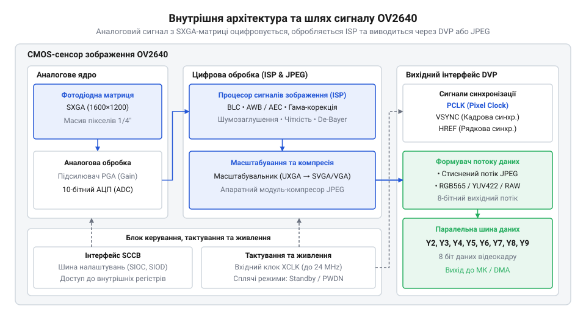
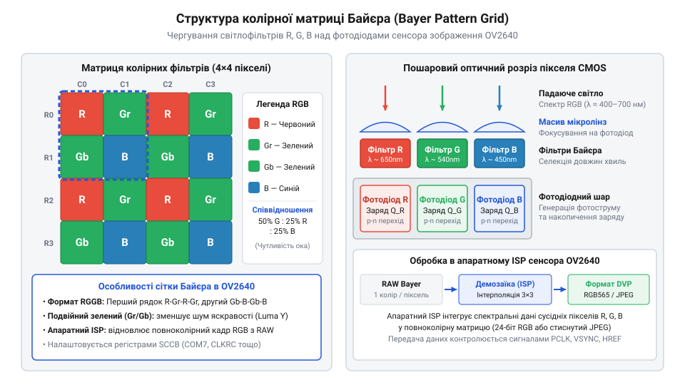
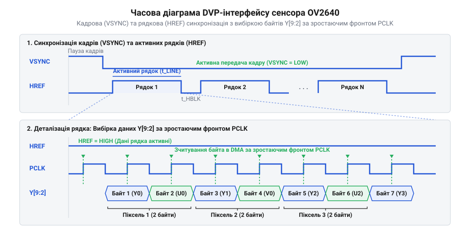

# Сенсор зображення OV2640

<preknowlist>
- [Паралельний відеоінтерфейс DVP](root:com-devices/dvp-parallel-video-interface) — Принципи синхронізації й передачі паралельних відеоданих через сигнали PCLK, HREF та VSYNC.
- [Шина керування SCCB](root:com-devices/sccb-bus-protocol-architecture) — Механізм послідовного читання й запису конфігураційних регістрів пристрою.
- [Принцип роботи CMOS-матриць](root:hw-sensing/cmos-sensor-pixel-architecture) — Накопичення заряду у фотодіодах та вибірка сигналу активними пікселями.
- [Апаратне кодування JPEG](root:com-signal/cmos-sensor-hardware-jpeg-compression) — Базовий алгоритм дискретного косинусного перетворення, квантування та кодування стисненого потоку.
</preknowlist>

## Проблема передачі відеопотоків у мікроконтролерах

Типові мікроконтролери мають обмежений обсяг статичної оперативної пам'яті — @@en|SRAM@@ (від англ. *Static Random-Access Memory* — статична пам'ять із довільним доступом) — від десятків до кількох сотень кілобайт. Кадр високої роздільної здатності потребує більше пам'яті, ніж має вся система.

Для кадру формату YUV з роздільною здатністю UXGA необхідний обсяг пам'яті `M` через ширину `W`, висоту `H` та `B` байтів на піксель обчислюють так:

```
M = W × H × B
= 1600 × 1200 × 2        [підстановка UXGA та 2 байтів на піксель]
= 3840000                [обсяг кадру в байтах]
```

Отримані 3.84 мегабайта не помістяться в @@en|SRAM@@. Потік зі швидкістю 15 кадрів на секунду створює навантаження на шину понад 57 мегабайтів на секунду, що блокує процесор.


*Внутрішня блок-схема сенсора OV2640 показує зв'язок між піксельною матрицею, обробником ISP, кодером JPEG та вихідним портом DVP.*

Розв'язком є перенесення стиснення на кристал сенсора. Сенсор @@en|OV2640@@ об'єднує [CMOS-матрицю](root:hw-sensing/cmos-sensor-pixel-architecture), процесор сигналів зображення — @@en|ISP@@ (від англ. *Image Signal Processor* — процесор сигналів зображення) та апаратний кодер @@en|JPEG@@ (від англ. *Joint Photographic Experts Group* — об'єднана група експертів у галузі фотографії). Мікроконтролер отримує вже стиснений потік даних.

## Архітектура фотодіодної матриці та ISP

Фотодіоди матриці @@en|CMOS@@ перетворюють фотони на електричний заряд, реєструючи лише інтенсивність світла та додаючи темновий шум від нагріву кристала. Щоб сформувати колір, поверх матриці нанесено мозаїчний @@en|фільтр Байєра@@, де кожен піксель фіксує один спектр — червоний, зелений або синій.


*Структура мозаїчного фільтра Байєра з подвоєною кількістю зелених пікселів для відтворення яскравості та кольору.*

Оцифрований потік обробляє вбудований процесор @@en|ISP@@: віднімає темновий шум, демозаїкою відновлює колір кожного пікселя із сусідніх та перетворює дані у проміжний простір @@en|YUV422@@. Детальніше про розділення каналів яскравості та колірності й формати субдискретизації читайте у статті про [колірний простір YUV у сенсорах зображення](root:sf-visual/ycbcr-digital-pixel-formats).

## Апаратне стиснення кадрів JPEG

Для розвантаження пам'яті вбудоване [апаратне кодування JPEG](root:com-signal/cmos-sensor-hardware-jpeg-compression) стискає потік від процесора @@en|ISP@@ у 10–30 разів — до 30–150 кілобайт на кадр.


*Конвеєр стиснення відеопотоку в сенсорі OV2640 від блочного розбиття YUV до формування заголовочних маркерів JPEG.*

Через залежність від деталізації сцени стиснений кадр має змінну довжину. Сенсор позначає його початок маркером `0xFFD8` (SOI), а кінець — `0xFFD9` (EOI), тож мікроконтролер зчитує потік до кінцевого маркера без попереднього знання розміру файлу.

## Синхронізація DVP та буферизація DMA

Виведення кадрів відбувається через [паралельний відеоінтерфейс DVP](root:com-devices/dvp-parallel-video-interface) — @@en|DVP@@ (від англ. *Digital Video Port* — цифровий відеопорт). Сигнал `@@en|VSYNC@@` (від англ. *Vertical Sync* — кадрова синхронізація) визначає межі кадру, `@@en|HREF@@` (від англ. *Horizontal Reference* — опорний сигнал рядка) стає активним під час передачі рядка, а `@@en|PCLK@@` (від англ. *Pixel Clock* — піксельний тактовий сигнал) стробує кожен байт.

Піксельну частоту `PCLK` обчислюють із вхідної частоти `XVCLK`, множника `M` та дільника `N` фазового автопідлаштування частоти — @@en|PLL@@ (від англ. *Phase-Locked Loop* — фазове автопідлаштування частоти):

```
PCLK = (XVCLK × M) ÷ N
```

Ця залежність визначає підсумкову швидкість передачі даних відповідно до системних дільників.


*Взаєморозміщення синхросигналів DVP під час передачі одного рядка та суцільного кадру зображення.*

Для прийому відеопотоку без навантаження ядра процесора використовують прямий доступ до пам'яті — @@en|DMA@@ (від англ. *Direct Memory Access* — прямий доступ до пам'яті) із подвійним кільцевим буфером. Поки один буфер заповнюється за стробами `PCLK`, процесор обробляє інший. Докладніше про принципи організації пинг-понг буферів та запобігання втратам даних при високих швидкостях зчитування читайте у статті про [подвійну DMA-буферизацію відеопотоків](root:hw-arch/dma-double-buffering-video).

## Конфігурування SCCB та живлення сенсора

Параметри сенсора мікроконтролер записує через [шину SCCB](root:com-devices/sccb-bus-protocol-architecture) — @@en|SCCB@@ (від англ. *Serial Camera Control Bus*).

Регістри @@en|OV2640@@ поділено на банк 0 (аналогова матриця) і банк 1 (блоки @@en|ISP@@ та @@en|JPEG@@). Перемикання виконується записом номера банку в `0xFF`; запис у неактивний банк спричиняє зависання відеопотоку.

Сенсор має три лінії живлення:

* `AVDD` (2.8 В) — аналогова матриця та АЦП (вимагає малошумного LDO);
* `DVDD` (1.2 В) — цифрове ядро й @@en|ISP@@;
* `DOVDD` (1.8–3.3 В) — інтерфейс @@en|DVP@@.

Подача високого рівня на `PWDN` вимикає тактування аналогових кіл, знижуючи струм до мікроамперів.