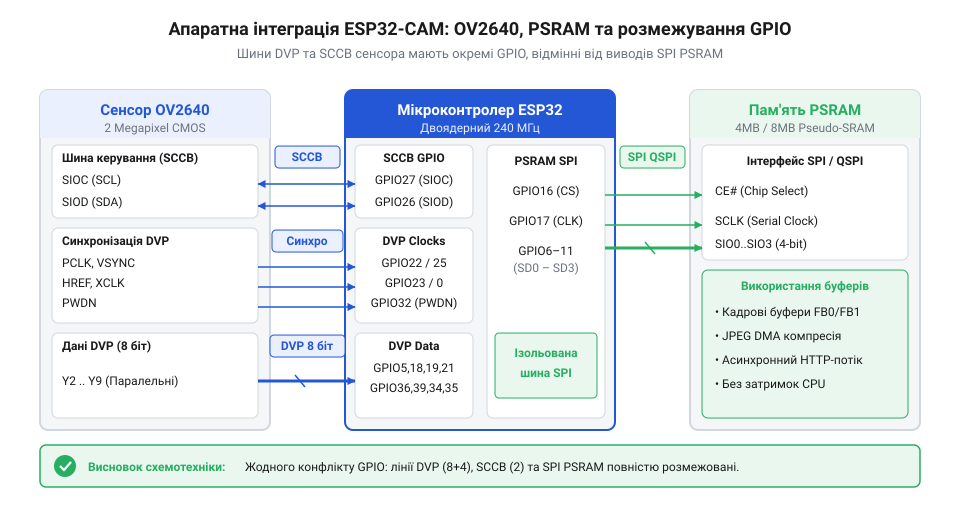

# 1. Проблема трансляції та стабілізація живлення

Спроба передати нестиснутий відеопотік через Wi-Fi на мікроконтролері — задача, що гарантовано стикається з низкою апаратних та програмних перешкод. Під час роботи з популярними платами ESP32-CAM розробники часто зустрічаються з переповненням пам'яті, значними мережевими затримками та, що найбільш неприємно, раптовими перезавантаженнями пристрою. Основна причина таких перезавантажень лежить у площині фізичного живлення мікроконтролера та його радіочастотного тракту.

У момент передачі даних Wi-Fi-модуль ESP32 переходить у режим максимальної потужності, споживаючи значні пікові струми, які можуть сягати 400–500 мА і більше в мікросекундних імпульсах. Якщо джерело живлення не здатне швидко згладити ці піки через недостатню потужність або високий внутрішній опір провідників, напруга на шині живлення 3.3В різко просідає. Внутрішня схема захисту мікроконтролера — Brown-out Detector (BOD) — постійно моніторить напругу. Щойно вона фіксує падіння напруги нижче безпечного рівня (зазвичай близько 2.4В), спрацьовує апаратне скидання, щоб запобігти пошкодженню даних у флеш-пам'яті або непередбачуваній поведінці процесора. Зовні це проявляється як нескінченні циклічні рестарти пристрою під час спроб ініціалізувати Wi-Fi-з'єднання або під час активної трансляції відеопотоку, коли навантаження на радіотракт є найвищим.

<�����>
Для вирішення цієї проблеми розробнику необхідно забезпечити бездоганно стабільне джерело живлення, що здатне з запасом видавати струм щонайменше 1-1.5 А без суттєвого просідання напруги. Навіть якщо використовується якісний імпульсний або лінійний (LDO) стабілізатор напруги, критично важливим є правильне використання блокувальних конденсаторів. Рекомендується встановлювати танталові або якісні електролітичні конденсатори ємністю 470–1000 мкФ з низьким еквівалентним послідовним опором (ESR) безпосередньо поблизу виводів живлення модуля ESP32-CAM. Важливо не лише підібрати правильний номінал, але й фізично грамотно розвести ці компоненти на платі. Танталові конденсатори слід розташовувати якомога ближче до пінів VCC та GND мікроконтролера, з'єднуючи їх короткими, широкими друкованими провідниками або суцільними полігонами живлення. Це мінімізує паразитну індуктивність доріжок, яка може звести нанівець ефективність конденсатора під час швидких змін струму. Також необхідно суворо дотримуватися полярності танталових конденсаторів, оскільки її порушення призводить до їхнього виходу з ладу. Їхня задача — віддавати накопичений заряд у моменти мікросекундних піків споживання. Додатково паралельно їм необхідно розташовувати керамічні SMD-конденсатори номіналом 0.1 мкФ для ефективної фільтрації високочастотних завад, що генеруються імпульсним живленням та радіомодулем. Лише за умови стабільного живлення та надійного відведення тепла можна гарантувати стабільну роботу мікроконтролера, камери та радіомодуля в режимі безперервної передачі відеоданих.

</�����>
</�����>

# 2. Апаратне узгодження OV2640 та PSRAM

Після того як проблему стабілізації живлення вирішено, наступним викликом для розробника стає обмеженість внутрішньої статичної пам'яті (SRAM) ESP32. Внутрішньої пам'яті, загальний обсяг якої становить близько 520 КБ, фізично недостатньо для утримання кадрових буферів високої роздільної здатності. Для розуміння масштабів: один нестиснутий кадр у форматі RGB565 з роздільною здатністю VGA (640x480 пікселів) вимагає 600 КБ пам'яті. Це вже перевищує весь обсяг доступної внутрішньої SRAM, не кажучи вже про те, що значна частина пам'яті потрібна для потреб самої операційної системи FreeRTOS, її задач, мережевого стека LwIP та буферів Wi-Fi.

Саме тому в модулях ESP32-CAM інтегровано мікросхему зовнішньої псевдостатичної оперативної пам'яті (PSRAM), яка зазвичай має обсяг 4 МБ або 8 МБ. Це архітектурне рішення дозволяє розміщувати великі масиви даних, такі як кадрові буфери, поза межами внутрішньої пам'яті мікроконтролера. Однак використання PSRAM вимагає ретельного схемотехнічного узгодження та розуміння механізмів обміну даними, оскільки вона підключається до мікроконтролера через послідовну шину SPI (або QSPI), виводи якої можуть перетинатися з іншими периферійними пристроями.

З іншого боку, сенсор зображення OV2640 підключається до мікроконтролера ESP32 через 8-бітну паралельну шину даних DVP (Digital Video Port). Ця шина передає дані кадру побайтово строго синхронно з піксельним тактовим сигналом (PCLK). Механізм синхронізації полягає в тому, що на кожен перепад сигналу PCLK (зазвичай по його фронту) на лініях даних виставляється новий валідний байт зображення, який апаратний інтерфейс мікроконтролера має миттєво зафіксувати. Крім восьми ліній даних (D0–D7), для коректної синхронізації прийому пікселів необхідні сигнали кадрової синхронізації (VSYNC), який позначає початок нового кадру, та рядкової синхронізації (HREF), який сигналізує про активність даних у поточному рядку. Для управління внутрішніми налаштуваннями самого сенсора (яскравість, контрастність, баланс білого тощо) використовується окрема керуюча шина SCCB, яка є функціональним аналогом інтерфейсу I2C.

Як видно з наведеної схеми взаємодії, мультиплексування виводів є критичним аспектом проєктування подібних пристроїв. Оскільки мікроконтролер ESP32 має обмежену кількість доступних GPIO-пінів, значна їх частина виявляється зайнятою паралельною шиною камери, мікросхемою PSRAM та слотом для SD-карт. Важливо забезпечити таке розведення плати та конфігурацію програмного забезпечення, що дозволить уникати апаратних конфліктів між шиною DVP матриці OV2640, через яку безперервно ллються дані на високій частоті, та шиною SPI, до якої підключена PSRAM. Будь-яке порушення синхронізації або завади на лініях призведуть до спотворення зображення (так званих артефактів tearing) або повної втрати кадру.

# 3. Конфігурація драйвера та апаратного JPEG

Навіть за умови успішного розв'язання проблеми оперативної пам'яті завдяки підключенню PSRAM, отримання сирих (нестиснутих) даних кадру з сенсора OV2640 залишається проблематичним через обмежену пропускну здатність каналу Wi-Fi та величезні обчислювальні витрати на програмне стиснення зображення. Програмна компресія сирих RGB- або YUV-даних у формат JPEG силами центрального процесора ESP32 займає сотні мілісекунд для кожного кадру. Це унеможливлює досягнення прийнятної частоти кадрів (FPS) для плавного відеопотоку.

На щастя, матриця OV2640 володіє критично важливою для вбудованих систем особливістю — вона має вбудований апаратний кодер (DSP), що виконує стиснення JPEG безпосередньо всередині самого сенсора. Це означає, що камера може самостійно компресувати зображення перед його відправкою по шині DVP. Такий підхід радикально розвантажує процесор ESP32: замість того, щоб виконувати складні математичні перетворення дискретного косинусного перетворення (DCT), мікроконтролеру залишається лише прийняти готовий потік JPEG-байт, сформувати правильні HTTP-заголовки та відправити ці дані в сокет клієнту через Wi-Fi.

Для реалізації цього ефективного конвеєра необхідно правильно сконфігурувати офіційний драйвер `esp32-camera` від компанії Espressif. Налаштування відбувається шляхом ретельного заповнення структури `camera_config_t`. У ній вказуються призначення всіх GPIO-виводів згідно зі схемотехнікою конкретної плати, задається опорна тактова частота (XCLK, зазвичай 20 МГц), встановлюється формат пікселів у значення `PIXFORMAT_JPEG`, обирається бажана початкова роздільна здатність, а також задається рівень якості компресії.

Ключовим параметром продуктивності є виділення кадрових буферів безпосередньо в зовнішній пам'яті PSRAM. Це здійснюється через використання контролера прямого доступу до пам'яті (DMA - Direct Memory Access). Використання DMA дозволяє апаратній периферії I2S мікроконтролера, до якої підключена шина камери, автоматично, без жодного втручання процесора, пересилати вхідні байти відео потоку прямо в PSRAM. Налаштувавши систему на подвійну буферизацію (double buffering, вказавши `fb_count = 2`), ми досягаємо паралелізму: поки сенсор заповнює один кадровий буфер новим зображенням через DMA, процесор ESP32 зчитує попередній готовий кадр з другого буфера та передає його по мережі. Це мінімізує затримки та максимізує можливий FPS потоку.

Реалізація цієї високоефективної архітектури вимагає написання відповідного низькорівневого програмного забезпечення. Нижче наведено вичерпні приклади коду мовою C, що демонструють ініціалізацію підсистеми камери з урахуванням наявності PSRAM, налаштування шини SCCB, виділення кадрових буферів та розгортання асинхронного HTTP-сервера для безперервної трансляції потоку `multipart/x-mixed-replace`.

:::code proj-esp32-cam-jpeg-streamer/c/include/app_camera.h
:::code proj-esp32-cam-jpeg-streamer/c/include/http_stream_server.h
:::code proj-esp32-cam-jpeg-streamer/c/src/app_camera.c
:::code proj-esp32-cam-jpeg-streamer/c/src/http_stream_server.c
:::code proj-esp32-cam-jpeg-streamer/c/src/main.c

Для проєктів, що розробляються в середовищі ESP32 Arduino Core або використовують сучасні підходи розробки, доцільно застосовувати об'єктно-орієнтований підхід мовою C++. У наступних лістингах драйвер камери та логіка HTTP-сервера елегантно інкапсульовані у відповідні класи. Використання парадигми RAII (Resource Acquisition Is Initialization) через спеціальні обгортки (наприклад, `FrameBufferGuard`) гарантує безпечне вивільнення кадрових буферів із PSRAM, повністю унеможливлюючи витоки пам'яті під час багатогодинної трансляції відео.

:::code proj-esp32-cam-jpeg-streamer/cpp/include/camera_config.hpp
:::code proj-esp32-cam-jpeg-streamer/cpp/include/esp_camera_wrapper.hpp
:::code proj-esp32-cam-jpeg-streamer/cpp/include/mjpeg_stream_server.hpp
:::code proj-esp32-cam-jpeg-streamer/cpp/src/esp_camera_wrapper.cpp
:::code proj-esp32-cam-jpeg-streamer/cpp/src/main.cpp
:::code proj-esp32-cam-jpeg-streamer/cpp/src/mjpeg_stream_server.cpp

У сукупності ці схемотехнічні та програмні рішення формують потужну та надійну архітектуру, яка дозволяє ESP32-CAM роками працювати в режимі асинхронної трансляції MJPEG-потоку. Завдяки правильній конфігурації апаратного стиснення та DMA-буферизації, розробник отримує стабільну частоту кадрів при мінімальному навантаженні на ядро мікроконтролера, залишаючи ресурси для паралельного виконання інших важливих системних задач.

## Асинхронний HTTP-сервер для MJPEG-потоку

Передача окремих JPEG-зображень за запитом клієнта не забезпечує плавного відеопотоку. На встановлення кожного нового TCP-з'єднання мікроконтролер витрачає час і ресурси, що обмежує частоту кадрів. Щоб потік був безперервним, клієнт встановлює з'єднання один раз, а мікроконтролер надсилає кадри один за одним у тому самому каналі. Це реалізується через стандарт @@en|Motion JPEG@@ (MJPEG), де відео передається як нескінченна послідовність статичних зображень.

Основою такої трансляції є механізм HTTP під назвою `multipart/x-mixed-replace`. Цей заголовок повідомляє браузеру, що відповідь складатиметься з багатьох частин, кожна з яких має свій заголовок і замінює попередню. Між частинами вставляється унікальний розділювач — границя (@@en|boundary@@), яка не може трапитися в самих даних.

Щойно кадр захоплено з камери, сервер формує для нього проміжний заголовок із зазначенням типу `image/jpeg` та точного розміру в байтах. Заголовок і самі бінарні дані відправляються клієнту як чергова частина. Завдяки RAII-обгортці або явному виклику повернення буфера, пам'ять звільняється одразу після відправки. Це критично для безперебійної роботи, оскільки [апаратний модуль кодування JPEG](root:cat-hw-sensors/ov2640-hardware-jpeg-engine) потребує вільних буферів для наступних кадрів.

:::tabs
:::code proj-esp32-cam-jpeg-streamer/c/src/http_stream_server.c 13-75
:::code proj-esp32-cam-jpeg-streamer/cpp/src/mjpeg_stream_server.cpp 55-120
:::

Цикл відправки працює нескінченно, доки клієнт не розірве з'єднання. Оскільки завдання потокової трансляції не має повністю блокувати мікроконтролер, між кадрами вставляється мінімальна затримка. Вона дозволяє системному планувальнику обслужити мережевий стек Wi-Fi та запобігає спрацьовуванню сторожового таймера. 

## Динамічне керування параметрами відеопотоку

Під час трансляції умови освітлення та пропускна здатність мережі можуть змінюватися. Фіксовані налаштування роздільної здатності й якості, задані при ініціалізації, змушують або жертвувати деталізацією, або миритися із затримками, коли мережа не встигає передавати великі кадри. Тому система потребує механізму зміни параметрів без зупинки потоку.

Камера OV2640 керується через шину SCCB, яка дозволяє записувати значення в конфігураційні регістри на льоту. Драйвер абстрагує цей інтерфейс, надаючи функції для зміни розміру кадру, якості JPEG-стиснення, яскравості та контрасту. Оскільки ці параметри неможливо передати в самому відеопотоці, для них створюють окремі HTTP-ендпоінти.

Клієнт надсилає звичайний GET-запит із параметрами, наприклад `/control?var=quality&val=10`. Вебсервер мікроконтролера розбирає запит і викликає відповідну функцію драйвера. Наступний кадр, який апаратний JPEG-кодер запише у буфер, вже матиме нові налаштування. 

:::tabs
:::code proj-esp32-cam-jpeg-streamer/c/src/app_camera.c 132-161
:::code proj-esp32-cam-jpeg-streamer/cpp/src/esp_camera_wrapper.cpp 138-176
:::

Зміна роздільної здатності може вимагати перерозподілу пам'яті для кадрових буферів, тому іноді призводить до короткочасного пропуску кадру клієнтом. Інші параметри, такі як вертикальний розворот (@@en|vflip@@) або налаштування експозиції, застосовуються миттєво і не впливають на стабільність TCP-з'єднання MJPEG-потоку.