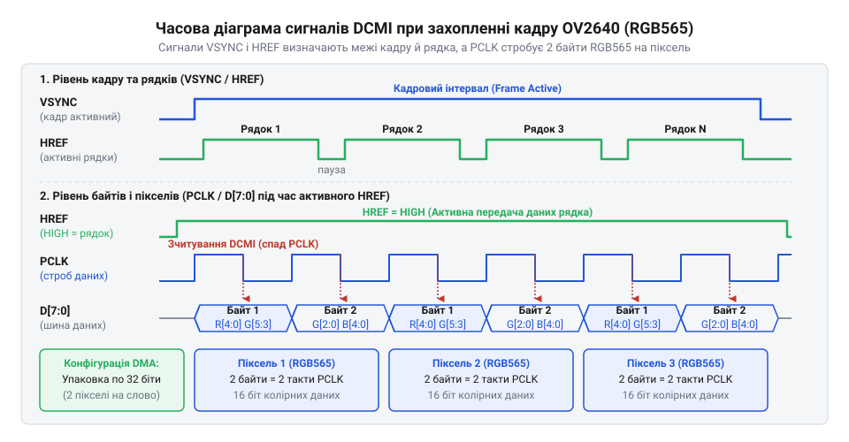
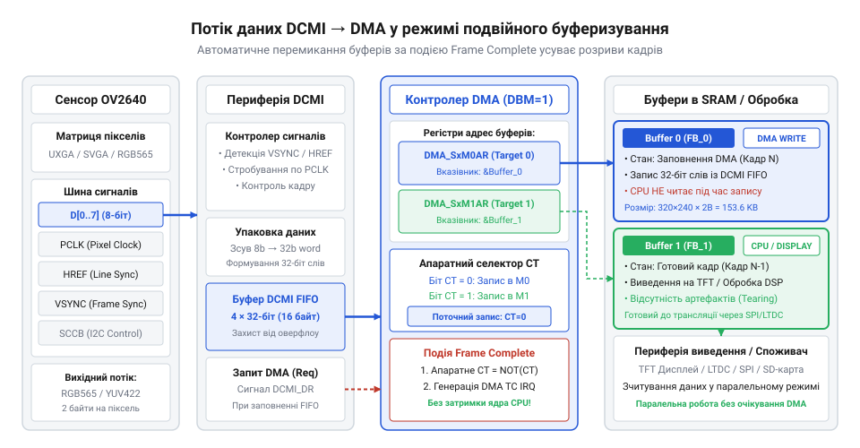

# Практичний проєкт: захоплення несжиманих кадрів RGB565 через STM32 DCMI та DMA

## Проблема програмного вичитування відеопотоку

Коли мікроконтролер має прийняти відеопотік з цифрової камери, найочевиднішим рішенням здається підключення паралельної шини даних камери до портів вводу-виводу загального призначення. При такому підході ядро процесора повинне реагувати на імпульси піксельного годинника, зчитувати стан портів і зберігати байти у пам'ять. Проте на практиці цей метод миттєво демонструє свою неспроможність. Сучасний сенсор зображення, навіть при роздільній здатності 320x240 та частоті 15 кадрів на секунду у форматі RGB565, генерує близько 2.3 мегабайт даних за секунду. Кожен байт супроводжується імпульсом синхронізації, що означає мільйони переривань на секунду для мікроконтролера.

Спроба програмно опитувати стан виводів або налаштувати переривання на кожен піксельний імпульс призводить до того, що процесор витрачає всі свої такти виключно на обробку цих подій. Оскільки паралельна шина даних камери має ширину 8 пінів, кожен такт синхронізації вимагає одночасного зчитування стану восьми фізичних ліній порту мікроконтролера та перекладання отриманого байта в оперативну пам'ять. Ресурси ядра вичерпуються на 100 відсотків, але навіть цього виявляється недостатньо: через затримки входу в обробник переривання та внутрішні арбітражі системної шини процесор неминуче пропускає байти даних. Кадр руйнується, кольори зміщуються, а мікроконтролер втрачає здатність виконувати будь-які інші завдання.

Ця напруга між високою частотою вхідного потоку і обмеженою швидкістю програмної обробки робить неминучим перехід до апаратного захоплення. Замість того, щоб навантажувати процесор, завдання прийому відеоданих доручають спеціалізованій периферії — модулю DCMI у зв'язці з контролером прямого доступу до пам'яті DMA. Апаратний інтерфейс працює на рівні логічних вентилів, відстежуючи сигнали камери та перекладаючи байти в пам'ять без участі процесора, що вивільняє ядро для корисної роботи.

## Апаратне узгодження та синхронізація сигналів

Щоб мікроконтролер міг приймати відеопотік самостійно, без безперервної участі процесора, він повинен чітко розрізняти межі зображення, рядків та окремих пікселів на шині даних. Для цього сенсор OV2640 видає три ключові апаратні сигнали синхронізації: кадровий `VSYNC`, рядковий `HREF` та піксельний годинник `PCLK`. Периферійний модуль DCMI приймає ці імпульси і на їх основі, разом із даними з восьмибітної паралельної шини, вибудовує матрицю зображення у пам'яті. Без такої жорсткої апаратної прив'язки контролер не знав би, коли зчитувати стан ліній даних, і потік перетворився б на хаотичний набір байтів.

*Схема часових діаграм сигналів PCLK, VSYNC та HREF при передачі двох байтів RGB565 на піксель показує, що кожен піксель вимагає двох тактів годинника, а дані валідуються лише за активного рівня HREF.*

Кадровий синхроімпульс `VSYNC` позначає межі всього зображення. Його активний стан сигналізує про початок нового кадру. Поки `VSYNC` активний, усі наступні дані належать до одного кадру. Сигнал `HREF` вказує на передачу корисних даних конкретного рядка. Коли `HREF` переходить в активний стан, це означає, що сенсор почав видавати пікселі поточного рядка. Неактивний стан `HREF` між рядками — це час гасіння (@@en|blanking@@), протягом якого дані на шині ігноруються.

Сигнал піксельного годинника `PCLK` є пульсом усієї системи. Саме він визначає момент, коли DCMI зчитує стан восьми ліній шини даних. Вибір фронту `PCLK`, за яким відбувається фіксація даних, є критичним для надійності. Сенсор OV2640 виставляє нові дані на шину по одному фронту (зазвичай по низхідному спаду), тому DCMI повинен надійно зачіпляти їх по протилежному фронту (по висхідному). Якщо зчитувати дані по тому ж фронту, коли вони змінюються, виникає ризик захоплення нестабільних, перехідних рівнів, що призводить до появи «снігу» або спотворених кольорів. Зчитування по протилежному фронту гарантує, що защіпання відбувається посередині стабільного стану байта на шині.

У форматі кольору RGB565 кожен піксель кодується двома байтами. Оскільки шина даних від OV2640 восьмибітна, для передачі одного повноцінного пікселя потрібно два такти `PCLK`. Сенсор послідовно видає спершу старший, а потім молодший байт пікселя. DCMI має бути налаштований так, щоб правильно приймати ці два байти поспіль. Полярність кожного з сигналів `VSYNC`, `HREF` та фронт `PCLK` можна налаштувати як у регістрах самої камери через шину управління, так і в конфігурації модуля DCMI. Головне правило — їх налаштування мають дзеркально збігатися: якщо камера видає активний `VSYNC` високим рівнем, то й DCMI має чекати високий рівень як початок кадру.

*Структурна схема потоку даних від шини DCMI через контролер DMA у два кільцеві фреймбуфери в RAM ілюструє, як зібрані 32-бітні слова автоматично пересилаються в пам'ять, дозволяючи процесору обробляти один буфер, поки заповнюється інший.*

DCMI не записує дані в пам'ять самостійно. Він акумулює вхідні байти у своєму внутрішньому регістрі, збираючи їх у 32-бітні слова (по чотири байти, тобто по два пікселі RGB565). Щойно таке слово готове, DCMI видає апаратний запит до контролера DMA. DMA, діставши запит, забирає це 32-бітне слово і прозоро для процесора перекладає його в оперативну пам'ять, за вказаною адресою фреймбуфера. Оскільки потік з камери йде без зупинок, обробляти його одним буфером небезпечно: процесор може не встигнути прочитати кадр до того, як DMA почне перезаписувати його новими даними. Тому використовується подвійне буферизування: поки DMA заповнює одну половину пам'яті, процесор безпечно читає й виводить на екран іншу. Цей механізм дозволяє ядру взагалі не відволікатися на процес транспортування байтів, отримуючи лише переривання від DMA після завершення прийому чергового блоку.

## Ініціалізація OV2640 через інтерфейс SCCB

Хоча сигнали `PCLK`, `VSYNC` і `HREF` забезпечують апаратну транспортування, сам сенсор OV2640 після подачі живлення не знає, у якому форматі і з якою частотою йому видавати зображення. Внутрішня архітектура сенсора містить сотні регістрів, які керують роздільною здатністю, балансом білого, експозицією та форматом вихідних даних. Щоб налаштувати камеру на видачу сирих пікселів RGB565, мікроконтролер використовує двопровідну шину керування, яка називається інтерфейсом SCCB. За своєю фізичною суттю та протоколом вона є аналогом I2C.

Налаштування починається з програмного скидання камери, після чого мікроконтролер послідовно записує масив значень у регістри сенсора. За замовчуванням OV2640 може використовувати [Апаратний модуль кодування JPEG сенсора OV2640](root:cat-hw-sensors/ov2640-hardware-jpeg-engine), який стискає зображення для зменшення потоку даних. Для нашого завдання захоплення несжиманих кадрів у фреймбуфер цей модуль вимикається відповідними бітами в конфігурації. Камера перемикається в режим виведення сирих даних, після чого налаштовується матриця перетворення кольору та модуль форматування для перепакування сирих даних у 16-бітний стандарт RGB565.

Послідовність регістрових записів також задає роздільну здатність і частоту кадрів шляхом налаштування подільників тактового генератора та обрізки вихідного вікна. Важливо налаштувати полярність вихідних сигналів синхронізації так, щоб вона відповідала очікуванням приймача DCMI на стороні STM32. Тільки після успішного завантаження всієї таблиці конфігурації через SCCB камера починає видавати стабільні імпульси `PCLK` разом із коректним потоком байтів кольору, що дозволяє запустити апаратний прийом через DCMI.

## Конфігурація DCMI та DMA Double-Buffer

Процесор не встигне прочитати кожен піксель відеопотоку, якщо перевірятиме стан ніжок камери програмно. Коли частота піксельного годинника сягає десятків мегагерців, найменша затримка ядра призводить до втрати даних. Щоб розвантажити процесор, приймання сигналів доручають апаратному модулю @@en|Digital Camera Memory Interface@@ (DCMI), а перенесення байтів у пам'ять — контролеру прямого доступу @@en|Direct Memory Access@@ (DMA). Разом вони утворюють міст, який переправляє потік пікселів від сенсора безпосередньо у фреймбуфер.

Налаштування починається з модуля DCMI. Він слухає синхроімпульси камери й фіксує стани восьми ліній даних у момент перепаду піксельного годинника. Оскільки камера видає формат RGB565 двома порціями по вісім бітів, DCMI налаштовують на захоплення восьмибітної шини. Модуль сам пакує отримані байти в одне тридцятидвобітне машинне слово, тому кожен запит до DMA відправляється лише після того, як DCMI збере чотири байти — тобто два повні пікселі. Таке пакування вчетверо зменшує кількість звернень до шини пам'яті.

Щоб безперервний потік не перезаписував дані, які процесор ще не встиг вивести на екран або обробити, одного буфера пам'яті замало. Поки заповнюється перший масив, система має працювати з другим. Для цього контролер DMA конфігурують у режим подвійного буферизування @@en|Double Buffer Mode@@. У цьому режимі контролеру вказують дві адреси в оперативній пам'яті. DMA автоматично записує слова за першою адресою, а коли лічильник досягає заданого розміру кадру, контролер самостійно перемикається на другу адресу без зупинки потоку. Завдяки цьому апаратний тракт працює незалежно від ядра, гарантуючи, що жоден піксель не загубиться.

## Синхронізація кадрів та обробка переривань

Система має точно знати момент, коли один кадр закінчився і фреймбуфер готовий до відображення. Якщо вивести зображення посеред процесу запису, на екрані з'явиться розрив: верхня половина належатиме новому кадру, а нижня — старому. Запобігти цьому дозволяють апаратні переривання.

Основна синхронізація будується навколо переривання від контролера DMA, яке виникає після повного заповнення одного з буферів. Коли це переривання спрацьовує, це означає, що камера передала цілий кадр, і DMA автоматично перемкнувся на запасний масив. У обробнику цього переривання програма отримує вказівник на щойно заповнений буфер і передає його підсистемі дисплея, наприклад, через інтерфейс FSMC або інший канал DMA до екрана.

Модуль DCMI також має власні переривання, серед яких найважливішим є переривання за сигналом кадру VSYNC. Воно дозволяє відстежувати реальний стан камери й відновлювати синхронізацію, якщо відбувся збій або втрата пікселів через перевантаження шини мікроконтролера. Якщо DMA повідомив про завершення передачі даних, а переривання VSYNC ще не настало, це свідчить про розбіжність між очікуваним розміром кадру та фактичними даними від сенсора. Поєднання цих двох подій дає змогу надійно оновлювати картинку на дисплеї саме тієї миті, коли кадр повністю сформовано, досягаючи плавного відеопотоку без навантаження на обчислювальне ядро.