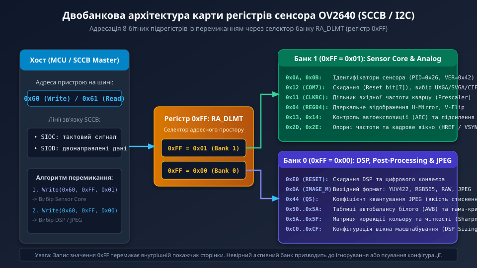
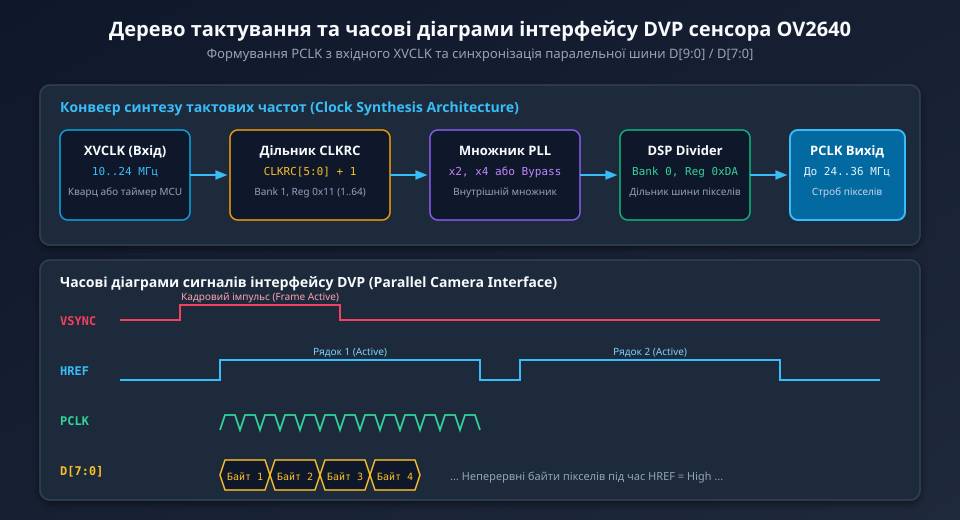
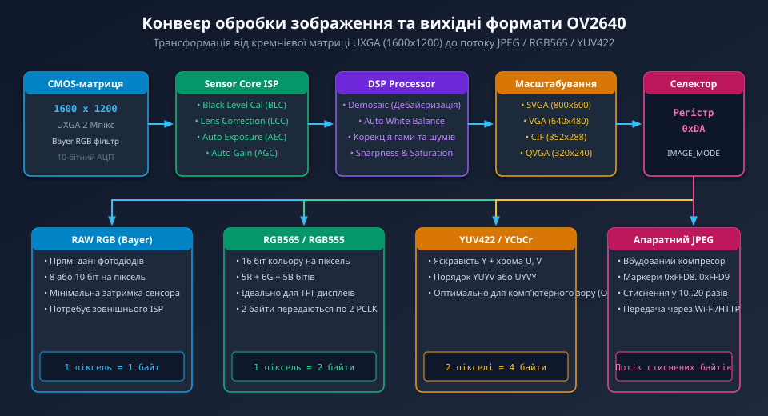

---
preknowlist:
  - "Принципи роботи CMOS-матриць та формування кольорового зображення за шаблоном Байєра"
  - "Основи послідовних інтерфейсів I2C та протоколу керування камерами SCCB"
  - "Паралельний інтерфейс цифрового відео DVP: сигнали синхронізації VSYNC, HREF та тактовий сигнал PCLK"
---

# Карта регістрів та конфігурація сенсора OV2640

Двомегапіксельний CMOS-сенсор OV2640 компанії OmniVision є одним із найпоширеніших рішень у вбудованих системах Інтернету речей (IoT), системах технічного зору мікроконтролерів ESP32-CAM та процесорів STM32 серій F4/F7/H7. Головна унікальна особливість сенсора — інтегрований у кристал апаратний сигнальний процесор зображення (DSP) з модулем стиснення JPEG, що дає змогу передавати кадри високої роздільної здатності UXGA (1600x1200) через обмежену за пропускною здатністю 8-бітну паралельну шину прямо в оперативну пам'ять мікроконтролера.

Керування всіма функціями сенсора — від підсилення сигналу фотодіодів до вибору коефіцієнтів квантування JPEG — здійснюється через послідовну шину SCCB за допомогою розгалуженої системи 8-бітних внутрішніх регістрів.



---

## 1. Архітектура адресного простору та механізм перемикання банків

Внутрішня пам'ять конфігурації OV2640 використовує 8-бітну адресацію регістрів (від 0x00 до 0xFF). Оскільки сумарна кількість налаштувань аналогового ядра, матриці пікселів, цифрового інтерфейсу та DSP перевищує 256 параметрів, виробник розділив адресний простір на два функціональні банки (сторінки):

1. **Банк 1 (Sensor Core / Аналогове ядро):** відповідає за фізичне зчитування матриці пікселів, коефіцієнти аналогового попереднього підсилювача (PGA), початкове зміщення чорного рівня (BLC), аналого-цифрове перетворення (10-бітний АЦП), таймінги експозиції та дільники вхідної частоти кварцу.
2. **Банк 0 (DSP / Цифрова обробка та JPEG):** керує дебайєризацією, балансом білого, матрицею корекції кольору, гама-кривими, геометричним масштабуванням зображення (Sizing), форматуванням вихідних пікселів і таблицями квантування JPEG.

Перемикання між цими банками здійснюється за допомогою виділеного командного регістра `0xFF` (`RA_DLMT` — Register Address Delimiter):
- Запис `0x01` у регістр `0xFF` активує **Банк 1**.
- Запис `0x00` у регістр `0xFF` активує **Банк 0**.

```text
[MCU Host] ---> SCCB Write: Dev=0x60, Reg=0xFF, Val=0x01  ===> Активовано БАНК 1 (Sensor Core)
[MCU Host] ---> SCCB Write: Dev=0x60, Reg=0x12, Val=0x80  ===> Скидання сенсора COM7 (у Банку 1)
[MCU Host] ---> SCCB Write: Dev=0x60, Reg=0xFF, Val=0x00  ===> Активовано БАНК 0 (DSP Engine)
[MCU Host] ---> SCCB Write: Dev=0x60, Reg=0xDA, Val=0x10  ===> Вибір вихідного формату в DSP
```

> **Важливе застереження:** Будь-яка помилка в послідовності виклику регістра 0xFF спрямує конфігураційні байти не в той блок мікросхеми. Це найпоширеніша причина апаратного збою ініціалізації камери, коли сенсор або зависає, або видає спотворений шум замість зображення.

---

## 2. Шина SCCB та ідентифікація сенсора

Налаштування регістрів відбувається за допомогою фірмового протоколу OmniVision SCCB (Serial Camera Control Bus). Електрично і логічно цей інтерфейс у 8-бітному режимі майже ідентичний стандартній шині I2C, проте має суттєву відмінність: 9-й біт відповіді від веденого пристрою в оригінальній специфікації SCCB позначається як «Don't Care» замість суворого біта підтвердження ACK. Сучасні апаратні контролери I2C мікроконтролерів без проблем працюють з OV2640 за наявності зовнішніх підтягувальних резисторів номіналом 2.2–4.7 кОм до лінії живлення 3.3 В.

- **Адреса запису на шині SCCB:** `0x60` (7-бітна адреса `0x30`, зсунута вліво: `0x30 << 1 | 0`).
- **Адреса читання на шині SCCB:** `0x61` (7-бітна адреса `0x30`, зсунута вліво: `0x30 << 1 | 1`).

Першим кроком будь-якого надійного драйвера є верифікація апаратного підключення сенсора шляхом читання регістрів ідентифікації в **Банку 1**:
- Регістр `0x0A` (`PID` — Product ID Number): старший байт ідентифікатора продукту. Для OV2640 він завжди повертає константу `0x26`.
- Регістр `0x0B` (`VER` — Version Code): молодший байт версії кристала. Для OV2640 повертає значення `0x41` або `0x42`.
- Регістри `0x1C` (`MIDH`) та `0x1D` (`MIDL`): ідентифікатор виробника OmniVision (`0x7F` та `0xA2`).

Якщо під час першого опитування зчитуються байти `0x00` або `0xFF`, це свідчить про апаратний обрив ліній SIOC/SIOD, відсутність живлення (аналогового AVDD 2.8 В чи цифрового DVDD 1.3 В), або відсутність зовнішнього тактового сигналу XVCLK на вході камери.

---

## 3. Тактування сенсора та формування відеосигналів DVP

Сенсор OV2640 не має власного автономного кварцового генератора і вимагає постійного зовнішнього сигналу тактування **XVCLK** частотою від 6 до 27 МГц (зазвичай 20 або 24 МГц), що подається з виходу таймера або генератора тактової частоти мікроконтролера.



Внутрішня схема фазового автопідстроювання частоти (PLL) та дільники формують головний тактовий сигнал піксельної шини — **PCLK (Pixel Clock)**:
- Регістр Банку 1 `0x11` (`CLKRC`): дільник частоти сенсора. Молодші біти `[5:0]` визначають коефіцієнт поділу вхідної частоти за формулою: `F_sensor = F_xvclk / (CLKRC[5:0] + 1)`. Біт `[7]` дозволяє подвоєння частоти через внутрішній PLL.
- Сигнали кадрової синхронізації паралельної шини DVP (Digital Video Port):
  - **VSYNC (Vertical Sync):** визначає межі окремого кадру. Може бути налаштований як активний високий або активний низький рівень (через біт регістра Банку 1 `0x03`).
  - **HREF (Horizontal Reference):** активний високий рівень під час передачі значущих байтів пікселів поточного рядка. Під час інтервалу горизонтального гасіння (Horizontal Blanking) лінія опускається в нуль.
  - **PCLK (Pixel Clock):** тактовий строб, по наростаючому або спадному фронту якого мікроконтролер захоплює байти з ліній `D[7:0]`.
  - **D[7:0]:** 8-бітна паралельна шина даних.

---

## 4. Конвеєр обробки зображення та вибір форматів

Матриця камери містить 1600x1200 світлочутливих елементів (UXGA), вкритих мозаїчним кольоровим фільтром Байєра (RGGB). Далі сигнал проходить через ланцюг цифрового сигнального процесора (DSP):



Вихідний формат потоку даних визначається значенням регістра Банку 0 `0xDA` (`IMAGE_MODE`):

1. **RAW RGB (Bayer):** Необроблені 8- або 10-бітні відліки безпосередньо з АЦП матриці. Кожен піксель несе інформацію лише про один колірний канал (червоний, зелений або синій). Вимагає виконання ресурсомісткої дебайєризації на боці процесора, проте має нульову затримку.
2. **RGB565 / RGB555:** 16-бітний колірний простір високої роздільності, адаптований під вбудовані графічні TFT-дисплеї. Кожен піксель кодується двома байтами: 5 бітів червоного, 6 зеленого, 5 синього. Сенсор формує такий кадр за два такти PCLK на один піксель.
3. **YUV422 (YCbCr):** Формат із розділенням сигналу яскравості (Y) та колірності (U, V). Око людини значно чутливіше до яскравості, ніж до відтінку, тому колірні компоненти проріджуються вдвічі: 4 байти описують два сусідні пікселі `[Y0, U, Y1, V]`. Це базовий формат для алгоритмів розпізнавання образів (OpenCV, розпізнавання облич і контурів).
4. **Апаратний JPEG:** Сенсор розбиває кадр на мікроквантові блоки 8x8 пікселів, виконує дискретне косинусне перетворення (DCT) і квантування. Вихідний потік починається маркером `0xFF, 0xD8` (SOI — Start of Image) і завершується маркером `0xFF, 0xD9` (EOI — End of Image). Обсяг стисненого кадру зменшується у 10–25 разів порівняно з RGB565.

---

## 5. Типова послідовність ініціалізації та скидання

Конфігурація сенсора OV2640 виконується за чітким алгоритмом, який обов'язково повинен враховувати час релаксації аналогових цеп та перезапуск внутрішнього DSP:

1. **Апаратний або програмний Reset:**
   - Подача логічного нуля на вивід `RESET_N` на час не менше 2 мс (або встановлення біта `[7]` у регістрі `0x12` Банку 1 `COM7 = 0x80`).
   - Пауза не менше 5 мс для завершення внутрішнього самокалібрування АЦП.
2. **Перевірка зв'язку (Device ID Check):**
   - Вибір Банку 1: запис `0x01` у регістр `0xFF`.
   - Читання регістрів `0x0A` (очікується `0x26`) та `0x0B` (очікується `0x42`).
3. **Завантаження базової таблиці налаштувань виробника:**
   - Почерговий запис списку пар `{регістр, значення}` для налаштування матриці зміщення, струмів живлення, фільтра деноайзингу та опорних напруг.
4. **Конфігурація роздільної здатності та кадрування:**
   - Налаштування вікна сканування (UXGA 1600x1200, SVGA 800x600 або CIF 352x288) за допомогою регістрів Банку 1 (`HSTART`, `HSTOP`, `VSTART`, `VSTOP`).
5. **Налаштування DSP та вибору формату:**
   - Перемикання в Банк 0 (запис `0x00` у регістр `0xFF`).
   - Запис параметрів кодування `0xDA` та коефіцієнта якості стиснення JPEG у регістр `0x44` (значення від `0x04` для найвищої якості до `0x3F` для низької).
6. **Запуск потоку пікселів:**
   - Увімкнення виходу тактування PCLK та активація переривань захоплення DMA на хості.

У наступному поглибленому розділі ми детально розберемо структуру бітових полів ключових регістрів керування, алгоритми автоекспозиції (AEC/AGC), налаштування таблиць квантування JPEG та програмну реалізацію драйвера на мові C.
