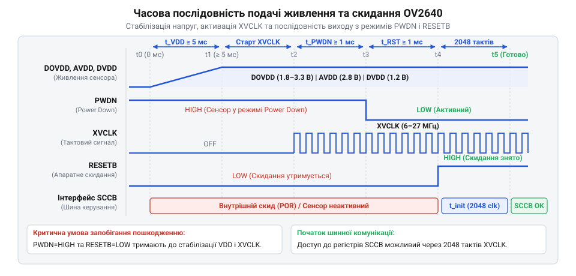

# Залізний інтерфейс OV2640: розпіновка, часові діаграми DVP, живлення та перемикання банків регістрів

## Проблеми апаратного підключення сенсора OV2640

Спроба прямого підключення CMOS-сенсора @@en|OV2640@@ (власна назва) до мікроконтролера чи ПЛІС найчастіше завершується відсутністю відеопотоку, спотворенням кадрів або виходом кристала з ладу. Сенсор @@en|OV2640@@ є повноцінною системою на кристалі (з англ. @@en|System on a Chip@@), що поєднує аналогову матрицю, АЦП, цифровий сигнальний процесор @@en|DSP@@ (з англ. *Digital Signal Processor* — цифровий сигнальний процесор, від *digital* — цифровий, *signal* — сигнал, *processor* — обробник) та вихідні буфери.

Причиною апаратних збоїв є нехтування трьома критичними аспектами архітектури сенсора:

По-перше, сенсор живиться від трьох незалежних доменів: аналогового @@en|AVDD@@ (2.8 В), цифрового ядра @@en|DVDD@@ (1.3 В) та буферів вводу-виводу @@en|DOVDD@@ (1.7–3.3 В). Подача сигналів до стабілізації живлення викликає @@en|latch-up@@ (з англ. *latch-up* — защіпання, від *latch* — засувка): відкриття паразитного тиристора CMOS-транзисторів створює коротке замикання, яке випалює кристал.

По-друге, автомат станів сенсора позбавлений власного тактового генератора. Без зовнішнього сигналу @@en|XCLK@@ (з англ. *System Clock* — тактування системи) шина керування @@en|SCCB@@ (з англ. *Serial Camera Control Bus* — шина керування) та регістри неактивні. Водночас вихідний паралельний відеоінтерфейс @@en|DVP@@ (з англ. *Digital Video Port* — цифровий відеопорт) генерує тактовий сигнал пікселів @@en|PCLK@@ (до 36 МГц), де розсогласування часу поширення сигналів спричиняє зсув фаз і спотворення даних.

По-третє, конфігурування понад 200 регістрів виконується в 8-бітному адресному просторі через два банки: @@en|Sensor Bank@@ та @@en|DSP Bank@@. Запис у регістр без попереднього вибору банку спрямовує команди в чужий модуль, повністю руйнуючи налаштування відеопотоку.

Тому проєктування апаратної частини @@en|OV2640@@ розділяють на три рівні: розпіновку, триканальне живлення із затримками та синхронізацію паралельної шини даних.

## Призначення виводів та сигнальні шини

Схема підключення @@en|OV2640@@ спирається на чотири функціональні домени виводів: тактування й апаратне керування, шину конфігурування, паралельний відеоінтерфейс та лінії живлення.

До домену тактування й керування належать три лінії:
- `XCLK` — вхідний тактовий сигнал (6–24 МГц, типово 24 МГц) від мікроконтролера чи генератора. Без `XCLK` сенсор не відповідає на команди шини керування. - `PWDN` — вхід вимкнення живлення (з англ. @@en|Power Down@@ — вимкнення живлення, від *power* — живлення, *down* — донизу). Активний рівень — 1: тактування вимикається, а виходи переходять у високоімпедансний стан @@en|Hi-Z@@ (з англ. *High-Impedance* — високоімпедансний стан, від *high* — високий, *impedance* — опір) для енергозбереження. При старті лінію утримують у 1. - `RESETB` — вхід апаратного скидання (з англ. @@en|Reset Active Low@@ — апаратне скидання, від *re-set* — повторне встановлення). Активний рівень — 0: логічний 0 скидає внутрішні регістри й автомати тактів. Після стабілізації живлення та `XCLK` її переводять у 1.

Шину конфігурування @@en|SCCB@@ утворюють вхідна тактова лінія `SIOC` (з англ. *Serial Interface Clock*) та двоспрямована лінія даних `SIOD` (з англ. *Serial Interface Data*) з відкритим стоком. Для сумісності з [протоколом I2C](root:com-devices/i2c-bus) обидві лінії підтягують резисторами 4.7 кОм до `DOVDD`.

Паралельний відеоінтерфейс @@en|DVP@@ передає піксельний потік вихідними лініями:
- `PCLK` — тактовий сигнал пікселів; його перепад сповіщає про новий дійсний байт на шині. - `VSYNC` — сигнал вертикальної кадрової синхронізації (з англ. @@en|Vertical Synchronization@@ — вертикальна кадрова синхронізація, від *vertical* — вертикальний, *synchronization* — одночасність). Високий рівень позначає межу між кадрами. - `HREF` — сигнал горизонтальної опорної синхронізації рядка (з англ. @@en|Horizontal Reference@@ — горизонтальна опорна синхронізація рядка, від *horizontal* — горизонтальний, *reference* — орієнтир). Логічна 1 відповідає передачі активних пікселів. - `D[9:0]` — 10-бітна шина даних. Для форматів RGB565, YUV422 чи JPEG зазвичай використовують 8-бітне підключення через `D[9:2]`, а `D[1:0]` заземлюють або залишають вільними.

При розбіжності напруги `DOVDD` і живлення мікроконтролера на лініях @@en|DVP@@ та @@en|SCCB@@ встановлюють двоспрямовані [перетворювачі логічних рівнів](root:hw-digital/level-shifter). На друкованій платі провідники @@en|DVP@@ трасують однаковою довжиною для запобігання часовому розсогласуванню (з англ. @@en|skew@@ — перекіс фаз, від *skew* — відхилятися) між `PCLK` та даними.

## Триканальне живлення та послідовність увімкнення

Внутрішня структура кристала @@en|OV2640@@ вимагає розділення живлення на три самостійні електричні домени.

Домен аналогового живлення `AVDD` подає 2.8 В (діапазон 2.5–3.0 В) на піксельну матрицю та АЦП. Шум у лінії `AVDD` трансформується у просторовий шум і горизонтальні смуги. Живлення подають через окремий малошумний [лінійний регулятор живлення](root:hw-power/ldo) @@en|LDO@@ із коефіцієнтом @@en|PSRR@@ не менше 60 дБ. У колі обов'язково встановлюють @@en|ferrite bead@@ та блокувальні керамічні конденсатори на 100 нФ і 10 мкФ біля виводу.

Домен живлення цифрового ядра `DVDD` забезпечує 1.3 В (1.235–1.365 В) для ядра @@en|DSP@@ та кодека JPEG. Перемикання вентилів створює імпульсні кидки струму. Напругу 1.2 В формують зовнішнім @@en|LDO@@ або внутрішнім стабілізатором сенсора.

Домен живлення вводу-виводу `DOVDD` приймає 1.7–3.3 В. Він визначає амплітуду вихідних сигналів шини @@en|DVP@@ та вхідні пороги шини @@en|SCCB@@. Напругу узгоджують із системною шиною мікроконтролера, що усуває потребу в буферних мікросхемаx.

Нехтування послідовністю подачі напруг та сигналів `PWDN` і `RESETB` призводить до паразитного струму пробою.


*Часова послідовність подачі напруг живлення та керуючих сигналів PWDN і RESETB для безпечного запуску сенсора OV2640.*

Сувора послідовність увімкнення складається з п'яти етапів:

1. Інтервал t0 (подача живлення): Напруги `DOVDD` та `AVDD` зростають до номіналу. Сигнал `PWDN` тримають у логічній 1, а `RESETB` — у 0. Це утримує виходи в стані @@en|Hi-Z@@ та запобігає прохідним струмам у CMOS-структурах. 2. Подача тактування `XCLK`: Після стабілізації живлення вмикають тактовий сигнал `XCLK`. 3. Інтервал t1 (перехід у робочий режим): Сигнал `PWDN` переводять у 0 для виходу з глибокого сну. Витримують затримку щонайменше 1 мс (або 2048 тактів `XCLK`) для стабілізації @@en|PLL@@. 4. Інтервал t2 (зняття скидання): Сигнал `RESETB` переводять у 1. Витримують затримку не менше 1 мс (або 1000 тактів `XCLK`) для початкового скидання регістрів. 5. Інтервал t3 (початок ініціалізації): Сенсор готовий до прийому команд конфігурування по шині @@en|SCCB@@.

## Часові діаграми паралельного інтерфейсу DVP

Передача цифрового відеопотоку сенсором @@en|OV2640@@ через паралельний інтерфейс @@en|DVP@@ базується на часовій синхронізації сигналів `PCLK`, `VSYNC` та `HREF`.

![Часова діаграма паралельного інтерфейсу DVP, що демонструє співвідношення тактового сигналу PCLK, сигналів синхронізації VSYNC, HREF та вибірки даних D[9:0]](img/ov2640-dvp-timing-diagram.svg)
*Часова діаграма сигналів PCLK, VSYNC, HREF та ліній даних D[9:0] паралельного інтерфейсу DVP при захопленні піксельного кадру.*

Імпульс високого рівня `VSYNC` сигналізує про початок кадру: за ним [периферія DMA мікроконтролера](root:hw-arch/dma-double-buffering-video) скидає вказівник буфера пам'яті.

Після інтервалу вертикального гасіння (з англ. @@en|vertical blanking interval@@) сигнал `HREF` переходить у 1, відкриваючи передачу дійсного рядка. Упродовж високого рівня `HREF` кожен такт `PCLK` виставляє новий байт даних на шину `D[9:2]`. Спад `HREF` у 0 позначає інтервал горизонтального гасіння (з англ. @@en|horizontal blanking interval@@).

Оскільки 8-бітна шина передає 16-бітні пікселі за два такти `PCLK`:
- У RGB565 першим тактом іде старший байт (`R[4:0]` та `G[5:3]`), другим — молодший (`G[2:0]` та `B[4:0]`). - У YUV422 за чотири такти передається пара пікселів: `Y₀`, `U₀₁`, `Y₁`, `V₀₁`.

Частота тактування `PCLK` (`f_PCLK`) залежить від кількості активних рядків `N_active_lines`, пікселів `N_active_pixels`, інтервалів гасіння (`N_v_blank`, `N_h_blank`), байтів на піксель `N_bytes_per_pixel` та частоти кадрів `FPS` (з англ. @@en|FPS@@ — Frames Per Second):

```
N_lines_total = N_active_lines + N_v_blank
N_bytes_line  = (N_active_pixels + N_h_blank) × N_bytes_per_pixel
f_PCLK        = N_lines_total × N_bytes_line × FPS
```

**Приклад розрахунку (SVGA, 800 × 600, RGB565, 30 FPS):**
За `N_v_blank` = 24 рядки та `N_h_blank` = 256 пікселів:

```
N_lines_total = 600 + 24 = 624 рядки
N_bytes_line  = (800 + 256) × 2 = 2112 байт/рядок
f_PCLK        = 624 × 2112 × 30 = 39505920 Гц ≈ 39.51 МГц
```

Приймальна периферія має зчитувати шину `D[9:2]` за висхідним фронтом `PCLK`, оскільки @@en|OV2640@@ змінює дані за спадним фронтом. Це гарантує необхідний час встановлення (з англ. @@en|setup time@@) та утримання (з англ. @@en|hold time@@).

## Шина SCCB та перемикання банків

Конфігурування режимів @@en|OV2640@@ здійснюється через двопровідну шину @@en|SCCB@@, функціонально сумісну з [протоколом I2C](root:com-devices/i2c-bus). Сенсор працює як @@en|slave device@@ із 7-бітною адресою `0x30` (`0x60` — запис, `0x61` — зчитування).

Оскільки 8-бітна адресація обмежує простір 256 байтами, а сенсор має понад 200 регістрів, його конфігурацію розділено на два банки, що перемикаються записом у регістр `0xFF`:

- **DSP Bank (Bank 0):** налаштування цифрової обробки, масштабування, колірних форматів (YUV, RGB, JPEG) та буферів шини @@en|DVP@@. - **Sensor Bank (Bank 1):** керування аналоговою матрицею пікселів, підсиленням (AGC), витримкою (AEC), балансом білого (AWB) та вікном зчитування.

Запис у регістр без гарантованого вибору банку призводить до збоїв: однакові адреси в різних банках мають різне призначення (наприклад, регістр `0x12` у @@en|Sensor Bank@@ відповідає за системне скидання й роздільність, а в @@en|DSP Bank@@ — за формат кольору).

Для запобігання помилкам у драйверах впроваджують сувору абстракцію, яка відстежує поточний банк і виконує запис у `0xFF` лише при зміні цільового домену.

:::tabs
@ C (ESP-IDF)
:::code api-ov2640-hardware-interface-spec/c/esp-idf/ov2640-set-bank.c
@ C++ (Arduino/Embedded)
:::code api-ov2640-hardware-interface-spec/cpp/arduino/ov2640hardwareinterface.cpp
:::