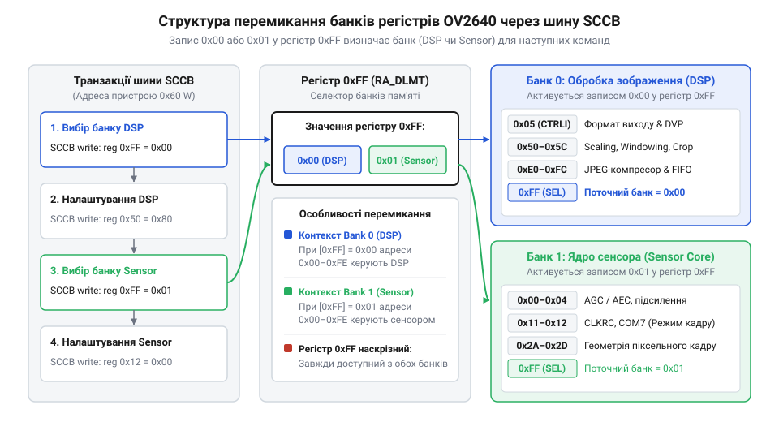
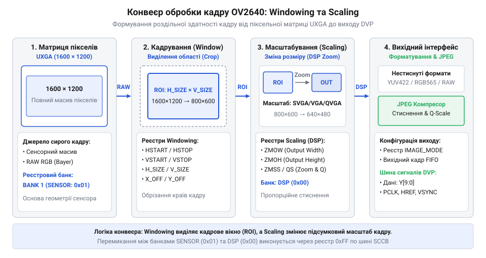

# Програмний інтерфейс конфігурування регістрів OV2640: початкова ініціалізація, матриці форматування та керування ISP

## Проблема некоректного конфігурування регістрів OV2640

Після подачі живлення на мікросхему @@en|OV2640@@ розробник часто стикається з тим, що камерний модуль видає суцільний чорний екран, хаотичні кольорові смуги або не стабілізує синхронізацію кадру. Пряма спроба записати довільні налаштування яскравості чи роздільної здатності через шину @@en|SCCB@@ (від англійського *Serial Camera Control Bus* — послідовна шина керування камерою) лише погіршує ситуацію: кадри повністю зникають, а мікроконтролер припиняє отримувати сигнатуру підтвердження.

Ця проблема виникає через складну двокомпонентну архітектуру кристала. Світлочутлива мікросхема @@en|OV2640@@ не є монолітним @@en|sensor@@ (від латинського *sensus* — відчуття) з лінійним масивом пам'яті. Всередині корпусу інтегровано два принципово різних апаратних блоки: кремнієву матрицю з первинною аналоговою обробкою (@@en|Sensor@@) та цифровий копроцесор обробки сигналів зображення (@@en|DSP@@, від англійського *Digital Signal Processor* — цифровий процесор сигналів). Обидва блоки керуються через спільну 8-бітову адресу шини @@en|SCCB@@, що створює дублювання адресного простору від `0x00` до `0xFF`.

Коли керуючий мікроконтролер відправляє команду записати значення у @@en|register@@ (від пізньолатинського *registrum* — список), внутрішній маршрутизатор @@en|OV2640@@ спрямовує байт у той блок, який активний у поточний момент. Якщо розробник намагається змінити коефіцієнт підсилення @@en|DSP@@, але внутрішній маршрутизатор залишається переключеним на @@en|Sensor@@, запис руйнує конфігурацію часу накопичення заряду матриці. В результаті замість зміни яскравості виникає повна розсинхронізація генератора стробів @@en|HREF@@ та @@en|VSYNC@@. Для перевірки [фізичних сигналів шини](root:com-devices/sccb-bus-protocol-architecture) слід застосувати осцилограф або логічний аналізатор.

Ситуація ускладнюється тим, що після апаратного скидання @@en|OV2640@@ перебуває в невизначеному стані і вимагає завантаження сотень табличних значень за замовчуванням. Проста пропускна здатність або відсутність часової затримки після перезапуску призводить до втрати окремих байтів на шині @@en|SCCB@@, перетворюючи процес конфігурування на хаотичний збій.

## Банківська адресація регістрів та ініціалізація

Для усунення адресного конфлікту між аналоговою матрицею та цифровим копроцесором розробники @@en|OV2640@@ впровадили механізм банківського перемикання контексту. Вся внутрішня пам'ять розбита на два @@en|bank@@ (від італійського *banco* — лава, контора): @@en|Sensor@@ @@en|bank@@ з селектором `0x01` та @@en|DSP@@ @@en|bank@@ з селектором `0x00`.

Ключем до управління адресацією є спеціальний @@en|register@@ `0xFF`, присутній в обох контекстах. Запис байта `0x01` за адресою `0xFF` перемикає внутрішню шину камери на обслуговування @@en|Sensor@@ @@en|bank@@. Після цього всі наступні транзакції @@en|SCCB@@ змінюють параметри аналогової матриці: експозицію, підсилення та генерацію базових частот. Навпаки, запис байта `0x00` за адресою `0xFF` перенаправляє потік команд у @@en|DSP@@ @@en|bank@@, де розміщені налаштування кадрування, кодування кольору та стиснення.

*Схема перемикання банків регістрів DSP та Sensor через регістр 0xFF: зміна значення за адресою 0xFF перевизначає цільовий блок обробки для всіх подальших транзакцій SCCB.*

Процедура ініціалізації @@en|OV2640@@ починається з програмного скидання. Контролер вибирає @@en|Sensor@@ @@en|bank@@ шляхом запису `0x01` у @@en|register@@ `0xFF`, після чого встановлює біт 7 у @@en|register@@ `0x12` (`0x80`). Після виконання цієї команди необхідно витримати паузу від 5 до 10 мілісекунд для стабілізації внутрішнього генератора тактової частоти.

Наступним кроком є послідовний запис масивів конфігурації. Таблиці ініціалізації розбиті на спеціалізовані блоки: спочатку відправляються базові масиви для @@en|Sensor@@ @@en|bank@@, після чого видається команда `0xFF` = `0x00` і завантажуються регістри @@en|DSP@@ @@en|bank@@. Нижче наведено приклад реалізації запису реєстрових масивів.

:::tabs
@tab ESP-IDF (C)
:::code api-ov2640-sccb-register-config/c/esp-idf/ov2640-write-array.c
@tab Arduino (C++)
:::code api-ov2640-sccb-register-config/cpp/arduino/registersetting.cpp
:::

## Конфігурування роздільної здатності та кадрування

Фізична матриця @@en|OV2640@@ містить фіксовану кількість світлочутливих осередків, що забезпечує максимальну роздільну здатність @@en|UXGA@@ (1600 × 1200 пікселів). Однак у багатьох практичних задачах передача повного кадру недоцільна через обмеження ширини смуги пропускання. Для отримання менших форматів, від @@en|SVGA@@ (800 × 600) до @@en|CIF@@ (352 × 288), у мікросхемі застосовується двоетапна обробка геометрії кадру: кадрування @@en|Windowing@@ (від англійського *windowing* — формування вікна) та цифрове масштабування @@en|Scaling@@ (від англійського *scaling* — масштабування).

*Схема проходження кадру від матриці UXGA через блоки кадрування Windowing та масштабування Scaling до вихідного інтерфейсу: кадрування виділяє ділянку інтересу з фізичного масиву пікселів, а масштабування пропорційно зменшує її до цільової роздільної здатності.*

Перший етап — кадрування @@en|Windowing@@ — виконується на рівні @@en|Sensor@@ @@en|bank@@. @@en|Register@@ прямокутника зчитування визначає початкові та кінцеві координати активної зони матриці: `HSTART`, `HSTOP` по горизонталі та `VSTART`, `VSTOP` по вертикалі. Встановлюючи ці значення, можна вирізати довільну область інтересу із загального поля @@en|UXGA@@. Якщо координати зчитування охоплюють усю матрицю, на наступний блок передається повний кадр без втрати кута огляду.

Другий етап — масштабування @@en|Scaling@@ — реалізовано всередині @@en|DSP@@ @@en|bank@@. Внутрішній обчислювальний модуль пропорційно зменшує сформований прямокутник пікселів до заданих розмірів. Координати та коефіцієнти масштабування задаються регістрами `ZMOW` (вихідна ширина), `ZMOH` (вихідна висота), а також регістрами `SZX` і `SZY`.

Поширеною помилкою конфігурування є неузгодженість співвідношення сторін між вікном @@en|Windowing@@ та параметрами @@en|Scaling@@. Якщо вибране вікно зчитування має співвідношення 4:3, а вихідні регістри @@en|DSP@@ налаштовані на формат 16:9, зображення отримує аморфне розтягнення по горизонталі. Для збереження пропорцій геометрія обчислюється так, щоб коефіцієнти зменшення по осях X та Y були однаковими.

## Налаштування вихідних форматів і JPEG

Після того як блок масштабування сформував необхідну геометрію кадру, цифрові дані надходять до вихідного форматизатора @@en|DSP@@. Мікросхема @@en|OV2640@@ підтримує декілька режимів кодування колірного простору: первинний @@en|RAW RGB@@ (масив @@en|Bayer@@), нестиснені формати @@en|YUV422@@ та @@en|RGB565@@, а також стиснутий потік @@en|JPEG@@ (від англійського *Joint Photographic Experts Group* — об'єднана група експертів із фотографії).

Вибір вихідного формату здійснюється конфігуруванням регістрів `IMAGE_MODE`, `CTRL0` та `CTRL2` у @@en|DSP@@ @@en|bank@@. Під час роботи з нестисненими форматами @@en|RGB565@@ та @@en|YUV422@@ кожен піксель передається двома послідовними байтами через паралельну шину @@en|DVP@@ (від англійського *Digital Video Port* — цифровий відеопорт). Це створює високе навантаження на обсяг оперативної пам'яті мікроконтролера, оскільки кадр @@en|VGA@@ (640 × 480) вимагає 614.4 кілобайт для зберігання одного знімка.

Двомегапіксельний кадр @@en|UXGA@@ у нестисненому вигляді вимагає 3.84 мегабайт, що перевищує можливості більшості вбудованих систем. Для вирішення цієї проблеми @@en|OV2640@@ містить апаратний компресор @@en|JPEG@@. При активації режиму @@en|JPEG@@ потік @@en|YUV422@@ із блоку масштабування спрямовується у внутрішній кодер, який виконує дискретне косинусне перетворення та формує стандартний бінарний потік з маркерами початку кадру `0xFFD8` (SOI) та кінця кадру `0xFFD9` (EOI). Докладніше [алгоритму стиснення JPEG](root:com-signal/jpeg-intra) присвячено окремий матеріал.

Якість та рівень компресії @@en|JPEG@@ регулюються через @@en|register@@ `QS` (`quantization scale`, адреса `0x44` у @@en|DSP@@ @@en|bank@@). Зменшення значення `QS` підвищує деталізацію та збільшує розмір вихідного файла, тоді як збільшення `QS` сильніше стискає дані, зменшуючи обсяг кадру ціною появи блочних артефактів. Оскільки розмір стиснутого @@en|JPEG@@ кадру змінюється від знімка до знімка, для прийому даних використовується буфер @@en|FIFO@@ (від англійського *First-In, First-Out* — перший прийшов, перший вийшов) або режим прямими каналами пам'яті DMA, орієнтований на відстеження вихідного стробу @@en|HREF@@ / @@en|VSYNC@@.

## Керування алгоритмами ISP та діагностика

Апаратний блок @@en|ISP@@ (від англійського *Image Signal Processor* — процесор обробки сигналів зображення) камери @@en|OV2640@@ містить автоматичні контури зворотного зв'язку, які адаптують параметри зйомки до умов зовнішнього освітлення. До основних алгоритмів належать:
- @@en|AGC@@ (від англійського *Automatic Gain Control* — автоматичне регулювання підсилення): змінює коефіцієнт аналогового та цифрового підсилення під час зйомки в темних приміщеннях. - @@en|AEC@@ (від англійського *Automatic Exposure Control* — автоматична експозиція): коригує час накопичення заряду матриці (час електронного затвора). - @@en|AWB@@ (від англійського *Automatic White Balance* — автоматичний баланс білого): підганяє співвідношення червоного та синього каналів відносно зеленого для компенсації колірної температури джерела світла.

У задачах комп'ютерного зору автоматична робота контурів @@en|ISP@@ може заважати, оскільки плавна зміна підсилення або балансу кольору руйнує роботу алгоритмів сегментації за колірним порогом. Для фіксації параметрів розробник може програмно відключити автоматику через @@en|register@@ `COM8` у @@en|Sensor@@ @@en|bank@@. Скидання відповідних бітів вимикає @@en|AGC@@, @@en|AEC@@ та @@en|AWB@@, після чого значення експозиції та підсилення записуються вручну через регістри `GAIN`, `AEC` та `AECH`.

Під час розробки драйвера нерідко виникають збої зв'язку. Первинна діагностика працездатності @@en|OV2640@@ полягає у зчитуванні ідентифікаційних регістрів `PID` (`0x0A`) та `VER` (`0x0B`) у @@en|Sensor@@ @@en|bank@@. Для справного модуля @@en|OV2640@@ зчитані значення мають дорівнювати `0x26` та `0x42` відповідно.

Якщо зчитування ідентифікатора повертає `0xFF` або `0x00`, це свідчить про відсутність електричного контакту на лініях @@en|SCCB@@ або некоректні рівні живлення. Якщо ж ідентифікатор зчитується, але зображення спотворене, проблему слід шукати у часових дільниках частоти пиксельного тактування @@en|PCLK@@ або у незбігу банківського контексту при записі конфігураційних масивів. Подальші деталі щодо [апаратного протоколу DVP](root:com-devices/dvp-interface-timing) дозволяють точно локалізувати помилки узгодження інтерфейсу.