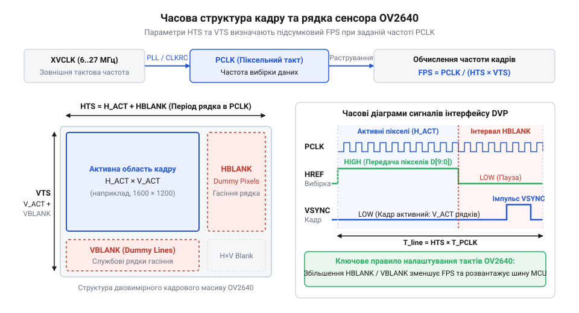

# Математичні розрахунки тактових частот, розгортки та кадрової частоти OV2640

## Причина втрати кадрів і спотворення

Спроба сприймати відеопотік сенсора @@en|OV2640@@ як безперервну послідовність пікселів призводить до випадання байтів, спотворення кольорів і зриву синхронізації. Причина полягає у фізичній нерівномірності видачі даних: корисні пікселі надходять короткими сплесками під час активного стану сигналу @@en|HREF@@ (від @@en|Horizontal Reference@@ — сигнал активного рядка), які перериваються паузами горизонтального гасіння @@en|HBLANK@@ (від @@en|Horizontal Blanking@@ — горизонтальний інтервал гасіння). Між кадрами витримується триваліша пауза вертикального гасіння @@en|VBLANK@@ (від @@en|Vertical Blanking@@ — вертикальний інтервал гасіння).

Під час активного рядка дані надходять із піковою частотою піксельного тактування @@en|PCLK@@ (від @@en|Pixel Clock@@ — піксельний тактовий сигнал). У форматах @@en|RGB565@@ та @@en|YUV422@@ кожен піксель складається з двох байтів, які виставляються на 8-бітну шину послідовно на кожен такт @@en|PCLK@@. Якщо системна шина або контролер @@en|DMA@@ (від @@en|Direct Memory Access@@ — прямий доступ до пам'яті) не встигають забирати дані або переповнюється буфер @@en|FIFO@@ (від @@en|First In, First Out@@ — буфер першим прийшов, першим вийшов), мікроконтролер пропускає байт.

Втрата єдиного байта руйнує парність байтових пар. У результаті старший і молодший байти колірного компонента міняються місцями, що спотворює кольори до кінця кадру. Якщо ж модуль @@en|DMA@@ не встигає переналаштувати свої дескриптори за час короткої паузи @@en|HBLANK@@ або @@en|VBLANK@@, втрачається синхронізація із сигналом @@en|VSYNC@@ (від @@en|Vertical Synchronization@@ — сигнал кадрової синхронізації), і кадр руйнується.

Щоб уникнути втрат, розробник мусить заздалегідь математично розрахувати тривалість усіх часових інтервалів. Через [паралельний відеоінтерфейс DVP](root:com-devices/dvp-parallel-video-interface) сенсор передає дані за суворим часовим розкладом, і лише точний розрахунок тактування дозволяє узгодити пікову швидкість вибірки з можливостями @@en|RAM@@ (від @@en|Random Access Memory@@ — оперативна пам'ять) мікроконтролера.

## Вхідне тактування та генерація PCLK

Для узгодження швидкості відеопотоку сенсора @@en|OV2640@@ із можливістю прийому даних мікроконтролером потрібно регулювати частоту вихідного піксельного годинника @@en|PCLK@@. Джерелом тактування є вхідна опорна частота @@en|XVCLK@@ (від @@en|External Clock@@ — зовнішня тактова частота).

Усередині сенсора частота @@en|XVCLK@@ перетворюється помножувачем @@en|PLL@@ (від @@en|Phase-Locked Loop@@ — система фазового автопідлаштування частоти) з коефіцієнтом `M` та ділиться дільником, де коефіцієнт задається молодшими бітами `[5:0]` регістру @@en|CLKRC@@ (від @@en|Clock Control Register@@ — регістр керування тактуванням) у вигляді цілого числа `N`.

Частоту піксельного годинника `f_PCLK` обчислюють через вхідну частоту `f_XVCLK`, коефіцієнт `M` та значення `N`:

```
f_PCLK = (f_XVCLK × M) ÷ (2 × (N + 1))
```

При обході блока @@en|PLL@@ формула спрощується:

```
f_PCLK = f_XVCLK ÷ (N + 1)
```

**Умова:** На вхід @@en|XVCLK@@ подано `f_XVCLK = 24` МГц, помножувач @@en|PLL@@ має коефіцієнт `M = 4`, а в бітах `[5:0]` регістру @@en|CLKRC@@ задано `N = 1`.

```
f_PCLK = (24 000 000 × 4) ÷ (2 × (1 + 1))
       = 96 000 000 ÷ (2 × 2)            [множення вхідної частоти на коефіцієнт PLL]
       = 96 000 000 ÷ 4                  [обчислення знаменника з урахуванням ділення]
       = 24 000 000 Гц                   [підсумкова частота піксельного годинника PCLK]
```

Підсумкова частота @@en|PCLK@@ становить 24 МГц (період `t_PCLK ≈ 41.67` нс). Збільшення `N` у регістрі @@en|CLKRC@@ пропорційно зменшує частоту @@en|PCLK@@, знімаючи навантаження з шини мікроконтролера. Повний опис регістрів наведено в [карті регістрів OV2640](root:cat-hw-sensors/ov2640-register-map-config).

## Структура розгортки та гасильні інтервали

Тривалість кадру сенсора @@en|OV2640@@ визначається геометрією растрової розгортки, що поєднує активну передачу пікселів із паузами гасіння для зсуву рядків і кадрової синхронізації.

У 16-бітних колірних режимах (@@en|RGB565@@, @@en|YUV422@@) кожен активний піксель передається двома байтами, тобто за 2 такти @@en|PCLK@@ (англ. @@en|Pixel Clock@@). Наприкінці рядка сигнал @@en|HREF@@ переходить у низький стан, розпочинаючи горизонтальне гасіння @@en|HBLANK@@ (англ. @@en|Horizontal Blanking@@), під час якого генерується `H_dummy` (англ. *dummy* — макет, холостий) холостих пікселів.

Сума активних тактів і холостих імпульсів дає повний горизонтальний розмір рядка `HTS` (англ. @@en|Horizontal Total Size@@) у тактах @@en|PCLK@@:

```
HTS = (2 × H_active) + H_dummy
```

Цей вираз описує тривалість одного рядка з урахуванням гасіння.

Вертикальна розгортка містить `V_active` корисних рядків та `V_dummy` холостих рядків вертикального гасіння @@en|VBLANK@@ (англ. @@en|Vertical Blanking@@), де сигнал @@en|VSYNC@@ позначає кінець кадру.

Повний вертикальний розмір кадру `VTS` (англ. @@en|Vertical Total Size@@) у рядках обчислюється як сума активних і холостих рядків:

```
VTS = V_active + V_dummy
```

Значення `VTS` виражає повну кількість рядків у кадровому циклі.

Добуток тривалості рядка `HTS` та кількості рядків `VTS` дає загальну кількість тактів `N_PCLK_frame`, необхідну для розгортки одного кадру:

```
N_PCLK_frame = HTS × VTS
```

Ця величина пов'язує геометрію розгортки із частотою піксельного тактування.



**Умова:** Сенсор @@en|OV2640@@ працює в режимі @@en|UXGA@@ (1600×1200 пікселів). Активна область становить `H_active = 1600` пікселів та `V_active = 1200` рядків. Інтервали гасіння дорівнюють `H_dummy = 600` тактів @@en|PCLK@@ та `V_dummy = 60` рядків.

```
HTS = (2 × 1600) + 600
    = 3200 + 600                       [переведення пікселів у такти та додавання гасіння]
    = 3800 тактів PCLK                 [повна тривалість одного рядка]

VTS = 1200 + 60
    = 1260 рядків                      [додавання холостих рядків вертикального гасіння]

N_PCLK_frame = 3800 × 1260
             = 4 788 000 тактів PCLK   [загальна кількість тактів на один повний кадр]
```

Для формування одного кадру в режимі @@en|UXGA@@ сенсору потрібно 4 788 000 тактів @@en|PCLK@@.

## Обчислення FPS та пропускної здатності

Кадрова частота @@en|FPS@@ (від @@en|Frames Per Second@@ — кількість кадрів за секунду) обернена до тривалості кадру `T_frame`. Загальна кількість тактів кадру `N_PCLK_frame` дорівнює добутку повних інтервалів `HTS` та `VTS`.

Для обчислення кадрової частоти ділимо піксельну частоту `f_PCLK` на загальну кількість тактів кадру:

```
FPS = f_PCLK ÷ N_PCLK_frame
    = f_PCLK ÷ (HTS × VTS)
```

Що більші гасильні інтервали в `HTS` чи `VTS`, то менше кадрів за секунду передає сенсор при сталій частоті `f_PCLK`.

**Приклад 1: Обчислення FPS для режиму UXGA (1600×1200)**

**Умова:** Задано `HTS = 3800` тактів, `VTS = 1260` рядків, а частоту тактування `f_PCLK = 36` МГц (36 000 000 Гц).

```
N_PCLK_frame = 3800 × 1260
             = 4 788 000 тактів PCLK   [загальна кількість тактів у кадрі]

FPS = 36 000 000 ÷ 4 788 000
    ≈ 7.52 кадрів/с                   [ділення частоти PCLK на кількість тактів кадру]
```

У режимі @@en|UXGA@@ при частоті `f_PCLK = 36` МГц сенсор видає приблизно 7.52 кадри за секунду.

**Приклад 2: Обчислення FPS для режиму SVGA (800×600)**

**Умова:** У режимі @@en|SVGA@@ (від @@en|Super Video Graphics Array@@ — 800×600) активна область становить `H_active = 800` пікселів і `V_active = 600` рядків, а гасіння — `H_dummy = 320` тактів та `V_dummy = 25` рядків при `f_PCLK = 24` МГц (24 000 000 Гц).

```
HTS = (2 × 800) + 320
    = 1600 + 320                       [переведення активних пікселів у такти PCLK]
    = 1920 тактів PCLK                 [тривалість рядка SVGA]

VTS = 600 + 25
    = 625 рядків                      [кількість рядків кадру SVGA]

N_PCLK_frame = 1920 × 625
             = 1 200 000 тактів PCLK   [кількість тактів кадру SVGA]

FPS = 24 000 000 ÷ 1 200 000
    = 20 кадрів/с                      [підсумкова кадрова частота]
```

Пропускна здатність шини `D[7:0]` визначає швидкість передачі даних у байтах за секунду.

Пікова швидкість `B_peak` виникає під час передачі активних пікселів рядка (сигнал @@en|HREF@@ у високому стані). Оскільки на кожен фронт @@en|PCLK@@ виводиться один байт, пікова швидкість дорівнює `f_PCLK`:

```
B_peak = f_PCLK
```

При `f_PCLK = 24` МГц піковий потік становить 24 МБ/с (24 000 000 байт/с).

Середня корисна пропускна здатність `B_avg` враховує лише корисні пікселі зображення за секунду:

```
B_avg = H_active × 2 × V_active × FPS
```

Для режиму @@en|SVGA@@ при 20 кадрів/с:

```
B_avg = 800 × 2 × 600 × 20
      = 960 000 × 20                   [обсяг байтів одного активного кадру]
      = 19 200 000 байт/с              [середній корисний потік даних (19.2 МБ/с)]
```

Різниця між піковим (24 МБ/с) і середнім потоком (19.2 МБ/с) виникає через паузи гасіння @@en|HBLANK@@ та @@en|VBLANK@@.

## Узгодження частот із пам'яттю DVP

Модуль @@en|DMA@@ (англ. *Direct Memory Access* — прямий доступ до пам'яті) мікроконтролера повинен встигати забирати кожен байт із шини за час одного такту @@en|PCLK@@ (наприклад, за 41.67 нс при `f_PCLK = 24` МГц). Затримка шини пам'яті переповнює буфер @@en|FIFO@@ і спричиняє втрату пікселів. Крім того, неснений кадр @@en|UXGA@@ у колірному форматі @@en|RGB565@@ вимагає 3.84 МБ пам'яті @@en|RAM@@, чого більшість мікроконтролерів не мають, тому зображення зчитують построково через [кільцеві буфери DMA](root:hw-arch/dma-double-buffering-video).

Адаптувати потік даних @@en|OV2640@@ під обмеження мікроконтролера без зміни роздільної здатності дозволяє коригування інтервалів гасіння:

1. **Збільшення `H_dummy` (холостих пікселів):** подовжує горизонтальне гасіння @@en|HBLANK@@. Це не змінює пікову швидкість `B_peak` у рядку, але надає контролеру @@en|DMA@@ час між рядками для перезапуску дескрипторів чи вивільнення буфера. 2. **Збільшення `V_dummy` (холостих рядків):** подовжує вертикальне гасіння @@en|VBLANK@@. Це зменшує кадрову частоту @@en|FPS@@ та середній потік `B_avg`, вивільняючи час між кадрами для обробки чи запису даних.

**Умова:** У режимі @@en|SVGA@@ при частоті `f_PCLK = 24` МГц та тривалості рядка `HTS = 1920` тактів мікроконтролер не встигає зберігати кадри при 20 кадрів/с. Необхідно знизити кадрову частоту до `FPS_target = 10` кадрів/с за рахунок `V_dummy`, залишаючи `f_PCLK` та `HTS` незмінними.

Знайдемо нову повну кількість рядків у кадрі `VTS_new` із частоти піксельного тактування `f_PCLK`, тривалості рядка `HTS` та цільової кадрової частоти `FPS_target`, після чого обчислимо необхідний інтервал холостих рядків `V_dummy_new` відніманням активних рядків `V_active`:

```
VTS_new = f_PCLK ÷ (HTS × FPS_target)
        = 24 000 000 ÷ (1920 × 10)
        = 24 000 000 ÷ 19 200          [необхідна кількість рядків у кадрі]
        = 1250 рядків                  [нове значення VTS]

V_dummy_new = VTS_new - V_active
            = 1250 - 600               [обчислення потрібних холостих рядків]
            = 650 рядків               [новий інтервал вертикального гасіння]
```

Збільшення `V_dummy` з 25 до 650 рядків зменшує кадрову частоту з 20 до 10 кадрів/с. Пікова швидкість у рядку лишається 24 МБ/с, але середня швидкість `B_avg` знижується з 19.2 МБ/с до 9.6 МБ/с, що усуває ризик втрати даних.