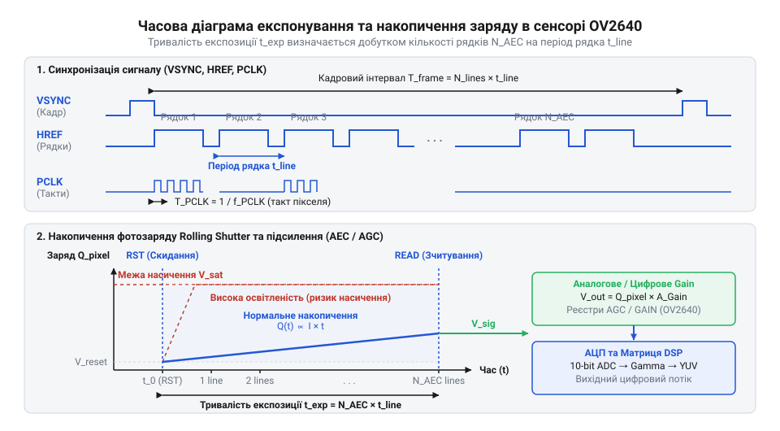
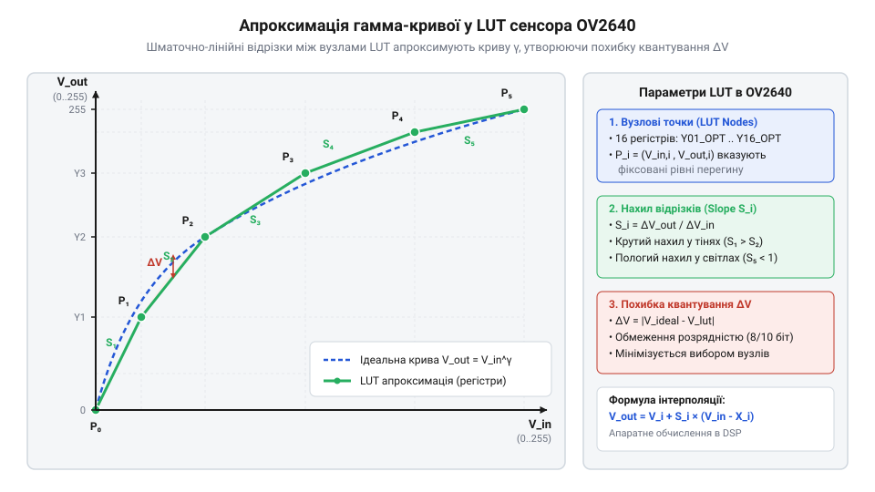

# Математична модель алгоритмів автоекспозиції та підсилення аналогового тракту

## Проблема засвічення та темних кадрів

Спроба налаштувати якість відеопотоку сенсора @@en|OV2640@@ шляхом запису випадкових числових значень у регістри @@en|AEC@@ та @@en|AGC@@ швидко призводить до деградації зображення при найменшій зміні зовнішнього освітлення. При виході об'єкта з тіні на сонячне світло кадр миттєво перетворюється на суцільну білу пляму, в якій значення всіх пікселів заповнені максимальним числом 255. І навпаки, при переході сцен у сутінки відеопотік занурюється в темряву, вкриваючись грубозернистим кольоровим шумом. Спроба підібрати сталі регістрові константи вручну не працює, оскільки природне освітлення динамічного середовища змінюється в мільйони разів — від часток люкса в приміщенні до сотень тисяч люксів під відкритим сонцем.

Причина такого спотворення полягає у фізичній природі напівпровідникового пікселя. Кожен @@en|фотодіод@@ (англ. @@en|photodiode@@, від грец. @@grc|φῶς@@ — світло та @@grc|ὁδός@@ — шлях) матриці виступає накопичувальною ємністю для фотоелектронів, які вибиваються падаючими фотонами під час експонування. Ця потенціальна яма має чітко обмежену максимальну місткість, яку описує @@en|повна місткість потенціальної ями@@ (англ. @@en|full well capacity@@). Якщо час накопичення заряду занадто великий для поточного рівня освітленості, згенеровані фотоелектрони переповнюють потенціальну яму пікселя. В результаті виникає @@en|насичення пікселя@@ (англ. @@en|pixel saturation@@), при якому аналогово-цифровий перетворювач повертає граничне значення, а будь-яка інформація про градації яскравості втрачається безповоротно.

З іншого боку, коли час накопичення занадто короткий, фотодіод встигає вловити лише поодинокі фотони. Згенерований корисний сигнал виявляється порівнянним із паразитарним рівнем, який створює @@en|темновий струм@@ (англ. @@en|dark current@@) та флуктуації теплових носіїв заряду. Якщо компенсувати цей брак світла шляхом збільшення коефіцієнта підсилення в аналоговому або цифровому тракті, підсилювач одночасно помножить як корисний сигнал, так і внутрішні шуми фотодіодів та @@en|дробовий шум@@ (англ. @@en|shot noise@@). На виході формується кадр із вкрай низьким значенням параметра @@en|відношення сигнал/шум@@ (англ. @@en|signal-to-noise ratio@@, скорочено @@en|SNR@@).

Складність керування матрицею @@en|OV2640@@ полягає в тому, що її внутрішні регістри не приймають час у мікросекундах або підсилення у децибелах. Сенсор оперує дискретними бітовими полями. Без математичної моделі, яка пов'язує розрядність регістрів із фізичними параметрами фотодіодів, розробник змушений шукати значення наосліп. Хоча зовнішні оптичні системи можуть застосовувати [механічний автоірис](root:cat-hw-sensors/camera-lens-auto-iris) або [автофокусування об'єктива](root:cat-hw-sensors/camera-lens-autofocus-control) для змінення фізичного світлового потоку на матрицю, внутрішнє електронне керування експозицією та підсиленням залишається єдиним інструментом адаптації в межах самого кристала.

Коли автоматичне регулювання виконує [внутрішній 3A-контролер](root:sf-visual/camera-isp-3a-stat-engine), він обчислює гістограму яскравості та формує нові регістрові команди. Однак без аналітичного розрахунку часових та підсилювальних характеристик неможливо встановити правильні граничні обмеження для контролера. Це призводить до виникнення автоколивань, падіння частоти кадрів або розриву синхронізації при перемиканні режимів. Залежність поглинання фотонів від довжини хвилі та квантового виходу розглядають [фізичні процеси фотогенерації](root:ph-condensed/sensor-photodiode-photogeneration), тоді як побудова єдиної математичної моделі @@en|AEC@@/@@en|AGC@@ дозволяє аналітично розрахувати параметри накопичення заряду й підсилення для будь-якої частоти кадрів та освітленості.

## Розрахунок часу накоплення заряду пікселів

Фізичний час накопичення фотозаряду в пікселях @@en|OV2640@@ задається не безпосереднім введенням часу у мікросекундах, а через числові значення регістрів @@en|автоматичного контролю експозиції@@ (англ. @@en|Automatic Exposure Control@@, від лат. @@la|expono@@ — виставляти назовні, скорочено @@en|AEC@@). Щоб розрахувати точну тривалість експонування, необхідно побудувати алгебраїчну модель, яка описує сітку тактування внутрішніх вузлів матриці.

Базовою одиницею відліку часу у відеосенсорі є період тактового сигналу @@en|піксельний годинник@@ (англ. @@en|pixel clock@@, від лат. @@la|clocca@@ — дзвін, скорочено @@en|PCLK@@). Частота цього сигналу `f_pclk` формується із зовнішнього опорного генератора `XVCLK` через внутрішній множник `PLL` та дільник регістру `CLKRC`. Період одного такту `T_pclk` обчислюють як обернену величину від частоти:

```
T_pclk = 1 / f_pclk
```

Формування кожного рядка кадру вимагає певної кількості тактів `N_pixel`. Ця величина складається з кількості активних пікселів у рядку `W_active` та кількості тактів горизонтального гасіння `N_hblank`, під час яких відбувається скидання й підготовка аналогових вибірково-запам'ятовувальних схем. Тривалість одного рядкового інтервалу `t_line` обчислюють за формулою:

```
t_line = N_pixel / f_pclk
```

Повний кадр зображення містить `N_line` рядків, що включає кількість активних рядків кадру `H_active` та вертикальний інтервал гасіння `N_vblank`, який складається з @@en|порожні рядки@@ (англ. @@en|dummy lines@@). Загальний час одного кадру `t_frame` та поточна частота кадрів `FPS` визначаються через рядковий інтервал:

```
t_frame = N_line × t_line
        = N_line × (N_pixel / f_pclk)      [заміна рядкового інтервалу виразом через PCLK]

FPS = 1 / t_frame
    = f_pclk / (N_pixel × N_line)           [обернена величина від часу кадру]
```

У сенсорах із затвором типу @@en|розгортка з послідовним накопиченням@@ (англ. @@en|rolling shutter@@) накопичення фотозаряду в кожному рядку починається в момент подачі імпульсу скидання фотодіодів даного рядка і завершується в момент подачі імпульсу зчитування. Часовий зсув між імпульсом скидання та імпульсом зчитування вимірюється в цілій кількості рядкових інтервалів `AEC_lines`.


_*Часова діаграма показує співвідношення між імпульсом скидання фотодіодів, інтервалом накопичення заряду та моментами зчитування рядків.*_

Аналітичний вираз для розрахунку фізичного часу експозиції `t_exp` має вигляд:

```
t_exp = AEC_lines × t_line
      = AEC_lines × (N_pixel / f_pclk)     [заміна тривалості рядка фізичним періодом]
```

Значення `AEC_lines` складається з бітових полів кількох регістрів @@en|OV2640@@. Сенсор об'єднує значення з регістрів `REG04` (значення `AEC[1:0]` у бітах [1:0] та `AEC[15:10]` у бітах [7:2]) і `AEC` (адреса 0x10, значення `AEC[9:2]`). Двійкове число `AEC_val`, сформоване з цих полів, прямо визначає кількість рядків `AEC_lines = AEC_val`.

Максимальний час експозиції без зміни частоти кадрів обмежений тривалістю кадру за вирахуванням технологічного запасу на зчитування `N_margin` (зазвичай від 4 до 16 рядків):

```
AEC_lines_max = N_line - N_margin
```

Якщо для компенсації недостатнього освітлення потрібно встановити час експозиції `t_exp`, що перевищує стандартний інтервал кадру, сенсор змушений додавати додаткові порожні рядки `N_dummy`. При цьому загальна кількість рядків зростає до `N_line_new = H_active + N_vblank + N_dummy`, що призводить до пропорційного зниження частоти кадрів `FPS`.

Розглянемо практичний розрахунок регістрів експозиції для заданих параметрів:

**Приклад розрахунку тривалості експозиції для частоти 30 кадрів/с:**

```
f_pclk = 24000000 Hz                       [частота PCLK 24 МГц]
N_pixel = 1000                             [тактів у рядку з урахуванням HBLANK]
N_line = 800                               [рядків у кадрі з урахуванням VBLANK]

t_line = 1000 / 24000000
       = 0.00004167 s                      [41.67 мікросекунди]

t_frame = 800 × 0.00004167
        = 0.03333 s                        [33.33 мілісекунди, що відповідає 30 FPS]

При t_exp_target = 10.0 ms:
AEC_lines = t_exp_target / t_line
          = 0.010 / 0.00004167
          = 240                            [значення регістру AEC у рядках]
```

Нижче наведено реалізацію розрахунку та розбиття значення `AEC_lines` по регістрах @@en|OV2640@@ мовами C та C++:

:::tabs
@tab C (ESP-IDF)
:::code math-ov2640-exposure-gain-math/c/esp-idf/ov2640-calculate-aec.c
@tab C++ (ESP-IDF)
:::code math-ov2640-exposure-gain-math/cpp/esp-idf/ov2640exposurecalculator.cpp
:::

## Логарифмічне та лінійне підсилення сигналу

Коли тривалість експонування `t_exp` досягає максимальної межі, відведеної кадровим інтервалом, подальша компенсація нестачі світла виконується шляхом підсилення електричного сигналу. В аналогово-цифровому тракті сенсора @@en|OV2640@@ підсилення реалізовано у два послідовні етапи: @@en|аналогове підсилення@@ (англ. @@en|analog gain@@) до аналогово-цифрового перетворення та @@en|цифрове підсилення@@ (англ. @@en|digital gain@@) у блоці @@en|процесора обробки сигналів зображення@@ (англ. @@en|Image Signal Processor@@, скорочено @@en|ISP@@).

Аналогове підсилення `G_analog` масштабує заряд або напругу зчитування фотодіодів безпосередньо у вибірково-запам'ятовувальній схемі перед подачею на @@en|аналогово-цифровий перетворювач@@ (англ. @@en|Analog-to-Digital Converter@@, від лат. @@la|converto@@ — перетворювати, скорочено @@en|АЦП@@). Головна перевага аналогового підсилення полягає в тому, що воно піднімає корисний сигнал вище порогу шуму квантування АЦП. Проте разом із корисним сигналом масштабуються шуми зчитування фотодіода та темновий струм.

Регістр @@en|автоматичного регулювання підсилення@@ (англ. @@en|Automatic Gain Control@@, від франк. *waiþanōn — здобувати, скорочено @@en|AGC@@) сенсора @@en|OV2640@@ (регістр GAIN за адресою 0x00) поєднує логарифмічне та лінійне кодування коефіцієнтів. @@gem|gahinao@@ — збільшувати, скорочено @@en|AGC@@) сенсора @@en|OV2640@@ (регістр `GAIN` за адресою 0x00) поєднує логарифмічне та лінійне кодування коефіцієнтів. Загальний коефіцієнт аналогового підсилення `G_analog` визначається мультиплікативним поєднанням бітів грубого логарифмічного діапазону `GAIN[7:4]` та лінійного точного кроку `GAIN[3:0]`:

```
G_analog = (1 + B7) × (1 + B6 × 0.5) × (1 + B5 × 0.25) × (1 + B4 × 0.125) × (1 + Gain_step / 16)
```

Де `B7, B6, B5, B4` — це значення відповідних бітів 7, 6, 5, 4 регістру `GAIN` (0 або 1), а `Gain_step` — ціле число з молодших бітів `GAIN[3:0]` у діапазоні від 0 до 15.

Проаналізуємо математичну структуру цієї функції:

1. При молодших бітах `GAIN[7:4] = 0000` значення підсилювача змінюється лінійно від `1.0` (при `Gain_step = 0`) до `1.9375` (при `Gain_step = 15`) з кроком `1/16 = 0.0625` (приблизно `+0.53 dB` на один крок). 2. Біт 4 (`B4 = 1`) додає мультиплікативний множник `1.125` (приблизно `+1.02 dB`). 3. Біт 5 (`B5 = 1`) додає множник `1.25` (приблизно `+1.94 dB`). 4. Біт 6 (`B6 = 1`) додає множник `1.5` (приблизно `+3.52 dB`). 5. Біт 7 (`B7 = 1`) подвоює сигнал, додаючи множник `2.0` (`+6.02 dB`).

Комбінація старших бітів дає змогу будувати ступені підсилення від `1×` (0 dB) до `32×` (+30.1 dB) або `64×` (+36.1 dB), забезпечуючи логарифмічну рівномірність кроку регулювання у широкому динамічному діапазоні.

Після оцифрування сигналу в АЦП вступає в дію цифрове підсилення `G_digital` у блоці @@en|ISP@@. Воно виконує множення оцифрованого коду пікселя `S_adc` на лінійний множник:

```
S_isp = S_adc × G_digital
      = S_adc × (1 + REG_ISP_GAIN / 128)   [лінійне цифрове масштабування]
```

При цьому вихідне значення обмежене максимальним кодом розрядності `S_max = 255` для 8-бітного сигналу:

```
S_out = min(255, floor(S_isp))
```

Вплив роздільного підсилення на @@en|відношення сигнал/шум@@ описується аналітичною моделлю шумів аналогово-цифрового тракту:

```
SNR_out = 20 × log10( (S_photo × G_analog × G_digital) / sqrt( (σ_photo × G_analog × G_digital)² + (σ_read × G_analog × G_digital)² + (σ_adc × G_digital)² ) )
```

Де `S_photo` — корисний фотозаряд, `σ_photo` — флуктуація фотонів, `σ_read` — шум зчитування фотодіода, а `σ_adc` — шум квантування АЦП. 

З цієї формули видно, що аналогове підсилення `G_analog` помножує як сигнал `S_photo`, так і шум `σ_read`, але зменшує відносний внесок шуму АЦП `σ_adc / G_analog`. Натомість цифрове підсилення `G_digital` масштабує шум АЦП `σ_adc` в однакове число разів із сигналом, погіршуючи підсумковий @@en|SNR@@ і збільшуючи видиму зернистість зображення. Тому математично оптимальна стратегія розподілу керування виглядає так:

1. Спочатку збільшувати час експозиції `t_exp` до межі `t_exp_max` (це максимізує фотонний накопичений заряд і покращує `SNR`). 2. При досягненні межі експозиції збільшувати `G_analog` до його максимально допустимого значення без виходу за межі шуму. 3. Цифрове підсилення `G_digital` застосовувати лише як останній параметр дрібного вирівнювання яскравості.

**Приклад обчислення регістру Gain для заданого аналогового підсилення 4.5×:**

```
Бажане підсилення G_target = 4.5

1. Визначаємо старші логарифмічні біти:
   Для G_target = 4.5 обираємо B7 = 1 (множник 2.0).
   Залишкове підсилення G_rem1 = 4.5 / 2.0 = 2.25
   Обираємо B5 = 1 (множник 1.25), оскільки 2.25 / 1.25 = 1.8.
   G_rem2 = 1.8

2. Розраховуємо лінійний крок Gain_step:
   1 + Gain_step / 16 = 1.8
   Gain_step / 16 = 0.8
   Gain_step = 0.8 × 16 = 12.8 ≈ 13

3. Формуємо підсумкове значення GAIN = (1 << 7) | (1 << 5) | 13 = 0xA0 | 0x0D = 0xAD
```

Програмна реалізація розрахунку регістру `GAIN` для @@en|OV2640@@ мовами C та C++:

:::tabs
@tab C (ESP-IDF)
:::code math-ov2640-exposure-gain-math/c/esp-idf/ov2640-calculate-gain-reg.c
@tab C++ (ESP-IDF)
:::code math-ov2640-exposure-gain-math/cpp/esp-idf/ov2640gaincalculator.cpp
:::

## Синтез таблиць нелінійного гамма-перетворення

Оцифровані сенсором @@en|OV2640@@ значення пікселів прямо пропорційні кількості фотонів, що впали на фотодіод. Якщо передати цей лінійний масив від АЦП безпосередньо на дисплей, зображення буде виглядати неприродно темним у більшості ділянок, а деталі в сутінках та тінях повністю зллються в суцільний чорний колір. Причина полягає у фізичній розбіжності між лінійною відповіддю кремнієвого давача та сприйняттям людського ока. Зоровий аналізатор людини має нелінійну чутливість: око набагато сприйнятливіше до малих змін інтенсивності в темних тонах, ніж у яскраво освітлених. Оскільки [сприйняття яскравості оком](root:sf-visual/human-vision-brightness-perception) підпорядковується нелінійній степеневій залежності, лінійна передача кодів 8-бітного АЦП витрачає більшість із 256 градацій на світлі ділянки, залишаючи для тіней лише кілька дискретних рівнів, що призводить до видимого східчастого спотворення.

Для компенсації цієї нелінійності у вихідному зображенні застосовують @@en|гамма-корекція@@ (англ. @@en|gamma correction@@, від назви грецької літери @@grc|γ@@). Вона перетворює вхідне лінійне значення пікселя `X_in` у скориговане вихідне значення `Y_out` за допомогою нелінійного степеневого співвідношення:

```
Y_out = Y_max × (X_in / X_max)⁰·⁴⁵
      = 255 × (X_in / 255)⁰·⁴⁵           [обчислення вихідної яскравості для 8-бітного тракту]
```

Показник степеня `1 / γ = 1 / 2.2 ≈ 0.45` забезпечує розтягування діапазону темних тонів та стиснення світлих. Однак безпосередній обчислювальний розрахунок дробового степеня `X⁰·⁴⁵` для кожного з мільйонів пікселів у реальному часі вимагав би колосальних обчислювальних ресурсів і складної математичної логіки всередині кристала сенсора.

Для апаратного прискорення обробки в процесорі @@en|ISP@@ сенсора @@en|OV2640@@ застосовують @@en|таблиця пошуку@@ (англ. @@en|Lookup Table@@, скорочено @@en|LUT@@, від англ. @@en|look up@@ — шукати, знаходити) з нерівномірною сіткою вузлів. Замість збереження всіх 256 значень у пам'яті або точного обчислення степеня, крива апроксимується за допомогою @@en|шматочно-лінійна апроксимація@@ (англ. @@en|piecewise-linear approximation@@, від лат. @@la|proximus@@ — найближчий).

Внутрішня пам'ять гамма-блоку @@en|OV2640@@ розбиває весь діапазон вхідних значень `[0, 255]` на інтервали за допомогою 15 вузлових точок `X₀, X₁, ..., X₁₄`. У темній області, де похідна степеневої функції стрімка, інтервали обирають вузькими, щоб зберегти точність кривизни. У світлій області інтервали розширюють.

Для вхідного значення `X_in`, яке потрапляє між вузлами `X_i` та `X_i+1`, вихідний код `Y_out` обчислюють за формулою лінійної інтерполяції:

```
Y_out = Y_i + (X_in - X_i) × S_i
      = Y_i + ΔX × (ΔY_i / ΔX_i)          [інтерполяція за нахилом відрізка]
```

Де `Y_i` — значення кривої у вузлі `X_i`, `ΔX = X_in - X_i` — зміщення всередині інтервалу, а `S_i = (Y_i+1 - Y_i) / (X_i+1 - X_i)` — @@en|slope coefficient@@ даного відрізка.


_*Графік ілюструє шматочно-лінійне наближення нелінійної степеневої кривої гамми вузловими точками з вузькими інтервалами в тінях та ширшими інтервалами у світлих тонах.*_

Проаналізуємо практичний розрахунок вузлових точок та інтерполяції для нелінійного гамма-перетворення:

**Приклад розрахунку вузлових точок та інтерполяції для нелінійного гамма-перетворення:**

```
X_in = 12                                  [вхідне значення оцифрованого пікселя]
γ = 2.2                                    [цільова гамма передачі]
X_i = 8,  X_i+1 = 16                       [вузлові точки інтервалу тіней]

Y_i = 255 × (8 / 255)⁰·⁴⁵
    = 255 × 0.2096 = 53.45 ≈ 53            [значення гамми у нижній точці вузла]

Y_i+1 = 255 × (16 / 255)⁰·⁴⁵
      = 255 × 0.2863 = 73.01 ≈ 73          [значення гамми у верхній точці вузла]

S_i = (Y_i+1 - Y_i) / (X_i+1 - X_i)
    = (73 - 53) / (16 - 8)
    = 20 / 8 = 2.5                         [крок нахилу відрізка]

Y_out = Y_i + (X_in - X_i) × S_i
      = 53 + (12 - 8) × 2.5
      = 53 + 10 = 63                       [використання цілочисельної інтерполяції]
```

Нижче наведено програмну реалізацію обчислення вузлових точок LUT та шматочно-лінійної інтерполяції мовами C та C++:

:::tabs
@tab C (ESP-IDF)
:::code math-ov2640-exposure-gain-math/c/esp-idf/ov2640-build-gamma-lut.c
@tab C++ (ESP-IDF)
:::code math-ov2640-exposure-gain-math/cpp/esp-idf/ov2640gammalut.cpp
:::

## Матричні перетворення колірного простору RGB-to-YUV

Після того як зображення пройшло нелінійну гамма-корекцію, воно представлене трьома первинними колірними каналами `R` (червоний), `G` (зелений) та `B` (синій). Однак прямо в такому вигляді колірний потік непридатний для ефективного стиснення та передачі. Передача трьох повнорозмірних каналів вимагає широкої смуги пропускання. Крім того, людське око володіє значно вищою роздільною здатністю до сприйняття просторових деталей яскравості, ніж до зміни колірного відтінку. Щоб скористатися цією особливістю зору і підготувати кадр для подальших блоків стиснення, необхідно відокремити яскравісну складову від хроматичних сигналів. Для цього застосовують лінійне математичне перетворення у @@en|колірний простір YUV@@ (англ. @@en|YUV color space@@).

Математична модель трансформації з колірного простору @@en|RGB@@ у простір @@en|YUV@@ базується на системі лінійних алгебраїчних рівнянь стандарту ITU-R BT.601, де [стандарт колірного охоплення](root:sf-visual/video-color-standards-gamut-transfer) визначає вагові коефіцієнти для кожного з колірних каналів. Розрахунок трьох вихідних компонентів виконують за такою системою співвідношень:

```
Y =  0.299 × R + 0.587 × G + 0.114 × B
U = -0.168736 × R - 0.331264 × G + 0.500 × B + 128
V =  0.500 × R - 0.418688 × G - 0.081312 × B + 128
```

Канал `Y` репрезентує загальну яскравість (яскравісний сигнал), тоді як `U` та `V` описують синю та червону колірні різниці відповідно. Додавання константи `128` у канали `U` та `V` необхідно для зсуву значень у позитивний діапазон `[0, 255]`, оскільки колірні різниці можуть набувати від'ємних значень.

В апаратній архітектурі @@en|OV2640@@ виконання операцій із плаваючою комою недоцільне через енергоспоживання. Тому коефіцієнти матриці перераховують у @@en|арифметика з фіксованою комою@@ (англ. @@en|fixed-point arithmetic@@, від грец. @@grc|ἀριθμητική@@ — мистецтво обчислення) з коефіцієнтом масштабування `S = 256` (формат `Q0.8`). Помноживши дрібні значення на 256 та округливши до найближчого цілого, отримують матричні коефіцієнти:

```
C_fixed = round(C_float × 256)             [масштабування коефіцієнтів у формат Q0.8]
```

Дискретна система рівнянь для оцифрованого 8-бітного тракту сенсора набуває вигляду:

```
Y = (77 × R + 150 × G + 29 × B) / 256
  = ((77 × R + 150 × G + 29 × B) >> 8)    [ділення замінено побітовим зсувом]

U = (((-43 × R - 85 × G + 128 × B) >> 8)) + 128
V = (((128 × R - 107 × G - 21 × B) >> 8)) + 128
```

Сума коефіцієнтів яскравості `77 + 150 + 29 = 256` гарантує збереження нормалізації: при подачі білого кольору `R = G = B = 255` значення `Y` буде точно дорівнювати 255.

Через помилки округлення в арифметиці з фіксованою комою або при активній підстройці насиченості розраховані значення `Y`, `U` та `V` можуть виходити за межі припустимого 8-бітного діапазону `[0, 255]`. Для запобігання арифметичному переповненню та спотворенню кольорів застосовують апаратне @@en|обрізання діапазону@@ (англ. @@en|clamping@@, від англ. @@en|clamp@@ — затискати, фіксувати):

```
Y_clamped = min(255, max(0, Y))            [обрізання нижньої та верхньої меж]
```

Проаналізуємо покроковий розрахунок колірного перетворення для реальних значень RGB:

**Приклад розрахунку колірного перетворення RGB-to-YUV із фіксованою комою:**

```
R = 200, G = 100, B = 50                   [вхідні значення колірних каналів пікселя]

Y_raw = 77 × 200 + 150 × 100 + 29 × 50
      = 15400 + 15000 + 1450 = 31850        [сума добутків каналів]

Y = 31850 / 256 = 124.41 ≈ 124             [цілочисельний зсув >> 8]

U_raw = -43 × 200 - 85 × 100 + 128 × 50
      = -8600 - 8500 + 6400 = -10700       [сума хроматичних добутків]

U = (-10700 / 256) + 128
  = -41.79 + 128 = 86.21 ≈ 86              [зсув та додавання константи 128]

V_raw = 128 × 200 - 107 × 100 - 21 × 50
      = 25600 - 10700 - 1050 = 13850

V = (13850 / 256) + 128
  = 54.10 + 128 = 182.10 ≈ 182             [оскальоване значення V]
```

Нижче наведено програмну реалізацію матричного перетворення RGB-to-YUV із підтримкою арифметики фіксованої коми та clamping мовами C та C++:

:::tabs
@tab C (ESP-IDF)
:::code math-ov2640-exposure-gain-math/c/esp-idf/clamp-u8.c
@tab C++ (ESP-IDF)
:::code math-ov2640-exposure-gain-math/cpp/esp-idf/ov2640colormatrix.cpp
:::