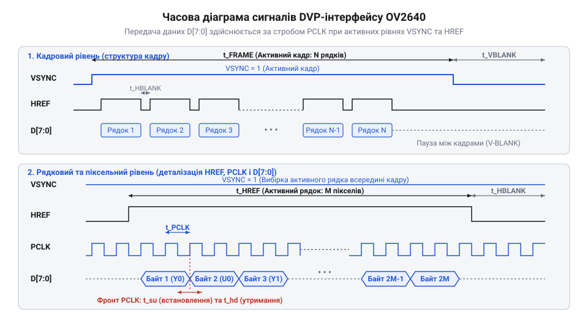
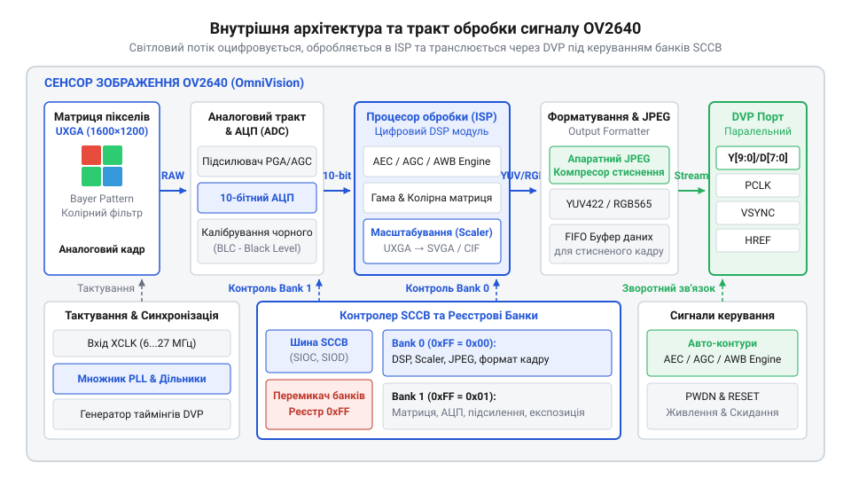
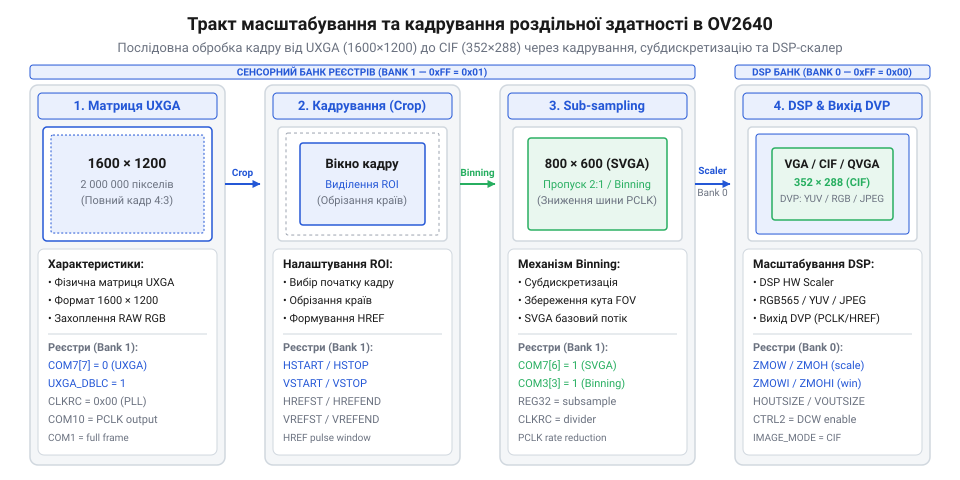
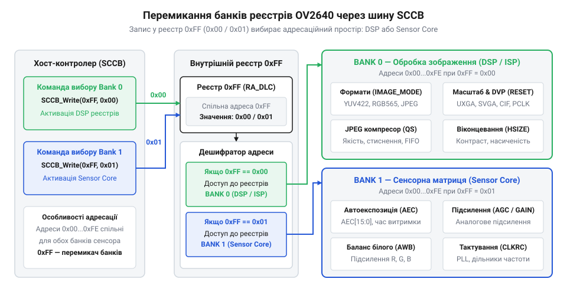

# Архітектура та внутрішні реєстри сенсора OV2640

## Обмеження прямого захоплення піксельного потоку

Під час спроби отримати зображення високої роздільної здатності з оптичного датчика розробники вбудованих систем стикаються з жорстким апаратним бар'єром. Оптична матриця сенсора @@en|UXGA@@ (англ. *Ultra Extended Graphics Array*, надрозширений графічний масив) формує сітку з 1600 × 1200 світлочутливих осередків. Якщо спробувати передавати кожен оцифрований @@en|pixel@@ (англ. *pixel*, від *picture element* — елемент зображення) безпосередньо у внутрішню оперативну пам'ять мікроконтролера у первинному 16-бітному форматі @@en|RGB565@@ (англ. *Red Green Blue 565*, червоний-зелений-синій з 5-6-5 бітами), обсяг даних одного кадру миттєво переповнює доступні ресурси.

Обчислимо необхідний обсяг оперативної пам'яті `S_frame` та потрібну пропускну здатність `BW` для обробки нестисненого відеопотоку зі стандартною кадровою частотою:

Нехай:
- `W` — ширина кадру у пікселях (`W = 1600`);
- `H` — висота кадру у пікселях (`H = 1200`);
- `B` — кількість байтів на один піксель (`B = 2` байта для 16-бітного кольору);
- `FPS` — кадрова частота (англ. *@@en|Frame rate@@*, кількість кадрів за секунду, `FPS = 15`).

```
S_frame = W × H × B
= 1600 × 1200 × 2        [підстановка параметрів матриці UXGA]
= 3840000 байт           [обчислення обсягу кадру]
= 3.662 Мбайт            [переведення у мегабайти]

BW = S_frame × FPS
= 3840000 × 15           [підстановка кадрової частоти]
= 57600000 байт/с        [обчислення пропускної здатності]
= 54.93 Мбайт/с          [переведення у мегабайти за секунду]
```

Для більшості популярних мікроконтролерів із внутрішньою пам'яттю @@en|SRAM@@ (англ. *Static Random-Access Memory*, статична оперативна пам'ять) обсягом від 128 до 512 кілобайт буферизація навіть одного повнокадрового знімка є фізично неможливою без використання зовнішньої пам'яті @@en|PSRAM@@ (англ. *Pseudo-Static RAM*, псевдостатична оперативна пам'ять). Крім того, передача даних зі швидкістю понад 54 Мбайт/с вимагає від шини безперервного пропускного потоку біля 440 Мбіт/с. При прямому програмному зчитуванні за допомогою опитування прапорців процесору довелося б витрачати всі обчислювальні такти лише на вибірку GPIO-портів, що робить виконання будь-якої аналітичної обробки чи мережевих протоколів нездійсненним.

Для передачі нестисненого цифрового відеосигналу використовують цифровий паралельний відеоінтерфейс @@en|DVP@@ (англ. *Digital Video Port*, цифровий відеопорт). Передача даних у DVP спирається на жорстку апаратну часову синхронізацію трьох основних сигналів: тактового сигналу пікселів `PCLK` (англ. *Pixel Clock*), строба активного рядка `HREF` (англ. *Horizontal Reference*) та строба кадрової синхронізації `VSYNC` (англ. *Vertical Synchronization*). Детальніше про [часові діаграми паралельних інтерфейсів](root:com-devices/dvp-parallel-video-interface) можна дізнатися у відповідній специфікації фізичного рівня.


*Часова діаграма сигналів DVP-інтерфейсу, що ілюструє синхронізацію рядків та кадрів піксельного потоку.*

Кожен піксель передається синхронно з фронтом імпульсу `PCLK`. Оскільки для формування 16-бітного кольору RGB565 потрібно два байти, на один піксель припадає два тактові імпульси `PCLK`. У разі найменшого часового зсуву або затримки під час обробки переривань прямим доступом до пам'яті @@en|DMA@@ (англ. *Direct Memory Access*, прямий доступ до пам'яті), контролер втрачає синхронізацію парних байтів. Це призводить до фатального викривлення кольорового балансу, коли старший байт червоного та зеленого каналів зчитується як молодший байт синього, викликаючи вертикальні смуги та спотворення на зображенні. Механізми розрахунку допустимих відхилень `PCLK` та формули кадрової частоти наведено у матеріалі щодо [розрахунку тактових частот](root:cat-hw-sensors/ov2640-sensor-architecture/math-ov2640-clocking-fps-calc.md) для матриць високої роздільної здатності.

Окрім байтового зсуву, при високій частоті `PCLK` (яка для 15 кадрів/с досягає 36 МГц) виникають серйозні проблеми з цілісністю сигналів на друкованій платі. Паразитні ємності та наводки між паралельними лініями даних `D[7:0]` викликають зсув фази між тактовим імпульсом `PCLK` і стробом `HREF`. Якщо контролер зчитує стан шини в момент перехідного процесу, виникають викривлення рядків (артефакт аркуша, що «розривається»). Без використання внутрішньої локальної буферизації будь-які затримки шини процесора призводять до втрати цілих рядків пікселів.

Проблема стає ще гострішою при передачі рухомого відео. Без локальної буферизації та підсилення сигналу безпосередньо у кристалі сенсора будь-які коливання напруги живлення або паразитні ємності долгої паралельної шини викликають пропуски тактових імпульсів. Фізичні обмеження розпіновки та живлення детально висвітлені у [архітектурі апаратного інтерфейсу](root:cat-hw-sensors/ov2640-sensor-architecture/api-ov2640-hardware-interface-spec.md) сенсора.

Переломним моментом у вирішенні цієї проблеми стала поява сенсора @@en|OV2640@@ розробки компанії OmniVision Technologies у середині 2000-х років. Розробники інтегрували повноцінний цифровий процесор обробки сигналів та апаратний кодер стиснення безпосередньо на одногодинному кремнієвому кристалі сенсора. Це зробило справжній прорив у галузі вбудованих систем: мікроконтролер позбувся потреби обробляти гігабітні первинні піксельні потоки, отримавши можливість зчитувати вже стиснений кадр помірного обсягу. Саме ця архітектурна революція перетворила OV2640 на стандарт де-факто для бюджетних пристроїв міжмережевого з'єднання та DIY-платформ на кшталт ESP32-CAM.

Отже, прямому захопленню піксельного потоку бракує швидкодії та обсягу пам'яті на боці приймача. Для стабільної роботи потрібен внутрішній апаратний тракт, який локально підсилює аналоговий сигнал, виконує первинне цифрове кодування та стискає обсяг кадру ще до його виходу на зовнішню шину.

## Внутрішній тракт обробки світлочутливої матриці

Внутрішня архітектура сенсора OV2640 побудована як замкнений обчислювальний конвеєр, що перетворює падаючий світловий потік на готовий цифровий кадр або стиснений потік даних. Основою пристрою є матриця світлочутливих осередків @@en|CMOS@@ (англ. *Complementary Metal-Oxide-Semiconductor*, комплементарна структура метал-оксид-напівпровідник) з роздільною здатністю 1600 × 1200 пікселів.


*Функціональна схема внутрішнього тракту OV2640, що показує перетворення світла у цифровий JPEG-потік.*

Процес формування зображення починається в аналоговому блоці @@en|AFE@@ (англ. *Analog Front End*, аналоговий тракт зчитування). Кожен фотодіод накопичує електричний заряд, пропорційний інтенсивності падаючого світла. Сигнали з матриці проходять через схему вибірки та зберігання, після чого підсилюються блоком аналогового регулювання підсилення @@en|AGC@@ (англ. *Automatic Gain Control*, автоматичне керування підсиленням). Далі аналоговий сигнал перетворюється на 10-бітний цифровий код за допомогою вбудованого аналогово-цифрового перетворювача @@en|ADC@@ (англ. *Analog-to-Digital Converter*, аналогово-цифровий перетворювач). Алгоритми керування витримкою та підсиленням розкрито у матеріалі про [моделі аналогового підсилення](root:cat-hw-sensors/ov2640-sensor-architecture/math-ov2640-exposure-gain-math.md) в автоматичних режимах.

Оцифровані первинні дані потрапляють до вбудованого процесора обробки сигналів зображення @@en|ISP@@ (англ. *Image Signal Processor*, процесор сигналів зображення). Первинна матриця використовує фільтр Байєра @@en|Bayer pattern@@ (названий на честь винахідника Брюса Байєра), де кожен піксель фіксує лише одну колірну компоненту (червону, зелену або синю) у шаблоні BGGR або GRBG. Оскільки зелені осередки займають 50% площі для відповідності людському зору, а червоні та сині по 25%, блок ISP здійснює інтерполяцію кольорів (дебайєризацію), відновлюючи повноколірний шар RGB для кожного пікселя. Одночасно ISP виконує корекцію дефектних пікселів, зниження цифрового шуму, гамма-корекцію та автоматичний баланс білого @@en|AWB@@ (англ. *Automatic White Balance*). Більше про внутрішню [архітектуру тракту обробки](root:sf-visual/raw-processing-pipeline) можна прочитати у спеціалізованому огляді.

Після відновлення кольору потік даних потрапляє до блоку кадрування та скалювання роздільної здатності. Сенсор OV2640 здатний динамічно зменшувати розмір вихідного кадру від нативного UXGA до SVGA ($800 \times 600$), VGA ($640 \times 480$), QVGA ($320 \times 240$) або CIF ($352 \times 288$).


*Послідовність кадрування та скалювання піксельного масиву від UXGA до нижчих роздільних здатностей.*

Зменшення роздільної здатності здійснюється шляхом субдискретизації (пропуску пікселів) або усереднення сусідніх осередків, що дозволяє суттєво зменшити навантаження на обчислювальне ядро мікроконтролера при збереженні повного поля зору об'єктива.

Ключовим блоком OV2640 є апаратний компресор зображень @@en|JPEG@@ (від назви розробника *Joint Photographic Experts Group*). Компресор приймає YUV-потік від ISP, виконує дискретне косинусне перетворення, квантування та кодування Гаффмана. Завдяки цьому обсяг 2-мегапіксельного кадру зменшується з 3.84 Мбайт до 30–150 Кілобайт (залежно від коефіцієнта стиснення). Захоплення такого стисненого потоку висвітлено у практичних проєктах [захоплення стисненого кадру](root:cat-hw-sensors/ov2640-sensor-architecture/proj-ov2640-esp32-cam-jpeg-capture.md) на базі ESP32-CAM та [системи оцифрування YUV](root:cat-hw-sensors/ov2640-sensor-architecture/proj-ov2640-stm32-dcmi-raw-yuv.md) на STM32. Основи функціонування блоку стиснення розібрано у статті про [апаратні кодери зображення](root:com-signal/cmos-sensor-hardware-jpeg-compression).

Керування всіма цими апаратними блоками здійснюється через серійну шину керування камерою @@en|SCCB@@ (англ. *Serial Camera Control Bus*). Фізично та програмно SCCB сумісна з протоколом I2C, проте має особливу організацію реєстрового простору. Сенсор містить понад три сотні конфігураційних регістрів, розділених на два основні банки:
- **Bank 0** (DSP Bank 0 / Sensor Core): відповідає за фізичні параметри матриці, аналогове підсилення, експозицію, формат розгортки та вибір коефіцієнтів ADC. - **Bank 1** (DSP Bank 1 / Digital Processing): керує функціями ISP, розрахунком матриці кольорів, скалюванням роздільної здатності та параметрами JPEG-компресора.


*Архітектура реєстрового простору OV2640 з адресацією банків через контрольний реєстр.*

Перемикання між банками здійснюється за допомогою опису реєстру `0xFF` (RA_DLC / Bank Select). Запис значення `0x00` у реєстр `0xFF` відкриває доступ до Bank 0, а запис `0x01` перемикає шину SCCB на адресацію Bank 1. Якщо розробник забуде перемикнути банк перед ініціалізацією таблиці параметрів JPEG, записи за адресами `0x00`–`0x80` потраплять у Bank 0, збивши налаштування аналогового підсилення та генератора розгортки. Повний опис послідовності [конфігурації регістрових банків](root:cat-hw-sensors/ov2640-sensor-architecture/api-ov2640-sccb-register-config.md) наведено у відповідному програмному довіднику. Специфічні відмінності та внутрішній таймінг [протоколу шини SCCB](root:com-devices/sccb-bus-protocol-architecture) регламентуються специфікацією шини.

Нижче наведено приклад коду мовами C та C++ для перемикання банків регістрів та ініціалізації базового режиму стиснення:

:::tabs
@c|esp-idf
:::code ov2640-sensor-architecture-d/c/ov2640-write-reg.c
@cpp|arduino
:::code ov2640-sensor-architecture-d/cpp/ov2640bankcontroller.cpp
:::

Завдяки узгодженій роботі аналогового тракту, ISP-процесора, апаратного кодера JPEG та двобанкній системі регістрів, сенсор OV2640 спроможний самостійно здійснювати повний цикл первинної обробки кадрів. Це звільняє мікроконтролер від рутинного обчислення піксельних масивів і дозволяє будувати компактні системи комп'ютерного зору на базі доступних мікросхем.

## Двобанкна система реєстрів і SCCB

Для безпосереднього налаштування багаторівневого тракту обробки зображення в сенсорі @@en|OV2640@@ керуюча мікроконтролерна система має взаємодіяти з кількома сотнями внутрішніх конфігураційних параметрів. Проте класична 8-бітна адресація реєстрів обмежує адресовний простір лише 256 осередками (від `0x00` до `0xFF`). Перехід на 16-бітну адресацію порушив би апаратну сумісність із простішими давачами та збільшив би службовий оверхед під час передачі кожного байта.

Розробники компанії OmniVision розв'язали це обмеження за допомогою двобанкної архітектури реєстрового простору. Усі внутрішні реєстри розділено на дві активні сторінки пам'яті: **@@en|Bank 0@@** (англ. *DSP Bank 0 / Digital Processing*, цифровий процесор обробки) та **@@en|Bank 1@@** (англ. *DSP Bank 1 / Sensor Core*, ядро сенсора).

- **Bank 0**: керує фізичними параметрами матриці, аналоговим трактом зчитування @@en|AFE@@, автоматичним підсиленням @@en|AGC@@, автоматичною витримкою @@en|AEC@@, геометричним кадруванням піксельного масиву (реєстри `HSTART`, `HSTOP`, `VSTART`, `VSTOP`), а також системними дільниками тактової частоти `CLKRC` та генератором @@en|PLL@@. - **Bank 1**: відповідає за функціонал цифрового процесора сигналів @@en|ISP@@, обчислення матриці балансу білого @@en|AWB@@, колірну корекцію, гамма-криві, контурну чіткість, модуль цифрового скалювання (SDE) та параметри апаратного кодера @@en|JPEG@@.

Вибір активного банку здійснюється за допомогою спеціального реєстру `0xFF` (англ. *Register Address Delimiter*, `RA_DLMT`), який фізично доступний за однією й тією ж адресою незалежно від поточного стану системи. Запис значення `0x00` у реєстр `0xFF` перемикає шину на адресацію `Bank 0`, а запис `0x01` відкриває доступ до `Bank 1`.

Обмін даними між мікроконтролером та сенсором відбувається через послідовну шину керування камерою @@en|SCCB@@ (англ. *Serial Camera Control Bus*, послідовна шина керування камерою). Фізично шина складається з двох ліній: тактової лінії `SIO_C` (англ. *Serial I/O Clock*) та лінії даних `SIO_D` (англ. *Serial I/O Data*). Для шини SCCB 7-бітна адреса пристрою OV2640 за замовчуванням дорівнює `0x30` (що відповідає 8-бітовій адресі `0x60` для запису та `0x61` для зчитування). 

Операція запису конфігураційного байта виконується за трифазним циклом передачі:

1. Фаза 1: Передача адреси пристрою з прапорцем запису (`0x60`). 2. Фаза 2: Передача адреси цільового реєстру (наприклад, `0x12`). 3. Фаза 3: Передача значення даного реєстру (наприклад, `0x80`).

Незважаючи на високу подібність до стандартного протоколу @@en|I2C@@, шина SCCB має специфічні особливості: на 9-му тактовому імпульсі під час зчитування ведений пристрій не формує жорсткого біта підтвердження (ACK), а майстер ігнорує його стан (стан Don't Care). Більш детально часові параметри та розбіжності передачі даних висвітлені у матеріалі про [специфікацію шини SCCB](root:com-devices/sccb-bus-protocol-architecture).

Найпоширенішою помилкою під час розробки драйверів OV2640 є «тихий» перезапис чутливих реєстрів через відсутність контролю активного банку. Адреси від `0x00` до `0x80` повторюються в обох банках, але відповідають за абсолютно різні апаратні вузли.

Наприклад, якщо розробник надсилає таблицю налаштувань апаратного JPEG-кодера (яка належить до `Bank 1`), але перед цим забув перемикнути банк через реєстр `0xFF`, значення потраплять у `Bank 0`. У результаті запис за адресою `0x12` замість налаштування DSP-режиму викличе скидання аналогового ядра `COM7`, а запис за адресою `0x11` зб'є внутрішній тактовий дільник `CLKRC`. Це призводить до миттєвого зникнення тактування `PCLK` або спотворення синхроімпульсів `VSYNC`.

Щоб запобігти подібним збоям, у програмному забезпеченні застосовують структуровані масиви ініціалізації, де кожна група реєстрів явно починається з виклику перемикання банку. Детальний довідник усіх реєстрових адрес та їхніх бітових масок наведено у розділі про [програмний інтерфейс конфігурування регістрів](root:cat-hw-sensors/ov2640-sensor-architecture/api-ov2640-sccb-register-config.md), а вимоги до електричного підключення та живлення — у матеріалі про [специфікацію апаратного інтерфейсу](root:cat-hw-sensors/ov2640-sensor-architecture/api-ov2640-hardware-interface-spec.md).

Нижче наведено приклад реалізації безпечного запису реєстрів із автоматичною перевіркою та перемиканням банків мовами C та C++:

:::tabs
@c|esp-idf
:::code ov2640-sensor-architecture-d/c/sccb-write-byte.c
@cpp|arduino
:::code ov2640-sensor-architecture-d/cpp/ov2640bankmanager.cpp
:::

Отже, двобанкна система реєстрів дозволяє розмістити розширений функціонал керування матрицею та процесором обробки в межах стандартної 8-бітної адресації шини SCCB.

## Конфігурація роздільної здатності та форматів

Після налаштування стійкого зв'язку через шину @@en|SCCB@@ та опанування механізму перемикання банків ключовим завданням стає вибір кадрового режиму й кодування вихідного піксельного потоку. Фізична світлочутлива матриця @@en|OV2640@@ має нативну роздільну здатність @@en|UXGA@@ (1600 × 1200 пікселів). Проте захоплення та обробка повного кадру в нестисненому вигляді вимагає величезних обсягів оперативної пам'яті, що перевищує можливості більшості мікроконтролерів.

Для гнучкого підлаштування під ресурси керуючого процесора в сенсор інтегровано каскадний тракт кадрування та масштабування. OV2640 здатний формувати зображення таких стандартних розмірів: UXGA (1600 × 1200), @@en|SVGA@@ (800 × 600), @@en|VGA@@ (640 × 480), @@en|CIF@@ (352 × 288), @@en|QVGA@@ (320 × 240) та @@en|QCIF@@ (176 × 144).

Формування зменшених роздільностей здійснюється трьома послідовними апаратними механізмами:

1. **Кадрування (Windowing)**: Виділення прямокутного робочого вікна на матриці за допомогою реєстрів `HSTART`, `HSTOP`, `VSTART`, `VSTOP` у `Bank 0`. Це дозволяє відсікти непотрібні крайові пікселі або реалізувати цифрове кадрування без змінення розміру самого осередка. 2. **Субдискретизація та Binning**:
   - `@@en|Binning@@` (англ. *binning*, від *bin* — корзина/комірка, об'єднання зарядів суміжних пікселів): апаратне підсумовування електричних зарядів $2 \times 2$ сусідніх світлочутливих фотодіодів перед оцифруванням. Це зменшує роздільну здатність у 4 рази (наприклад, з UXGA до SVGA), але суттєво підвищує відношення сигнал/шум та чутливість камери в умовах слабкого освітлення. - `@@en|Subsampling@@` (англ. *subsampling*, субдискретизація): пропуск парних рядків чи стовпчиків пікселів. Дозволяє зберегти повний кут огляду об'єктива при зменшенні кількості переданих даних. 3. **Цифрове скалювання (DSP Zoom Engine)**: Блок SDE (англ. *Special Digital Effects*) у `Bank 0` здійснює цифрове пропорційне стиснення піксельної сітки (через реєстри `ZMOW`, `ZMOH`, `ZMCH`) до довільних точно заданих габаритів.

Поряд із розміром кадру критично важливим є вибір формату кодування вихідних даних. Сенсор OV2640 підтримує чотири основні формати:

- **RAW RGB (Bayer RGB)**: `@@en|RAW RGB@@` (англ. *Raw RGB*, первинний колірний масив без інтерполяції) являє собою первинні 8-бітні або 10-бітні значення напруги з фотодіодів матриці під фільтром Байєра. Цей формат вимагає найменших затримок обробки в самому сенсорі, але покладає завдання дебайєризації на зовнішній процесор. Принципи функціонування колірної інтерполяції розкладено у статті про [архітектуру вбудованого ISP-тракту](root:sf-visual/raw-processing-pipeline). - **YUV422**: `@@en|YUV422@@` (англ. *YUV 4:2:2*, яскравість Y та колірнорізницеві компоненти U/V) передається у вигляді 16 біт на піксель (послідовність байтів `Y0 Cb0 Y1 Cr0`). Відокремлення каналу яскравості (Y) від хроматичних компонент робить цей формат ідеальним для алгоритмів комп'ютерного зору, виявлення контурів та нейромережевої обробки на мікроконтролерах. - **RGB565**: 16-бітне кодування кольору (5 біт червоного, 6 біт зеленого, 5 біт синього), сформоване внутрішньою колірною матрицею ISP. Зручне для прямого виведення зображення у буфер дисплеїв без додаткових обчислень. - **JPEG**: апаратно стиснений бінарний потік даних. Апаратний кодер у `Bank 1` розбиває YUV-масив на блоки $8 \times 8$, виконує дискретне косинусне перетворення та кодування Гаффмана. Потік виходить на DVP-шину у вигляді послідовності байтів з маркером початку кадру `0xFF 0xD8` (SOI) та кінця `0xFF 0xD9` (EOI). Докладно механіку роботи блоку стиснення розкрито у матеріалі про [алгоритми апаратного стиснення JPEG](root:com-signal/cmos-sensor-hardware-jpeg-compression).

Обчислимо необхідний обсяг буфера пам'яті `S_buffer` для нестисненого кадру VGA у форматі RGB565 та порівняємо його з середнім розміром стисненого JPEG-файлу `S_jpeg`:

Нехай:
- `W = 640` (ширина кадру VGA у пікселях);
- `H = 480` (висота кадру VGA у пікселях);
- `B = 2` (кількість байтів на піксель для RGB565);
- `S_jpeg = 30720` байт (середній розмір JPEG-кадру VGA при середньому коефіцієнті якості).

```
S_buffer = W × H × B
= 640 × 480 × 2          [підстановка параметрів кадру VGA у форматі RGB565]
= 614400 байт            [обчислення обсягу нестисненого кадру]
= 600 Кілобайт           [переведення у кілобайти]

R_compression = S_buffer ÷ S_jpeg
= 614400 ÷ 30720         [підстановка середнього розміру JPEG-файлу]
= 20                     [кратність зменшення обсягу даних]
```

З обчислення видно, що для розміщення одного нестисненого кадру VGA RGB565 потрібно 600 Кілобайт безперервної оперативної пам'яті, що виходить за межі внутрішньої пам'яті SRAM більшості мікроконтролерів. Натомість апаратний стискач зменшує обсяг у 20 разів — до 30 Кілобайт, що дозволяє зберігати кадри навіть високої роздільної здатності UXGA у звичайній SRAM.

Практичну реалізацію потокової передачі стиснених кадрів розкрито у проєкті [передача JPEG-зображень на ESP32-CAM](root:cat-hw-sensors/ov2640-sensor-architecture/proj-ov2640-esp32-cam-jpeg-capture.md), а захоплення YUV/RGB-потоку через апаратний паралельний інтерфейс контролера — у проєкті [захоплення нестисненого відеопотоку на STM32](root:cat-hw-sensors/ov2640-sensor-architecture/proj-ov2640-stm32-dcmi-raw-yuv.md).

Зміна роздільної здатності та формату безпосередньо впливає на пропускну здатність тактової лінії `PCLK` та часові інтервали сигналів синхронізації. Формули розрахунку кадрової частоти та налаштування внутрішнього генератора наведено у матеріалі про [розрахунок тактових частот](root:cat-hw-sensors/ov2640-sensor-architecture/math-ov2640-clocking-fps-calc.md). При зміні кадрового режиму також виникає потреба перераховувати тривалість автоекспозиції, що деталізовано в матеріалі про [автоматичне регулювання експозиції](root:cat-hw-sensors/ov2640-sensor-architecture/math-ov2640-exposure-gain-math.md). Для узгодження вихідних імпульсів з контролером слід враховувати часові обмеження, описані в специфікації про [таймінги паралельного інтерфейсу DVP](root:com-devices/dvp-parallel-video-interface).

Нижче наведено приклад функцій конфігурування роздільної здатності та формату вихідного потоку OV2640 мовами C та C++:

:::tabs
@c|esp-idf
:::code ov2640-sensor-architecture-d/c/ov2640-set-output-format.c
@cpp|arduino
:::code ov2640-sensor-architecture-d/cpp/cameraresolution.cpp
:::

Таким чином, комбінування каскадного скалювання та апаратного стиснення JPEG дозволяє конфігурувати сенсор OV2640 для роботи у широкому спектрі застосувань — від компактних систем машинного зору до бездротової потокової передачі відео.

## Формування сигналів паралельного інтерфейсу DVP

Після того як вбудований процесор зображення обробив піксельну матрицю та сформував вихідний потік байтів, виникає задача передачі цієї інформації у пам'ять мікроконтролера. Безпосередня передача мультимедійного потоку високої роздільної здатності потребує суворої часової синхронізації між давачем та приймальним пристроєм. Найменша розсинхронізація у частках наносекунди призводить до зсуву пікселів, викривлення кольорових каналів або повної втрати кадру.

Для передачі потокових даних давач @@en|OV2640@@ використовує паралельний цифровий відеоінтерфейс @@en|DVP@@ (англ. *Digital Video Port*, від *digital* — цифровий, *video* — відео, *port* — гавань/вхід). Інтерфейс містить 8-бітову або 10-бітову паралельну шину даних `D[9:2]`/`D[7:0]` та три лінії часової синхронізації: піксельний тактовий сигнал @@en|PCLK@@ (англ. *Pixel Clock*, від *pixel* — елемент зображення, *clock* — годинник), строб рядка @@en|HREF@@ (англ. *Horizontal Reference*, від *horizontal* — горизонтальний, *reference* — орієнтир) та імпульс кадрової синхронізації @@en|VSYNC@@ (англ. *Vertical Synchronization*, від *vertical* — вертикальний, *synchronization* — узгодження).

Функціонування синхронного інтерфейсу базується на вхідному опорному тактовому сигналі @@en|XVCLK@@ (англ. *External Clock*, від *external* — зовнішній), який подається від мікроконтролера або окремого генератора на фізичний вивід сенсора. Типова частота @@en|XVCLK@@ становить від 6 до 24 МГц (найчастіше 12 або 24 МГц). Усі внутрішні таймінги сенсора та вихідна частота @@en|PCLK@@ формуються шляхом каскадного перетворення вхідного сигналу @@en|XVCLK@@ через внутрішній модуль @@en|PLL@@ (англ. *Phase-Locked Loop*, від *phase* — фаза, *locked* — захоплений, *loop* — петля) та програмно налаштовувані дільники частоти.

Зв'язок між частотою вхідного сигналу `f_XVCLK`, коефіцієнтом помножувача `PLL_mult` та значенням реєстру системного дільника `CLKRC[5:0]` описується послідовним розрахунком. Дістаємо внутрішню системну частоту ядра `f_internal` та вихідну частоту піксельного стробу `f_PCLK` з вхідної частоти `f_XVCLK`:

```
f_internal = f_XVCLK × PLL_mult
= 12.0 × 4                           [застосування помножувача PLL]
= 48.0                               [системна частота ядра у МГц]

f_PCLK = f_internal ÷ (2 × (CLKRC + 1))
= 48.0 ÷ (2 × (0 + 1))                [ділення на дільник CLKRC]
= 24.0                               [вихідна частота PCLK у МГц]
```

Зі збільшенням значення у реєстрі `CLKRC` частота `f_PCLK` пропорційно зменшується. Це дозволяє узгодити швидкість видачі піксельних байтів із максимальною пропускною здатністю периферійного модуля прямого доступу до пам'яті @@en|DMA@@ (англ. *Direct Memory Access*, від *direct* — прямий, *memory* — пам'ять, *access* — доступ) приймального мікроконтролера. Більш детальний аналіз часових розгортань наведено у матеріалі з [розрахунком тактових частот](root:cat-hw-sensors/ov2640-sensor-architecture/math-ov2640-clocking-fps-calc.md).

Для правильного захоплення кадру приймач повинен чітко розрізняти початок кадру, активну частину рядка та допоміжні інтервали гасіння:

![Часова діаграма сигналів PCLK, HREF, VSYNC та шини даних D[7:0] показує часові співвідношення при передачі рядка пікселів, з яких видно прив'язку тактових імпульсів PCLK до активного стану строба HREF.](img/ov2640-dvp-timing-diagram.svg)
*Часова діаграма сигналів PCLK, HREF, VSYNC та шини даних D[7:0] показує часові співвідношення при передачі рядка пікселів, з яких видно прив'язку тактових імпульсів PCLK до активного стану строба HREF.*

- **Сигнал VSYNC**: визначає межі окремого кадру. У конфігурації за замовчуванням високий логічний рівень @@en|VSYNC@@ свідчить про паузу між кадрами, а спадний фронт позначає початок передачі нового кадру. Приймальний модуль МК використовує цей імпульс для скидання внутрішнього адресного вказівника буфера пам'яті. - **Сигнал HREF**: вказує на передачу активних пікселів поточного рядка. Коли @@en|HREF@@ перебуває у високому стані, кожен спадний або висхідний фронт @@en|PCLK@@ супроводжує появу нового дійсного байта даних на шині `D[9:2]`. Під час низького стану @@en|HREF@@ шина даних перебуває в неактивному стані, а сенсор виконує внутрішнє перенесення рядка та обчислення чорного рівня. - **Передача двобайтових форматів**: У форматах @@en|RGB565@@ та @@en|YUV422@@ кожен піксель складається з двох послідовних байтів (старшого та молодшого). Отже, для передачі одного пікселя зображення потрібно два тактові імпульси @@en|PCLK@@ в межах одного активного інтервалу @@en|HREF@@. При цьому кількість імпульсів @@en|PCLK@@ під час високого рівня @@en|HREF@@ удвічі перевищує горизонтальну роздільну здатність кадру.

Особливості часових розгортань та електричних рівнів детально висвітлено у [цифровому відеоінтерфейсі DVP](root:com-devices/dvp-parallel-video-interface), а також у загальносистемному [апаратному описі інтерфейсу](root:cat-hw-sensors/ov2640-sensor-architecture/api-ov2640-hardware-interface-spec.md) давача.

Під час виходу в режимі @@en|JPEG@@ часова діаграма змінюється. Оскільки розмір стисненого кадру є динамічним і залежить від деталізації сцени, передача відбувається нерівномірно. Сенсор @@en|OV2640@@ генерує строб @@en|HREF@@ та тактові імпульси @@en|PCLK@@ лише тоді, коли внутрішній кодер @@en|JPEG@@ має готові байтові дані у своєму вихідному буфері. Приймальний МК у режимі @@en|JPEG@@ повинен зчитувати байти за стробом @@en|PCLK@@ під час активного @@en|HREF@@ та шукати маркери початку кадру (`0xFF 0xD8`) і кінця кадру (`0xFF 0xD9`). Практичні рішення для обробки стисненого потоку висвітлено у матеріалах про [потокову передачу даних](root:cat-hw-sensors/ov2640-sensor-architecture/proj-ov2640-esp32-cam-jpeg-capture.md) на мікроконтролері ESP32-CAM та [захоплення кадру DCMI](root:cat-hw-sensors/ov2640-sensor-architecture/proj-ov2640-stm32-dcmi-raw-yuv.md) на STM32.

Налаштування фази @@en|PCLK@@, полярності @@en|VSYNC@@/@@en|HREF@@ та частоти @@en|PLL@@ виконується через реєстри `COM10` (`0x15`), `CLKRC` (`0x11`) та `REG04` (`0x04`) у @@en|Bank 1@@. Нижче наведено приклад коду для конфігурації часових параметрів інтерфейсу @@en|DVP@@ мовами C та C++:

:::tabs
@c|esp-idf
:::code ov2640-sensor-architecture-d/c/write-sccb.c
@cpp|arduino
:::code ov2640-sensor-architecture-d/cpp/ov2640dvpcontroller.cpp
:::

## Діагностика збоїв і часових розсинхронізацій

Практична експлуатація сенсора @@en|OV2640@@ у складі вбудованих систем часто супроводжується апаратними та програмними збоями. Через високі частоти стробування @@en|PCLK@@ (до 24–36 МГц), складнощі часової синхронізації @@en|DVP@@ та наявність двобанкної системи реєстрів найменше відхилення від нормативних параметрів викликає спотворення зображення, зсув кольорів, втрату кадрових імпульсів або зависання шини керування @@en|SCCB@@.

Поширеною апаратною проблемою при передачі нестисненого відео є байтовий зсув фази (англ. *byte phase shift*). Захоплене зображення у форматі @@en|RGB565@@ або @@en|YUV422@@ при цьому отримує фіолетовий чи зелений відтінок, а на межах контрастних об'єктів з'являється кольоровий шум. Оскільки кожен піксель складається з двох байтів, помилковий початок захоплення з другого байта замість першого призводить до того, що старший байт одного пікселя об'єднується з молодшим байтом сусіднього. Для локалізації несправності аналізують спадний фронт @@en|HREF@@ відносно @@en|PCLK@@. Якщо зсув виникає через перехідні процеси на лінії, інвертують активний фронт зчитування @@en|PCLK@@ у реєстрі `COM10[4]` у @@en|Bank 0@@, а також налаштовують скидання лічильника буфера @@en|DMA@@ за фронтом імпульсу @@en|VSYNC@@.

У режимі @@en|JPEG@@ часті збої проявляються як руйнування структури кадру, коли файл не відкривається декодером або має відсутній маркер кінця кадру `0xFF 0xD9`. Головною причиною є переповнення вихідного буфера через обмежену пропускну здатність шини пам'яті @@en|PSRAM@@ (англ. *Pseudo-Static RAM*, від *pseudo* — несправжній, *static* — нерухомий, *RAM* — оперативна пам'ять). Під час різкого збільшення деталізації сцени кодер @@en|JPEG@@ генерує щільний потік байтів з високою піковою частотою @@en|PCLK@@. Якщо периферійний модуль МК не встигає зберегти дані у @@en|PSRAM@@, виникає втрата байтів. Проблему усувають зниженням частоти @@en|PCLK@@ через дільник `CLKRC` у @@en|Bank 0@@ або збільшенням коефіцієнта квантування @@en|JPEG@@ у реєстрі `QS` (`0x44` у @@en|Bank 1@@). Детальніше про внутрішню обробку зображення й стиснення викладено в матеріалах про [апаратне стиснення JPEG](root:com-signal/cmos-sensor-hardware-jpeg-compression) та загальний [конвеєр обробки ISP](root:sf-visual/raw-processing-pipeline).

Діагностика шини @@en|SCCB@@ виявляє випадки, коли запит зчитування ідентифікатора пристрою (`0x0A`/`0x0B`) повертає помилку або блокує лінії `SIO_C`/`SIO_D`. Найчастіша причина полягає у відсутності зовнішнього тактування @@en|XVCLK@@ під час ініціалізації. Цифрова логіка шини @@en|SCCB@@ всередині кристала @@en|OV2640@@ тактується від вхідної частоти @@en|XVCLK@@, тому спроба запису до включення генератора МК викликає відсутність відповіді від сенсора. Для відновлення зв'язку забезпечують подачу @@en|XVCLK@@ до першого звернення по шині та додають скидання через вивід `RESETB` або біт `COM7[7]` у @@en|Bank 0@@. Усі варіанти реєстрових ініціалізацій наведено у [довіднику конфігурації реєстрів](root:cat-hw-sensors/ov2640-sensor-architecture/api-ov2640-sccb-register-config.md) та на [специфікації шини SCCB](root:com-devices/sccb-bus-protocol-architecture).

Складні збої колірного балансу виникають при некоректній роботі модулів автоматичної витримки @@en|AEC@@ (англ. *Automatic Exposure Control*, від *automatic* — автоматичний, *exposure* — витримка, *control* — керування) та автоматичного підсилення @@en|AGC@@ (англ. *Automatic Gain Control*, від *gain* — підсилення). При цьому зображення пульсує за частотою штучного освітлення (50/60 Гц) або переекспонується у білий колір. Для усунення мерехтіння налаштовують регістри антимерехтіння під частоту електромережі та обмежують максимальне підсилення аналогового тракту через регістри `COM9` та `AGC`. Математичне виведення взаємозв'язку між витримкою та рядковими імпульсами детально розкрито у матеріалі з [моделлю регулювання витримки](root:cat-hw-sensors/ov2640-sensor-architecture/math-ov2640-exposure-gain-math.md).

Для швидкої перевірки апаратного стану давача доцільно використовувати програмну утиліту самотестування. Нижче наведено приклад реалізації діагностичного тестування мовами C та C++:

:::tabs
@c|esp-idf
:::code ov2640-sensor-architecture-d/c/sccb-read-reg.c
@cpp|arduino
:::code ov2640-sensor-architecture-d/cpp/ov2640diagnostic.cpp
:::