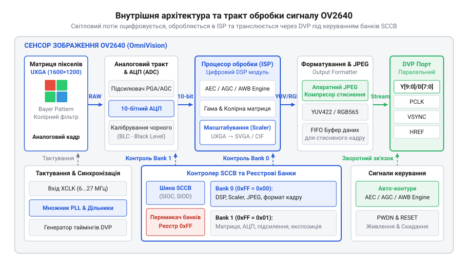
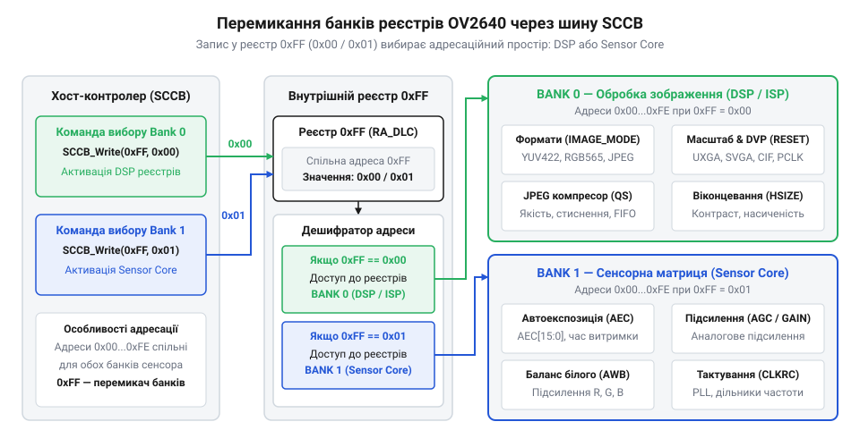
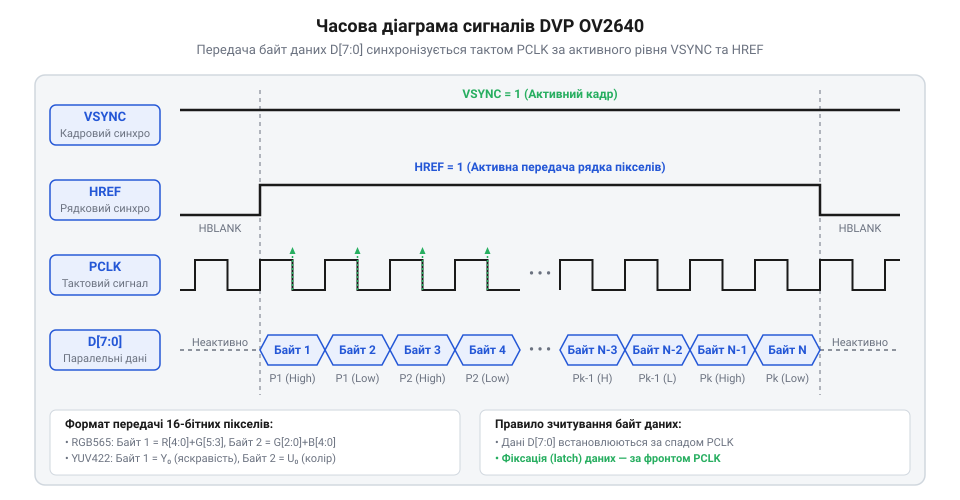

# Архітектура та внутрішні реєстри сенсора OV2640

## Обмеження прямого захоплення піксельного потоку

Пряма передача нестисненого відеопотоку з @@en|OV2640@@ у пам'ять мікроконтролера переповнює її обсяг. У роздільній здатності @@en|UXGA@@ (1600×1200) кадр у форматі @@en|RGB565@@ (2 байти на піксель) вимагає `V_frame` пам'яті:

```
V_frame = 1600 × 1200 × 2
        = 3 840 000 байт         [1600×1200 пікселів × 2 байти/піксель]
        ≈ 3.66 Мбайт             [переведення в мегабайти]
```

Внутрішня пам'ять @@en|SRAM@@ мікроконтролерів обмежена сотнями кілобайт, тому кадр не вміщується без зовнішньої @@en|PSRAM@@. При 15 кадрах/с необхідна пропускна здатність `BW` сягає:

```
BW = 3.84 Мбайт × 15
   = 57.6 Мбайт/с                [15 кадрів на секунду]
```

Передача `57.6 Мбайт/с` по 8-бітній шині вимагає частоти `PCLK` близько 28.8 МГц. На такій швидкості найменша затримка @@en|DMA@@ збиває порядок парних байтів і спотворює кольори. Для роботи з відеопотоком кристалу необхідний вбудований конвеєр обробки сигналу.

## Внутрішній конвеєр обробки та стиснення

Внутрішня архітектура сенсора @@en|OV2640@@ усуває перевантаження мікроконтролера завдяки апаратному конвеєру обробки. Світловий потік із @@en|CMOS@@-матриці через мозаїчний фільтр Баєра (англ. @@en|Bayer filter@@) підсилюється й оцифровується в аналоговому тракті @@en|AFE@@ (англ. @@en|AFE@@, @@en|Analog Front-End@@).

Далі цифровий масив обробляє процесор @@en|ISP@@ (англ. @@en|ISP@@, @@en|Image Signal Processor@@): виконує дебайєризацію, автобаланс білого (@@en|AWB@@), корекцію гами та масштабування роздільності від `UXGA` до `VGA` чи `QVGA`.


*Внутрішній конвеєр OV2640 здійснює аналогово-цифрове перетворення, дебайєризацію, масштабування та апаратне стиснення JPEG безпосередньо на кристалі.*

Апаратний кодер @@en|JPEG@@ стискає [конвеєр обробки RAW](root:sf-visual/raw-processing-pipeline) у десятки разів — із 3.84 Мбайт кадру `UXGA` до 30–150 Кілобайт. Для задач комп'ютерного зору обирають первинні формати @@en|YUV@@ або @@en|RGB565@@, а для передачі знімків чи відеопотоку — [апаратне кодування JPEG](root:com-signal/cmos-sensor-hardware-jpeg-compression).

## Двобанкна система реєстрів і SCCB

Конфігурування понад 200 реєстрів @@en|OV2640@@ обмежене однобайтовою адресацією (0x00–0xFF), тому реєстровий простір розділено на дві системні сторінки: `Bank 0` та `Bank 1`.

Сторінка `Bank 0` налаштовує цифровий процесор @@en|ISP@@ та кодер @@en|JPEG@@, а `Bank 1` керує аналоговим ядром матриці, підсилювачами @@en|AFE@@ і тактовими дільниками. Вибір сторінки виконується записом `0x00` або `0x01` у контрольний реєстр `0xFF` (`RA_DLMT`) по [протоколу шини SCCB](root:com-devices/sccb-bus-protocol-architecture) (англ. @@en|SCCB@@, @@en|Serial Camera Control Bus@@):

```
0xFF = 0x00    [активація Bank 0: ISP та JPEG]
0xFF = 0x01    [активація Bank 1: ядро матриці й тактування]
```


*Вибір сторінки через реєстр 0xFF є обов'язковим перед зміною налаштувань.*

Без перемикання банків команда потрапляє за тією ж байтовою адресою в активну сторінку, спричиняючи «тихе» псування конфігурації. Наприклад, помилковий запис у `Bank 1` замість `Bank 0` збиває тактовий дільник `CLKRC` і повністю зриває кадрову синхронізацію.

## Формування сигналів паралельного інтерфейсу DVP

Передача зображення до мікроконтролера відбувається через [паралельний інтерфейс DVP](root:com-devices/dvp-parallel-video-interface) (англ. @@en|DVP@@, @@en|Digital Video Port@@). Вхідна частота `XVCLK` через модуль @@en|PLL@@ (англ. @@en|PLL@@, @@en|Phase-Locked Loop@@) і дільник `CLKRC` у `Bank 1` формує піксельний тактовий сигнал `PCLK` (англ. @@en|PCLK@@, @@en|Pixel Clock@@):

```
f_pclk = (f_xvclk × PLL_mult) / (2 × (CLKRC_div + 1))
```

Синхронізацію кадру забезпечують строб кадру `VSYNC` (англ. @@en|VSYNC@@, @@en|Vertical Synchronization@@) та строб рядка `HREF` (англ. @@en|HREF@@, @@en|Horizontal Reference@@).


*Синхронізаційні сигнали DVP адаптують видачу даних від рівномірного піксельного тактування в RGB/YUV до буферизованої видачі потоку JPEG.*

У нестиснених режимах (@@en|YUV@@/@@en|RGB565@@) `PCLK` тактує безперервно під час високого `HREF`, видаючи два байти на піксель. У режимі @@en|JPEG@@ видача є вибуховою (англ. @@en|burst mode@@): сенсор накопичує потік у буфері @@en|FIFO@@ (англ. @@en|FIFO@@, @@en|First-In, First-Out@@) і стробує `PCLK` лише за наявності даних між маркерами `0xFFD8` та `0xFFD9` для захоплення периферією @@en|DMA@@.

## Діагностика збоїв і часових розсинхронізацій

Фіолетовий чи зелений відтінок зображення викликаний байтовим зсувом кольорів: @@en|DMA@@ захоплює шину даних на спадаючому фронті `PCLK` замість наростаючого або зміщує вибірку на байт. Зсув усувають інвертуванням біта `PCLK_reverse` у реєстрі `COM10` (`Bank 1`, `0x15`), зміною полярності тактування в периферії мікроконтролера та прив'язкою скидання адрес @@en|DMA@@ до `VSYNC`.

Відсутність відповіді @@en|ACK@@ по шині @@en|SCCB@@ виникає через брак тактування `XVCLK`. На відміну від @@en|I2C@@, контролер @@en|SCCB@@ у @@en|OV2640@@ тактується від `XVCLK`. Без тактового сигналу до першого звернення сенсор блокується. Зв'язок відновлюють запуском `XVCLK` та імпульсом скидання на `RESETB`.

Сірі смуги в @@en|JPEG@@ свідчать про переповнення буфера чи втрату байтів. Причину усувають зменшенням частоти `PCLK` дільником `CLKRC` або спрощенням матриці квантування. Мерехтіння кадру при штучному освітленні прибирають увімкненням антимерехтіння (англ. @@en|anti-flicker@@) у реєстрі `COM8` під частоту 50 або 60 Гц.