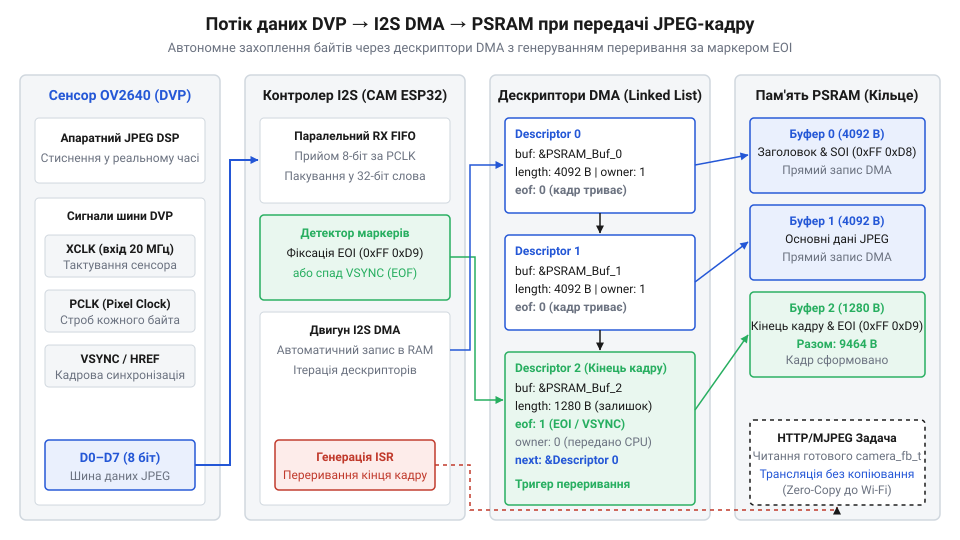
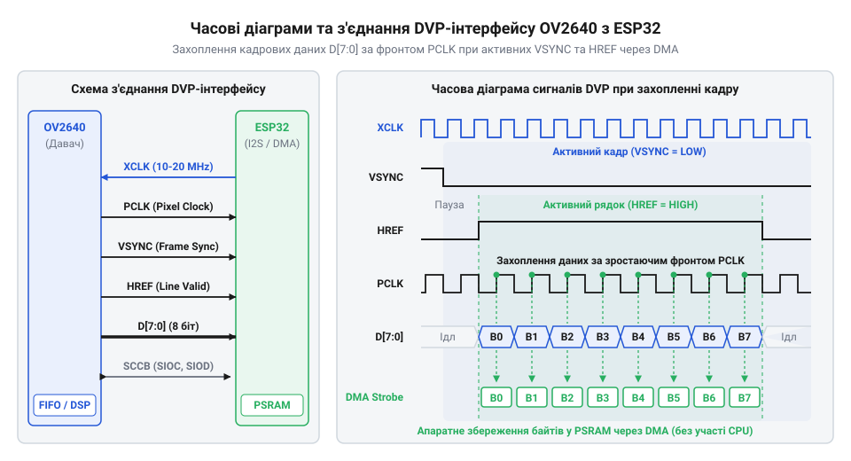

# Захоплення та потокова передача JPEG-зображень з OV2640 на ESP32-CAM

## Проблема передачі відеопотоку на мікроконтролерах

Обробка та передача відеопотоку на вбудованих пристроях неминуче зіштовхується з фундаментальним обмеженням: продуктивність процесорного ядра та обсяг внутрішньої оперативної пам'яті (@@en|SRAM@@) мікроконтролерів є занадто малими для роботи з нестиснутими зображеннями. Якщо спробувати зчитати стандартний кадр роздільністю @@en|SVGA@@ (800×600 пікселів) у форматі @@en|RGB565@@, де кожний піксель займає два байти, обсяг одного кадру становитиме майже дев'ятсот тисяч байт. За частоти 30 кадрів на секунду потік даних досягає величезних швидкостей, які процесор не встигає ані прийняти через паралельні лінії, ані закодувати, ані передати через бездротову мережу @@en|Wi-Fi@@. Внутрішня пам'ять мікроконтролера заповнюється за лічені мілісекунди, після чого система неминуче зависає через переповнення або спрацьовування захисту від збоїв.

Рішення цієї проблеми полягає у відмові від передачі сирих даних силами центрального процесора та перенесенні завдань захоплення й компресії на спеціалізовані апаратні модулі. Сенсор зображення повинен самостійно стискати кожен кадр у компактний формат @@en|JPEG@@ безпосередньо під час знімання, а мікроконтролер — приймати ці байти через апаратний паралельний інтерфейс за допомогою прямого доступу до пам'яті (@@en|DMA@@) у зовнішню енергонезалежну або псевдостатистичну оперативну пам'ять (@@en|PSRAM@@). Завдяки цьому процесорне ядро повністю звільняється від рутинної роботи з пересилання байтів і може займатися виключно мережевим стеклом та вебсервером для трансляції потоку.


*Структурна схема потоку даних від шини DVP через контролер I2S DMA до кільцевих буферів у зовнішній пам'яті PSRAM.*

Обробка високих потоків даних від сенсора на мікроконтролерах ускладнюється тим, що стандартна шина i2s працює через прямий доступ до пам'яті (@@en|DMA@@) у режимі паралельного приймання пікселів, що вимагає безперервного вивільнення черги буферів без затримок з боку ядра. На високих частотах піксельного тактування (@@en|PCLK@@) кожен втрачений такт або затримка переривання призводить до зсуву байтів у буфері, через що декодер не може знайти стартові маркери кадру (@@en|SOI@@) і відкидає зіпсований потік.

## Апаратний інтерфейс DVP та тактування OV2640

Під час побудови систем комп'ютерного зору на мікроконтролерах головним вузьким місцем стає передача величезних масивів піксельних даних від матриці до оперативної пам'яті. Звичайне читання станів ніжок процесором через програмний код (@@en|GPIO polling@@) споживає 100% ресурсів ядра і неминуче призводить до втрати байтів, оскільки частота появи пікселів сягає десятків мегагерців. Щоб розвантажити процесор і забезпечити безперебійний потік, використовується паралельний апаратний інтерфейс @@en|DVP@@ (Digital Video Port) спільно з контролером @@en|DMA@@ (Direct Memory Access), який вивантажує байти безпосередньо у зовнішню пам'ять @@en|PSRAM@@. Проте сам сенсор @@en|OV2640@@ не здатний генерувати пікселі самостійно — для запуску внутрішньої логіки та тактування процесу виведення йому потрібен зовнішній опорний сигнал @@en|XCLK@@.

Генерацію цього опорного сигналу зазвичай налаштовують на частоту 20 мегагерців за допомогою спеціалізованого периферійного модуля @@en|LEDC@@ (LED Control) мікроконтролера @@en|ESP32@@. Таймер LEDC формує прямокутний сигнал із заданою скважністю, який подається на вивід тактування сенсора. Тут виникає перша апаратна пастка — якість та стабільність опорного сигналу. Якщо джерело страждає від значного джиттера (часового тремтіння фронтів), внутрішня ФАПЧ (@@en|PLL@@) сенсора втрачає синхронізацію, що призводить до зсуву фаз піксельного тактування та спотворення кольорів чи повного зникнення кадрів. Тому конфігурація таймера LEDC вимагає використання якісного джерела тактування, наприклад внутрішнього кристалічного генератора SoC.

Отримавши стабільний @@en|XCLK@@, внутрішній процесор зображень сенсора починає формувати власні тактові та синхронізаційні сигнали. Початок нового кадру позначається імпульсом @@en|VSYNC@@ (Vertical Synchronization), який триває протягом часу гасіння кадру. Передачу кожного окремого рядка активних пікселів супроводжує сигнал @@en|HREF@@ (Horizontal Reference), що перебуває у високому рівні лише під час виведення дійсних даних рядка. Усередині цього вікна на кожний піксель або пару пікселів припадає імпульс піксельного тактування @@en|PCLK@@ (Pixel Clock). Мікроконтролер зобов'язаний за зрізом або фронтом сигналу @@en|PCLK@@ зчитувати стан восьми біт паралельної шини даних @@en|D0–D7@@.

Через надзвичайно високу швидкість зміни сигналу @@en|PCLK@@ програмне перехоплення неможливе, тому ніжки шини даних @@en|D0–D7@@ разом із @@en|PCLK@@, @@en|VSYNC@@ та @@en|HREF@@ апаратно зв'язуються з периферією @@en|I2S@@ мікроконтролера, переведеною у спеціальний режим паралельного приймача. Апаратний модуль @@en|I2S@@ із підтримкою @@en|DMA@@ автоматично приймає байти за кожним тактом @@en|PCLK@@, пакує їх у слова та пересилає до буферів у @@en|PSRAM@@. Контролер переривань спрацьовує лише після завершення прийому цілого кадру або заповнення чергового дескриптора @@en|DMA@@, звільняючи процесорне ядро для виконання мережевого стека та передачі даних.

:::code proj-ov2640-esp32-cam-jpeg-capture/c/main/ov2640_driver.c

Наведений фрагмент показує ініціалізацію апаратного генератора @@en|XCLK@@ через модуль @@en|LEDC@@, де конфігурується низькошвидкісний режим таймера з частотою 20 МГц. Правильний розрахунок дільників частоти та прив'язка до виводу @@en|GPIO0@@ гарантують статтєву подачу опорного сигналу, без якого ініціалізація шини @@en|SCCB@@ та читання ідентифікаційних регістрів сенсора неможливі.


*Схема часових діаграм та зв'язку сигналів XCLK, PCLK, VSYNC, HREF та D0–D7 між сенсором OV2640 і периферією ESP32. Читач виразно бачить момент захоплення даних за фронтом PCLK у межах активного стану HREF та стробу VSYNC.*

## Ініціалізація OV2640 та апаратний JPEG

Успішне підключення шини та подача тактування ще не гарантують отримання готового зображення, оскільки за замовчуванням сенсор видає нестиוסнутий потік @@en|YUV@@ або @@en|RGB@@. Щоб змусити внутрішній цифровий сигнальний процесор (@@en|DSP@@) сенсора самостійно виконувати апаратне стиснення у формат @@en|JPEG@@, необхідно налаштувати величезну кількість внутрішніх регістрів через двопровідну шину @@en|SCCB@@ (Sensor Control Camera Bus), яка є електричним та протокольним аналогом звичайної шини @@en|I2C@@. Головна складність роботи з регістрами @@en|OV2640@@ полягає в тому, що вони розділені на два окремі банки: банк 0x00 відповідає за параметри обробки зображення в @@en|DSP@@, а банк 0x01 — за налаштування світлочутливої матриці пікселів та аналогових підсилювачів.

Перед записом або зчитуванням будь-якого регістра програма зобов'язана надіслати спеціальну команду перемикання банку через регістр @@en|0xFF@@. На етапі ініціалізації мікроконтролер надсилає на сенсор послідовність базових конфігураційних таблиць, які скидають пристрій, перевіряють його ідентифікаційні регістри @@en|PID@@ та @@en|VER@@, активують вбудований компресор зображення та встановлюють коефіцієнт якості стиснення в регістрі @@en|QS@@. Після цього стає можливим динамічно змінювати роздільну здатність кадру та транслювати живий відеопотік.

Повна ініціалізація сенсора, налаштування шини @@en|SCCB@@ та запуск HTTP-сервера потокової трансляції на базі фреймворку @@en|ESP-IDF@@ реалізовані у наступному програмному коді:

```c|esp-idf
:::code proj-ov2640-esp32-cam-jpeg-capture/c/main/main.c
```

Аналогічна об'єктно-орієнтована реалізація для середовища @@en|Arduino@@ з використанням мови @@en|C++@@ та автоматичним керуванням буферами через шаблон @@en|RAII@@ наведена нижче:

```cpp|arduino
:::code proj-ov2640-esp32-cam-jpeg-capture/cpp/src/main.cpp
```

## Захоплення кадрів через DMA в PSRAM

Для безперебійного надходження кадрових даних із паралельного інтерфейсу @@en|DVP@@ без завантаження центрального процесора застосовується апаратна передача через @@en|DMA@@ у зовнішню оперативну пам'ять @@en|PSRAM@@. Оскільки один кадр у форматі @@en|JPEG@@ має змінну довжину залежно від складності та деталізації зображення, стандартні статичні буфери призводять або до переповнення, або до марної витрати пам'яті. Система виділяє кільцеві буфери у зовнішній пам'яті @@en|PSRAM@@, куди периферійний модуль @@en|I2S@@ у режимі @@en|DMA@@ автоматично вивантажує байти безпосередньо з портів даних давача.

Після завершення передачі кадру спрацьовує переривання за сигналом кадрової синхронізації @@en|VSYNC@@, яке сигналізує про готовність повного блока даних. Драйвер перевіряє маркери початку @@en|SOI@@ (`0xFFD8`) та кінця @@en|EOI@@ (`0xFFD9`) зображення, щоб точно визначити реальний розмір отриманого кадру та виключити зайві байти.

:::code proj-ov2640-esp32-cam-jpeg-capture/c/main/ov2640_driver.c

:::code proj-ov2640-esp32-cam-jpeg-capture/c/main/ov2640_driver.c

## Потокова трансляція MJPEG через HTTP-сервер

Отримані в буферах @@en|PSRAM@@ кадри стають основою для безперервної відеотрансляції мережею @@en|Wi-Fi@@ за протоколом @@en|HTTP@@ у форматі @@en|MJPEG@@. Асинхронний вебсервер приймає запити від клієнтів і відкриває постійне з'єднання, надсилаючи заголовки типу `multipart/x-mixed-replace`, які змушують браузер оновлювати зображення в реальному часі без перезавантаження сторінки.

:::code proj-ov2640-esp32-cam-jpeg-capture/c/main/mjpeg_server.c 12-71

:::code proj-ov2640-esp32-cam-jpeg-capture/cpp/src/mjpeg_streamer.cpp 80-133