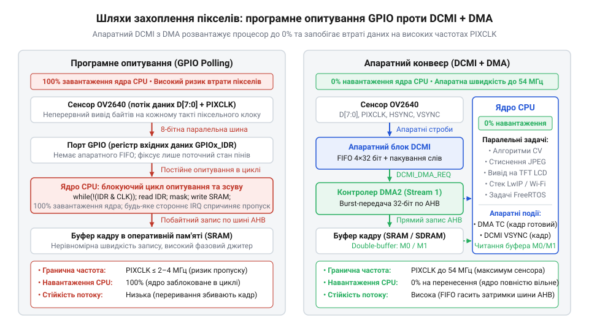
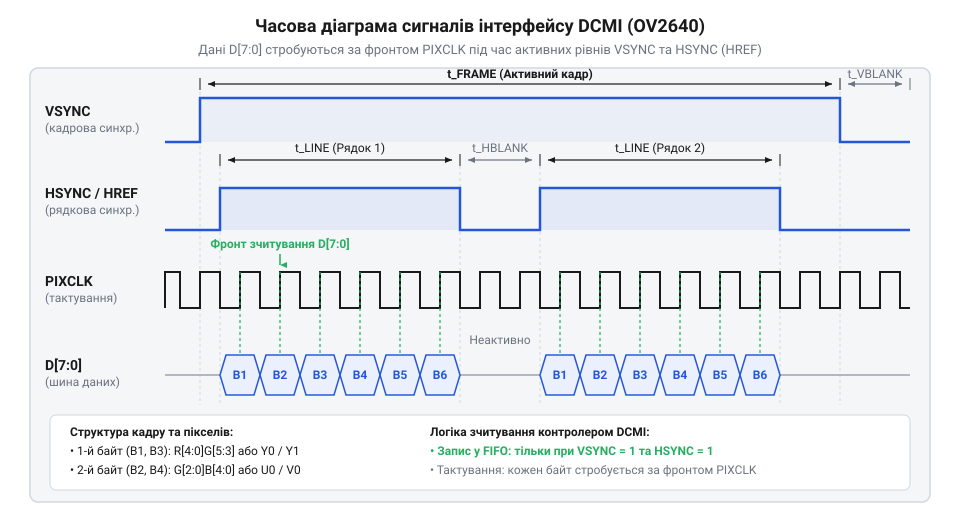
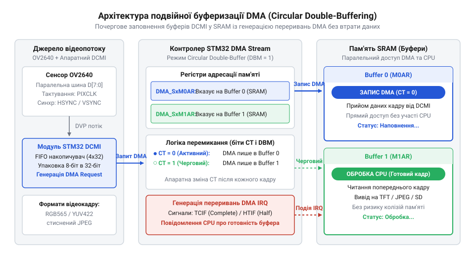

# Практична реалізація захоплення нестиснених кадрів RGB565/YUV422 на STM32 через DCMI

<preknowlist>
- [Внутрішня архітектура та функціональні блоки сенсора OV2640](root:cat-hw-sensors/ov2640-sensor-architecture) — Принципи побудови сенсора OV2640, банківська організація регістрів та формування сигналів DVP.
- [Контролер прямого доступу до пам'яті DMA у STM32](root:cat-hw-sensors/stm32-dma-controller-architecture) — Організація потоків DMA, кільцевих буферів та арбітражу пам'яті.
</preknowlist>

## Проблема програмного захоплення швидкого відеопотоку

Під час підключення сенсора @@en|OV2640@@ до мікроконтролера @@en|STM32@@ найпростішим рішенням видається читання пікселів через лінії введення-виведення загального призначення (@@en|GPIO@@, від англ. @@en|general-purpose input/output@@ — виводи загального призначення). Програмне опитування (@@en|polling@@, від англ. *poll* — опитувати по черзі) або зовнішні переривання (@@en|interrupt@@, від лат. *interruptus* — розірваний) за стробом пікселя зазнають невдачі: ядро процесора не встигає за нестисненим відеопотоком @@en|RGB565@@ чи @@en|YUV422@@ навіть помірної роздільності @@en|QVGA@@ чи @@en|SVGA@@. Виникає апаратне переповнення (@@en|overrun@@, від англ. *run over* — переливатися через край), а пам'ять кадру заповнюється спотвореними байтами зі зміщенням кольорів.


*Спроба читання байтів через порт введення-виведення перевантажує ядро процесора тактами, тоді як апаратний інтерфейс DCMI у супроводі контролера DMA знімає навантаження з процесора, забезпечуючи надійне надходження нестиснених даних у пам'ять.*

Сенсор транслює зображення послідовністю байтів через 8-бітну паралельну шину. Оскільки піксель у кольорових форматах @@en|RGB565@@ чи @@en|YUV422@@ займає два байти (16 біт), передача кожної точки потребує двох імпульсів піксельного тактового сигналу (@@en|PIXCLK@@, від англ. @@en|pixel clock@@ — піксельний тактовий строб).

Визначимо пропускну здатність (@@en|bandwidth@@, від англ. *band* — смуга, та *width* — ширина) потоку байтів `B` через кількість точок у рядку `W`, кількість рядків `H`, число байтів на піксель `b` та кадрову частоту `FPS`:

```
B = W · H · b · FPS
```

Добуток визначає секундний потік байтів, необхідний для оновлення кадрів.

**Розрахунок смуги пропускання для нестисненого потоку SVGA при 30 кадрах/с:**
Обчислимо мінімальний потік даних `B` для кадру `800 × 600` точок із глибиною `b = 2` байти при частоті оновлення `FPS = 30` кадрів за секунду:

```
B = 800 · 600 · 2 · 30
  = 28 800 000 байт/с      [перемноження точок на подвоєну кадрову частоту]
  = 28.8 МБ/с              [переведення в мегабайти за секунду]
```

Значення `28.8 МБ/с` враховує лише корисні пікселі. Разом із паузами синхронізації рядків і кадрів частота стробування @@en|PIXCLK@@ сягає `f_PIXCLK ≈ 24–36 МГц`.

При частоті `f_PIXCLK = 24 МГц` період надходження байта становить `T_PIXCLK = 1 / f_PIXCLK ≈ 41.7 нс`. За системної частоти мікроконтролера @@en|STM32@@ у `168 МГц` період такту ядра становить `T_CPU ≈ 5.95 нс`. Це залишає процесору лише `41.7 / 5.95 ≈ 7` тактів на прийом одного байта. Програмне читання `GPIOx_IDR`, маскування бітів, запис у пам'ять та інкремент покажчика потребують щонайменше 8 тактів — процесор фізично не встигає зберегти потік.

Використання зовнішніх переривань (@@en|EXTI@@) лише погіршує ситуацію: збереження та відновлення контексту (@@en|stacking@@) у Cortex-M триває понад 25 тактів на подію. Потік запитів кожні 7 тактів спричиняє лавину переривань (@@en|interrupt storm@@), а тремтіння часової затримки (@@en|jitter@@, від англ. *jitter* — нервове тремтіння) остаточно руйнує фазу зчитування.

Потік відеоданих неможливо обслуговувати ядром програмно. Його приймання делегують спеціалізованому цифровому камерному інтерфейсу (@@en|DCMI@@, від англ. @@en|digital camera interface@@ — цифровий камерний інтерфейс). Модуль @@en|DCMI@@ апаратно фіксує байти за стробами камери і передає їх у пам'ять [контролером прямого доступу](root:cat-hw-sensors/stm32-dma-controller-architecture) (@@en|DMA@@, від англ. @@en|direct memory access@@ — прямий доступ до пам'яті) через виділений [арбітраж системної шини](root:cat-hw-sensors/stm32-bus-matrix-arbitration).

## Апаратна синхронізація DCMI та тактування

Для відновлення двовимірного кадру з неперервної часової послідовності байтів апаратний інтерфейс @@en|DCMI@@ спирається на синхронізаційні строби сенсора @@en|OV2640@@:
- 8-бітну паралельну шину `D[7:0]` для передачі байтів даних;
- строб піксельного тактування @@en|PIXCLK@@ для фіксації валідності байта;
- рядкову синхронізацію @@en|HSYNC@@ (або `HREF`), яка виділяє часові межі активного рядка;
- кадрову синхронізацію @@en|VSYNC@@, яка визначає межі повного кадру.

Кожен піксель нестисненого зображення транслюється двома послідовними байтами. У форматі @@en|RGB565@@ перший байт несе червоний і частину зеленого каналів `[R4..R0, G5..G3]`, а другий — решту зеленого та синій `[G2..G0, B4..B0]`. У форматі @@en|YUV422@@ чотири байти задають пару точок `Y0, U0, Y1, V0` зі спільними кольорорізницевими компонентами. Під час передачі пікселів сигнал @@en|HSYNC@@ утримує активний стан. На час зворотного ходу променя він спадає — настає горизонтальний інтервал гасіння (@@en|horizontal blanking@@). Після закінчення рядків кадру імпульс @@en|VSYNC@@ формує вертикальний інтервал гасіння (@@en|vertical blanking@@), що скидає лічильник рядків.

Взаємне часове розташування стробів демонструє часова діаграма:


*Синхронізація піксельних байтів за наростаючим фронтом сигналу PIXCLK у межах активного вікна рядка HSYNC та періоду кадру VSYNC забезпечує коректну фіксацію відеопотоку апаратним модулем DCMI.*

Модуль @@en|DCMI@@ тактується вхідним сигналом @@en|PIXCLK@@ від сенсора. На кожному активному фронті за високого рівня @@en|HSYNC@@ він фіксує байт із ліній `D[7:0]`, пакує чотири послідовні байти в одне 32-бітне слово і записує його в апаратне @@en|FIFO@@ ємністю 4 слова (16 байтів). Після накопичення слова блок формує запит на транзакцію до каналу @@en|DMA@@.

Фазове узгодження стробів є критичним. Сенсор @@en|OV2640@@ виставляє нові дані на лініях `D[7:0]` за спадним фронтом @@en|PIXCLK@@. Тому периферійний блок @@en|DCMI@@ у регістрі `DCMI_CR` конфігурують для вибірки за **наростаючим фронтом** (`PCKPOL = 0`). Це гарантує достатній час встановлення (@@en|setup time@@) та утримання (@@en|hold time@@) шини до моменту фіксації. Помилка у виборі фронту стробу спричиняє захоплення перехідного процесу і змішування парних та непарних байтів. Полярності рядка `HSPOL` та кадру `VSPOL` узгоджують із вихідними рівнями сенсора.

Конфігурацію тактування та полярностей драйвер записує через шину послідовного керування камерою (@@en|SCCB@@, від англ. @@en|Serial Camera Control Bus@@ — послідовна шина керування камерою):

:::code proj-ov2640-stm32-dcmi-raw-yuv/cpp/include/ov2640_registers.hpp 31-34

Ці службові регістри керують дільником тактування `REG_SENSOR_CLKRC` та полярністю ліній `REG_SENSOR_COM10`:

:::code proj-ov2640-stm32-dcmi-raw-yuv/cpp/include/ov2640_registers.hpp 55-62

Значення `0x00` для `REG_SENSOR_COM10` виставляє пряму полярність стробу @@en|PIXCLK@@ та активний високий рівень @@en|VSYNC@@.

Тактовий строб @@en|PIXCLK@@ сенсор генерує з базової частоти `XCLK`, що надходить від мікроконтролера через вивід [тактового генератора сенсора](root:cat-hw-sensors/ov2640-image-sensor) (@@en|MCO@@, від англ. @@en|microcontroller clock output@@ — тактовий вихід мікроконтролера). Регістр `REG_SENSOR_CLKRC` задає коефіцієнт ділення:
```
f_PIXCLK = f_XCLK / (CLKRC[5:0] + 1)
```
Частота вхідного стробу обмежена пропускною здатністю шини мікроконтролера: за специфікацією `f_PIXCLK ≤ f_AHB / 2`. Для шини `AHB` на частоті `168 МГц` максимальна частота обмежена `84 МГц`, проте з урахуванням ємності друкованих доріжок надійне захоплення забезпечується на частотах до `24–48 МГц`.

## Подвійна буферизація DMA без втрат

Цифровий сенсор виступає некерованим джерелом неперервного потоку даних: він транслює байти без зупинки, не очікуючи завершення обробки попереднього кадру процесором. Якщо виділити під зображення лише один лінійний буфер у пам'яті, виникає конфлікт доступу. Поки центральний процесор зчитує кадр для виведення на екран, контролер @@en|DMA@@ перезаписує його початок новими рядками. Зображення зазнає розриву — тирингу (@@en|tearing@@, від англ. *tear* — рвати, роздирати), коли верхня й нижня частини кадру належать різним моментам часу. Примусова зупинка прийому неможлива: невелике @@en|FIFO@@ модуля @@en|DCMI@@ переповнюється за лічені мікросекунди, виставляючи статус апаратної помилки `OVR_RIS` (@@en|Overrun Raw Interrupt Status@@).

Цю колізію розв'язує подвійна буферизація (@@en|double buffering@@, від англ. *double* — подвійний, та *buffer* — проміжне сховище), відома як пінг-понг буфер (@@en|ping-pong buffer@@, за аналогією з настільним тенісом пінг-понг — почергове відбивання кульки). В оперативній пам'яті виділяються два ідентичні незалежні масиви — Буфер А та Буфер Б:
- Контролер @@en|DMA@@ автономно приймає упаковані слова з периферії @@en|DCMI@@ та заповнює Буфер А. - Процесор у цей самий час безпечно читає й обробляє Буфер Б без конфліктів шини. - Щойно Буфер А заповнюється, контролер @@en|DMA@@ апаратно перемикає адресу на Буфер Б і генерує переривання. - Ролі масивів міняються: процесор отримує доступ до щойно заповненого Буфера А, тоді як Буфер Б приймає свіжі рядки.

Схему конвеєрного обміну ілюструє діаграма подвійної буферизації:


*Чергування активного буфера запису DMA та буфера читання процесора забезпечує безперервне захоплення пікселів без ризику переповнення DCMI FIFO та виникнення розривів зображення.*

У мікроконтролерах @@en|STM32@@ подвійне захоплення організовують двома шляхами:
- **Апаратний подвійний буфер (`DBM`):** Потік @@en|DMA2 Stream 1 Channel 1@@ перемикають у режим подвійної буферизації бітом `DBM` регістра `DMA_SxCR`. Контролер почергово адресує регістри пам'яті `M0AR` та `M1AR`, відображаючи активну ціль у біті `CT` (@@en|Current Target@@) та формуючи переривання завершення передачі (@@en|Transfer Complete Interrupt@@, `TCIF`). - **Кільцевий режим із половинним перериванням:** У пам'яті створюють подвійний масив, а канал @@en|DMA@@ запускають у кільцевому режимі (@@en|circular mode@@). Заповнення першої половини генерує переривання половинного завершення (@@en|half transfer@@, `HTIF`), дозволяючи процесору обробляти перший блок, поки заповнюється другий. Повний трансфер викликає переривання `TCIF` із поверненням покажчика на початок.

У C++ драйвері керування пам'яттю інкапсульовано в класі `DcmiDmaBuffer`. Структура опису кадру містить покажчик на виділений блок та лічильники:

:::code proj-ov2640-stm32-dcmi-raw-yuv/cpp/include/dcmi_dma_buffer.hpp 15-28

Після апаратного завершення кадру обробник фіксує метадані та сповіщає застосунок через зворотний виклик (@@en|callback@@, від англ. *call back* — передзвонити, зворотний виклик функції):

:::code proj-ov2640-stm32-dcmi-raw-yuv/cpp/src/dcmi_dma_buffer.cpp 83-98

Перемикання індексів виконується циклічним оновленням лічильника:

:::code proj-ov2640-stm32-dcmi-raw-yuv/cpp/src/dcmi_dma_buffer.cpp 107-110

Надійна передача спирається на апаратне вирівнювання: блок @@en|DCMI@@ формує вихідні пакети розміром 32 біти, тому параметри потоку @@en|DMA@@ вимагають конфігурації `PSIZE = 32 біти` та `MSIZE = 32 біти` з вирівнюванням адрес за межею 4 байтів. Буфери слід розміщувати в загальній пам'яті SRAM1 або SRAM2. Спроба виділити пам'ять у тісно зв'язаній пам'яті (@@en|CCM SRAM@@, від англ. @@en|Core Coupled Memory@@ — пам'ять, жорстко зв'язана з процесорним ядром) є типовою фатальною помилкою: шина @@en|CCM SRAM@@ з'єднана виключно з ядром і не має доступу до контролера прямого доступу, що призводить до апаратної помилки шини при старті @@en|DMA@@.

## Форматування й упаковка RGB565 та YUV422

Для алгоритмів машинного зору та виведення на дисплей у реальному часі стиснений формат @@en|JPEG@@ не підходить: мікроконтролер @@en|STM32@@ витрачає десятки мілісекунд на обчислення зворотного косинусного перетворення та таблиць Гаффмана. Нестиснені формати @@en|RGB565@@ та @@en|YUV422@@ усувають обчислювальну затримку, надаючи прямий доступ до числових значень пікселів у пам'яті. За замовчуванням сенсор @@en|OV2640@@ спрямовує відеопотік через внутрішній цифровий процесор сигналів (@@en|DSP@@, від англ. @@en|digital signal processor@@ — цифровий сигнальний процесор) для @@en|JPEG@@-стиснення. Щоб отримати сирі пікселі, драйвер вмикає режим прямого обходу (@@en|bypass@@, від англ. *bypass* — обхідний шлях) через конфігураційні регістри шини @@en|SCCB@@:

:::code proj-ov2640-stm32-dcmi-raw-yuv/cpp/src/ov2640_driver.cpp 71-83

Запис одиниці в `REG_DSP_R_BYPASS` вимикає компресію, виводячи нестиснені байти безпосередньо на паралельну шину `D[7:0]`.

Кодування пікселів у форматах @@en|RGB565@@ та @@en|YUV422@@ спирається на різні принципи подання кольору за однакової середньої щільності — 2 байти на точку. У форматі @@en|RGB565@@ кожен піксель займає 16 бітів: старший байт несе 5 бітів червоного каналу `[R4..R0]` та 3 старші біти зеленого `[G5..G3]`, а молодший — 3 молодші біти зеленого `[G2..G0]` і 5 бітів синього `[B4..B0]`. Простір @@en|YUV422@@ використовує психофізіологічну нерівномірність зору: око значно чутливіше до яскравості (@@en|luminance@@, від лат. *lumen* — світло, світловий потік, компонент `Y`), ніж до змін колірного тону (@@en|chrominance@@, від грец. *chroma* — колір, забарвлення, компоненти `U` та `V`). Чотири послідовні байти кодують пару сусідніх точок у послідовності `Y0, U0, Y1, V0`, де кожна точка має власну яскравість `Y0` і `Y1`, але ділить спільні кольорорізницеві коефіцієнти `U0` та `V0`.

Сенсор транслює дані побайтово за стробами @@en|PIXCLK@@. Апаратний блок @@en|DCMI@@ фіксує байти на лініях `D[7:0]`, накопичує чотири байти у внутрішньому регістрі зсуву та пакує їх у 32-бітне слово для передачі в чергу @@en|FIFO@@. Байт `B0` записується в біти `[7:0]`, `B1` — у `[15:8]`, `B2` — у `[23:16]`, а `B3` — у `[31:24]`. Контролер @@en|DMA@@ записує це слово в системну пам'ять із розрядністю слів `PSIZE = 32 біти` та `MSIZE = 32 біти`. Архітектура процесорів Cortex-M організована за правилом розташування молодшим кінцем уперед (@@en|little-endian@@, від англ. *little-endian* — молодшим кінцем уперед), тому байт `B0` розміщується за молодшою адресою `A`, `B1` — за `A+1`, `B2` — за `A+2`, а `B3` — за `A+3`.

Тут виникає колізія порядку байтів. Сенсор @@en|OV2640@@ транслює 16-бітний піксель @@en|RGB565@@ у порядку старшим кінцем уперед (@@en|big-endian@@, від англ. *big-endian* — старшим кінцем уперед): спершу передається старший байт `B0` з червоним каналом, а потім молодший `B1` із синім. Коли процесор зчитує 16-бітне значення пікселя операцією `*(uint16_t*)A`, ядро сприймає байт `B0` за молодшою адресою як молодшу половину числа, а байт `B1` за адресою `A+1` — як старшу. Унаслідок цього значення пікселя в регістрі спотворюється: червоний і синій канали міняються місцями, а зелений розривається навпіл. На екрані замість природних кольорів з'являється кислотно-синій відтінок.

Для відновлення коректного масиву порядок байтів у кожному 16-бітному слові розгортають. Програмно це виконує процесорна інструкція `REV16`, доступна через апаратний компіляторний виклик (@@en|intrinsic@@, від лат. *intrinsecus* — внутрішній, вбудована функція компілятора) `__REV16()`, яка обмінює місцями байти всередині двох напівслів за один такт. У високопродуктивних відеотрактах перестановку байтів делегують апаратному [графічному прискорювачу 2D](root:cat-hw-sensors/stm32-dma2d-chrom-art-accelerator) без участі центрального процесора.

## Трансляція кадрів у SDRAM та дисплей

Обробка нестисненого відеопотоку створює жорстке обмеження за обсягом оперативної пам'яті. На відміну від @@en|JPEG@@, де компресія зменшує потік у 10–20 разів, нестиснене зображення потребує суцільного виділення пам'яті під кожну точку матриці.

Визначимо необхідний обсяг пам'яті для зберігання одного кадру `M` через ширину зображення в пікселях `W`, його висоту `H` та глибину кольору `b` в байтах на піксель:

```
M = W · H · b
```

Формула показує лінійне зростання вимог до буфера пропорційно до кількості пікселів у кадрі.

**Розрахунок обсягу кадрового буфера для режиму SVGA у форматі RGB565:**
Обчислимо розмір пам'яті `M` для кадру роздільності `800 × 600` точок за глибини кольору `b = 2` байти:

```
M = 800 · 600 · 2
  = 480 000 · 2           [множення кількості точок на розмір пікселя]
  = 960 000 байтів        [розмір у байтах]
  ≈ 937.5 КБ              [переведення в кілобайти діленням на 1024]
```

Отримане значення `937.5 КБ` перевищує весь обсяг внутрішньої оперативної пам'яті мікроконтролера @@en|STM32@@, де доступна ємність @@en|SRAM@@ становить від 128 до 512 КБ. Внутрішня пам'ять здатна вмістити лише малі роздільності на зразок @@en|CIF@@ (`352 × 288 × 2 ≈ 198 КБ`) або @@en|QVGA@@ (`320 × 240 × 2 = 150 КБ`), до того ж без можливості створити подвійний буфер.

Для нестиснених потоків високої роздільності відеопам'ять виносять у зовнішню синхронну динамічну пам'ять (@@en|SDRAM@@, від англ. @@en|Synchronous Dynamic Random-Access Memory@@ — синхронна динамічна пам'ять із довільним доступом). Мікроконтролери підключають мікросхеми @@en|SDRAM@@ ємністю від 8 до 32 МБ через апаратний [інтерфейс зовнішньої пам'яті](root:cat-hw-sensors/stm32-fmc-sdram-interface) (@@en|FMC@@, від англ. @@en|Flexible Memory Controller@@ — гнучкий контролер пам'яті). Під час ініціалізації менеджер пам'яті виділяє необхідні блоки:

:::code proj-ov2640-stm32-dcmi-raw-yuv/cpp/src/dcmi_dma_buffer.cpp 32-43

Коли пам'ять @@en|SDRAM@@ відображена в адресний простір за базовою адресою `0xD0000000`, покажчик `buffers_[i].data` адресує зовнішній масив, знімаючи обмеження на розмір кадру.

Тракт реального часу транслює захоплені кадри безпосередньо на екран без копіювання байтів ядром процесора. Виділений кадровий буфер (@@en|framebuffer@@, від англ. *frame* — кадр, та *buffer* — проміжне сховище) спільно використовують контролер прямого доступу @@en|DMA2@@ та апаратний [дисплейний контролер TFT](root:cat-hw-sensors/stm32-ltdc-display-controller) (@@en|LTDC@@, від англ. @@en|LCD-TFT Display Controller@@ — контролер дисплеїв на тонкоплівкових транзисторах). Контролер @@en|LTDC@@ автономно зчитує рядки пікселів із пам'яті @@en|SDRAM@@ і формує паралельні сигнали для рідкокристалічної панелі. Обмін організовують у конвеєр:
- Поки контролер @@en|LTDC@@ виводить зображення з Буфера 0, потік @@en|DMA2@@ записує новий кадр від периферії @@en|DCMI@@ в Буфер 1. - Після заповнення кадру модуль @@en|DCMI@@ генерує переривання, і драйвер оновлює метадані:

:::code proj-ov2640-stm32-dcmi-raw-yuv/cpp/src/dcmi_dma_buffer.cpp 83-98

- В обробнику зворотного виклику застосунок перемикає адресу базового регістра `LTDC_LxCFBAR` на щойно отриманий Буфер 1 під час вертикального інтервалу гасіння @@en|VSYNC@@:

:::code proj-ov2640-stm32-dcmi-raw-yuv/cpp/src/main.cpp 39-47

Уся трансляція відбувається апаратно без затримки на копіювання даних.

Надійність такого тракту спирається на арбітраж шини та узгодженість пам'яті. Одночасне звернення потоку @@en|DMA2@@ на запис і модуля @@en|LTDC@@ на читання навантажує спільну шину контролера @@en|FMC@@. Якщо пропускної здатності не вистачає, дисплейне @@en|FIFO@@ вичерпується, викликаючи апаратну помилку спустошення черги (@@en|underrun@@, від англ. *underrun* — брак даних у буфері) та мерехтіння рядків на екрані. Для усунення колізій контролеру @@en|LTDC@@ призначають найвищий пріоритет у шинній матриці, а транзакції @@en|DMA2@@ налаштовують на пакетну передачу по 4 слова (`INCR4`) для утилізації пакетного режиму @@en|SDRAM@@. Другим ризиком у ядрах Cortex-M7 є порушення когерентності (@@en|coherency@@, від лат. *cohaerens* — зв'язаний, узгодженість даних між кешем та оперативною пам'яттю): кеш даних процесора не відстежує фоновий запис контролером @@en|DMA@@. Якщо ядру необхідно обробити пікселі, кеш примусово інвалідують через [керування когерентністю пам'яті](root:cat-hw-sensors/cortex-m7-cache-coherency-dma) функцією `SCB_InvalidateDCache_by_Addr()` або налаштовують буфери як некешовані через модуль захисту пам'яті (@@en|MPU@@, від англ. @@en|Memory Protection Unit@@ — модуль захисту пам'яті).