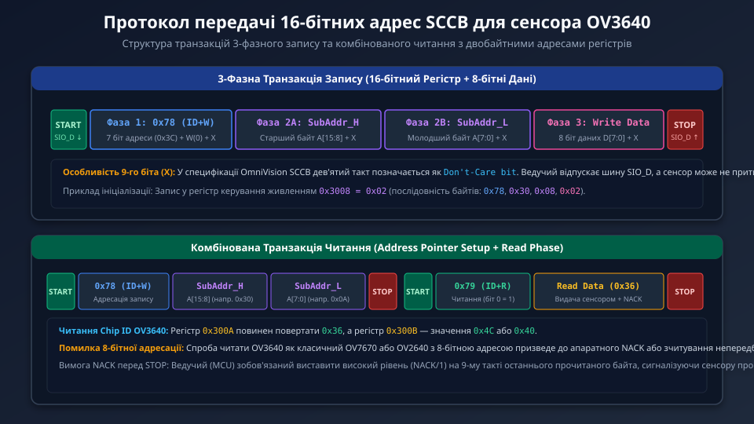
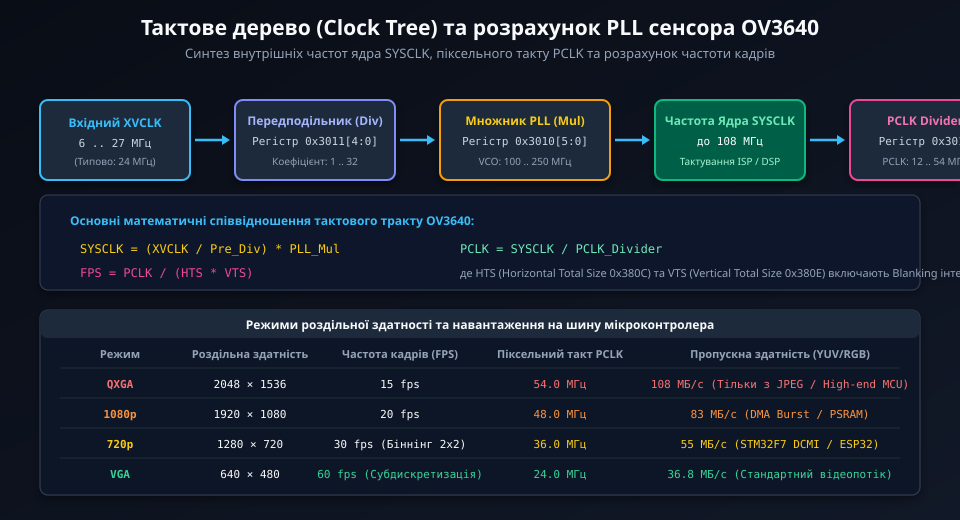
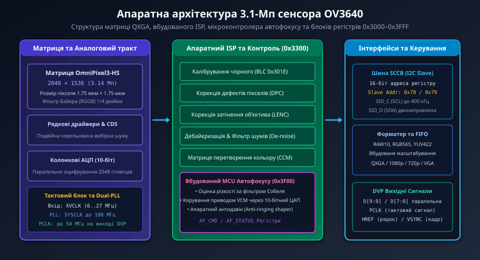

# Низькорівневе програмування 16-бітних регістрів сенсора OV3640

Сенсор зображення OmniVision OV3640 вирізняється складним лінійним простором конфігурації, де керування аналоговими підсилювачами, ядром ФАПЧ, цифровим сигнальним процесором (ISP) та мікроконтролером автофокусу здійснюється через двобайтну адресацію по шині SCCB. Реалізація надійного драйвера вимагає глибокого розуміння бітових масок системних регістрів, розрахунку тактового дерева та суворого дотримання таймінгів шини.

## 1. Специфікація фізичного рівня та таймінги 16-бітної шини SCCB

Інтерфейс SCCB у сенсорі OV3640 підтримує стандартний режим (Standard Mode, до 100 кбіт/с) та швидкісний режим (Fast Mode, до 400 кбіт/с). Оскільки кожна операція адресації вимагає передачі 16 біт субадреси, накладні витрати на конфігурацію зростають на один байт на кожну транзакцію порівняно з попередніми 8-бітними сенсорами.



Часові параметри передачі сигналів по лініях SIO_C (тактування) та SIO_D (дані):
- **Час утримання після START (tHD;STA):** мінімум 0.6 мкс при 400 кГц. Спад лінії SIO_D повинен випереджати спад SIO_C.
- **Тривалість низького рівня такту (tLOW):** мінімум 1.3 мкс.
- **Тривалість високого рівня такту (tHIGH):** мінімум 0.6 мкс.
- **Час випередження перед STOP (tSU;STO):** мінімум 0.6 мкс. Лінія SIO_D повинна перейти з низького на високий рівень після наростання SIO_C.
- **9-й біт (Don't-Care / ACK):** під час фази запису ведучий відпускає лінію SIO_D на 9-му такті кожного байта. Сенсор притискає SIO_D до нуля, формуючи апаратний сигнал ACK. Під час фази читання даних ведучий мікроконтролер формує високий рівень (NACK/1), після чого негайно генерує умову STOP, сигналізуючи про завершення сеансу читання.

Адреса пристрою визначається на апаратному рівні:
- **Write Device ID:** `0x78` (7-бітна адреса `0x3C`, біт R/W = 0).
- **Read Device ID:** `0x79` (7-бітна адреса `0x3C`, біт R/W = 1).

## 2. Детальна карта бітових полів ключових регістрів

Регістри керування OV3640 згруповані у 16-бітному адресному просторі від `0x3000` до `0x3FFF`. Нижче наведено структуру критично важливих регістрів базової конфігурації.

| Адреса | Символьне ім'я | Біти | Опис бітових полів та функція |
| :--- | :--- | :--- | :--- |
| **0x3008** | `SYSTEM_CTRL0` | `[7]` | **RESET:** Програмне скидання. 1 — ініціалізація скидання всіх регістрів, автоскидання в 0. |
| | | `[6]` | **POWER_DOWN:** Програмний режим сну (Sleep). 1 — зупинка внутрішніх генераторів. |
| | | `[5]` | **STANDBY:** Режим очікування. |
| | | `[4:0]` | Резерв, повинен залишатися в 0. |
| **0x300A** | `CHIP_ID_H` | `[7:0]` | Старший байт ідентифікатора сенсора. Завжди повертає константу `0x36`. |
| **0x300B** | `CHIP_ID_L` | `[7:0]` | Молодший байт ідентифікатора сенсора. Повертає значення ревізії кристала: `0x4C` або `0x40`. |
| **0x3010** | `PLL_CTRL0` | `[5:0]` | **PLL_MULT:** Множник контуру ФАПЧ (від 4 до 63). Визначає вихідну частоту VCO. |
| | | `[7:6]` | **PLL_BYPASS:** 0 — активний контур PLL, 1 — тактування напряму від XVCLK. |
| **0x3011** | `PLL_CTRL1` | `[4:0]` | **PRE_DIV:** Передподільник вхідної частоти генератора XVCLK (коефіцієнт від 1 до 32). |
| **0x3012** | `CLK_DIV` | `[3:0]` | **PCLK_DIV:** Дільник частоти вихідного піксельного такту PCLK (1, 2, 4, 8). |
| **0x3800** | `HS_HIGH` | `[3:0]` | Старші 4 біти горизонтальної початкової координати вікна захоплення (H-Start[11:8]). |
| **0x3801** | `HS_LOW` | `[7:0]` | Молодші 8 бітів горизонтальної початкової координати (H-Start[7:0]). |
| **0x3804** | `HW_HIGH` | `[3:0]` | Старші 4 біти ширини вихідного вікна (H-Width[11:8]). |
| **0x3805** | `HW_LOW` | `[7:0]` | Молодші 8 бітів ширини вихідного вікна (H-Width[7:0]). |
| **0x380C** | `HTS_HIGH` | `[4:0]` | Старші 5 бітів загальної кількості піксельних тактів на рядок (HTS[12:8]). |
| **0x380D** | `HTS_LOW` | `[7:0]` | Молодші 8 бітів загальної кількості тактів на рядок (HTS[7:0]). Включає Blanking. |
| **0x380E** | `VTS_HIGH` | `[4:0]` | Старші 5 бітів загальної кількості рядків у кадрі (VTS[12:8]). |
| **0x380F** | `VTS_LOW` | `[7:0]` | Молодші 8 бітів кількості рядків у кадрі (VTS[7:0]). Включає Vertical Blanking. |
| **0x3818** | `FORMAT_CTRL` | `[6]` | **BINNING_EN:** 1 — активація апаратного усереднення 2x2 пікселів (Binning). |
| | | `[1:0]` | **SUBSAMPLE:** 00 — повне зчитування, 01 — субдискретизація 1/2, 10 — субдискретизація 1/4. |

## 3. Математика синхронізації та конфігурація тактового генератора PLL

Синтезатор тактової частоти OV3640 забезпечує генерацію системної частоти ядра SYSCLK та вихідного такту шини PCLK, з яких формується тривалість кожного кадру.



Обчислення параметрів виконується за наступними рівняннями:

1. **Частота внутрішнього генератора ФАПЧ:**
   ```
   F_vco = (F_xvclk / PRE_DIV) * PLL_MULT
   ```
   Діапазон робочих частот генератора VCO повинен знаходитися в межах від 100 МГц до 250 МГц. При стандартному вхідному кварці F_xvclk = 24 МГц, значення `PRE_DIV = 2` та `PLL_MULT = 16` дають внутрішню опорну частоту `F_vco = 192 МГц`.

2. **Частота вихідного такту шини даних (PCLK):**
   ```
   PCLK = SYSCLK / PCLK_DIV
   ```
   Для режиму QXGA (2048x1536 при 15 fps) PCLK конфігурується на частоту 54 МГц. Для режиму 720p (1280x720 при 30 fps з увімкненим біннінгом 2x2) PCLK встановлюється на 36 МГц.

3. **Розрахунок частоти кадрів (Frame Rate):**
   ```
   T_line = HTS / PCLK
   T_frame = VTS * T_line = (HTS * VTS) / PCLK
   FPS = PCLK / (HTS * VTS)
   ```
   де HTS (Horizontal Total Size) та VTS (Vertical Total Size) визначаються вмістом регістрів `0x380C–0x380F`. Наприклад, для режиму 720p: при `HTS = 1600`, `VTS = 750` та `PCLK = 36 000 000 Гц`:
   ```
   FPS = 36000000 / (1600 * 750) = 36000000 / 1200000 = 30.0 кадр/с.
   ```

## 4. Керування вбудованим модулем автофокусу (AF MCU)

Сенсор OV3640 містить виділений апаратний блок для автоматичного фокусування об'єктива, що взаємодіє з приводом звукової котушки (Voice Coil Motor, VCM).



Контролер автофокусу працює під керуванням вбудованої мікропрограми, яка завантажується у виділену пам'ять сенсора через групу регістрів `0x3F00`–`0x3F10`:
- **Регістр команд автофокусу (`0x3F00`):** запис команд запуску поодинокого фокусування (Single AF), постійного слідкуючого фокусування (Continuous AF) або повернення лінзи у базову позицію нескінченності (Infinity Position).
- **Регістр статусу фокусування (`0x3F01`):** біт 0 показує зайнятість приводу (1 — фокусування триває, 0 — позиція зафіксована), біт 1 сигналізує про успішне досягнення максимального контрасту (Focus Lock).
- **Вбудований 10-бітний ЦАП приводу VCM:** перетворює цифровий код кроку (від 0 до 1023) у вихідний струм котушки переміщення лінзи в діапазоні від 0 до 100 мА.
- **Апаратний блок гасіння механічного резонансу (Anti-ringing Shaper):** автоматично формує сходинкові імпульси керування струмом для запобігання коливанням підвісу лінзи при різких переміщеннях.

## 5. Драйвер конфігурації 16-бітних регістрів OV3640 на мові C

Нижче наведено модульний виробничий код драйвера на мові C для роботи з 16-бітними регістрами OV3640, включаючи ідентифікацію чіпа, завантаження масиву конфігураційних параметрів та встановлення роздільної здатності кадру.

```c
#include <stdint.h>
#include <stdbool.h>
#include <stddef.h>

/* Базові константи сенсора OV3640 */
#define OV3640_SCCB_ADDR_WRITE    0x78
#define OV3640_SCCB_ADDR_READ     0x79

#define OV3640_CHIP_ID_REG_H      0x300A
#define OV3640_CHIP_ID_REG_L      0x300B
#define OV3640_CHIP_ID_EXPECTED_H 0x36
#define OV3640_CHIP_ID_EXPECTED_L 0x4C /* або 0x40 залежно від партії */

#define OV3640_REG_SYSTEM_CTRL0   0x3008
#define OV3640_REG_RESET_BIT      (1U << 7)

/* Структура конфігураційного списку регістрів */
typedef struct {
    uint16_t reg;
    uint8_t  val;
} ov3640_reg_val_t;

/* Прототипи платформно-залежних функцій низькорівневої шини I2C/SCCB */
extern bool i2c_master_transmit(uint8_t dev_addr, const uint8_t *data, uint16_t size);
extern bool i2c_master_receive(uint8_t dev_addr, uint8_t *data, uint16_t size);
extern void delay_ms(uint32_t ms);

/**
 * @brief  Запис одного байта в 16-бітний регістр OV3640
 * @param  reg_addr: 16-бітна адреса регістру (напр. 0x3008)
 * @param  value: 8-бітне значення для запису
 * @retval true у разі успіху
 */
bool ov3640_write_reg(uint16_t reg_addr, uint8_t value)
{
    uint8_t packet[3];
    
    /* Формуємо пакет: [SubAddr_H] [SubAddr_L] [Data] */
    packet[0] = (uint8_t)((reg_addr >> 8) & 0xFF);
    packet[1] = (uint8_t)(reg_addr & 0xFF);
    packet[2] = value;

    return i2c_master_transmit(OV3640_SCCB_ADDR_WRITE, packet, sizeof(packet));
}

/**
 * @brief  Читання одного байта з 16-бітного регістру OV3640
 * @param  reg_addr: 16-бітна адреса регістру
 * @param  out_val: вказівник для збереження зчитаного значення
 * @retval true у разі успішного зчитування
 */
bool ov3640_read_reg(uint16_t reg_addr, uint8_t *out_val)
{
    uint8_t addr_bytes[2];

    if (out_val == NULL) {
        return false;
    }

    /* 1. Фаза встановлення покажчика адреси */
    addr_bytes[0] = (uint8_t)((reg_addr >> 8) & 0xFF);
    addr_bytes[1] = (uint8_t)(reg_addr & 0xFF);

    if (!i2c_master_transmit(OV3640_SCCB_ADDR_WRITE, addr_bytes, sizeof(addr_bytes))) {
        return false;
    }

    /* 2. Фаза зчитування даних від сенсора */
    return i2c_master_receive(OV3640_SCCB_ADDR_READ, out_val, 1);
}

/**
 * @brief  Апаратна верифікація присутності сенсора OV3640 за Chip ID
 * @retval true якщо ідентифікатори збігаються зі специфікацією
 */
bool ov3640_probe(void)
{
    uint8_t id_high = 0;
    uint8_t id_low = 0;

    /* Зчитуємо старший та молодший байти ID */
    if (!ov3640_read_reg(OV3640_CHIP_ID_REG_H, &id_high)) {
        return false;
    }

    if (!ov3640_read_reg(OV3640_CHIP_ID_REG_L, &id_low)) {
        return false;
    }

    /* Перевіряємо відповідність Chip ID */
    if (id_high == OV3640_CHIP_ID_EXPECTED_H) {
        if (id_low == OV3640_CHIP_ID_EXPECTED_L || id_low == 0x40) {
            return true; /* Сенсор знайдено та готовий до роботи */
        }
    }

    return false;
}

/**
 * @brief  Завантаження списку ініціалізаційних регістрів у сенсор
 * @param  regs: масив пар {регістр, значення}
 * @param  count: кількість регістрів у масиві
 * @retval true якщо всі регістри записано без помилок
 */
bool ov3640_load_regs(const ov3640_reg_val_t *regs, size_t count)
{
    if (regs == NULL) {
        return false;
    }

    for (size_t i = 0; i < count; i++) {
        /* Обробка спеціального маркера програмної затримки */
        if (regs[i].reg == 0xFFFF) {
            delay_ms(regs[i].val);
            continue;
        }

        if (!ov3640_write_reg(regs[i].reg, regs[i].val)) {
            return false; /* Помилка зв'язку по шині SCCB */
        }
    }

    return true;
}

/**
 * @brief  Виконання програмного скидання та базової ініціалізації OV3640
 */
bool ov3640_init(void)
{
    /* 1. Перевіряємо фізичний зв'язок */
    if (!ov3640_probe()) {
        return false;
    }

    /* 2. Програмне скидання сенсора */
    if (!ov3640_write_reg(OV3640_REG_SYSTEM_CTRL0, OV3640_REG_RESET_BIT)) {
        return false;
    }

    /* Чекаємо стабілізації аналогових кіл після скидання */
    delay_ms(10);

    /* 3. Конфігурація тактового генератора PLL (24 МГц -> 54 МГц PCLK) */
    ov3640_write_reg(0x3011, 0x02); /* Pre_Div = 2 */
    ov3640_write_reg(0x3010, 0x10); /* PLL_Mult = 16 */
    ov3640_write_reg(0x3012, 0x01); /* PCLK_Div = 1 */

    return true;
}
```
