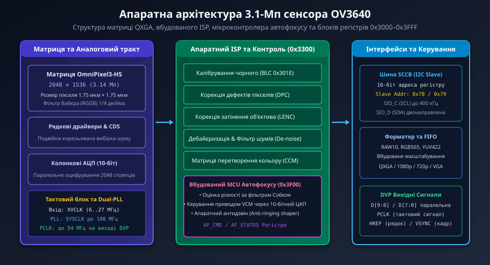
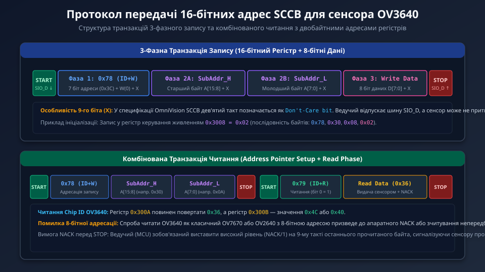
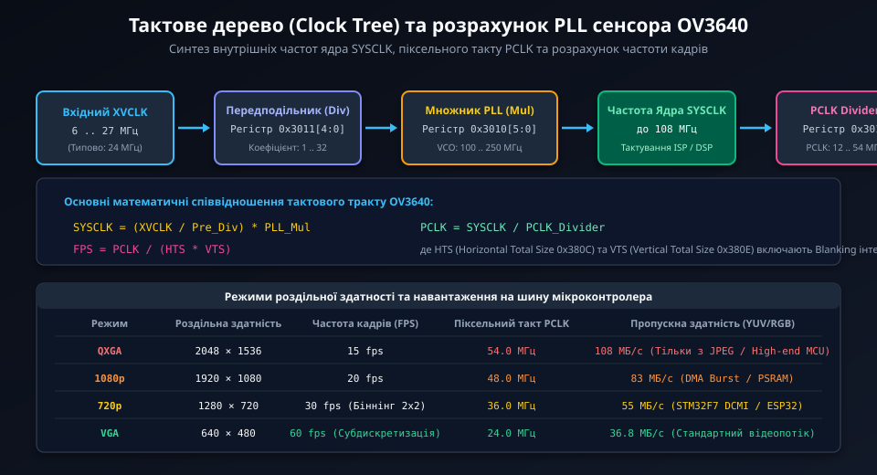

# Конфігурація регістрів сенсора OV3640 через шину SCCB

Сенсор OmniVision OV3640 — це високопродуктивна 3.1-мегапіксельна CMOS-матриця (роздільна здатність QXGA 2048x1536), призначена для вбудованих систем технічного зору, систем відеоспостереження та портативної електроніки. На відміну від молодших моделей (OV7670, OV2640), сенсор OV3640 використовує розширений 16-бітний простір внутрішніх адрес регістрів, що потребує специфічного протоколу обміну через шину SCCB (Serial Camera Control Bus).

## 1. Архітектурні особливості та простір адрес OV3640

Головна відмінність архітектури керування OV3640 від попередніх поколінь сенсорів полягає у відмові від механізму перемикання банків пам'яті через регістр `0xFF`. Замість 8-бітної адреси з банками, OV3640 реалізує єдиний лінійний адресний простір з 16-бітними субадресами регістрів (від `0x3000` до `0x3FFF`).



Внутрішня структура сенсора об'єднує декілька потужних апаратних вузлів:
- **Матриця OmniPixel3-HS:** активна зона 2048x1536 пікселів з розміром чутливого елемента 1.75 мкм x 1.75 мкм та низьким рівнем темнового шуму завдяки подвійній корельованій вибірці (CDS).
- **Вбудований цифровий сигнальний процесор (ISP):** здійснює корекцію дефектних пікселів (DPC), калібрування рівня чорного (BLC), корекцію затінення об'єктива (Lens Shading), автоматичний баланс білого (AWB) та матричні колірні перетворення.
- **Вбудований мікроконтролер автофокусу (AF MCU):** спеціалізований апаратний блок для аналізу контрасту зображення за фільтром Собеля та безпосереднього керування приводом звукової котушки (Voice Coil Motor, VCM) через вбудований 10-бітний ЦАП.
- **Дворівневий помножувач частоти (Dual PLL):** синтезує внутрішні тактові сигнали ядра до 108 МГц та вихідний піксельний такт PCLK до 54 МГц з опорного кварцового генератора XVCLK (6–27 МГц).

## 2. Протокол 16-бітної передачі через шину SCCB

Шина SCCB (Serial Camera Control Bus) є апаратним інтерфейсом OmniVision, функціонально сумісним з I2C, але з певними особливостями формування підтвердження (ACK/NACK). Для OV3640 базовою адресою пристрою на шині є `0x78` для операцій запису та `0x79` для операцій читання (або 7-бітна адреса `0x3C`).



Транзакції обміну даними мають фіксовану фазову структуру:

1. **3-фазний цикл запису (3-Phase Write):**
   - **Фаза 1:** Передача байта ідентифікатора пристрою з бітом запису (`0x78`).
   - **Фаза 2A:** Передача старшого байта адреси регістру `SubAddr_H` (A[15:8]).
   - **Фаза 2B:** Передача молодшого байта адреси регістру `SubAddr_L` (A[7:0]).
   - **Фаза 3:** Передача 8-бітного значення даних для запису у вказаний регістр.
   - Завершується стандартною умовою STOP (перепад SIO_D з низького на високий рівень при високому SIO_C).

2. **Комбінований цикл читання (Address Pointer Setup + Read):**
   - **Крок 1 (Встановлення покажчика):** ведучий формує умову START, передає адресу `0x78`, потім два байти адреси регістру (`SubAddr_H`, `SubAddr_L`) і генерує умову STOP або RESTART.
   - **Крок 2 (Зчитування даних):** ведучий генерує умову START, передає адресу пристрою для читання (`0x79`), після чого сенсор виставляє байт даних на лінію SIO_D. Ведучий зобов'язаний сформувати високий рівень (NACK) на 9-му такті та завершити транзакцію умовою STOP.

## 3. Функціональні групи регістрів та карта конфігурації

Адресний простір OV3640 логічно структурований за функціональними блоками:

- **Системний контроль та живлення (`0x3000`–`0x300F`):**
  - `0x3008`: Регістр системного керування та програмного скидання (Software Reset). Запис біта 7 скидає всі внутрішні регістри до заводських налаштувань за замовчуванням.
  - `0x300A`, `0x300B`: Регістри ідентифікації чіпа (Chip ID). Зчитування повинно повертати значення `0x36` та `0x4C` (або `0x40`), що є обов'язковим тестом працездатності шини зв'язку.
- **Тактове дерево та налаштування PLL (`0x3010`–`0x3012`):**
  - Визначають коефіцієнти передподільника та множника вбудованого генератора PLL для отримання стабільної частоти кадрів.
- **Форматер та кадрування зображення (`0x3800`–`0x382F`):**
  - Визначають координати вікна захоплення (Windowing), субдискретизацію (Sub-sampling), апаратний біннінг (Binning 2x2 для режиму 720p/VGA) та тривалості гасячих імпульсів Blanking (HTS, VTS).
- **Керування ISP та колірним простором (`0x3300`–`0x33BF`):**
  - Налаштування гамма-кривих, насиченості кольорів, коефіцієнтів балансу білого та режимів виводу (RAW10, RGB565, YUV422).
- **Контролер автофокусу (`0x3F00`–`0x3F10`):**
  - Завантаження калібрувальних таблиць кроків для лінзи та активація автоматичного або ручного позиціонування VCM.

## 4. Тактове дерево, PLL та розрахунок частоти кадрів

Сенсор OV3640 забезпечує гнучке керування швидкістю зчитування кадру за допомогою інтегрованого синтезатора частоти на базі ФАПЧ (PLL).



Частота вихідного піксельного такту PCLK та результуюча частота кадрів (FPS) розраховуються за формулами:
```
SYSCLK = (XVCLK / Pre_Div) * PLL_Mul
PCLK = SYSCLK / PCLK_Divider
FPS = PCLK / (HTS * VTS)
```
де:
- `XVCLK` — частота зовнішнього генератора (зазвичай 24 МГц).
- `Pre_Div` — дільник вхідної частоти (регістр `0x3011`).
- `PLL_Mul` — цілочисельний множник генератора VCO (регістр `0x3010`).
- `HTS` (Horizontal Total Size, регістри `0x380C`–`0x380D`) — повна кількість тактів PCLK на один рядок відео, включаючи горизонтальний гасячий імпульс (Horizontal Blanking).
- `VTS` (Vertical Total Size, регістри `0x380E`–`0x380F`) — повна кількість рядків у кадрі, включаючи вертикальний інтервал повернення променя (Vertical Blanking).

Зміна значення VTS дозволяє плавно регулювати час експозиції сенсора в режимі автоматичного контролю експозиції (AEC) без зміни піксельної частоти PCLK.

## 5. Типові помилки інтеграції та апаратні рекомендації

Під час проектування апаратних модулів та написання драйверів для OV3640 необхідно враховувати такі критичні моменти:

1. **Плутанина розрядності адрес:** спроба використати типові бібліотеки для сенсорів OV7670 або OV2640 безпосередньо призведе до збою ініціалізації. Стандартні функції I2C надсилають лише 1 байт адреси, тоді як логіка OV3640 інтерпретує перші два передані байти виключно як адресу регістру.
2. **Підтягувальні резистори шини SCCB:** лінії SIO_C та SIO_D вимагають зовнішніх резисторів підтяжки до напруги цифрового інтерфейсу вводу/виводу DOVDD (зазвичай 1.8 В або 2.8 В) номіналом від 1.5 кОм до 4.7 кОм. Використання внутрішньої підтяжки мікроконтролера часто недостатньо через високу паразитну ємність шлейфа камери.
3. **Фільтрація та розділення ліній живлення:** матриця OV3640 вкрай чутлива до високочастотних пульсацій на аналоговій шині AVDD (2.8 В). Використання спільних імпульсних перетворювачів DC-DC для AVDD та цифрового ядра DVDD (1.5 В) призводить до появи горизонтальних смуг шуму на темних ділянках зображення. Для AVDD необхідно застосовувати виділений ультранизькошумний лінійний стабілізатор LDO.
4. **Узгодження довжини трас шини DVP:** при роботі на частотах PCLK понад 48 МГц (режими QXGA та 1080p) навіть незначна розбіжність у довжині друкованих провідників паралельних ліній D[9:0] викликає часовий перекіс (Skew), що призводить до спотворення кольорів у прийомному буфері мікроконтролера.
