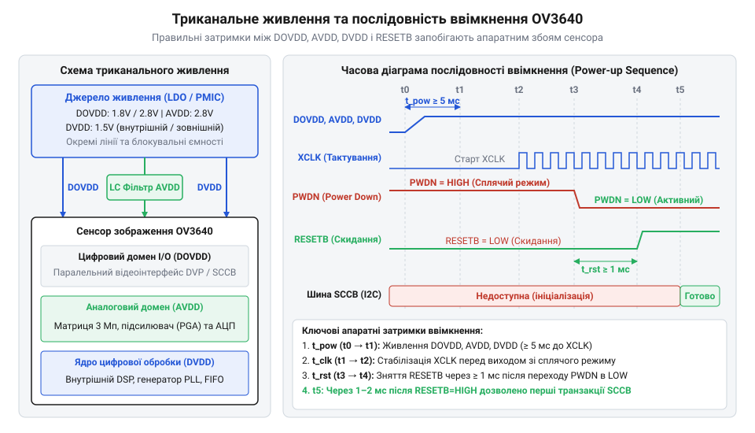
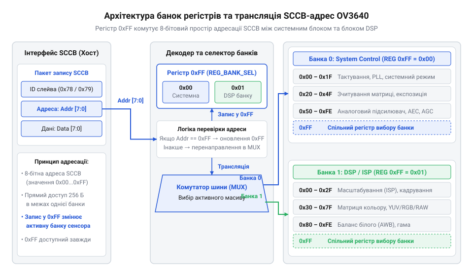
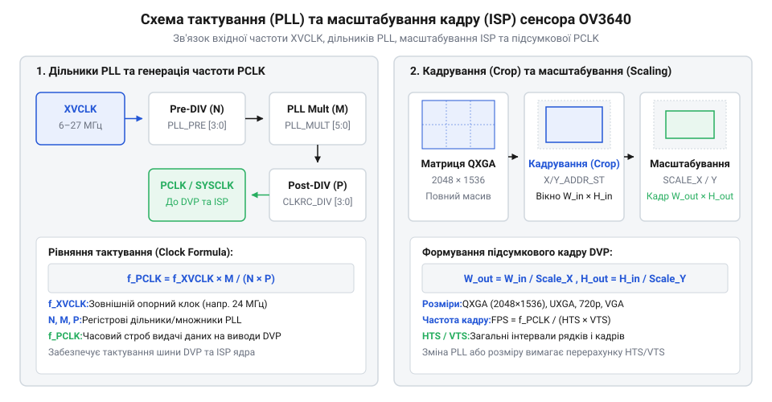

# Апаратне підключення, сигнали DVP та карта банок регістрів OV3640

## Електричне живлення та розпіновка OV3640

Високороздільні матриці зображення на основі @@en|CMOS@@ (*Complementary Metal-Oxide-Semiconductor* — від англ. *complementary* — доповняльний, *metal* — метал, *oxide* — оксид, *semiconductor* — напівпровідник) поєднують на одному кремнієвому кристалі надчутливі аналогові сенсорні пікселі та високошвидкісну цифрову логіку обробки. Головною причиною появи горизонтальних смуг шумів на знімках, спотворення кольорів чи раптових апаратних зависань сенсора OV3640 є недотримання вимог до розв'язки електричного живлення та порушення часової послідовності подачі напруг під час ввімкнення. На відміну від простих цифрових мікросхем, сенсор зображення вимагає ізольованого живлення для трьох незалежних доменів кристала.

Сенсор OV3640 живиться від трьох окремих ліній напруги, кожна з яких відповідає за власний діляночний блок внутрішньої структури:
- Аналогове живлення `AVDD` (номінал `2.8 V`) — живить матрицю з 3 мільйонів світлочутливих пікселів, схеми вибірки та збереження сигналу, а також вбудований 10-бітний аналогово-цифровий перетворювач (англ. @@en|ADC@@, *Analog-to-Digital Converter*). Будь-які пульсації чи високочастотні завади в цій лінії безпосередньо транслюються в помітний піксельний шум або просторові сітки на підсумковому зображенні. - Живлення цифрових портів вводу-виводу `DOVDD` (діапазон `1.8 V – 3.0 V`, зазвичай `1.8 V` або `2.8 V`) — подає напругу на вихідні буфери паралельного цифрового відеоінтерфейсу (англ. @@en|DVP@@, *Digital Video Port* — від англ. *digital* — цифровий, *video* — відео, *port* — порт) та лінії керування. Рівень напруги `DOVDD` мусить чітко відповідати логічному рівню сигналів мікроконтролера або пліс (FPGA). - Живлення цифрового ядра `DVDD` (номінал `1.5 V`) — живить внутрішню керуючу логіку, генератори тактових імпульсів та апаратний процесор сигналів зображення (англ. @@en|ISP@@, *Image Signal Processor* — від англ. *image* — зображення, *signal* — сигнал, *processor* — процесор). Напруга `DVDD` може подаватися від зовнішнього стабілізатора або формуватися вбудованим регулятором із низьким падінням напруги (англ. @@en|LDO@@, *Low Dropout* — від англ. *low* — низький, *dropout* — падіння напруги).

Порушення порядку подачі напруг призводить до небезпечного фізичного явища — засувки (англ. @@en|latch-up@@ — від англ. *latch* — засувка, *up* — вгору). У кремнієвій структурі між виводами портів вводу-виводу та внутрішніми шинами живлення існують захисні паразитичні діоди від електростатичного розряду (англ. @@en|ESD@@, *Electrostatic Discharge*). Якщо на шину `DOVDD` або сигнальні лінії тактування подати напругу раніше, ніж увімкнеться живлення аналогового або цифрового ядра (`AVDD` / `DVDD`), паразитичні діоди відкриваються у прямому напрямку. Через кристал починає протікати неконтрольований струм стрибка величиною в сотні міліампер, що викликає апаратне блокування шин, термічний перегрів і потенційне вигорання кремнієвого кристала.

Щоб запобігти засувці й гарантувати стабільне скидання системних регістрів, схема подачі живлення повинна суворо дотримуватися часової послідовності.


*Схема триканального живлення DOVDD, AVDD, DVDD та часова діаграма послідовності підняття напруг під час ввімкнення OV3640.*

Правильний алгоритм апаратного запуску OV3640 складається з п'яти послідовних кроків:
1. Одночасна або послідовна подача напруг `DOVDD` та `AVDD` (при цьому `DOVDD` подається першою або одночасно з `AVDD`). 2. Подача напруги цифрового ядра `DVDD` (або ввімкнення внутрішнього LDO-регулятора). 3. Утримування сигналу апаратного скидання `RESETB` у стані низького логічного рівня (`0 V`), а сигналу вимкнення живлення `PWDN` у стані високого логічного рівня (`DOVDD`). 4. Подача стабільного зовнішнього тактового сигналу `XVCLK` від хост-контролера (частота в діапазоні від `6 MHz` до `27 MHz`). 5. Переведення сигналу `PWDN` у низький рівень (вихід зі стану зниженого енергоспоживання) із наступною витримкою затримки стабілізації (не менше `5 ms`), після чого сигнал `RESETB` піднімається у високий логічний рівень для запуску внутрішнього процесора.

Для захисту аналогового тракту `AVDD` від цифрових завад застосовують окремий LDO-стабілізатор з високим коефіцієнтом пригнічення пульсацій. У лінію живлення перед виводом сенсора послідовно вмикають феритовий фільтр (англ. @@en|ferrite bead@@, імпеданс `600 Ω` на частоті `100 MHz`), а безпосередньо біля ніжок сенсора розміщують паралельні розв'язувальні керамічні конденсатори ємністю `100 nF` (для пригнічення високочастотних завад) та `10 µF` (для компенсації низькочастотних просідань). Аналогова земля (`AGND`) та цифрова земля (`DGND`) розводяться окремими полігонами й з'єднуються в одній точці (англ. @@en|star ground@@) під корпусом мікросхеми.

Конфігурування сигналів апаратного керування та послідовності запуску сенсора на боці хост-мікроконтролера реалізується через керування відповідними виводами загального призначення (GPIO).

:::tabs
@tab C
:::code api-ov3640-hardware-and-register-map/c/ov3640-hardware-power-on.c
@tab C++
:::code api-ov3640-hardware-and-register-map/cpp/ov3640powercontroller.cpp
:::

Після забезпечення стабільного живлення та зняття сигналу скидання внутрішній програмний простір сенсора стає доступним для конфігурування через послідовну шину керування, деталі фізичного рівня якої розбираються в статті про [протокол та фізичний рівень шини SCCB](root:com-devices/sccb-bus-protocol-architecture).

## Синхронізація та часові діаграми DVP

Після подачі живлення та тактового сигналу сенсор OV3640 формує вихідний піксельний потік за допомогою паралельного відеоінтерфейсу DVP. Головне завдання цього інтерфейсу полягає у безперервній передачі цифрових значень колірних компонентів або яскравості на хост-контролер синхронно з апаратними стробувальними сигналами. Безпечна та точна вибірка кожного байта вимагає суворого узгодження часових діаграм між сенсором-джерелом та периферійним приймачем мікроконтролера.

Шина DVP складається з паралельної шини даних `D[9:0]` (або `D[9:2]` при 8-бітному режимі) та трьох ключових сигналів синхронізації:
- Тактовий сигнал пікселів `PCLK` (англ. @@en|PCLK@@, *Pixel Clock* — від англ. *pixel* — піксель, *clock* — тактовий сигнал) — формується внутрішнім генератором фазового автопідстроювання частоти (англ. @@en|PLL@@, *Phase-Locked Loop* — від англ. *phase* — фаза, *locked* — захоплений, *loop* — петля) сенсора OV3640. Кожен фронт сигналу `PCLK` сигналізує про виставлення нового байта або слова на шину даних. Частота `PCLK` залежить від роздільної здатності кадру та частоти оновлення і може сягати від `12 MHz` до `48 MHz`. - Сигнал кадрової синхронізації `VSYNC` (англ. @@en|VSYNC@@, *Vertical Synchronization* — від англ. *vertical* — вертикальний, *synchronization* — синхронізація) — визначає межі окремого кадру зображення. Високий (або низький, залежно від налаштувань регістрів) рівень `VSYNC` вказує на початок передачі нового кадру та період кадрового гашення (англ. @@en|V-blanking@@, *Vertical Blanking*). Період між імпульсами `VSYNC` визначає частоту кадрів (наприклад, `30 Hz` для 30 кадрів на секунду). - Сигнал стробування рядків `HREF` (англ. @@en|HREF@@, *Horizontal Reference* — від англ. *horizontal* — горизонтальний, *reference* — орієнтир) — контролює вибірку активних пікселів усередині кожного рядка. Сигнал `HREF` набуває високого логічного рівня лише тоді, коли на шині `D[9:2]` присутні дійсні дані активних пікселів. Під час інтервалу рядкового гашення (англ. @@en|H-blanking@@, *Horizontal Blanking*) `HREF` спадає в `0 V`.

![Часова діаграма паралельного відеоінтерфейсу DVP з сигналами PCLK, VSYNC, HREF та шиною даних D[9:0]](img/ov3640-dvp-timing-diagram.svg)
*Часова діаграма паралельного відеоінтерфейсу DVP з сигналами PCLK, VSYNC, HREF та шиною даних D[9:0].*

При передачі кадрів у 8-бітному режимі `D[9:2]` для формування одного 16-бітного пікселя у форматах RGB565 або YUV422 сенсор використовує два послідовних тактових імпульси `PCLK`:
- На першому такті `PCLK` при високому рівні `HREF` передається старший байт пікселя (наприклад, компоненти `Y` або `R[4:0]G[5:3]`). - На другому такті `PCLK` при високому рівні `HREF` передається молодший байт пікселя (компоненти `U/V` або `G[2:0]B[4:0]`).

Отже, для рядка шириною `W` пікселів тривалість активного стану `HREF` становить `2 × W` тактових імпульсів `PCLK`. Математичні алгоритми первинного відновлення кольору з матриці Баєра описані в матеріалі про [алгоритми дебайєризації та первинної обробки зображень](root:sf-visual/bayer-demosaic).

Для надійного захоплення даних без втрати байтів хост-контролер повинен мати периферійний модуль прямого доступу до пам'яті (англ. @@en|DMA@@, *Direct Memory Access* — від англ. *direct* — прямий, *memory* — пам'ять, *access* — доступ) та вбудовану буферну чергу (англ. @@en|FIFO@@, *First In, First Out* — від англ. *first* — перший, *in* — зайшов, *out* — вийшов). Якщо швидкість шини DMA недостатня або обробка переривань затримує запис, буфер FIFO переповнюється, що призводить до зсуву рядків та спотворення кадру.

Полярність сигналів `PCLK` (зчитування по наростаючому чи спадаючому фронту), `VSYNC` та `HREF` має бути ідентично налаштована як у реєстрах сенсора OV3640, так і в конфігурації периферійного контролера камери хоста.

:::tabs
@tab C
:::code api-ov3640-hardware-and-register-map/c/init-dvp-interface.c
@tab C++
:::code api-ov3640-hardware-and-register-map/cpp/dvpcamerainterface.cpp
:::

Зрозумівши часову логіку та фізичні вимоги до зчитування даних через шину DVP, ми можемо перейти до програмування внутрішніх регістрів сенсора для налаштування частот тактування, геометрії кадру та матричних алгоритмів автоматичної експозиції.

## Архітектура банок регістрів та SCCB

Уявіть, що ви налаштовуєте сенсор зображення високої роздільної здатності [OV3640](root:cat-hw-sensors/ov3640-sensor-architecture), і вам необхідно одночасно задати коефіцієнти підсилення аналогової матриці, налаштувати дільники частоти, обрати формат вихідних колірних даних та ввімкнути цифрове масштабування. Для опису всіх цих вузлів потрібні сотні окремих параметрів. Проте командна шина керування @@en|SCCB@@ (від англ. *Serial Camera Control Bus* — послідовна шина керування камерою, розроблена компанією @@en|OmniVision Technologies@@) оперує стандартними 8-бітними адресами регістрів. Один 8-бітний байт дає змогу адресувати лише 256 унікальних комірок пам'яті (від `0x00` до `0xFF`). Якби кожен із сотень внутрішніх параметрів мав фіксовану фізичну адресу, 8-бітного адресного простору катастрофічно не вистачило б для керування настільки складним пристроєм.

Щоб розширити доступний обсяг налаштувань без ускладнення шини @@en|SCCB@@ та без переходу на 16-бітну адресацію, інженери розділили внутрішню карту регістрів @@en|OV3640@@ на два незалежні логічні сторінкові блоки — банки регістрів (@@en|Register Banks@@). Усі параметри пристрою згруповано за функціональним призначенням:
- @@en|Bank 0@@ (банка обробки зображення) містить регістри цифрового процесора обробки сигналів (@@en|ISP@@, від англ. *Image Signal Processor* — процесор обробки сигналів зображення). Тут розташовані бітові маски вибору вихідного формату, параметри кадрування (@@en|Cropping@@), геометричного масштабування (@@en|Scaling@@), колірних матриць та цифрових фільтрів. - @@en|Bank 1@@ (банка системного керування) відповідає за безпосередню роботу аналогового ядра сенсора. Сюди винесено конфігурацію дільників фазового автопідлаштування частоти (@@en|PLL@@), генератора тактування, блоків автоматичного регулювання експозиції (@@en|AEC@@), підсилення (@@en|AGC@@) та балансу білого (@@en|AWB@@), а також керування режимами живлення.

Перемикання між цими двома просторами відбувається за допомогою спеціального виділеного регістру вибору банки — `REG_BANK_SEL`, який розташований за адресою `0xFF` в обох сторінкових контекстах. Запис байта `0x00` у регістр `0xFF` активує @@en|Bank 0@@, а запис байта `0x01` — перемикає пристрій у @@en|Bank 1@@.


*Структурна схема простору адресації OV3640: регістр 0xFF вибирає між банком системного керування (Bank 1) та банком обробки зображення DSP (Bank 0).*

Після того як хост-контролер записав відповідний номер банки в регістр `0xFF`, усі наступні транзакції шини @@en|SCCB@@ за адресами від `0x00` до `0xFE` звертаються до комірок саме обраної банки. Якщо розробник забуде перемкнути банку перед записом конфігураційного параметра (наприклад, спробує змінити коефіцієнт підсилення в @@en|Bank 1@@, коли активною лишається @@en|Bank 0@@), контролер випадково перезапише регістр геометричного масштабувача в @@en|Bank 0@@, що призведе до викривлення пропорцій кадру або зриву синхронізації.

Фізично шина @@en|SCCB@@ є протоколом, сумісним із @@en|I2C@@, і використовує дві сигнальні лінії: лінію тактування `SIO_C` та двонаправлену лінію даних `SIO_D`. Пристрій @@en|OV3640@@ виступає веденим (@@en|Slave@@) з базовою 7-бітною адресою `0x3C`. Під час виконання операцій запису ця адреса зсувається на один біт ліворуч із додаванням нульового біта запису, утворюючи 8-бітний байт адресації `0x78`. Для операцій зчитування біт напрямку встановлюється в одиницю, що відповідає байту `0x79`.

Транзакція запису на шині @@en|SCCB@@ складається з трьох послідовних фаз:
1. Передача адреси веденого пристрою на запис (`0x78`) із підтвердженням від сенсора (байт @@en|ACK@@). 2. Передача 8-бітної адреси цільового регістру (`0x00`..`0xFF`). 3. Передача 8-бітного значення даних для запису в обраний регістр.

Під час зчитування інформації використовується двофазна транзакція: спочатку хост надсилає адресу пристрою `0x78` та номер регістру для встановлення внутрішнього покажчика адреси сенсора, після чого генерує повторний стартовий сигнал (@@en|Repeated Start@@) або нову фазу читання з адресою `0x79` і зчитує байт даних від сенсора. Зрозумівши принцип двобаночної адресації та структуру протоколу @@en|SCCB@@, ми можемо перейти до конфігурування внутрішнього тактування й вибору вихідного формату відеопотоку.

## Конфігурування тактування форматів та геометрії

Коли хост-контролер отримує можливість безпомилково записувати дані в будь-який регістр @@en|OV3640@@, першим практичним завданням є узгодження частоти вихідного піксельного тактування `PCLK` із приймальними можливостями контролера [паралельного відеоінтерфейсу DVP](root:hw-arch/dcmi-dma-double-buffering-architecture). Якщо частота `PCLK` буде занадто високою, буфер прийому даних (@@en|FIFO@@) у хості буде переповнюватися, спричиняючи втрату байтів. Якщо ж частота буде занизькою, частота оновлення кадрів впаде нижче допустимого рівня.

Сенсор @@en|OV3640@@ отримує зовнішній опорний тактовий сигнал `XVCLK` (зазвичай від 6 МГц до 27 МГц, стандартно 24 МГц) від кварцового генератора або тактового виходу мікроконтролера. Для генерації високих внутрішніх частот використовується модуль фазового автопідлаштування частоти @@en|PLL@@ (від англ. *Phase-Locked Loop* — фазове автопідлаштування частоти), розташований у @@en|Bank 1@@.

Вхідна частота `XVCLK` спочатку проходить через попередній дільник `PLL_PRE_DIV` (N), після чого множиться в петлі @@en|PLL@@ на коефіцієнт `PLL_MULT` (M), формуючи внутрішню системну частоту `SYSCLK`. Далі `SYSCLK` ділиться системним пост-дільником `PLL_SYS_DIV` (P) та дільником піксельного тактування `PCLK_DIV` (D), виходячи на зовнішню ніжку `PCLK`.

Розрахунок частоти системного тактування та підсумкового піксельного такту описується ланцюжком виразів:

```
SYSCLK = (XVCLK ÷ N) × M                 [помноження базової частоти в блоці PLL]
PCLK   = SYSCLK ÷ (P × D)                [ділення системи для формування такту PCLK]
```

Для прикладу розрахуємо значення `PCLK` при вхідній частоті `XVCLK = 24 МГц`, якщо у регістрах @@en|Bank 1@@ задано параметри N = 2, M = 24, P = 2 та D = 2:

**Обчислення частоти піксельного тактування PCLK**

```
SYSCLK = (24 ÷ 2) × 24
       = 12 × 24                         [обчислення опорної частоти PLL]
       = 288 МГц                         [значення SYSCLK]

PCLK   = 288 ÷ (2 × 2)
       = 288 ÷ 4                         [застосування пост-дільників]
       = 72 МГц                          [вихідна частота піксельного тактування]
```

Отримана частота `PCLK = 72 МГц` визначає швидкість видачі байтів піксельного потоку на паралельну шину `D[9:0]`.

Паралельно з налаштуванням тактування необхідно визначити формат представлення колірних даних. Блок @@en|ISP@@ у @@en|Bank 0@@ підтримує три основні родини форматів:
1. `YUV422` (режими `YUYV` або `UYVY`): кожен піксель описується компонентами яскравості Y та колірності U/V. Передається у вигляді двох послідовних байтів на один піксель (16 бітів/піксель). Ідеально підходить для прямого виводу на кольорові @@en|TFT@@-дисплеї або стиснення у @@en|JPEG@@. 2. `RGB565` / `RGB555`: упаковка 5 бітів червоного, 6 бітів зеленого та 5 бітів синього каналу в 2 байти на піксель. 3. `RAW10` / `RAW8`: необроблені сирі дані з світлочутливої матриці в форматі Байєра (від англ. *Bayer Filter Pattern*). Вони передаються як один 8-бітний або 10-бітний байт на піксель, минаючи внутрішні колірні матриці @@en|ISP@@. Математичні основи відновлення кольору з матриці Байєра розглянуто в матеріалі про [алгоритми дебайєризації в ISP](root:com-signal/isp-bayer-demosaicing-theory).

Вибір формату здійснюється встановленням відповідних бітових масок у регістрі `FORMAT_CTRL` (адреса `0x12` у @@en|Bank 0@@).

Фізична матриця @@en|OV3640@@ має роздільну здатність 2048 × 1536 пікселів (3.15 мегапікселя, формат @@en|QXGA@@). Обробка такого обсягу даних вимагає колосальної пам'яті. Для зменшення кадру застосовуються два послідовні механізми: кадрування (@@en|Cropping@@) та масштабування (@@en|Scaling@@).


*Схема проходження сигналу від вхідного тактування XVCLK через дільники PLL та блок кадрування і масштабування ISP.*

Кадрування вирізає потрібну прямокутну область матриці (@@en|Region of Interest@@) шляхом налаштування регістрів `X_START`, `Y_START`, `X_OUTPUT` та `Y_OUTPUT` у @@en|Bank 0@@. Після кадрування цифровий масштабувач (@@en|ISP Scaler@@) пропорційно стискає обраний прямокутник до цільової роздільної здатності кадру (наприклад, @@en|VGA@@ 640×480 або @@en|QVGA@@ 320×240). При субдискретизації (@@en|Subsampling / Binning@@) сусідні фотодіоди об'єднуються на апаратному рівні аналогового ядра, що підвищує чутливість у темряві та зберігає повне поле зору об'єктива (@@en|Field of View@@).

Опанувавши геометрію та тактування, ми готові до налаштування блоків автоматичної адаптації сенсора до умов освітлення.

## Регістри автоматичної адаптації AEC AGC AWB

Під час зйомки у реальних умовах рівень освітленості сцени постійно змінюється — від яскравого сонячного світла до глибокої тіні. Якщо сенсор зображення працюватиме з фіксованими параметрами накопичення заряду та підсилення, вихідний кадр буде або повністю засвічений (біле полотно), або темний із високим рівнем аналогових шумів. Для автоматичної підтримки оптимальної якості зображення без залучення обчислювальних ресурсів центрального процесора хоста, сенсор @@en|OV3640@@ оснащено трьома апаратними контурами автоматичного регулювання.

Контурами керують наступні апаратні блоки:
- **AEC** (від англ. *Automatic Exposure Control* — автоматичне керування експозицією): контролює час накопичення фотозаряду у фотодіодах матриці (тривалість витримки), змінюючи кількість рядкових інтервалів накопичення. - **AGC** (від англ. *Automatic Gain Control* — автоматичне регулювання підсилення): змінює аналоговий коефіцієнт підсилення підсилювачів зчитування (@@en|Analog Front-End Gain@@), а при досягненні його межі — підключає цифрове підсилення. - **AWB** (від англ. *Automatic White Balance* — автоматичний баланс білого): обчислює спектральний розподіл світла у сцені та незалежно підганяє коефіцієнти підсилення червоного (`R_GAIN`), зеленого (`G_GAIN`) та синього (`B_GAIN`) колірних каналів у @@en|Bank 1@@, щоб білі та сірі об'єкти залишалися нейтральними при будь-якому джерелі світла (від ламп розжарювання до денного неба).

Роботою контурів керують регістри у @@en|Bank 1@@. За допомогою регістру цільової яскравості (`AEC_TARGET`) задається бажаний середній рівень світлості кадру. Щоб запобігти постійному миготінню зображення під час незначних коливань освітленості, використовується гістерезис (@@en|Hysteresis@@): регістри `AEC_STABLE_UP` та `AEC_STABLE_LOW` визначають допустиму зону стабільності навколо цільового значення.

Для запобігання появі кольорових аналогових шумів у темряві, регістр `GAIN_MAX` жорстко обмежує максимальний коефіцієнт підсилення (наприклад, межею 4× або 8×). У задачах комп'ютерного бачення або зчитування штрихкодів, де потрібна сувора постійність яскравості між кадрами, автоматичні контури можна вимкнути, скинувши відповідні біти у регістрі керування `AEC_AGC_CTRL`. Після цього витримка та підсилення задаються вручну через регістри `EXPO_HIGH`, `EXPO_MID`, `EXPO_LOW` та `GAIN_CTRL`.

Для передачі сформованого відеопотоку на хост-контролер без спотворень необхідно правильно розвести друковану плату (@@en|PCB@@, від англ. *Printed Circuit Board* — друкована плата). Паралельний інтерфейс @@en|DVP@@ працює на частотах `PCLK` до 72 МГц. При таких частотах спадні та наростаючі фронти імпульсів створюють потужні високочастотні завади.

![Схема топології друкованої плати з дотриманням хвильового опору та вирівнюванням довжин сигнальних ліній PCLK, HREF, VSYNC та D[9:0]](img/ov3640-pcb-dvp-layout-guidelines.svg)
*Схема топології друкованої плати з дотриманням хвильового опору та вирівнюванням довжин сигнальних ліній PCLK, HREF, VSYNC та D[9:0].*

Основними правилами трасування є:
1. Забезпечення контрольованого хвильового опору сигнальних ліній (зазвичай 50 Ом). 2. Суворе вирівнювання довжин трас (@@en|Trace Length Matching@@): довжини сигнальних ліній `PCLK`, `HREF`, `VSYNC` та шини даних `D[9:0]` повинні збігатися з точністю до ±1 мм. Це усуває часовий зсув сигналів (@@en|Signal Skew@@), при якому байти даних можуть зчитуватися хостом у момент зміни стану. 3. Розміщення суцільного шару заземлення (@@en|Ground Plane@@) безпосередньо під трасами @@en|DVP@@ для мінімізації контуру зворотного струму та встановлення послідовних демпфуючих резисторів (22..33 Ом) поблизу вихідних ніжок @@en|OV3640@@.

Послідовність апаратної ініціалізації на боці хост-контролера починається з подачі живлення (послідовно `AVDD`, `DOVDD`, `DVDD`), зняття сигналу скидання `RESETB` та подачі тактування `XVCLK`. Після цього хост зчитує 16-бітний ідентифікатор пристрою (@@en|Product ID@@) із регістрів `0x300A` та `0x300B` (або `0x0A` та `0x0B`). Для сенсора @@en|OV3640@@ зчитане значення має дорівнювати `0x3640`. Якщо шина повернула значення `0x0000` або `0xFFFF`, це свідчить про відсутність реакції пристрою (помилка @@en|NACK@@), що вимагає перевірки напруг живлення та наявності тактування `XVCLK` за допомогою осцилографа.

Розглянемо практичний приклад реалізації процедури перевірки ідентифікатора та налаштування банок регістрів на хост-контролері.

:::tabs
:::code api-ov3640-hardware-and-register-map/c/esp-idf/ov3640-write-reg.c
:::code api-ov3640-hardware-and-register-map/cpp/arduino/ov3640camera.cpp
:::

Дотримання правил трасування друкованої плати та надійна процедура перевірки ідентифікатора гарантують стабільну роботу камери у складі складних ембеддед-систем.

## Ініціалізація трасування плати та діагностика

Навіть найточніше налаштування внутрішніх регістрів не поверне коректне зображення, якщо на етапі запуску порушено послідовність подачі живлення або якщо вихідні тактові імпульси викривлені через нехтування хвильовим опором трас. Апаратна ініціалізація паралельного цифрового відеопорту @@en|DVP@@ (від англ. *Digital Video Port* — цифровий відеопорт) вимагає суворого дотримання часових інтервалів між подачею напруг, подачею зовнішнього тактового сигналу @@en|XVCLK@@ (від англ. *External Reference Clock* — зовнішній опорний тактовий сигнал) та зняттям скидання, аби уникнути стану ефекту @@en|latch-up@@ (від англ. *latch-up* — засувка).

Послідовність апаратного запуску сенсора складається з чотирьох послідовних кроків. Спочатку подається напруга на лінії живлення DOVDD, AVDD та DVDD при утриманні виводу PWDN у стані високого логічного рівня, а виводу RESETB — у низькому. На другому кроці подають стабільний зовнішній тактовий сигнал @@en|XVCLK@@ частотою від 6 до 27 МГц. На третьому кроці вивід PWDN переводять у низький рівень для активації аналогових та цифрових блоків кристала. На четвертому кроці вивід RESETB переводять у високий рівень із витримкою паузи тривалістю щонайменше 5 мс. Ця затримка є критичною для стабілізації внутрішніх джерел опорної напруги, запуску схеми скидання за напругою та захоплення частоти генератором PLL.

Перед завантаженням повного масиву регістрових конфігурацій хост-контролер повинен виконати діагностику фізичного зв'язку через послідовну шину керування @@en|SCCB@@ (від англ. *Serial Camera Control Bus* — послідовна шина керування камерою). Для цього зчитують унікальні ідентифікаційні регістри пристрою @@en|Product ID@@ (від лат. *productus* — вироблений та *identificator* — тотожність). У сенсорі OV3640 ці параметри знаходяться в першій банці регістрів за адресами 0x0A (старший байт 0x36) та 0x0B (молодший байт 0x40). Якщо зчитування повертає значення 0x00 або 0xFF, це свідчить про фізичний розрив ліній, відсутність зовнішніх підтягувальних резисторів @@en|pull-up@@ (від англ. *pull-up* — підтягувальний резистор) або [фізичний збій на шині](root:com-devices/sccb-bus-troubleshooting). При виявленні помилки алгоритм діагностики має виконати циклами повторне скидання через вивід PWDN для відновлення автоматів стану шини перед оголошенням апаратної відмови.

![Схема вирівнювання довжин трас сигналу PCLK та ліній даних D[9:0] на друкованій платі з компенсаційними меандрами](img/dvp-pcb-trace-alignment.svg)
*Топологія розведення шини @@en|DVP@@: вирівнювання довжин трас ліній даних відносно @@en|PCLK@@ та розміщення суцільної опорної площини заземлення @@en|Ground Plane@@.*

Друкована плата для високих частот піксельного тактування @@en|PCLK@@ (від англ. *Pixel Clock* — тактовий сигнал пікселів) вимагає ретельного контролю завадозахищеності та вирівнювання часових затримок сигналів. Перекіс фази @@en|skew@@ (від англ. *skew* — перекіс) між тактовою лінією @@en|PCLK@@ та шиною даних D[9:0] не повинен перевищувати 10% від періоду тактового сигналу. При частоті @@en|PCLK@@ 54 МГц період становить 18.5 нс, що обмежує допустимий перекіс значенням 1.85 нс. У матеріалі FR-4 це відповідає максимальній допустимій різниці довжин трас до 15 мм, проте для гарантування стабільності вибірки траси D[9:0], VSYNC та HREF розводять із допуском не більше ±2 мм відносно @@en|PCLK@@, застосовуючи меандри.

Для захисту від взаємних наводок @@en|crosstalk@@ (від англ. *crosstalk* — перехресні завади) та дзвону сигналів усі лінії @@en|DVP@@ розводять із розрахованим хвильовим опором 50 Ом та встановлюють послідовні демпфувальні резистори номіналом 22–33 Ом безпосередньо біля вихідних ніжок сенсора. Траси прокладають безпосередньо над суцільним шаром заземлення @@en|Ground Plane@@ (від англ. *ground plane* — опорна площина заземлення), уникаючи будь-яких розрізів чи щілин у фользі під високочастотними провідниками, що запобігає випромінюванню електромагнітних завад та забезпечує цілісність фронтів сигналів.

:::tabs
:::code api-ov3640-hardware-and-register-map/c/esp-idf/ov3640-verify-product-id.c
:::code api-ov3640-hardware-and-register-map/cpp/esp-idf/ov3640diagnostic.cpp
:::