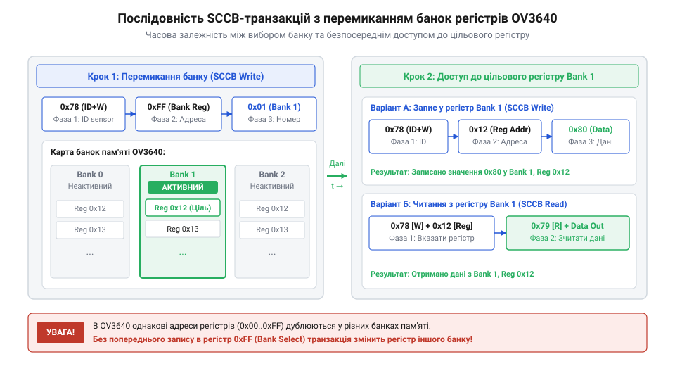
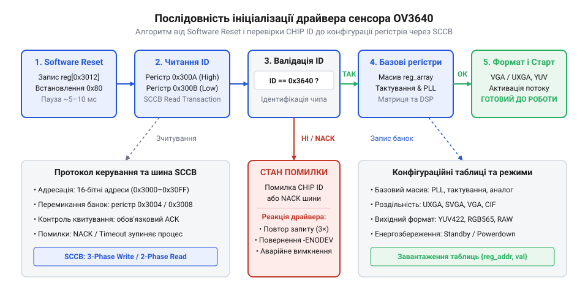

# Програмний інтерфейс драйвера OV3640 для керування через шину SCCB

## Проблема некоректної ініціалізації сенсора зображення

Пряме підключення сенсора зображення @@en|OV3640@@ (від @@en|OmniVision 3.6 Megapixel CMOS Image Sensor@@) до мікроконтролера чи керованого системного процесора @@en|Host Controller@@ (від @@en|Host Controller System@@) без попередньої програмної конфігурації не дозволяє отримати валідний відеопотік. Якщо розробник намагається одразу зчитувати дані з шини [паралельного відеоінтерфейсу DVP](root:com-devices/dvp-parallel-video-interface), екран відображає суцільну чорну заливку, хаотичні кольорові смуги або повну відсутність імпульсів кадрової та рядкової синхронізації @@en|VSYNC@@ (від @@en|Vertical Synchronization Signal@@) і @@en|HREF@@ (від @@en|Horizontal Reference Signal@@). Спроба спрощеного запису довільних констант у довільні регістри без врахування внутрішньої структури пристрою призводить до «замикання» шини управління та відсутності відповіді від матриці.

Причина такої поведінки полягає в тому, що після подачі живлення внутрішня логіка @@en|OV3640@@ перебуває в невизначеному або базовому апаратному стані. Внутрішній генератор частоти @@en|PLL@@ (від @@en|Phase-Locked Loop Generator@@) не налаштований під зовнішній опорний сигнал @@en|XCLK@@ (від @@en|External Master Clock@@), підсилювач аналогового тракту @@en|AGC@@ (від @@en|Automatic Gain Control@@) вимкнений, а блоки автоматичного регулювання експозиції @@en|AEC@@ (від @@en|Automatic Exposure Control@@) не мають завантажених цільових матриць гістограми. Якщо хост-контролер генерує такт @@en|PCLK@@ (від @@en|Pixel Clock Signal@@) без синхронізації з матрицею пікселів, паралельний порт не здатний сформувати валідні строби вибірки.

Хаотичний доступ до регістрів через шину @@en|SCCB@@ (від @@en|Serial Camera Control Bus@@) без дотримання протокольних фаз викликає стан відсутності підтвердження @@en|NACK@@ (від @@en|Negative Acknowledgment Signal@@). Сенсор просто припиняє реагувати на наступні транзакції, блокуючи лінію даних у низькому стані. Для уникнення цих апаратних збоїв необхідний низькорівневий драйвер з чітким @@en|API@@ (від @@en|Application Programming Interface@@). Він забезпечує впорядковану процедуру скидання @@en|Software Reset@@ (від @@en|Software Programmed Reset State@@), зчитування розпізнавального коду @@en|CHIP ID@@ (від @@en|Chip Identification Number@@) та покрокове вивантаження калібрувальних пар "адреса-значення", що переводить [архітектурою сенсорів зображення](root:hw-sensing/cmos-matrix) у стабільний робочий режим.

## Транзакції SCCB та перемикання банок

Для обміну налаштуваннями між хост-контролером і сенсором @@en|OV3640@@ використовується двопровідний інтерфейс @@en|SCCB@@. Хоч зовні він схожий на стандартний I2C, обмін даними має власні специфічні часові фази та сувору структуру транзакцій. Операція запису складається з трьох послідовних 8-бітних фаз: передачі адреси веденого пристрою зі прапорцем запису (за замовчуванням `0x78`), передачі адреси цільового регістру та передачі самого байта даних. Операція зчитування складається з двох транзакцій: спочатку виконується 2-фазний запис адреси регістру, а потім, після повторного стартового стану, 2-фазне читання даних з адреси веденого пристрою зі прапорцем читання (`0x79`).

Головна архітектурна особливість @@en|OV3640@@ полягає у використанні сторінкової організації пам'яті регістрів, яка називається @@en|Register Bank@@ (від @@en|Register Bank Memory Page@@). Сенсор містить сотні керуючих комірок, проте фізичний адресний простір обмежений. Усі регістри розділено на дві основні банки: сторінку цифрового процесора сигналів @@en|DSP@@ (від @@en|Digital Signal Processor Core@@) та сторінку ядра матриці @@en|Sensor@@ (від @@en|Sensor Matrix Core Area@@). Перемикання банок здійснюється через спеціальний регістр вибору сторінки з адресою `0x3000`. Запис значення `0x00` відкриває доступ до регістрів @@en|DSP@@, а значення `0x01` — до регістрів @@en|Sensor@@.

Якщо функція драйвера намагається модифікувати параметри посилення чи експозиції без попереднього переключення в банк @@en|Sensor@@, байт даних буде записано у випадковий регістр сторінки @@en|DSP@@. Це викликає викривлення кольоропередачі або повне зависання внутрішнього конвеєра. Щоб запобігти цьому, низькорівневі функції `ov3640_write_reg` та `ov3640_read_reg` мусять відстежувати поточну активну сторінку пам'яті або відправляти транзакцію вибору банку перед кожним доступом до регістрів.

*Схема показує часовий порядок байтів у транзакції SCCB з явним кроком запису в регістр вибору банку, що забезпечує адресування потрібної сторінки пам'яті сенсора.*

Нижче наведено приклад реалізації низькорівневих функцій читання та запису регістрів @@en|OV3640@@ з автоматичним керуванням банками пам'яті через [протоколом обміну даними SCCB](root:com-devices/sccb-bus-protocol-architecture).

:::tabs
@tab C
:::code api-ov3640-sccb-software-control-interface/c/ov3640-set-bank.c
@tab C++
:::code api-ov3640-sccb-software-control-interface/cpp/ov3640sccbdriver.cpp
:::

## Структури конфігурації та початкова ініціалізація

Після забезпечення стабільного низькорівневого обміну даними постає завдання впорядкованого завантаження початкових налаштувань у сенсор @@en|OV3640@@. Масив конфігурації матриці складається з сотень пар регістр-значення. У коді драйвера ці послідовності організовують у вигляді спеціальних структур `ov3640_reg_val`, де кожна комірка описує цільовий банк, адресу регістру та байтове значення для запису.

Процедура початкової ініціалізації драйвера має виконуватися за суворим алгоритмом станів. Першим кроком є ініціалізація програмного скидання @@en|Software Reset@@. Запис значення `0x80` у регістр `0x3012` скидає внутрішні дільники частоти, скидає регістри @@en|DSP@@ у дефолтний стан та перезапускає стан внутрішнього контролера. Після видачі скидання драйвер зобов'язаний витримати паузу затримки (приблизно 5–10 мілісекунд), щоб дати можливість аналоговим колапсам та @@en|PLL@@ вийти на робочу частоту.

Другим критичним кроком є зчитування та перевірка коду ідентифікації пристрою @@en|CHIP ID@@. Для @@en|OV3640@@ значення @@en|CHIP ID@@ розміщено в двох послідовних реєстрах сторінки @@en|Sensor@@: старший байт розміщено за адресою `0x300A` (очікуване значення `0x36`), а молодший байт — за адресою `0x300B` (очікуване значення `0x40`). Зчитування значення `0x3640` підтверджує фізичну наявність сенсора на шині @@en|SCCB@@ та цілісність електричних ліній живлення і тактування. Лише після успішної перевірки драйвер переходить до завантаження базової таблиці конфігурації.

*Діаграма станів ілюструє послідовність кроків ініціалізації, яка гарантує перехід матриці з невизначеного початкового стану в режим готовності до видачі відеопотоку.*

Нижче наведено програмну структуру даних та послідовність ініціалізації сенсора з вивантаженням таблиці регістрів для [налаштуванням матриці пікселів](root:sf-devices/sensor-pixel-array-configuration).

:::tabs
@tab C
:::code api-ov3640-sccb-software-control-interface/c/ov3640-reg-val.c
@tab C++
:::code api-ov3640-sccb-software-control-interface/cpp/registerconfig.cpp
:::

## Динамічне керування роздільністю та форматами

Забезпечивши базовий вихід відеосигналу, розробник зіштовхується з потребою динамічно змінювати параметри кадрів у процесі роботи пристрою. Наприклад, системі може знадобитися виводити швидкий відеопотік низької роздільності для попереднього перегляду на екрані, а при настанні події — миттєво переключатися у режим зйомки високої якості або генерувати стиснутий кадри у форматі @@en|JPEG@@ (від @@en|Joint Photographic Experts Group Compression@@).

Драйвер @@en|OV3640@@ забезпечує вибір чотирьох стандартних роздільностей: @@en|UXGA@@ (від @@en|Ultra Extended Graphics Array Resolution@@) (1600×1200), @@en|SVGA@@ (від @@en|Super Video Graphics Array Resolution@@) (800×600), @@en|VGA@@ (від @@en|Video Graphics Array Resolution@@) (640×480) та @@en|CIF@@ (від @@en|Common Intermediate Format Resolution@@) (352×288). Зміна роздільності досягається комбінацією трьох механізмів всередині сенсора: кадрування @@en|windowing@@ (від @@en|Windowing Frame Crop Area@@), пропуску пікселів @@en|subsampling@@ (від @@en|Subsampling Pixel Reduction Ratio@@) та цифрового масштабування @@en|scaling@@ (від @@en|Scaling Digital Resizing Logic@@). Субдискретизація дозволяє зменшити розмір кадру без звуження кута огляду об'єктива, зберігаючи високу частоту оновлення.

Паралельно з роздільністю @@en|API@@ реалізує керування вихідним форматом даних. Сенсор підтримує вихідні формати @@en|YUV422@@ (від @@en|YUV Color Space 4:2:2 Subsampling@@), @@en|RGB565@@ (від @@en|16-bit High Color RGB Format@@), несформований колірний масив @@en|Raw RGB@@ (від @@en|Raw Bayer Pattern RGB Format@@) та апаратний @@en|JPEG@@. Перемикання формату виконується шляхом перезапису регістрів форматування конвеєра @@en|DSP@@. Запис у формати @@en|YUV422@@ та @@en|RGB565@@ перетворює кожен піксель у 2-байтові послідовності на інтерфейсі [обробкою кольорових просторів YUV](root:sf-visual/yuv-rgb-color-space-conversion). Режим @@en|JPEG@@ додатково вмикає внутрішній стискач, змінюючи структуру вихідних синхроімпульсів @@en|HREF@@.

Нижче наведено функціональний блок @@en|API@@ для динамічного налаштування роздільності та форматів вихідного потоку.

:::tabs
@tab C
:::code api-ov3640-sccb-software-control-interface/c/ov3640-set-fmt.c
@tab C++
:::code api-ov3640-sccb-software-control-interface/cpp/imageformat.cpp
:::

## Енергозбереження та обробка помилок SCCB

Надійне функціонування відеосистеми вимагає коректної обробки критичних апаратних станів: збоїв живлення, тимчасової відсутності відповідей сенсора та режимів зниженого енергоспоживання @@en|Powerdown@@ (від @@en|Power Down Low Power State@@). У мобільних і автономних пристроях сенсор не повинен постійно споживати номінальний струм (близько 75 міліампер).

Переведення @@en|OV3640@@ у режим @@en|Powerdown@@ здійснюється програмно або апаратно. Програмне призупинення реалізується записом відповідного прапорця у регістр керування живленням `0x3008` сторінки @@en|Sensor@@. У цьому стані внутрішній генератор тактування @@en|PLL@@ вимикається, аналогові матричні підсилювачі знеструмлюються, а вихідні лінії @@en|DVP@@ переходять у високоімпедансний стан. Споживання струму знижується до декількох мікроампер. Вихід з режиму @@en|Powerdown@@ вимагає повторної перевірки готовності та затримки на стабілізацію тактування.

Другою важливою задачею @@en|API@@ є перехоплення помилок обміну даними по шині @@en|SCCB@@. Під час роботи можливі дві основні апаратні проблеми: відсутність сигналу підтвердження @@en|ACK@@ (від @@en|Acknowledgment Signal@@) (що викликає стан @@en|NACK@@) та перевищення часу очікування @@en|timeout@@ (від @@en|Timeout Signal Transfer Delay@@). Помилка @@en|NACK@@ свідчить про хибну адресу пристрою, обрив лінії або відсутність підтягуючих резисторів. Помилка @@en|timeout@@ виникає при захопленні шини іншим веденим пристроєм або зависанні лінії `SCL`.

Драйвер мусить перевіряти коди повернення кожної транзакції. При виявленні @@en|NACK@@ або @@en|timeout@@ виклики не повинні безкінечно блокувати виконання програми в циклі опитування @@en|polling@@ (від @@en|Polling Bus Status Method@@). Замість цього @@en|API@@ повертає відповідні коди помилок (`-EIO` або `-ETIMEDOUT`) та ініціює процедуру скидання шини `ov3640_reset_bus` з повторним викликом ініціалізації драйвера для відновлення [діагностикою шин системного живлення](root:hw-arch/embedded-power-management-strategies).

Нижче наведено приклад реалізації функцій керування живленням та перевірки кодів помилок @@en|SCCB@@.

:::tabs
@tab C
:::code api-ov3640-sccb-software-control-interface/c/ov3640-set-powerdown.c
@tab C++
:::code api-ov3640-sccb-software-control-interface/cpp/ov3640powermanager.cpp
:::