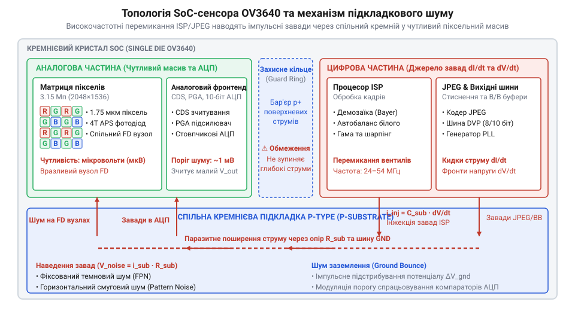
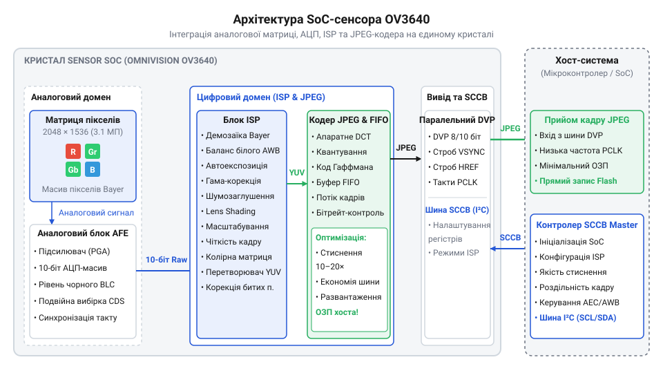
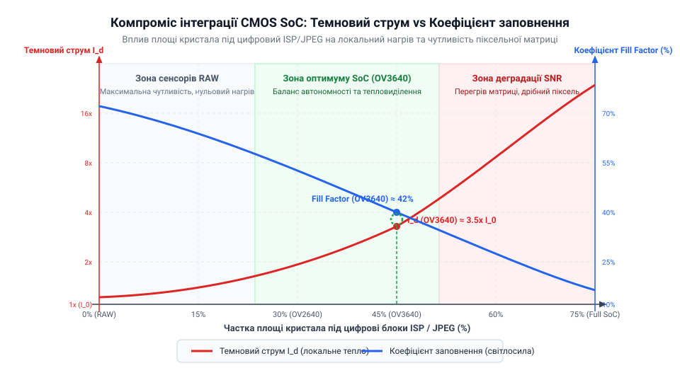

# Еволюція CMOS-сенсорів: від сирої піксельної матриці до систем на кристалі з JPEG

## Криза пропускної здатності мобільних шин

На початку 2000-х років ринок мобільних телефонів зіткнувся з вибуховим зростанням роздільної здатності вбудованих камер. Перші мобільні фотомодулі мали скромну роздільність рівнів CIF (352×288) або VGA (640×480 пікселів), але вже за кілька років виробники оновлювали флагманські моделі сенсорами на 1.3, 2.0 та 3.0 мегапікселі. Проте таке стрімке нарощування кількості фотодіодів несподівано виявило глибокий інженерний затор на межі між давачем зображення та центральним процесором пристрою.

Класична дискретна @@en|CMOS@@ (англ. *Complementary Metal-Oxide-Semiconductor* — комплементарна структура метал-оксид-напівпровідник) матриця тих років виконувала лише первинне збирання світлових квантів та їхню аналогово-цифрову конверсію. Коли світло потрапляє на піксельний масив, накритий [мозаїчним колірним фільтром](root:hw-sensing/sensor-bayer-filter-mosaic), кожен окремий напівпровідниковий фотодіод реєструє лише один конкретний колір (червоний, зелений або синій) відповідно до @@en|Bayer pattern@@ (англ. *Bayer pattern* — сітка Баєра, запропонована Брайсом Баєром у 1976 році). У результаті на виході аналогово-цифрового перетворювача @@en|ADC@@ (англ. *Analog-to-Digital Converter* — аналогово-цифровий перетворювач) утворюється «сирий» масив відліків, де кожен піксель представлений лише 8, 10 або 12 бітами інтенсивності одного кольору.

Щоб сформувати повноцінну картинку, цей велетенський масив незавершених даних необхідно було передати на хост-процесор через [паралельну шину даних](root:com-devices/dvp-parallel-video-interface). Розрахуємо величину пропускної здатності, якої вимагає передавання «сирого» відеопотоку з 3-мегапіксельної матриці. Нехай `W` — горизонтальна роздільність кадру (2048 пікселів), `H` — вертикальна роздільність (1536 пікселів), `b` — розрядність АЦП (10 біт на піксель), а `f` — частота зйомки (15 кадрів за секунду). Тоді сумарний потік даних `B` обчислюється так:

```
B = W × H × b × f
= 2048 × 1536 × 10 × 15        [підстановка параметрів 3 Мп кадру при 10 біт на піксель та 15 к/с]
= 707 788 800 bit/s            [обчислення загального потоку в бітах за секунду]
≈ 88.47 MB/s                   [переведення у мегабайти за секунду діленням на 8 × 10⁶]
```

Для мобільних платформ середини 2000-х років потік у 88.5 МБ/с виявився фатальним. Мобільні процесори того часу (наприклад, на базі ядер ARM9 з тактовою частотою 100–200 МГц) мали спільну 16-бітну шину системної оперативної пам'яті SDRAM із загальною пропускною здатністю близько 150–200 МБ/с. Передавання «сирого» масиву з давача через прямий доступ до пам'яті @@en|DMA@@ (англ. *Direct Memory Access* — прямий доступ до пам'яті) забирало понад половину всієї шини пристрою, блокуючи роботу дисплея, процесора та радіомодема.

Понад те, після потрапляння «сирого» кадру в оперативну пам'ять обчислювальне ядро змушене було вручну виконувати алгоритм @@en|debayering@@ (англ. *de-* + *Bayer* — відновлення повноколірного зображення з мозаїчного масиву). Для кожного з 3 мільйонів пікселів процесор мав інтерполювати відсутні значення двох інших колірних компонентів по сусідніх пікселях. Програмне виконання цієї математичної операції 15 разів на секунду повністю завантажувало обчислювальні ядра, не залишаючи ресурсів навіть для користувацького інтерфейсу. Стало очевидно: подальше збільшення роздільності без зміни архітектури передачі даних неможливе.

## Інтеграція ISP на кремнієву підкладку

Для подолання обчислювального затору інженери напівпровідникової галузі реалізували революційний крок: перенесли процесор обробки сигналів зображення @@en|ISP@@ (англ. *Image Signal Processor* — процесор обробки сигналів зображення) безпосередньо на кремнієву підкладку сенсора зображення. Замість виготовлення окремої матриці фотодіодів та окремого чипа обробки, на єдиній монолітній пластині розмістили світлочутливі елементи, блоки @@en|ADC@@ та апаратні конвеєри обробки сигналу.

Розміщений на кристалі @@en|ISP@@ перебрав на себе всі критичні за ресурсами операції. Апаратні блоки конвеєра прямо під час зчитування рядків матриці виконують інтерполяцію колірної сітки @@en|Bayer pattern@@, автоматичне коригування білого балансу, компенсацію дефектних пікселів, гамма-корекцію та матричне перетворення кольорів. Завдяки цьому з давача виходить уже повністю сформований колірний потік у стандартному форматі @@en|YUV@@ (англ. *YUV* — колірна модель з поділом на яскравісну та хроматичні компоненти) або @@en|RGB@@ (англ. *Red, Green, Blue* — червона, зелена та синя колірні компоненти). Центральний процесор повністю звільнився від потреби обчислювати @@en|debayering@@ у програмному коді й отримував кадр, готовий до виведення на екран.

Проте розміщення високочастотної цифрової логіки @@en|ISP@@ поруч із високочутливим аналоговим масивом фотодіодів створило серйозні інженерні проблеми фізичного характеру.


*Схема перехресних завад у силіконовій підкладці SoC-сенсора: перемикання вентилів цифрового ISP створює пульсації потенціалу підкладки, які спотворюють аналоговий сигнал фотодіодів.*

Під час роботи цифрових вентилів @@en|ISP@@ виникають високочастотні струми перемикання та імпульсні кидки напруги в шинах живлення й заземлення. Через спільну напівпровідникову підкладку кристала ці завади, відомі як @@en|crosstalk@@ (англ. *cross-talk* — перехресні завади), проникають у зони збереження заряду фотодіодів та аналогові кола читання @@en|ADC@@. Порівняно з тогочасними дискретними [сенсорами із зарядовим зв'язком](root:hw-sensing/ccd-vs-cmos-architecture) (@@en|CCD@@, англ. *Charge-Coupled Device*), перші системи на кристалі @@en|SoC@@ (англ. *System on Chip* — система на кристалі) мали суттєво вищий рівень фіксованого шумового візерунку та вужчий динамічний діапазон. Інтеграція @@en|ISP@@ здійснювалася зовсім не заради підвищення якості зображення, а як жорсткий компроміс задля зниження навантаження на процесор хоста та зменшення вартості кінцевого пристрою.

Хоча поява інтегрованого @@en|ISP@@ звільнила центральний процесор від розрахунків, вона лише частково послабила кризу пропускної здатності шини. Передавання одного нестиснутого кадру в форматі @@en|YUV@@ 4:2:2 з роздільністю 3 мегапікселі вимагає 2 байти на піксель, що становить 6.29 МБ на кадр (або 94.3 МБ/с при 15 к/с). Шина даних мобільного пристрою все ще залишалася критично завантаженою.

## Поява апаратного кодера JPEG в OV3640

Остаточним архітектурним проривом середини 2000-х років стала поява знакового 3-мегапіксельного @@en|CMOS@@ @@en|SoC@@ сенсора @@en|OV3640@@ від компанії @@en|OmniVision@@ Technologies. Інженери @@en|OmniVision@@ пішли далі й розмістили на тому ж кристалі площею 1/4 дюйма не лише піксельну матрицю та @@en|ISP@@, а й повноцінний апаратний кодер @@en|JPEG@@ (англ. *Joint Photographic Experts Group* — об'єднана група експертів у галузі фотографії).


*Архітектура SoC-сенсора OV3640: аналоговий сигнал піксельної матриці оцифровується АЦП, обробляється блоком ISP і кодується в JPEG без залучення ресурсів мобільного хост-процесора.*

У сенсорі @@en|OV3640@@ конвеєр обробки сигналу набув завершеної автономності. Світловий потік оцифровується 10-бітними @@en|ADC@@, далі блоком @@en|ISP@@ виконується @@en|debayering@@ та перетворення у формат @@en|YUV@@, після чого цей потік подається безпосередньо на вхід апаратного блоку стиснення @@en|JPEG@@. Кодер виконує дискретне косинусне перетворення, квантування й ентропійне кодування, записуючи готовий стиснутий бінарний файл у внутрішній буфер @@en|FIFO@@ (англ. *First In, First Out* — буфер типу «першим прийшов — першим вийшов»).

Впровадження апаратного стиснення радикально змінило баланс навантаження на системну шину:

- Обсяг несфокусованого кадру @@en|YUV@@ 4:2:2 роздільністю 2048×1536 складає 6.29 МБ. - Обсяг того ж кадру після апаратного стиснення @@en|JPEG@@ зі коефіцієнтом стиснення 10:1…15:1 становить лише 300–600 КБ.

Пропускна здатність, необхідна для передавання кадру через паралельний порт @@en|DVP@@ (англ. *Digital Video Port* — цифровий відеопорт), зменшилася більш ніж у 10 разів. Замість мільйонів окремих піксельних відліків мобільний процесор за допомогою короткої процедури @@en|DMA@@ просто копіював з буфера сенсора готовий файл @@en|JPEG@@ безпосередньо на карту пам'яті або у флеш-накопичувач.

Успіх @@en|OV3640@@ закріпив домінування @@en|SoC@@-камер у мобільній техніці середини 2000-х років. Разом із тим, цей крок яскраво проілюстрував сутність інженерних компромісів. Інтеграція кодера @@en|JPEG@@ та @@en|ISP@@ на спільний кристал робилася не для досягнення максимальної фотографічної якості, а виключно через обмеження обчислювальної потужності й пропускної здатності тогочасних мобільних хостів. Артефакти стиснення та теплові завади від додаткових цифрових блоків знижували чіткість порівняно з професійними фотосистемами. Лише через роки, з появою високошвидкісних серійних інтерфейсів @@en|MIPI CSI@@ (англ. *Mobile Industry Processor Interface Camera Serial Interface* — серійний інтерфейс камери) та потужних мобільних процесорів із виділеними графічними ядрами, індустрія змогла повернутися до використання «сирих» сенсорів. Для вбудованих же систем концепція @@en|SoC@@-сенсорів залишається еталоном раціонального розподілу системних ресурсів.

## Міф якості та компроміси цифрового шуму

Маркетингові матеріали мобільних пристроїв середини 2000-х років часто подавали появу @@en|SoC@@-камер як прогресивний крок до підвищення якості зйомки. Проте в реальності перші камери на єдиному кристалі суттєво поступалися за деталізацією та рівнем завад як класичним @@en|CCD@@-матрицям, так і дискретним @@en|CMOS@@-сенсорам із зовнішніми процесорами. Інтеграція блоків @@en|ISP@@ та апаратного кодування @@en|JPEG@@ здійснювалася виключно задля збереження обчислювальних ресурсів хоста й здешевлення системної платформи, а не заради оптимізації оптичних характеристик.

Розміщення мільйонів цифрових транзисторів поруч із високочутливими фотодіодами неминуче спричиняє завади. Під час перемикання вентилів у блоках @@en|ISP@@ та кодера @@en|JPEG@@ у спільну напівпровідникову підкладку та лінії живлення інжектуються імпульсні струми. Ці високочастотні наведення, відомі як @@en|crosstalk@@, потрапляють у вузли накопичення заряду пікселів та опорні кола @@en|ADC@@. У результаті на підсумковому зображенні виникає паразитна сітка фіксованого шумового візерунка та зростає загальний рівень цифрового шуму, що суттєво звужує динамічний діапазон.

Окрім електричних завад, обчислювальні блоки створюють і теплове навантаження. Логіка @@en|ISP@@ та кодер @@en|JPEG@@ споживають значний струм, перетворюючи його на тепло безпосередньо на компактному кристалі площею в кілька квадратних міліметрів. Нагрівання напівпровідника призводить до фізичного явища, пов'язаного з [темновим струмом напівпровідника](root:hw-sensing/dark-current) (@@en|dark current@@, англ. *dark current* — струм витоку p-n переходу за відсутності фотонів) — виникнення паразитного заряду у фотодіодах навіть за повної відсутності світла. Нехай `I_d` — величина темнового струму за температури кристала `T`, `I_0` — початковий темновий струм за кімнатної температури `T_0` (25 °C), а `ΔT` — температурний інтервал подвоєння струму (близько 8 °C для силіційових структур). Залежність описується виразом:

```
I_d = I_0 × 2^((T - T_0) / 8)    [експоненціальне зростання темнового струму при нагріві кристала]
```

Підвищення температури кристала на 16 °C через активну роботу внутрішнього процесора збільшує темновий струм у 4 рази. Це призводить до появи хаотичних яскравих пікселів у темних ділянках кадру та падіння співвідношення сигналу до шуму @@en|SNR@@ (англ. *Signal-to-Noise Ratio* — співвідношення корисного сигналу до шуму).


*Вплив інтеграції цифрових блоків на характеристики сенсора: локальне нагрівання підвищує рівень темнового струму, а зменшення площі світлочутливої зони пікселя знижує динамічний діапазон.*

Фізична площа підкладки також є жорстко обмеженим ресурсом. Додавання блоків @@en|ISP@@, кодера @@en|JPEG@@ та буферів @@en|FIFO@@ вимагає значної площі кремнію. Щоб зберегти стандартний оптичний формат матриці (наприклад, 1/4 дюйма) і прийнятну вартість виготовлення, інженери змушені були зменшувати розмір самих фотодіодів. Зменшення фізичної площі пікселя знижує його [коефіцієнтом заповнення пікселя](root:hw-sensing/sensor-pixel-fill-factor) (@@en|fill factor@@, англ. *fill factor* — коефіцієнт заповнення пікселя світлочутливою площею) та граничну ємність накопичення фотоелектронів. Малий піксель уловлює менше фотонів, що прямим чином погіршує світлочутливість та здатність передавати півтони в умовах складного освітлення.

## Архітектурний вибір між RAW та SoC

При проектуванні сучасних вбудованих систем розробник постає перед фундаментальною архітектурною дилемою: застосувати «сирий» сенсор із передаванням [апаратних конвеєрів обробки](root:sf-visual/raw-processing-pipeline) (@@en|RAW@@, англ. *raw* — необроблений масив даних з піксельної матриці) на зовнішній процесор чи використати автономний @@en|SoC@@-сенсор із вбудованими блоками @@en|ISP@@ та кодування. Обидва підходи мають чітко визначені сфери застосування, зумовлені вимогами до швидкодії, обсягу пам'яті, енергоспоживання та необхідної якості зображення.

Архітектура із застосуванням @@en|RAW@@-сенсора передбачає передавання нестиснутих первинних відліків матриці через високошвидкісні серійні інтерфейси @@en|MIPI CSI@@ або паралельні шини @@en|DVP@@. Головна перевага цього вибору — абсолютна гнучкість та найвища якість підсумкового кадру. Зовнішній потужний @@en|ISP@@ у складі системного процесора може застосовувати складні алгоритми просторового придушення шуму, розширення динамічного діапазону (HDR), точного калібрування кольорів та компенсації дисторії об'єктива. При цьому сам сенсор зображення виділяє мінімум тепла, що гарантує низький рівень темнового струму. Однак цей підхід вимагає наявності потужного хост-процесора з відповідним контролером відеовходу, високої пропускної здатності системної шини та виділення значних буферів оперативної пам'яті для прямих транзакцій @@en|DMA@@.

Використання автономного @@en|SoC@@-сенсора зі вбудованим кодером @@en|JPEG@@ або блоком формування @@en|YUV@@ навпаки повністю ізолює центральний мікроконтролер від обчислювального навантаження. Хост отримує вже готовий стиснутий файл або сформований колірний кадр через відносно повільні інтерфейси, не витрачаючи тактові частоти на інтерполяцію колірної сітки Баєра чи математичні перетворення. Це робить @@en|SoC@@-камери ідеальним рішенням для компактних пристроїв інтернету речей (IoT), автономних датчиків та малопотужних мікроконтролерів, які не мають вбудованих апаратних відеопроцесорів. Ціною такої автономності є неможливість гнучкого налаштування алгоритмів обробки, наявність артефактів апаратного стиснення та підвищене тепловиділення на модулі камери.

Підсумковий вибір між @@en|RAW@@ та @@en|SoC@@ визначається критеріями системного балансу:

- Сенсори @@en|RAW@@ обирають тоді, коли ключовими вимогами є бездоганна деталізація, робота при слабкому освітленні, застосування алгоритмів комп'ютерного зору або коли центральний процесор вже має вбудований апаратний @@en|ISP@@. - Модулі @@en|SoC@@ обирають у разі використання обчислювально обмежених мікроконтролерів, необхідності мінімізувати трафік системної шини, спростити розведення друкованої плати та прискорити розробку програмного забезпечення.