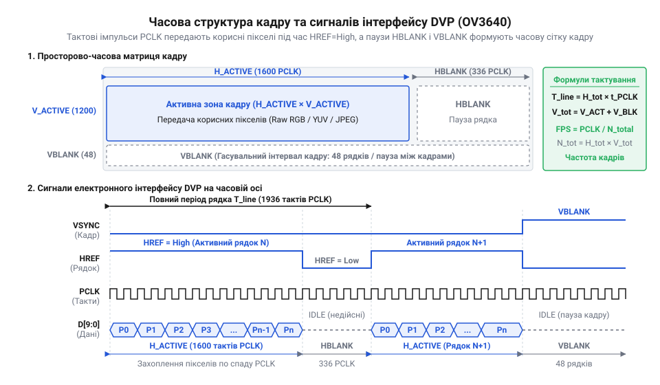

# Розрахунок тактування, часових інтервалів DVP та частоти кадрів сенсора OV3640

## Зрив захоплення кадрів у вбудованих системах

Розробник вбудованої системи підключає матрицю зображення OV3640 до мікроконтролера й налаштовує захоплення кадрів із роздільністю @@en|Ultra Extended Graphics Array@@ (від @@en|ultra@@ — ультра, @@en|extended graphics array@@ — розширена графічна матриця, `UXGA`, 1600 × 1200 пікселів) у форматі @@en|YUV422@@. Простий розрахунок показує, що один кадр містить 3.84 мегабайти даних. Якщо задати частоту кадрів 15 кадрів за секунду, середня швидкість передачі складе 57.6 мегабайтів за секунду. Мікроконтролер має периферійний модуль @@en|Direct Memory Access@@ (від @@en|direct@@ — прямий, @@en|memory@@ — пам'ять, @@en|access@@ — доступ, `DMA`), який за паспортом підтримує пропускну здатність до 80 мегабайтів за секунду. Проте під час запуску відеопотоку зображення розривається, кольори зміщуються, а контролер `DMA` фіксує постійну помилку переповнення буфера — @@en|Overrun@@ (від @@en|over@@ — понад, @@en|run@@ — бігти).

Причина такого збою полягає в хибній гіпотезі про рівномірність надходження даних. Сенсор зображення передає байтові дані через паралельний відеоінтерфейс @@en|Digital Video Port@@ (від @@en|digital@@ — цифровий, @@en|video@@ — відео, @@en|port@@ — порт, `DVP`) не суцільним потоком, а пульсуючими сплесками. Протягом виведення активного рядка зображення байти передаються з максимальною піковою частотою, яку визначає вихідний тактовий сигнал піксельного синхросигналу @@en|Pixel Clock@@ (від @@en|pixel@@ — піксель, @@en|clock@@ — тактовий сигнал, `PCLK`). Між окремими рядками та кадрами сенсор робить пасивні паузи для скидання фотодіодів, зчитування аналого-цифрових перетворювачів та горизонтального й вертикального гасіння.

Через наявність паус пікова частота `PCLK` під час передачі корисних пікселів виявляється значно вищою за середню частоту обробки даних. Якщо пікова швидкість вибірки перевищує фізичну пропускну здатність шини пам'яті мікроконтролера або швидкість реакції внутрішнього буфера @@en|First In, First Out@@ (від @@en|first in, first out@@ — першим зайшов, першим вийшов, `FIFO`), виникає втрата байтів. Навіть якщо середня обчислювальна потужність мікроконтролера достатня для обробки 57.6 MB/s, його периферійний вузол `DVP` споживає дані з піковою швидкістю 96 MB/s.

Щоб запобігти збоям захоплення, необхідно розрахувати точну математичну модель тактування сенсора. Ця модель починається від вхідного генератора, проходить через внутрішні дільники й фазове автопідстроювання частоти, враховує формат кодування кольору та паузи гасіння й завершується обчисленням вимог до обсягу оперативної пам'яті @@en|Static Random-Access Memory@@ (від @@en|static@@ — статичний, @@en|random-access memory@@ — оперативна пам'ять, `SRAM`) та затримок `DMA`.

## Генерація системної та піксельної частот

Сенсор зображення OV3640 не створює тактову частоту самостійно. На його вхід @@en|External Clock@@ (від @@en|external@@ — зовнішній, @@en|clock@@ — тактовий сигнал, `XVCLK`) подається опорний високочастотний сигнал від мікроконтролера або зовнішнього кварцового генератора, що зазвичай дорівнює 24 MHz. Для забезпечення внутрішньої обробки піксельної матриці та формування вихідних імпульсів шини `DVP` сенсор синтезує системну частоту @@en|System Clock@@ (від @@en|system@@ — системний, @@en|clock@@ — тактовий сигнал, `SYSCLK`) та піксельну частоту `PCLK` за допомогою внутрішнього вузла фазового автопідстроювання частоти — @@en|Phase-Locked Loop@@ (від @@en|phase@@ — фаза, @@en|locked@@ — синхронізований, @@en|loop@@ — петля, `PLL`).

Ланцюжок синтезу частоти складається з послідовних етапів перетворення:
1. Вхідний дільник `PLL_PRE` зменшує частоту `XVCLK`, приводячи її до робочого діапазону вхідного порівняння `PLL`. 2. Множник `PLL_MULT` примножує частоту у зворотному зв'язку `PLL`, утворюючи внутрішню високочастотну опорну частоту `PLL_CLK`. 3. Системний дільник `SYS_DIV` зменшує частоту `PLL_CLK` до рівня `SYSCLK`. 4. Піксельний дільник `PCLK_DIV` формує остаточну вихідну частоту `PCLK` на фізичній ніжці шини `DVP`.

Обчислимо системну частоту `SYSCLK_freq` через коефіцієнти регістрів сенсора. Означимо вхідну частоту як `XVCLK_freq`, коефіцієнт попереднього ділення як `PLL_PRE`, коефіцієнт множення `PLL` як `PLL_MULT` та системний дільник як `SYS_DIV`.

```
SYSCLK_freq = XVCLK_freq × PLL_MULT ÷ (PLL_PRE × SYS_DIV)
            = 24.0 × 16 ÷ (2 × 2)                         [підстановка типових значень регістрів OV3640]
            = 384.0 ÷ 4                                   [перемноження числівника та знаменника]
            = 96.0 MHz                                    [підсумкова системна частота сенсора]
```

Отримане значення `SYSCLK_freq` визначає швидкодію внутрішнього цифрового ядра сенсора. Для формування зовнішньої піксельної частоти `PCLK_freq` системна частота ділиться на коефіцієнт піксельного дільника `PCLK_DIV`:

```
PCLK_freq = SYSCLK_freq ÷ PCLK_DIV
          = 96.0 ÷ 2                                      [ділення системної частоти на піксельний дільник]
          = 48.0 MHz                                      [підсумкова піксельна частота на шині DVP]
```

Зміна будь-якого з коефіцієнтів через [конфігурацію регістрів OV3640](root:cat-hw-sensors/ov3640-sccb-register-configuration) безпосередньо змінює частоту `PCLK`. Наприклад, якщо збільшити дільник `PCLK_DIV` удвічі, пікова пропускна здатність шини зменшиться вдвічі, що полегшить роботу `DMA`, але пропорційно знизить підсумкову частоту кадрів.

## Часова структура кадру та гасувальні інтервали

Часовий кадр у паралельному інтерфейсі `DVP` являє собою двовимірну матрицю тактів. Кожен рядок складається з активних тактів передачі пікселів та пасивних тактів горизонтального гасіння @@en|Horizontal Blanking@@ (від @@en|horizontal@@ — горизонтальний, @@en|blanking@@ — гасіння, `HBLANK`). Кадр у цілому складається з активних рядків зображення та пасивних рядків вертикального гасіння @@en|Vertical Blanking@@ (від @@en|vertical@@ — вертикальний, @@en|blanking@@ — гасіння, `VBLANK`).

Розподіл сигналів синхронізації та інтервалів гасіння в часі показує схема:


*Розподіл тактових імпульсів PCLK між передачею пікселів активного рядка та інтервалами гасіння.*

Зі схеми видно, що сигнал вертикальної синхронізації @@en|Vertical Synchronization@@ (від @@en|vertical@@ — вертикальний, @@en|synchronization@@ — синхронізація, `VSYNC`) задає тривалість одного повного кадру. Усередині кадру сигнал горизонтальної синхронізації @@en|Horizontal Reference@@ (від @@en|horizontal@@ — горизонтальний, @@en|reference@@ — орієнтир, `HREF`) набуває високого логічного рівня лише під час передачі корисних байтів активного рядка.

Обчислимо повну кількість тактів в одному рядку `H_TOTAL_clks`. Позначимо кількість активних пікселів як `H_ACTIVE`, кількість байтів на один піксель як `N_bpp`, а тривалість горизонтального гасіння в тактах як `HBLANK_clks`.

```
H_TOTAL_clks = (H_ACTIVE × N_bpp) + HBLANK_clks
             = (1600 × 2) + 640                           [для UXGA у форматі YUV422 з HBLANK = 640 тактів]
             = 3200 + 640                                 [додавання активних тактів і гасіння]
             = 3840 clks                                  [загальна тривалість одного рядка в тактах PCLK]
```

Аналогічно обчислюється повна висота кадру `V_TOTAL_lines` у рядках. Вона складається з кількості активних рядків зображення `V_ACTIVE` та кількості баластих рядків вертикального гасіння `VBLANK_lines`:

```
V_TOTAL_lines = V_ACTIVE + VBLANK_lines
              = 1200 + 50                                 [для UXGA з VBLANK = 50 рядків]
              = 1250 lines                                [загальна тривалість кадру в рядках]
```

Повна кількість тактів `PCLK`, необхідна для передачі одного кадру `CLK_PER_FRAME`, обчислюється як добуток повної ширини рядка на повну висоту кадру:

```
CLK_PER_FRAME = H_TOTAL_clks × V_TOTAL_lines
              = 3840 × 1250                               [помноження тактів рядка на кількість рядків]
              = 4800000 clks                              [загальна кількість тактів PCLK на кадр]
```

Отриманий результат свідчить, що гасувальні інтервали `HBLANK` та `VBLANK` додають додаткові 25% тактів до чистого обсягу пікселів зображення. Ігнорування цих пауз у розрахунках призведе до помилкової оцінки частоти кадрів.

## Вплив форматів кодування на тактування

Шина даних `DVP` у сенсорі OV3640 має фізичну ширину 10 біт (`D[9:0]`). Оскільки піксель зображення описується більшим обсягом інформації (наприклад, 16 бітами у форматі YUV422), сенсор передає кожен піксель кількома послідовними байтами за декілька тактів `PCLK`.

Кількість тактів `PCLK` на один піксель `N_bpp` залежить від обраного режиму кодування:
- **@@en|Raw RGB@@**: передається 1 байт на піксель (`N_bpp = 1`). На кожен такт `PCLK` припадає один піксель сирого масиву байєрівського фільтра. - **YUV422 / RGB565**: передається 2 байти на піксель (`N_bpp = 2`). Перший такт передає старший байт (компонент `Y` або `R/G`), другий такт — молодший байт (компонент `U/V` або `G/B`). - **Стиснений @@en|JPEG@@**: сенсор оцифровує зображення, стискає його внутрішнім процесором і видає байтовий потік через `DVP`. Кількість байтів на кадр змінюється залежно від деталізації сцени, але тактування `PCLK` та межі `HREF` зберігають прив'язку до системної тактової сітки.

З'ясуємо, як зміна формату кодування з Raw RGB на YUV422 впливає на тривалість активної частини рядка при роздільності @@en|Super Video Graphics Array@@ (від @@en|super video graphics array@@ — супервідеографічна матриця, `SVGA`, 800 × 600 пікселів).

Для Raw RGB (`N_bpp = 1`):

```
H_ACTIVE_clks_raw = H_ACTIVE × 1
                  = 800 × 1                               [1 такт PCLK на піксель]
                  = 800 clks                              [тривалість активного рядка для Raw RGB]
```

Для YUV422 (`N_bpp = 2`):

```
H_ACTIVE_clks_yuv = H_ACTIVE × 2
                  = 800 × 2                               [2 такти PCLK на піксель]
                  = 1600 clks                             [тривалість активного рядка для YUV422]
```

Якщо при переході на YUV422 не змінити системну частоту `PCLK_freq`, активна частина рядка розтягнеться в часі удвічі. Це означає, що за сталої частоти `PCLK` підсумкова частота кадрів зменшиться майже вдвічі. Якщо ж необхідно зберегти високу частоту кадрів, потрібно через регістри `PLL` збільшити частоту `PCLK_freq` у 2 рази, що подвоїть пікове навантаження на периферійні буфери хост-контролера.

## Розрахунок частоти кадрів та буферів

Маючи піксельну частоту `PCLK_freq` та повну кількість тактів у кадрі `CLK_PER_FRAME`, обчислимо підсумкову частоту кадрів — @@en|Frames Per Second@@ (від @@en|frames per second@@ — кадри за секунду, `FPS`).

Тривалість одного кадру визначається діленням кількості тактів кадру на піксельну частоту. Підставимо ці значення у формулу `FPS = PCLK_freq ÷ CLK_PER_FRAME`:

```
FPS = PCLK_freq ÷ CLK_PER_FRAME
    = 48000000 ÷ 4800000                                  [ділення 48 MHz на 4.8 мільйона тактів кадру]
    = 10.0 Hz                                             [підсумкова частота 10 кадрів за секунду]
```

Для визначення вимог до обчислювальної системи розрахуємо пікову пропускну здатність шини `DVP`. Оскільки кожен такт `PCLK` передає 1 байт даних, пікова швидкість надходження байтів `B_peak` дорівнює частоті `PCLK_freq`:

```
B_peak = PCLK_freq × 1 byte
       = 48.0 MB/s                                        [пікова швидкість передачі байтів]
```

Мікроконтролер мусить гарантувати, що периферійний модуль `DVP` та шина `DMA` спроможні вибірково приймати байти з періодом `T_pclk = 1 ÷ PCLK_freq = 20.83 ns`. Якщо апаратний буфер `FIFO` у периферійному модулі `DVP` мікроконтролера має глибину `FIFO_depth = 16` байтів, максимальний допустимий час затримки шини пам'яті `T_dma_max` обчислюється так:

```
T_dma_max = FIFO_depth × T_pclk
          = 16 × 20.833                                   [множення глибини FIFO на період PCLK]
          = 333.3 ns                                      [максимальна допустима затримка DMA]
```

Якщо інша периферія мікроконтролера блокує системну шину пам'яті на час, що перевищує 333.3 нс, буфер `FIFO` переповнюється і виникає помилка `Overrun`. Детальніше організацію [буферизації відеопотоку](root:hw-arch/dma-video-fifo-buffering) розглядають під час проектування шинних арбітрів.

Для організації захоплення кадрів у пам'яті `SRAM` хост-мікроконтролера використовують три схеми буферизації:
1. **Порядкова буферизація (подвійний рядковий буфер)**: виділяється пам'ять для двох рядків обсягом `2 × H_ACTIVE × N_bpp` байтів (для UXGA YUV422: `2 × 1600 × 2 = 6400` байтів). Дозволяє обробляти потік потоково з мінімальними витратами `SRAM`. 2. **Повнокадрова буферизація**: виділяється пам'ять обсягом `H_ACTIVE × V_ACTIVE × N_bpp` байтів (для UXGA YUV422: `1600 × 1200 × 2 = 3840000` байтів = 3.84 MB). Потребує зовнішньої пам'яті PSRAM або SDRAM. 3. **Буферизація JPEG-кадру**: виділяється буфер очікуваного стисненого кадру `Buffer_jpeg ≈ (H_ACTIVE × V_ACTIVE × N_bpp) ÷ CR`, де `CR` — коефіцієнт стиснення (типово 10:1 – 20:1), що знижує вимоги до `SRAM` до ~200-300 Кбайт.

Точний розрахунок часових параметрів `DVP` дозволяє безмилково налаштувати регістри тактування OV3640 та гарантувати стійке захоплення відеопотоку у вбудованих системах.