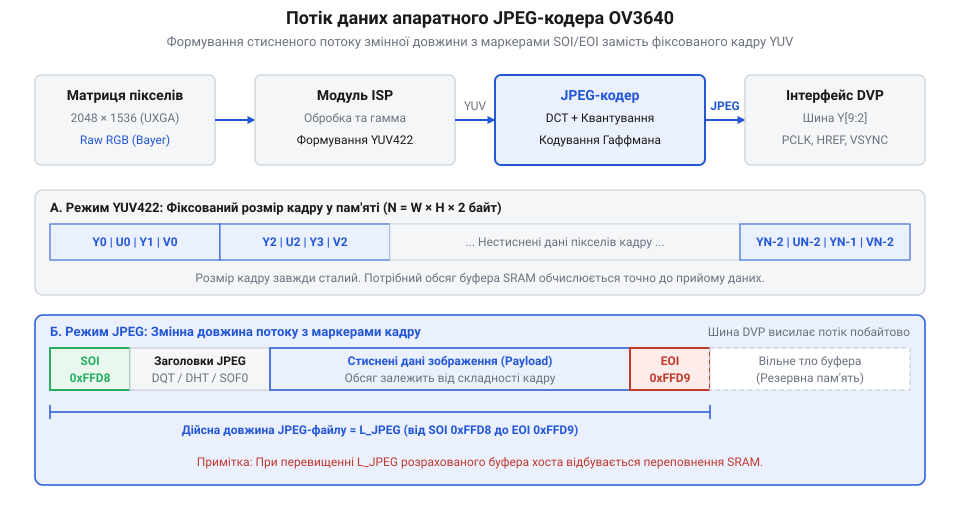
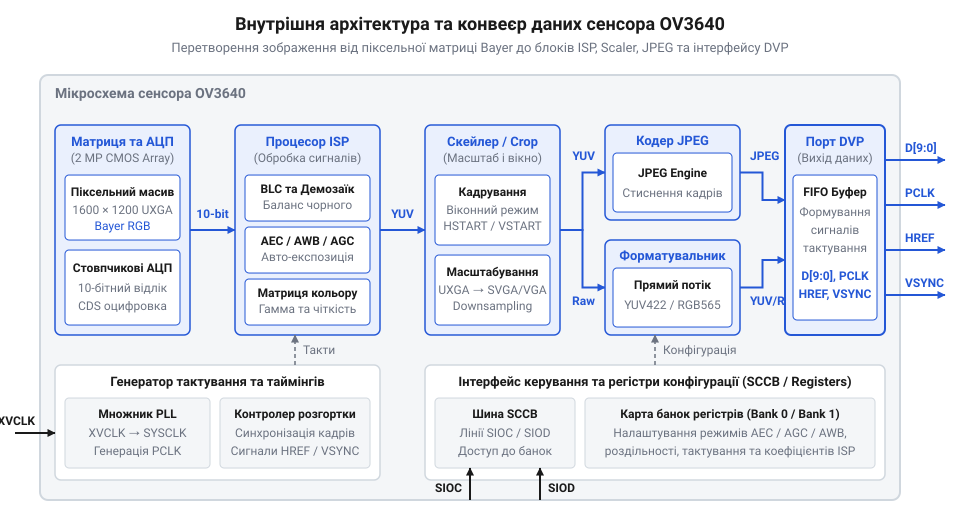
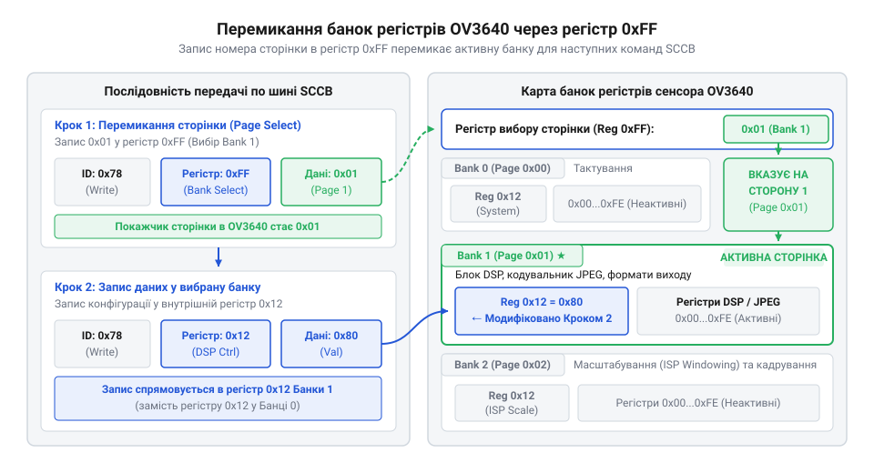
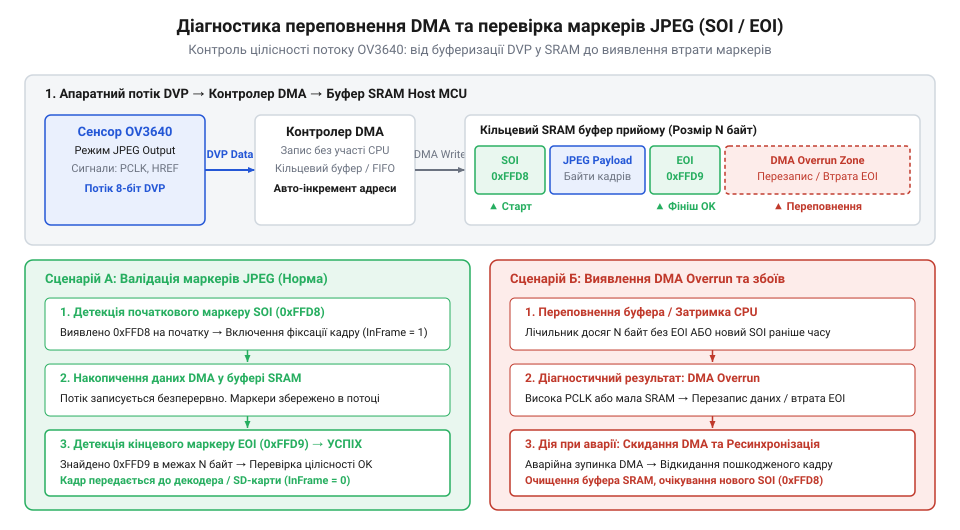

# Огляд матриці та регістрів сенсора OV3640

## Обмеження оперативної пам'яті при захопленні кадрів

Спроба прямого зчитування нестисненого графічного кадру високої роздільності з 3-мегапіксельного @@en|CMOS@@-сенсора (від англ. *Complementary Metal-Oxide-Semiconductor* — комплементарна структура метал-оксид-напівпровідник) @@en|OV3640@@ у внутрішню оперативну пам'ять мікроконтролера миттєво призводить до системного збою або переповнення буфера. Причиною цього є фізична прірва між обсягом даних, що генерує оптична матриця, та доступними ресурсами вбудованих обчислювальних платформ.

Типові мікроконтролери загального призначення, такі як сімейства @@en|STM32F4@@ або @@en|STM32F7@@, володіють внутрішньою статичною оперативною пам'яттю @@en|SRAM@@ (від англ. *Static Random-Access Memory* — статична оперативна пам'ять) обсягом від 128 @@en|KB@@ до 512 @@en|KB@@. Водночас матриця сенсора @@en|OV3640@@ у режимі повної роздільності @@en|QXGA@@ (від англ. *Quad Extended Graphics Array* — 2048 × 1536 пікселів) створює потік, кожен елемент якого у колірних форматах @@en|YUV422@@ або @@en|RGB565@@ кодується двома байтами. Обчислення необхідного обсягу оперативної пам'яті $V$ для збереження лише одного нестисненого кадру виконується за базовою формулою, де $W$ — ширина кадру в пікселях, $H$ — висота кадру в рядках, а $bpp$ — колірна глибина пікселя у байтах (від англ. @@en|bytes per pixel@@):

```
V = W × H × bpp
  = 1600 × 1200 × 2          [множення ширини на висоту та розмір пікселя в байтах]
  = 3840000 байтів           [обчислення повного обсягу нестисненого кадру]
  = 3.66 МБ                  [переведення значення у мегабайти]
```

Для збереження одного такого кадру потрібно 3.66 @@en|MB@@ суцільного фізичного простору пам'яті, що у 7–30 разів перевищує всю оперативну пам'ять хост-мікроконтролера. Навіть при зниженні роздільності до @@en|SVGA@@ (800 × 600 пікселів) один кадр потребує 960 @@en|KB@@ @@en|SRAM@@, що все одно виходить за межі кристала більшості @@en|MCU@@ (від англ. *Microcontroller Unit*).

Окрім обсягу пам'яті, серйозним обмеженням є часова динаміка передачі даних через паралельний інтерфейс @@en|DVP@@ (від англ. *Digital Video Port* — цифровий відеопорт). При частоті оновлення 15 кадрів на секунду (@@en|FPS@@, від англ. *Frames Per Second*) пропускна здатність шини перевищує 54 @@en|MB/s@@, а тактова частота пікселів @@en|PCLK@@ (від англ. *Pixel Clock*) досягає 55 @@en|MHz@@. Процесорне ядро з тактовою частотою 168 @@en|MHz@@ спроможне виділити лише 3 такти на один прийнятий байт, що робить програмний опит портів або переривання за кожним байтом фізично неможливими.

Виходом із цього системного глухого кута стала еволюція оптичних давачів. Історичний процес, під час якого [еволюція CMOS-сенсорів](root:cat-hw-sensors/ov3640-sensor-architecture/hist-cmos-soc-camera-evolution.md) привела до інтеграції цифрових сигнальних процесорів та апаратних кодерів безпосередньо на кремнієвий кристал, перетворив сенсор @@en|OV3640@@ на повноцінну систему на кристалі (@@en|SoC@@, від англ. *System on Chip*).

Замість прямої трансляції гігантських сирих масивів, сенсор @@en|OV3640@@ самостійно виконує масштабування, кадрування та апаратне стиснення фотопотоку за стандартом @@en|JPEG@@ (від англ. *Joint Photographic Experts Group*). При апаратному кодуванні колірна надлишковість та просторові частоти зображення стискаються у 10–40 разів. Кадр роздільністю @@en|UXGA@@ зменшується з 3.66 @@en|MB@@ до 50–200 @@en|KB@@, залежно від складності сцени та обраного коефіцієнта квантування.


*Структура потоку даних при апаратному стисненні кадру та його передачі через буфери з виявленням маркерів.*

Стиснений потік передається через вихідний порт @@en|DVP@@ у вигляді послідовності байтів змінної довжини. Щоб хост-мікроконтролер міг прийняти цей потік без локального мегабайтного буфера, використовується циркулярна кільцева буферизація за допомогою модуля прямого доступу до пам'яті @@en|DMA@@ (від англ. *Direct Memory Access*). Мікроконтролер виділяє у внутрішній @@en|SRAM@@ лише два невеликі буфери (наприклад, по 4 @@en|KB@@ кожен), які працюють у режимі перемикання (від англ. *ping-pong buffer*). Модуль @@en|DMA@@ заповнює один буфер, поки процесор скидає другий буфер у зовнішню пам'яті або на @@en|SD@@-карту.

Апаратний потік @@en|JPEG@@ обов'язково обрамляється специфічними маркерами протоколу: початком кадру @@en|SOI@@ (`0xFFD8`, від англ. *Start of Image*) та кінцем кадру @@en|EOI@@ (`0xFFD9`, від англ. *End of Image*). Для надійної ідентифікації меж стисненого кадру в потоці байтів [парсер маркерів JPEG](root:com-signal/jpeg-stream-parsing-and-marker-processing) сканує вхідний кільцевий буфер @@en|DMA@@ у реальному часі, відсікаючи холості байти гасіння між кадрами.

Щоб правильно налаштувати тривалість рядків, частоту тактування шини та позбутися втрат байтів при передачі, розробнику необхідно розрахувати параметри системного генератора. Точний [розрахунок тактування DVP](root:cat-hw-sensors/ov3640-sensor-architecture/math-dvp-pixel-clock-and-framerate-calculation.md) дозволяє зіставити швидкість генерування байтів сенсором із максимальною пропускною здатністю шини пам'яті мікроконтролера.

Практичну організацію схемотехніки та драйвера для прийому стиснених даних через периферійний блок @@en|DCMI@@ (від англ. *Digital Camera Interface*) мікроконтролерів сімейства @@en|STM32@@ детально висвітлює [захоплення зображень YUV та JPEG](root:cat-hw-sensors/ov3640-sensor-architecture/proj-stm32-ov3640-dvp-jpeg-capture.md).

Для обчислення необхідних обсягів буферного простору під час проектування прошивки застосовують відповідні алгоритми розрахунку розміру буферів залежно від режиму стиснення:

:::tabs
@tab C
:::code ov3640-sensor-architecture-d/c/stm32/calculate-required-buffer-bytes.c
@tab C++
:::code ov3640-sensor-architecture-d/cpp/stm32/frameformat.cpp
:::

Отже, локальна обробка та апаратне стиснення зображення безпосередньо на кремнієвому кристалі сенсора є не просто додатковою функцією, а фундаментальною умовою для роботи камери у зв'язці з мікроконтролерами з обмеженим обсягом пам'яті.

## Внутрішня піксельна матриця та конвеєр ISP

Щоб зрозуміти, як саме сенсор @@en|OV3640@@ перетворює фотони світла на сформований цифровий потік даних, необхідно розглянути його оптико-електронну архітектуру. Вона складається з трьох ключових рівнів: фізичної піксельної матриці, аналогового тракту первинного зчитування та цифрового конвеєра обробки сигналів зображення (@@en|ISP@@, від англ. *Image Signal Processor*).

В основі сенсора лежить світлочутлива матриця з активною роздільністю 3.1 мегапікселя (`2048 × 1536` діючих фотоелементів). Кожен окремий піксель являє собою кремнієвий фотодіод (від грец. *φῶς* — світло та *ὁδός* — шлях), накритий мікролінзою для фокусування світлового потоку та кольоровим світлофільтром.

Оскільки напівпровідниковий фотодіод реагує лише на загальну інтенсивність світла і не здатний розрізняти довжину хвилі, формування кольорового зображення забезпечується матрицею колірних фільтрів Байєра (@@en|Bayer RGB@@, від імені винахідника Брайса Байєра). У цій структурі 50% пікселів покриті зеленими фільтрами ($G$), 25% — червоними ($R$) та 25% — синіми ($B$). Перевага зелених елементів зумовлена тим, що людське око має найвищу чутливість саме до зеленого спектра світла.


*Блок-схема апаратної структури сенсора OV3640, що ілюструє послідовну обробку аналогового фотоструму в цифровий потік.*

Під час експозиції світлові фотони вибивають електронно-діркові пари в кремнії, накопичуючи електричний заряд у ємності фотодіода. При зчитуванні кадру цей заряд перетворюється на аналогову напругу. Однак аналоговий сигнал із фізичних пікселів містить значний рівень шумів: kTC-шум скидання ємності, тепловий струм витоку та темноий шум.

Для нейтралізації цих завад у сенсор @@en|OV3640@@ інтегровано колонкові схеми корельованої подвійної вибірки @@en|CDS@@ (від англ. *Correlated Double Sampling* — корельована подвійна вибірка). Схема @@en|CDS@@ вимірює напругу на пікселі двічі: одразу після скидання вимірювальної ємності та після перенесення фотозаряду. Різниця між цими двома значеннями дає чистий корисний сигнал, повністю очищений від шуму скидання. Детальніше про фізичні та схемотехнічні механізми приглушення kTC-шуму читайте у матеріалі про [принцип корельованої подвійної вибірки (CDS) у CMOS-сенсорах](root:hw-sensing/correlated-double-sampling).

Очищений аналоговий сигнал підсилюється програмованими підсилювачами та подається на аналого-цифровий перетворювач @@en|ADC@@ (від англ. *Analog-to-Digital Converter*), який перетворює напругу у 10-бітні цифрові значення формату @@en|Raw RGB@@.

Отриманий 10-бітний потік @@en|Raw RGB@@ потрапляє у внутрішній конвеєр @@en|ISP@@. Процесор сигналів зображення виконує комплексну апаратну обробку в реальному часі без залучення ресурсів зовнішнього мікроконтролера:

1. **Автоматичне керування експозицією (@@en|AEC@@, від англ. *Automatic Exposure Control*):** аналізує гістограму яскравості кадру та коригує час накопичення заряду фотодіодами. 2. **Автоматичне регулювання підсилення (@@en|AGC@@, від англ. *Automatic Gain Control*):** підлаштовує аналогове та цифрове підсилення в умовах недостатнього освітлення. 3. **Автоматичний баланс білого (@@en|AWB@@, від англ. *Automatic White Balance*):** розраховує колірну температуру сцени та коригує коефіцієнти підсилення червоного, зеленого та синього каналів, щоб білі об'єкти залишалися нейтральними при будь-якому освітленні. 4. **Корекція затемнення лінзи (@@en|Lens Shading Correction@@):** компенсує падіння освітленості на краях кадру, спричинене оптичними абераціями об'єктива. 5. **Інтерполяція кольору та демозаїка:** кожен піксель матриці Байєра містить інформацію лише про один колір. Блок демозаїки відновлює повні значення $R, G, B$ для кожного пікселя шляхом аналізу колірних значень сусідніх елементів.

Формули та просторові фільтри, які реалізують алгоритми [демозаїки матриці Байєра](root:sf-visual/raw-processing-pipeline), перетворюють сирий 10-бітний масив на повноколірне зображення @@en|RGB888@@, яке далі конвертується у вихідні формати @@en|YUV422@@ або @@en|RGB565@@.

Усі параметри конвеєра @@en|ISP@@, режим зчитування пікселів, тактові дільники та формати вихідних даних налаштовуються через внутрішню карту регістрів сенсора. Доступ до цих регістрів здійснюється через послідовну шину керування @@en|SCCB@@ (від англ. *Serial Camera Control Bus*).

Внутрішньо регістровий простір @@en|OV3640@@ розділений на кілька банків (наприклад, Bank 0, Bank 1), оскільки 8-бітної адресації недостатньо для охоплення сотень конфігураційних параметрів. Перемикання між банками регістрів здійснюється шляхом запису номера потрібного банку у спеціальний системний регістр `0xFF`.

Фізичний протокол та часові діаграми [протоколу шини SCCB](root:com-devices/sccb-bus-protocol-architecture) визначають правила читання та запису даних за адресами регістрів.

Детальну картографію регістрових банок, призначення ніжок модуля та вимоги до живлення наведено у матеріалі про [апаратне підключення OV3640](root:cat-hw-sensors/ov3640-sensor-architecture/api-ov3640-hardware-and-register-map.md).

Програмні функції для викликів шини, процедури перемикання банок регістрів та ініціалізаційні таблиці реалізовано через [інтерфейс драйвера SCCB](root:cat-hw-sensors/ov3640-sensor-architecture/api-ov3640-sccb-software-control-interface.md).

Завдяки такій глибоко інтегрованій архітектурі, сенсор @@en|OV3640@@ бере на себе всю складну математику первинної обробки фотосигналу, видаючи на вихідні лінії інтерфейсу @@en|DVP@@ готовий, збалансований та за потреби стиснений відеопотік.

## Геометричне масштабування та апаратний кодер JPEG

Пряма передача повнорозмірного нестисненого кадру з піксельної матриці @@en|OV3640@@ у роздільності @@en|UXGA@@ (`1600 × 1200` пікселів) вимагає значних апаратних ресурсів хост-системи. При глибині кольору 16 біт на піксель у форматі @@en|YUV422@@ або @@en|RGB565@@ один кадр зображення займає `1600 × 1200 × 2 = 3 840 000` байтів (3.66 МБ). Для більшості вбудованих мікроконтролерів (наприклад, сімейства @@en|STM32@@), які мають обсяг оперативної пам'яті @@en|SRAM@@ у межах від 192 до 512 КБ, збереження навіть одного такого кадру є фізично неможливим. Навіть при передачі потоку через паралельний інтерфейс пропускна здатність шини швидко вичерпується. Для розв'язання цієї проблеми в архітектуру сенсора @@en|OV3640@@ інтегровано два послідовних блоки апаратної обробки: блок геометричного масштабування та апаратний кодер @@en|JPEG@@.

В історичному контексті створення таких багатофункціональних сенсорів ознаменувало важливий етап в [історичній еволюції CMOS-матриць](root:cat-hw-sensors/ov3640-sensor-architecture/hist-cmos-soc-camera-evolution.md) від простих аналогових та сирих цифрових сенсорів до повноцінних систем на кристалі (@@en|SoC@@, англ. *System on Chip*). Раніше завдання обробки колірного масиву, масштабування та стиснення повністю покладалися на зовнішні спеціалізовані процесори обробки сигналів (@@en|DSP@@) або потужні центральні процесори. Інтеграція @@en|ISP@@, скалера та кодера @@en|JPEG@@ безпосередньо на одного кремнієвому кристалі @@en|OV3640@@ дозволила підключати 2-мегапіксельні камери до бюджетних мікроконтролерів без використання дорогої зовнішньої пам'яті @@en|SDRAM@@.

Першим ступенем підготовки геометричного розміру є кадрування (@@en|cropping@@, англ. *crop* — обрізати) або віконний режим (@@en|windowing@@, англ. *window* — вікно). У цьому режимі внутрішній контролер матриці зчитує лише вибрану прямокутну область пікселів із повного масиву `2048 × 1536`. Початкові координати та розмір вікна задаються через регістри конфігурації `H_START`, `V_START`, `H_SIZE` та `V_SIZE`. Кадрування дозволяє зберегти оригінальну оптичну роздільність (деталізація на одиницю площі не змінюється), але зменшує кут огляду (поле зору) та загальний обсяг даних кадру.

Другим ступенем є субдискретизація (@@en|subsampling@@, англ. *sub* — під, *sampling* — вибірка) та об'єднання пікселів (@@en|binning@@, англ. *bin* — комірка, корзина). При субдискретизації сенсор пропускає певні рядки та стовпчики пікселів при зчитуванні (наприклад, зчитується лише кожен другий або кожен четвертий піксель). Це дозволяє миттєво зменшити роздільність кадру до @@en|SVGA@@ (\(800 \times 600\)) або @@en|VGA@@ (\(640 \times 480\)) без зменшення поля зору камери. При використанні режиму @@en|binning@@ заряд сусідніх фотодіодів (наприклад, блоку \(2 \times 2\) пікселів) підсумовується ще до аналогово-цифрового перетворення або на рівні цифрового сумування в @@en|ISP@@. Це не лише зменшує роздільну здатність, але й суттєво підвищує співвідношення сигнал/шум (@@en|SNR@@) у умовах низького освітлення.

Після первинного зниження роздільності потік даних потрапляє до цифрового масштабувальника (@@en|scaler@@, англ. *scale* — масштаб). Блок @@en|scaler@@ виконує двовимірну інтерполяцію (білінійну або бікубічну) піксельного масиву для отримання довільних нестандартних розмірів кадру, таких як @@en|QVGA@@ (\(320 \times 240\)), @@en|CIF@@ (\(352 \times 288\)) або @@en|QQVGA@@ (\(1600 \times 1200\) скальований до будь-яких проміжних пропорцій). На відміну від простого пропуску пікселів, інтерполяція запобігає появі сходинчастих спотворень (аліасінгу) на похилих лініях та дрібних деталях зображення.

Налаштування параметрів кадрування, субдискретизації та масштабувальника здійснюється шляхом запису в регістрові банки сенсора. Для доступу до відповідних регістрів хост-контролер виконує перемикання банок за допомогою шини @@en|SCCB@@.


*_Перемикання банок регістрів OV3640 за допомогою запису значення банку в регістр 0xFF через шину SCCB._*

Детальний опис розподілу регістрів та послідовностей ініціалізації наведено в [програмному інтерфейсі драйвера SCCB](root:cat-hw-sensors/ov3640-sensor-architecture/api-ov3640-sccb-software-control-interface.md).

Отриманий після масштабування та обробки на [конвеєрі цифрової обробки ISP](root:sf-visual/raw-processing-pipeline) потік у колірній моделі @@en|YUV422@@ спрямовується до вбудованого апаратного кодера @@en|JPEG@@. Блок кодувальника виконує дискретне косинусне перетворення (@@en|DCT@@), квантування коефіцієнтів за заданими таблицями (@@en|QTABLE@@) та ентропійне кодування за алгоритмом Хаффмана (@@en|Huffman@@).

Сформований бітовий потік @@en|JPEG@@ має структуру зі змінною довжиною кадрів. На відміну від нестисненого @@en|YUV@@, де кожен кадр має суворо фіксований розмір байтів, обсяг стисненого кадру @@en|JPEG@@ залежить від насиченості деталями та контрастності знімальної сцени. Структура потоку містить стандартні службові маркери:
- Маркер початку зображення @@en|SOI@@ (англ. *Start of Image*, `0xFFD8`), що сигналізує хост-контролеру про початок стисненого кадру. - Заголовки таблиць квантування @@en|DQT@@ (`0xFFDB`), таблиць Хаффмана @@en|DHT@@ (`0xFFC4`) та структури кадру @@en|SOF0@@ (`0xFFC0`). - Маркер кінця зображення @@en|EOI@@ (англ. *End of Image*, `0xFFD9`), який означає завершення передачі кадру.

Завдяки апаратному кодуванню коефіцієнт стиснення зображення становить від 10:1 до 50:1. Повнорозмірний кадр @@en|UXGA@@, який у сирому вигляді займав 3.66 МБ, у стисненому вигляді @@en|JPEG@@ зменшується до 50–150 КБ. Це дозволяє вбудованому мікроконтролеру захоплювати стиснені кадри високої роздільності безпосередньо в кільцевий буфер @@en|DMA@@ у локальній оперативній пам'яті @@en|SRAM@@. Алгоритми виявлення маркерів та виділення кадрів детально розглядаються в матеріалі про [парсинг потоку даних JPEG](root:com-signal/jpeg-stream-parsing-and-marker-processing).

Конфігурація кодера @@en|JPEG@@ передбачає перемикання банок регістрів та встановлення коефіцієнтів стиснення. Приклад реалізації функцій налаштування банок регістрів та масштабування наведено нижче.

:::tabs
@tab C
:::code ov3640-sensor-architecture-d/c/stm32/ov3640-select-bank.c
@tab C++
:::code ov3640-sensor-architecture-d/cpp/stm32/ov3640scaler.cpp
:::

## Часові діаграми сигналів синхронізації DVP

Після формування цифрового потоку пікселів (нестисненого @@en|YUV422@@ або стисненого @@en|JPEG@@) сенсор @@en|OV3640@@ має передати ці дані у зовнішній мікроконтролер. Фізичне транспортування здійснюється через паралельний інтерфейс цифрового відеопорту (@@en|DVP@@, англ. *Digital Video Port*). Оскільки передача відбувається байт за байтом із високою частотою, хост-контролер повинен чітко розрізняти межі окремих пікселів, рядків та повних кадрів. Найменша розсинхронізація сигналів тактування або хибне зчитування байта призводить до зсуву колірних каналів, викривлення геометрії кадру або повного руйнування маркерного потоку @@en|JPEG@@.

Паралельний інтерфейс @@en|DVP@@ містить 8-бітну (або 10-бітну) шину даних `D[7:0]` та три основні сигнали синхронізації:
- **`PCLK`** (англ. *Pixel Clock* — тактова частота пікселів): вихідний сигнал тактування, що генерується внутрішнім блоком фазового автопідлаштування частоти (@@en|PLL@@) сенсора. Кожен фронт (наростаючий або спадний) сигналу `PCLK` фіксує наявність стабільного байта даних на шині `D[7:0]`. - **`HREF`** (англ. *Horizontal Reference* — сигнал стробування рядка): активний високий рівень сигналу вказує на передачу дійсних пікселів у поточному рядку. Під час переходу в низький рівень відбувається горизонтальне гасіння (@@en|HBLANK@@, англ. *horizontal blanking*). - **`VSYNC`** (англ. *Vertical Sync* — сигнал вертикальної синхронізації кадру): визначає межі між окремими кадрами. Рівень сигналу змінюється під час вертикального гасіння (@@en|VBLANK@@, англ. *vertical blanking*).

![Часова діаграма сигналів паралельного DVP-інтерфейсу (PCLK, VSYNC, HREF, D[9:0]) у режимах нестисненого YUV422 та потокового кодування JPEG з позначенням інтервалів гасіння HBLANK та VBLANK.](img/dvp-interface-timing-diagram.svg)
*_Часові діаграми сигналів синхронізації PCLK, HREF та VSYNC для нестисненого та стисненого режимів передачі даних DVP._*

Часові інтервали інтерфейсу @@en|DVP@@ визначаються загальною кількістю тактів `PCLK` на один рядок та загальною кількістю рядків у періоді кадру, враховуючи інтервали гасіння. Для розрахунку необхідної тактової частоти пікселів `PCLK` використовується система математичних співвідношень.

Нехай `H_ACTIVE` — кількість активних піксельних тактів у рядку, `H_BLANK` — тривалість інтервалу горизонтального гасіння в тактах `PCLK`, `V_ACTIVE` — кількість активних рядків у кадрі, а `V_BLANK` — кількість рядків вертикального гасіння. Загальна кількість тактів на рядок `HTOT` та загальна кількість рядків у кадрі `VTOT` дорівнюють:

```
HTOT = H_ACTIVE + H_BLANK             [загальна кількість тактів на рядок]
VTOT = V_ACTIVE + V_BLANK             [загальна кількість рядків у кадрі]
PCLK = HTOT × VTOT × FPS              [необхідна частота піксельного тактування]
```

Де `FPS` (англ. *Frames Per Second* — кадрів за секунду) — задана частота оновлення кадрів (наприклад, 30 кадрів/с), а `PCLK` — підсумкова частота тактування в Герцах. У режимі передачі колірної моделі @@en|YUV422@@ для формування одного пікселя вимагається два байти (`Y` та `U`/`V`), тому значення `H_ACTIVE` дорівнює подвоєній кількості горизонтальних пікселів: \(H_{ACTIVE} = 2 \times N_{pixels}\).

Інтервали гасіння `HBLANK` та `VBLANK` виконують критичну роль у роботі периферійного модуля апаратного захоплення відео (наприклад, @@en|DCMI@@ у мікроконтролерах @@en|STM32@@). Під час низького рівня `HREF` (інтервал `HBLANK`) контролер прямого доступу до пам'яті (@@en|DMA@@) встигає завершити перезапис адреси призначення в кільцевому буфері або згенерувати переривання про завершення рядка без загрози втрати наступних пікселів. Детальні формули та приклади розрахунку тактування наведено у відповідному [детальному розрахунку тактування DVP](root:cat-hw-sensors/ov3640-sensor-architecture/math-dvp-pixel-clock-and-framerate-calculation.md).

Існує фундаментальна відмінність у функціонуванні сигналів @@en|DVP@@ при передачі нестисненого відеопотоку та стисненого коду @@en|JPEG@@:
- **Режим YUV422 / RGB**: Сигнали `PCLK` та `HREF` мають суворо детерміновану періодичність. Кожен рядок містить рівно однакову кількість тактів `PCLK`, а тривалість активного стану `HREF` є сталою від рядка до рядка. - **Режим JPEG**: Апаратний кодер сенсора генерує дані пакетами зі змінною швидкістю. Сигнал `HREF` діє як строб наявності даних у внутрішньому буфері @@en|FIFO@@ кодера. Сигнал `PCLK` може подаватися безперервно або стробуватися (burst mode). При цьому кількість активних тактів у рядку змінюється, а загальний обсяг байтів між маркерами @@en|SOI@@ та @@en|EOI@@ варіюється від кадру до кадру. Хост-мікроконтролер повинен перевести свій модуль @@en|DCMI@@ у спеціальний режим захоплення @@en|JPEG@@, де апаратна синхронізація спирається на фронти `PCLK` та рівні `VSYNC` незалежно від фіксованої ширини рядка.

При фізичному підключенні сенсора @@en|OV3640@@ до периферійного модуля @@en|DCMI@@ мікроконтролера @@en|STM32@@ критично важливо забезпечити узгодження апаратних полярностей сигналів. Через шину @@en|SCCB@@ у регістрах конфігурації @@en|OV3640@@ можна інвертувати активний рівень сигналів `VSYNC` (активний високий або низький), `HREF` (активний високий або низький) та активний фронт `PCLK` (зчитування по наростаючому або спадному фронту).

Якщо полярність `VSYNC` у сенсорі встановлена в active-high, а в регістрі `DCMI_CR` мікроконтролера вказана active-low, модуль захоплення сприйматиме паузу між кадрами як активний кадр, що призведе до збою синхронізації та відсутності переривань @@en|DMA@@. Повний опис апаратного підключення, виводів та карти регістрів міститься в [документації апаратного інтерфейсу OV3640](root:cat-hw-sensors/ov3640-sensor-architecture/api-ov3640-hardware-and-register-map.md).

Приклад практичної реалізації драйвера та налаштування периферійних модулів @@en|DCMI@@ і @@en|DMA@@ для прийому стиснених кадрів детально розглянуто у [практичному проєкті захоплення кадру](root:cat-hw-sensors/ov3640-sensor-architecture/proj-stm32-ov3640-dvp-jpeg-capture.md) на @@en|STM32@@. Для забезпечення надійного обміну даними через шину керування рекомендується ознайомитися з реалізацією [протоколу шини SCCB](root:com-devices/sccb-bus-protocol-architecture).

Для забезпечення коректної роботи периферійного модуля хост-мікроконтролера при підключенні інтерфейсу @@en|DVP@@ використовується програмне узгодження конфігурацій полярностей сигналів.

:::tabs
@tab C
:::code ov3640-sensor-architecture-d/c/stm32/ov3640-configure-dvp-polarities.c
@tab C++
:::code ov3640-sensor-architecture-d/cpp/stm32/dvppolarityconfig.cpp
:::

## Карта банок регістрів та шина SCCB

При включенні живлення 2-мегапіксельний сенсор @@en|OV3640@@ завантажує за замовчуванням базові значення регістрів, які встановлюють низьку роздільну здатність та стандартну частоту оновлення. Проте при реальному підключенні камери до вбудованого мікроконтролера дефолтні налаштування майже ніколи не відповідають обмеженням системи: тактова частота пікселів `PCLK` може перевищувати граничну швидкість периферійного модуля, полярність сигналів `VSYNC` і `HREF` — не збігатися з конфігурацією контролера, а формат вихідного потоку — вимагати нестисненого @@en|YUV422@@ замість @@en|JPEG@@ (або навпаки). Без узгодженого програмного налаштування внутрішніх регістрів прийом даних стає неможливим.

Для конфігурування сенсора використовується двопровідна шина керування @@en|SCCB@@ (англ. *Serial Camera Control Bus* — послідовна шина керування камерою), розроблена компанією OmniVision. Протокол @@en|SCCB@@ за своєю структурою та часовими діаграмами подібний до широкопоширеного інтерфейсу @@en|I2C@@, проте має власні специфічні відмінності у процедурах підтвердження (@@en|ACK@@/@@en|NAK@@) та транзакціях читання й запису. Повний опис часових діаграм та кадрів наведено у матеріалі про [протокол шини SCCB](root:com-devices/sccb-bus-protocol-architecture).

Внутрішнє обладнання сенсора @@en|OV3640@@ містить понад триста конфігураційних 8-бітних регістрів. Оскільки стандартний виклик запису по шині @@en|SCCB@@ використовує 8-бітову адресу регістра (`0x00`–`0xFF`), фізичний простір адресації обмежений 256 осередками. Для подолання цього обмеження інженери застосували архітектуру банок регістрів (@@en|register bank@@, англ. *register bank* — банк регістрів). Усі регістри розподілено по декількох логічних сторінках (банках), а вибір активної сторінки здійснюється шляхом запису номеру банку у спеціальний системний регістр адресації `0xFF`.

Ключові банки регістрів @@en|OV3640@@ мають чіткий функціональний розподіл:
- **Bank `0x00` (System Control)**: Містить регістри управління системним тактуванням, вибору джерела тактування, налаштування коефіцієнтів генератора @@en|PLL@@, скидання внутрішніх блоків (Master Reset, регістр `0x12`), інверсії полярності вихідних сигналів `PCLK`, `HREF`, `VSYNC` (регістр `0x11`) та енергозбереження (@@en|clock gating@@, регістр `0x0E`). - **Bank `0x01` (ISP Core Control)**: Відповідає за роботу внутрішнього сигнального процесора (@@en|ISP@@). Тут розташовані регістри ввімкнення та вимкнення автоматичного регулювання експозиції (@@en|AEC@@), підсилення (@@en|AGC@@), балансу білого (@@en|AWB@@), калібрування рівня чорного (@@en|BLC@@), а також вибору вихідного колірного формату (`0x12` для вибору між Raw, YUV422 та увімкненням кодера JPEG). - **Bank `0x02` (Geometric Scaler & Crop)**: Містить налаштування віконного режиму (координати `H_START`, `V_START`, розміри `H_SIZE`, `V_SIZE`), коефіцієнти субдискретизації (@@en|subsampling@@) та сумування пікселів (@@en|binning@@), а також підсумкові геометричні розміри кадру після масштабування (регістри `0x90`–`0x93`). - **Bank `0x03` (JPEG Encoder Control)**: Управляє параметрами апаратного стиснення: рівнем квантування (якість зображення), порогами внутрішнього буфера @@en|FIFO@@ кодера, формуванням заголовків кадрів та вставкою додаткових байтів вирівнювання.

Детальна розводка виводів та повна адресація регістрів наведені в [документації апаратного інтерфейсу OV3640](root:cat-hw-sensors/ov3640-sensor-architecture/api-ov3640-hardware-and-register-map.md), а програмні процедури низькорівневого обміну розглянуто в [програмному інтерфейсі драйвера SCCB](root:cat-hw-sensors/ov3640-sensor-architecture/api-ov3640-sccb-software-control-interface.md).

Один із найважливіших етапів налаштування — конфігурація тактової частоти пікселів `PCLK`. Сенсор отримує зовнішній опорний тактовий сигнал `XVCLK` (зазвичай 24 МГц від мікроконтролера або кварцового генератора). Внутрішній блок фазового автопідлаштування частоти (@@en|PLL@@) множить цю частоту, після чого дільники частоти (@@en|prescaler@@, англ. *pre* — до, *scaler* — дільник/масштабувальник) формують системну частоту ядра та підсумкову частоту `PCLK`.

Розрахунок здійснюється за покроковими формулами:

```
SYSCLK = (XVCLK × PLL_MULT) ÷ (PLL_PRE_DIV × PLL_POST_DIV)   [обчислення системної тактової частоти]
PCLK = SYSCLK ÷ PCLK_DIV                                    [обчислення вихідної частоти пікселів]
```

Де `PLL_MULT` — коефіцієнт множення генератора @@en|PLL@@ (задається в регістрі `0x0D` банку 0), `PLL_PRE_DIV` та `PLL_POST_DIV` — дільники входження та виходу @@en|PLL@@, а `PCLK_DIV` — дільник вихідної тактової частоти пікселів (регістр `0x10` банку 0). Якщо розрахована частота `PCLK` перевищує максимальну частоту зчитування периферійного модуля мікроконтролера (наприклад, 48 МГц для модуля @@en|DCMI@@ у @@en|STM32F4@@), приймач втрачатиме окремі байти, що призведе до катастрофічного спотворення кадру.

Ініціалізація сенсора виконується шляхом відправки послідовності пар "адреса-значення". Процедура строго впорядкована:
1. **М'яке скидання (Software Reset)**: Запис значення `0x80` у регістр `0x12` банку `0x00`. Після скидання витримується часова затримка 5–10 мс для стабілізації аналогових кіл. 2. **Налаштування тактування (PLL & Clocks)**: Запис коефіцієнтів множника та дільників у банк `0x00` для генерації стабільної частоти `PCLK`. 3. **Вибір колірного формату та ISP**: Запис у банк `0x01` для вибору потрібної колірної моделі (YUV422 чи стиснений JPEG) та активації алгоритмів @@en|AEC@@/@@en|AWB@@. 4. **Конфігурування скалера та геометрії**: Запис у банк `0x02` для визначення цільової роздільної здатності кадру (наприклад, VGA 640 × 480). 5. **Налаштування полярності сигналів DVP**: Запис у регістр `0x11` банку `0x00` для узгодження активних рівнів `VSYNC`, `HREF` та строб-фронту `PCLK` з мікроконтролером.

Нижче наведено практичну реалізацію створення таблиць ініціалізації та процедури запису з урахуванням оптимізації перемикання банок регістрів.

:::tabs
@tab C
:::code ov3640-sensor-architecture-d/c/stm32/ov3640-write-array.c
@tab C++
:::code ov3640-sensor-architecture-d/cpp/stm32/ov3640registermanager.cpp
:::

## Діагностика апаратних збоїв та переповнення SRAM

Навіть при безпомилково завантаженій таблиці регістрів реальне функціонування камери у вбудованій системі піддається впливу апаратних завад, обмежень пропускної здатності шин та недосконалостей обробки переривань. Найтиповіші симптоми збоїв — це зависання прийому кадрів, спотворення кольорів, поява горизонтальних смуг або "битих" маркерів у файлах @@en|JPEG@@, а також раптове переповнення локальної оперативної пам'яті @@en|SRAM@@ мікроконтролера. Для забезпечення стабільної роботи необхідно розуміти фізичну природу цих явищ та мати чіткі алгоритми діагностики й самовідновлення.

Втрата кадрової (@@en|VSYNC@@) або рядкової (@@en|HREF@@) синхронізації найчастіше викликана однією з трьох причин:
1. **Невідповідність полярностей**: Якщо в мікроконтролері модуль @@en|DCMI@@ очікує спадний фронт `VSYNC` як початок кадру, а сенсор конфігуровано на вихід active-high, контролер розпізнає тривалий інтервал вертикального гасіння `VBLANK` як один безнеперервний кадр. У результаті переривання завершення кадру не генерується взагалі, а контролер @@en|DMA@@ блокується. 2. **Паразитні наводки та тремтіння (@@en|jitter@@, англ. *jitter* — тремтіти/дефанізація) на лінії `PCLK`**: Довгі провідники шлейфа камери без заземлювальних екранів створюють відбиття сигналів. Модуль @@en|DCMI@@ фіксує помилкові додаткові фронти `PCLK`, що зміщує межі рядків і призводить до зсуву колірних компонентів `Y`, `U`, `V`. 3. **Зсув частоти PLL**: При некоректному виборі множника @@en|PLL@@ частота `PCLK` стає нестабільною, перевищуючи максимальну частоту шини @@en|AHB@@/@@en|APB@@ мікроконтролера.

Для діагностики втрати синхронізації використовуються апаратні прапори помилок відеопериферії (наприклад, прапори `OVRERR` — переповнення FIFO, та `ERRERR` — помилка синхронізації в @@en|STM32@@). При їх виникненні система повинна виконати процедуру скидання модуля прийому та чекати наступного чистий спадний фронт `VSYNC`.

Переповнення буфера оперативної пам'яті (@@en|overrun@@, англ. *overrun* — вибігати за межі) виникає у разі, коли швидкість надходження піксельних байтів з вихідного порту @@en|DVP@@ перевищує швидкість, з якою контролер @@en|DMA@@ та ядро мікроконтролера встигають звільняти буферні осередки в @@en|SRAM@@.

У режимі передачі нестисненого @@en|YUV422@@ обсяг даних строго фіксований, тому переповнення є наслідком недостатньо високого пріоритету шини @@en|DMA@@ або надмірно високої частоти `PCLK`. У режимі стисненого @@en|JPEG@@ ситуація ускладнюється тим, що кодер генерує дані нерівномірними сплесками. Під час передачі складних високодеталізованих ділянок кадру потік даних може різко зростати у кілька разів.

Для запобігання переповненню розробник повинен реалізувати подвійне буферування (англ. *double buffering*) або кільцевий буфер @@en|DMA@@. У цьому режимі контролер @@en|DMA@@ заповнює першу половину буфера, після чого апаратно перемикається на другу половину та генерує переривання. Поки процесор обробляє перший блок даних, камера продовжує запис у другий. Для запобігання overrun при передачі JPEG також корисно встановити поріг внутрішнього @@en|FIFO@@ у банку 3 регістрів @@en|OV3640@@, що примусово згладжує пікові сплески виходу даних. Приклади налаштування периферийних модулів наведено у [практичному проєкті захоплення кадру](root:cat-hw-sensors/ov3640-sensor-architecture/proj-stm32-ov3640-dvp-jpeg-capture.md). Опис налаштування кільцевих та подвійних буферів DMA для безперервного прийому відеопотоку наведено у матеріалі про [архітектуру подвійної буферизації DMA для відеопериферії DCMI](root:hw-arch/dcmi-dma-double-buffering-architecture).

Оскільки кадр @@en|JPEG@@ має змінну довжину, хост-мікроконтролер не знає точного розміру файлу заздалегідь і змушений аналізувати бітовий потік на наявність маркерів. За нормальних умов потік починається маркером початку зображення @@en|SOI@@ (`0xFFD8`), містить заголовки таблиць квантування @@en|DQT@@ (`0xFFDB`), таблиць Хаффмана @@en|DHT@@ (`0xFFC4`), структуру кадру @@en|SOF0@@ (`0xFFC0`), і завершується маркером кінця зображення @@en|EOI@@ (`0xFFD9`).

Основні види пошкодження потоку @@en|JPEG@@:
- **Відсутність маркеру `0xFFD9` (EOI)**: Виникає, якщо буфер @@en|DMA@@ виявився замалим для розміщення всього стисненого кадру і запис зупинився достроково. - **Хибні маркери всередині потоку**: Викликані електричними завадами на шині даних `D[7:0]`. - **Зміщення байтів**: Викликане втратою тактів `PCLK`.

Важливо враховувати механізм вставки байтів (@@en|byte stuffing@@, англ. *byte stuffing* — заповнення/вставка байтів). У специфікації @@en|JPEG@@, якщо в процесі ентропійного кодування виникає байт `0xFF`, за ним обов'язково вставляється послідовний байт `0x00` (`0xFF 00`), щоб декодер не сприйняв його як початок нового маркера.

Для захисту від збоїв парсер має перевіряти цілісність маркерів після кожного захопленого кадру. Докладний аналіз парсингу маркерів наведено в матеріалі про [структуру потоку даних JPEG](root:com-signal/jpeg-stream-parsing-and-marker-processing).


*Діаграма виявлення переповнення буфера DMA та перевірки маркерів SOI і EOI у потоці JPEG ілюструє процес відстеження меж кадру в кільцевому буфері та процедуру виявлення апаратних втрат даних.*

Якщо під час обміну даними по шині @@en|SCCB@@ мікроконтролер зазнав перезавантаження або живлення сенсора короткочасно просіло, сенсор може залишити лінію даних `SIOD` у низькому стані. У такому стані подальші виклики читання чи запису повертають помилку (@@en|NAK@@), а шина блокується.

Алгоритм апаратного відновлення шини @@en|SCCB@@:
1. Перевести виводи `SIOC` (тактування) та `SIOD` (дані) у режим програмного керування вводом-виводом (@@en|GPIO@@ bit-banging). 2. Подати 9 імпульсів тактування на лінію `SIOC`, тримаючи лінію `SIOD` підтягнутою до високого рівня через зовнішній резистор. Це змусить ведений пристрій випустити лінію `SIOD`. 3. Згенерувати умову STOP (перехід `SIOD` з низького в високий рівень при високому `SIOC`). 4. Переініціалізувати апаратний модуль @@en|I2C@@/@@en|SCCB@@ мікроконтролера та виконати м'яке скидання сенсора записом `0x80` у регістр `0x12` банку `0x00`.

Нижче наведено код реалізації перевірки цілісності потоку @@en|JPEG@@ та алгоритму аналізу буфера.

:::tabs
@tab C
:::code ov3640-sensor-architecture-d/c/stm32/ov3640-validate-jpeg-buffer.c
@tab C++
:::code ov3640-sensor-architecture-d/cpp/stm32/ov3640diagnostic.cpp
:::