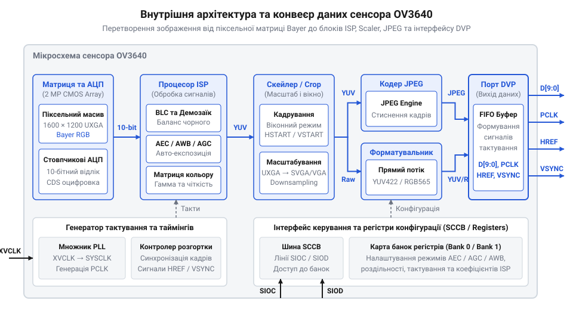
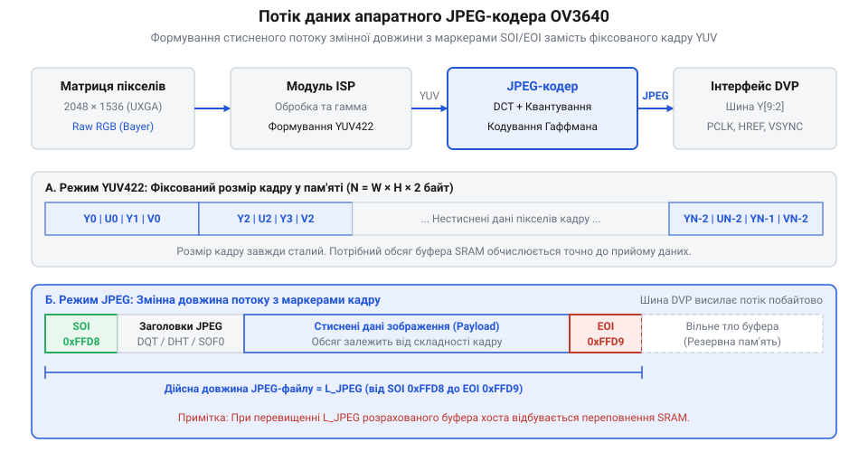
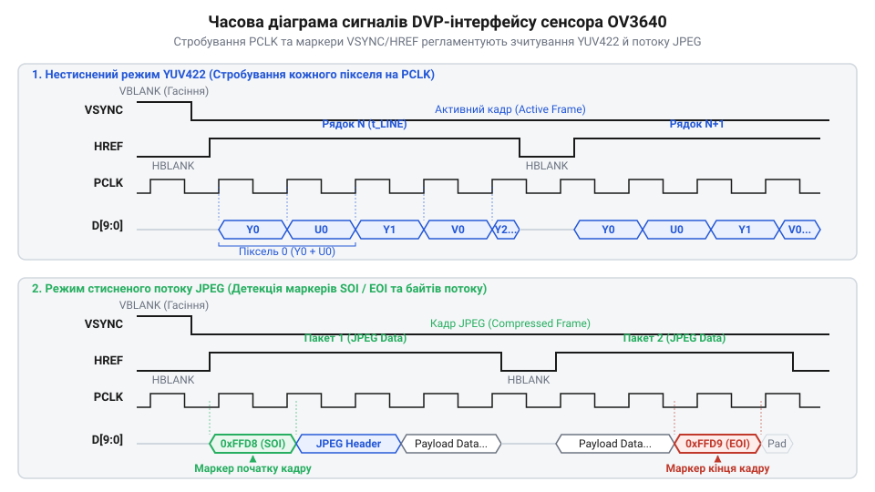
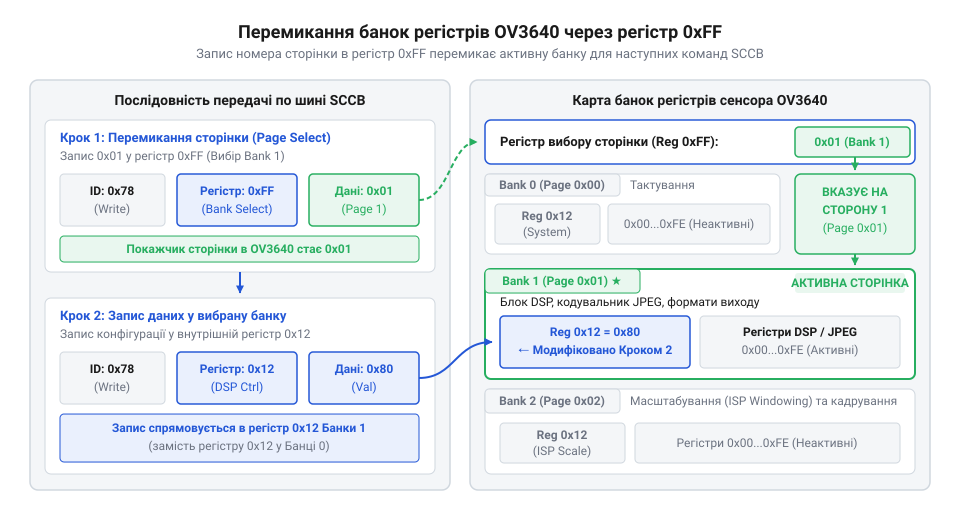

# Огляд матриці та регістрів сенсора OV3640

<preknowlist>
- [Принцип корельованої подвійної вибірки (CDS) у CMOS-сенсорах](root:hw-sensing/correlated-double-sampling) — метод пригнічення kTC-шуму скидання фотодіода через подвійне вимірювання напруги.
- [Протокол шини SCCB](root:com-devices/sccb-bus-protocol-architecture) — фізичні параметри та специфіка фаз обміну двопровідного інтерфейсу керування.
- [Демозаїка матриці Байєра](root:sf-visual/raw-processing-pipeline) — принцип просторової інтерполяції трьох колірних компонентів з масиву Bayer RGB.
- [Парсер маркерів JPEG](root:com-signal/jpeg-stream-parsing-and-marker-processing) — функціональне призначення службових маркерів SOI та EOI для визначення меж кадру.
</preknowlist>

## Проблема пам'яті та апаратне стиснення

Пряме захоплення нестисненого кадру високої роздільності в оперативну пам'яті мікроконтролера викликає її переповнення. Світлочутлива матриця сенсора @@en|OV3640@@ (англ. @@en|CMOS@@, від @@en|Complementary Metal-Oxide-Semiconductor@@ — комплементарний метал-оксид-напівпровідник) має роздільність `2048 × 1536` пікселів (`3.15` Мп). У `16`-бітному колірному форматі @@en|RGB565@@ обсяг кадру становить:

```
V = W × H × B
  = 2048 × 1536 × 2    [обчислення обсягу кадру RGB565]
  = 6291456            [необхідний обсяг пам'яті в байтах]
```

Ці `6.29` МБ значно перевищують обсяг внутрішньої оперативної пам'яті (англ. @@en|SRAM@@, від @@en|Static Random-Access Memory@@ — статична оперативна пам'ять) вбудованих процесорів (десятки чи сотні кілобайтів).


*Внутрішня блок-схема сенсора OV3640 з інтегрованими матрицею, ISP та кодером JPEG.*

Тому сенсор реалізовано як систему на кристалі (англ. @@en|SoC@@, від @@en|System on a Chip@@ — система на кристалі) з вбудованим апаратним кодером @@en|JPEG@@ (англ. @@en|Joint Photographic Experts Group@@). Він стискає зображення під час зчитування з матриці у `10`–`50` разів — до `100`–`300` КБ. Завдяки цьому мікроконтролер через цифровий відеопорт (англ. @@en|DVP@@, від @@en|Digital Video Port@@) приймає дані порціями в кільцевий буфер прямого доступу до пам'яті (англ. @@en|DMA@@, від @@en|Direct Memory Access@@ — прямий доступ до пам'яті) і відразу відправляє у сховище, не зберігаючи повний кадр в @@en|SRAM@@.

## Формування та первинна обробка кадру

Світлочутлива матриця з фільтрами @@en|Bayer RGB@@ накопичує заряд відповідно до інтенсивності світла. Зчитувальні схеми застосовують [метод пригнічення kTC-шуму](root:hw-sensing/correlated-double-sampling) (англ. @@en|CDS@@, від @@en|Correlated Double Sampling@@), а `10`-бітний аналого-цифровий перетворювач (англ. @@en|ADC@@) видає потік @@en|Raw RGB@@.

Далі конвеєр обробки зображень (англ. @@en|ISP@@, від @@en|Image Signal Processor@@) виконує корекцію експозиції (англ. @@en|AEC@@), баланс білого (англ. @@en|AWB@@) та [демозаїку колірних компонентів](root:sf-visual/raw-processing-pipeline). Апаратна обробка звільняє @@en|CPU@@ від математичних обчислень, видаючи готовий колірний потік.

## Масштабування та кодування в JPEG

Перед кодуванням кадру блок обрізання (англ. @@en|Cropping@@), блок пропуску пікселів (англ. @@en|Sub-sampling@@) та інтерполяційний скалер (англ. @@en|Scaler@@) адаптують геометрію зображення до потрібної роздільності, після чого масив перетворюється з @@en|RGB@@ у простір @@en|YUV@@.


*Послідовність перетворення масиву YUV у стиснений бітовий потік JPEG з маркерами.*

Підготовлений потік @@en|YUV@@ надходить до кодера @@en|JPEG@@, де зображення розбивається на блоки `8 × 8` пікселів, проходить дискретне косинусне перетворення (англ. @@en|DCT@@, від @@en|Discrete Cosine Transform@@ — дискретне косинусне перетворення), квантування коефіцієнтів та стиснення за методом Хаффмана (англ. @@en|Huffman@@).

На виході формується бітовий потік зі змінною довжиною кадру, залежною від деталей сцени. Для локалізації меж кадру мікроконтролером у потік вставляються [маркери початку та кінця зображення](root:com-signal/jpeg-stream-parsing-and-marker-processing) — @@en|SOI@@ (`0xFFD8`, від англ. @@en|Start of Image@@) та @@en|EOI@@ (`0xFFD9`, від англ. @@en|End of Image@@).

## Синхронізація інтерфейсу DVP та регістри

Паралельний цифровий відеопорт (англ. @@en|DVP@@, від @@en|Digital Video Port@@) передає відеодані через `8`- або `10`-бітну шину `D[9:0]` за трьома сигналами синхронізації: тактом `PCLK` (англ. @@en|PCLK@@, від @@en|Pixel Clock@@) для стробування байта, стробом рядка `HREF` (англ. @@en|HREF@@, від @@en|Horizontal Reference@@) та імпульсом кадрової синхронізації `VSYNC` (англ. @@en|VSYNC@@, від @@en|Vertical Synchronization@@).


*Синхронізація передачі піксельних даних та меж кадрів через паралельний відеопорт.*

Конфігурація сенсора виконується через двопровідну [шину SCCB](root:com-devices/sccb-bus-protocol-architecture) (англ. @@en|SCCB@@, від @@en|Serial Camera Control Bus@@). Щоб обійти обмеження `8`-бітного простору адресації (`256` регістрів), застосовано банківську організацію: запис номера банки в системний регістр `0xFF` перемикає область адресації `0x00`–`0xFE` на відповідні конфігураційні параметри.


*Адресація розширеного регістрового простору OV3640 через запис номера банки в регістр 0xFF.*

:::tabs
```c|esp-idf
#include <stdint.h>
#include <stdbool.h>

// Низькорівневий запис значення в регістр OV3640 через SCCB
bool ov3640_write_reg(uint8_t reg_addr, uint8_t value);

// Вибір активної регістрової банки сенсора OV3640
bool ov3640_select_bank(uint8_t bank_id) {
    // Системний регістр 0xFF виконує перемикання банок регістрової карти
    return ov3640_write_reg(0xFF, bank_id);
}
```
```cpp|esp-idf
#include <cstdint>

class Ov3640Sensor {
public:
    virtual bool writeRegister(std::uint8_t regAddr, std::uint8_t value) = 0;

    // Вибір активної регістрової банки сенсора OV3640
    bool selectBank(std::uint8_t bankId) {
        // Системний регістр 0xFF виконує перемикання банок регістрової карти
        return writeRegister(0xFF, bankId);
    }
};
```
:::

Частота тактування пікселів `PCLK` формується внутрішнім блоком фазового автопідстроювання частоти (англ. @@en|PLL@@, від англ. @@en|Phase-Locked Loop@@) від вхідного джерела `XVCLK`:

```
f_PCLK = (f_XVCLK × M) ÷ N    [множення та ділення частоти в блоці PLL]
```

Помилка в обчисленні коефіцієнтів `PLL` призводить до перевищення частоти прийому периферійним модулем камери (англ. @@en|DCMI@@, від @@en|Digital Camera Interface@@) і переповнення буфера @@en|DMA@@. Типовими збоями при налагодженні є інверсія полярності сигналів `HREF` або `VSYNC` у регістрах сенсора, що спричиняє втрату синхронізації, а також зависання шини @@en|SCCB@@ через відсутність підтягувальних резисторів чи спробу запису без перемикання банки.