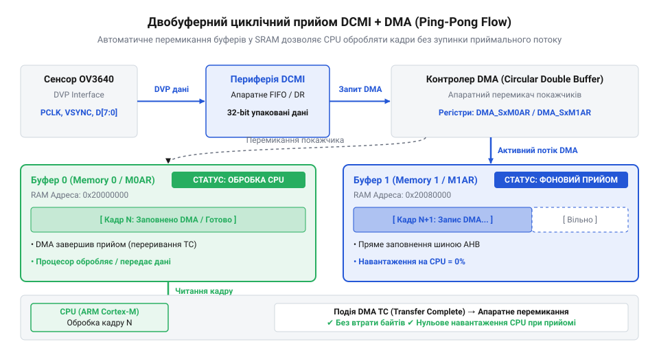

# Захоплення зображень YUV та стисненого JPEG з OV3640 на мікроконтролері STM32 через DVP та DMA

## Проблема прийому високошвидкісного відеопотоку мікроконтролером

Зчитування даних із матриці камери через програмне опитування контактів загального призначення (@@en|GPIO@@) або використання звичайних переривань для кожного пікселя є першим інтуїтивним підходом, але він швидко призводить до пропуску даних. Під час передачі відеопотоку камера генерує дані на високій швидкості, яка визначається тактовим сигналом пікселів. Навіть для порівняно невеликої роздільної здатності кадри надходять сотнями тисяч байтів за секунду. 

Якщо процесор намагається обробляти кожен байт програмно, він витрачає всі свої обчислювальні ресурси лише на перекладання даних із порту вводу-виводу до пам'яті. Коли виникає інше переривання або завдання, яке потребує часу, процесор не встигає прочитати наступний піксель. Це руйнує цілісність кадру, оскільки частина зображення втрачається безповоротно. Відповідно, програмний прийом не підходить для високошвидкісних потоків. Необхідно використовувати апаратні блоки, які самостійно узгоджують тактові сигнали, приймають дані та зберігають їх у пам'яті автономно від ядра процесора. Саме для цього розроблено паралельний інтерфейс @@en|DVP@@ та периферійний модуль @@en|DCMI@@.

## Апаратне узгодження шини DVP камери

Для передачі цифрового відеопотоку камера OV3640 використовує паралельний інтерфейс @@en|DVP@@ (Digital Video Port). Цей інтерфейс забезпечує синхронну передачу даних за допомогою кількох керуючих ліній та 8-бітної шини даних `D[7:0]`.

Ключовим елементом передачі є тактовий сигнал пікселів `PCLK` (Pixel Clock). З кожним імпульсом `PCLK` на шині даних з'являється новий валідний байт пікселя або частини пікселя. Щоб мікроконтролер міг розрізнити, де починається новий рядок і де починається новий кадр, камера формує два додаткові сигнали: `HREF` (Horizontal Reference) та `VSYNC` (Vertical Sync). Сигнал `HREF` активний протягом передачі видимих пікселів одного рядка, а `VSYNC` позначає межі всього кадру. 

![Часова діаграма сигналів PCLK, VSYNC, HREF та шини даних D[7:0] паралельного інтерфейсу DVP під час передачі кадру.](img/ov3640-dvp-timing-diagram.svg)
*Часова діаграма сигналів PCLK, VSYNC, HREF та шини даних D[7:0] паралельного інтерфейсу DVP під час передачі кадру.*

При фізичному підключенні камери до мікроконтролера STM32 важливо узгодити частоти. STM32 повинен забезпечити камері опорний тактовий сигнал `XCLK` — зазвичай це реалізується апаратно шляхом виведення тактової частоти мікроконтролера (наприклад, від PLL) назовні через спеціальний вивід MCO (Microcontroller Clock Output). На основі цього сигналу внутрішній генератор камери формує `PCLK`. Частота `PCLK` має бути достатньо високою для передачі обраної кількості кадрів на секунду, але при цьому не перевищувати можливостей периферійного модуля мікроконтролера. Також необхідно враховувати паразитну ємність з'єднувальних провідників та рівні напруги: лінії повинні бути якомога коротшими для уникнення спотворень високочастотних сигналів.

## Конфігурація DCMI та кільцевого DMA

Щоб зняти навантаження з процесора, для прийому даних із шини @@en|DVP@@ використовується периферійний модуль @@en|DCMI@@ (Digital Camera Memory Interface). Він апаратно підключається до ліній `PCLK`, `VSYNC`, `HREF` та шини даних. @@en|DCMI@@ самостійно відстежує сигнали синхронізації, захоплює кожен байт за фронтом `PCLK` і формує 32-бітні слова для подальшої передачі.

Оскільки @@en|DCMI@@ лише захоплює дані, але не зберігає їх, йому необхідний прямий доступ до пам'яті — @@en|DMA@@ (Direct Memory Access). @@en|DCMI@@ переспрямовує потік слів до контролера @@en|DMA@@, який записує їх у виділений буфер в оперативній пам'яті (RAM) без жодної участі процесора.


*Схема руху потоку піксельних даних від периферійного модуля DCMI через двохбуферний циклічний DMA у пам'ять SRAM.*

Для забезпечення безперервного прийому даних застосовується режим подвійного кільцевого буфера (@@en|Ping-Pong@@). @@en|DMA@@ налаштовується на роботу з двома окремими буферами однакового розміру. Поки @@en|DMA@@ заповнює перший буфер, процесор може безпечно обробляти або копіювати дані з другого. Щойно перший буфер заповнюється, @@en|DMA@@ автоматично перемикається на другий, генеруючи переривання повноти буфера. Це дозволяє програмному забезпеченню встигати за відеопотоком, не перериваючи апаратного захоплення.

Розмір DMA-буферів обирається як компроміс між частотою переривань та обсягом доступної пам'яті. Занадто малий буфер генеруватиме переривання надто часто, перевантажуючи ядро процесора; занадто великий — збільшить затримку обробки й споживатиме зайву оперативну пам'ять. У наведеній реалізації буфери вміщують по 16 кілобайтів (4096 слів). Зважаючи на архітектуру шинної матриці мікроконтролерів STM32, ці буфери розташовуються в основній ділянці пам'яті SRAM, до якої контролер DMA має прямий доступ, оскільки спеціалізовані ділянки (наприклад, CCM або TCM RAM) можуть бути доступні лише безпосередньо процесору.

Програмна реалізація драйвера ініціалізації OV3640 та налаштування @@en|DCMI@@ й @@en|DMA@@ для захоплення відеопотоку наведена нижче:

:::tabs
```c|stm32
:::code proj-stm32-ov3640-dvp-jpeg-capture/c/include/dcmi_dma.h
:::code proj-stm32-ov3640-dvp-jpeg-capture/c/include/ov3640.h
:::code proj-stm32-ov3640-dvp-jpeg-capture/c/src/dcmi_dma.c
:::code proj-stm32-ov3640-dvp-jpeg-capture/c/src/main.c
:::code proj-stm32-ov3640-dvp-jpeg-capture/c/src/ov3640.c
```
```cpp|stm32
:::code proj-stm32-ov3640-dvp-jpeg-capture/cpp/include/dcmi_dma_manager.hpp
:::code proj-stm32-ov3640-dvp-jpeg-capture/cpp/include/jpeg_stream_parser.hpp
:::code proj-stm32-ov3640-dvp-jpeg-capture/cpp/include/ov3640_camera.hpp
:::code proj-stm32-ov3640-dvp-jpeg-capture/cpp/include/ov3640_registers.hpp
:::code proj-stm32-ov3640-dvp-jpeg-capture/cpp/include/sccb_bus.hpp
:::code proj-stm32-ov3640-dvp-jpeg-capture/cpp/src/dcmi_dma_manager.cpp
:::code proj-stm32-ov3640-dvp-jpeg-capture/cpp/src/jpeg_stream_parser.cpp
:::code proj-stm32-ov3640-dvp-jpeg-capture/cpp/src/main.cpp
:::code proj-stm32-ov3640-dvp-jpeg-capture/cpp/src/ov3640_camera.cpp
:::code proj-stm32-ov3640-dvp-jpeg-capture/cpp/src/sccb_bus.cpp
```
:::

Переривання кадрової синхронізації @@en|DCMI@@ сповіщають ядро про успішне завершення кадру або про помилки переповнення (коли @@en|DMA@@ не встигає записати дані). Після базового налаштування апаратного захоплення камера конфігурується через [Конфігурація регістрів тактування OV3640 через SCCB](root:cat-hw-sensors/ov3640-sccb-register-configuration) для вибору роздільної здатності та формату вихідних даних.

## Конфігурування регістрів OV3640 через SCCB

Будь-який сенсор зображення потребує початкового налаштування: роздільна здатність, формат пікселів, тактова частота — усе це задається через внутрішні регістри. Для OV3640 таким інтерфейсом керування є шина SCCB (Serial Camera Control Bus), яка електрично та логічно сумісна зі стандартним I2C. Сенсор виступає підлеглим пристроєм із базовою адресою `0x3C`, приймаючи команди від мікроконтролера. Без правильної ініціалізації DCMI не отримає жодного байта, оскільки сенсор перебуватиме у стані сну або генеруватиме шум замість очікуваних даних.

Процес ініціалізації починається з апаратного та програмного скидання. Спершу лінія живлення PWDN переводиться в активний стан, після чого мікроконтролер надсилає команду скидання через SCCB. Лише після цього можна перевіряти ідентифікатор мікросхеми (Chip ID), щоб переконатися у наявності зв'язку.

:::code proj-stm32-ov3640-dvp-jpeg-capture/c/src/ov3640.c 86-129

Коли базовий зв'язок встановлено, мікроконтролер завантажує масив конфігураційних регістрів. Для OV3640 це не просто кілька налаштувань, а сотні значень, які визначають роботу матриці, блоку цифрової обробки сигналів (DSP) та гамма-корекції. Наприклад, щоб увімкнути формат JPEG, необхідно активувати апаратний енкодер та налаштувати дільник тактової частоти PCLK. Якщо PCLK буде занадто швидким, контролер DMA не встигатиме забирати дані, що призведе до переповнення буфера.

:::code proj-stm32-ov3640-dvp-jpeg-capture/c/src/ov3640.c 49-54

Детальніше про налаштування частот і дільників можна прочитати у [Конфігурація регістрів тактування OV3640 через SCCB](root:cat-hw-sensors/ov3640-sccb-register-configuration). 

## Обробка кадрів YUV422 та JPEG

Апаратне захоплення відеопотоку через DCMI та DMA суттєво відрізняється залежно від формату. YUV422 генерує кадри фіксованого розміру, де кожен піксель завжди займає рівно два байти. Мікроконтролер точно знає, скільки даних надійде, тому може покладатися на переривання завершення кадру (Frame Event). Проте з JPEG ситуація інша: через стиснення розмір кадру стає змінним і непередбачуваним. DCMI не розуміє стиснення і просто передає потік байтів, тому межі кадру доводиться шукати самостійно за допомогою специфічних маркерів.

Потік JPEG завжди починається з маркера SOI (Start of Image, `0xFFD8`) і закінчується маркером EOI (End of Image, `0xFFD9`). Оскільки DMA працює у режимі подвійного кільцевого буфера, дані надходять порціями. Завдання програми — аналізувати кожну таку порцію у фоновому режимі, не зупиняючи прийом наступних даних.

:::code proj-stm32-ov3640-dvp-jpeg-capture/c/src/dcmi_dma.c 193-238

Цей неблокуючий аналізатор послідовно перевіряє кожен байт. Коли знайдено SOI, програма починає складати дані у великий вихідний буфер. Щойно зустрічається EOI, поточний кадр вважається завершеним, і програма може передати його на подальшу обробку чи збереження. Якщо ж вихідний буфер переповнюється до появи EOI, це свідчить про пошкодження потоку або недостатній розмір виділеної пам'яті. У такому разі стан парсера скидається, щоб не зберегти битий кадр.

:::code proj-stm32-ov3640-dvp-jpeg-capture/cpp/src/jpeg_stream_parser.cpp 34-73

У C++ варіанті ця логіка інкапсульована у класі `JpegStreamParser`, який бере на себе відстеження стану автомата (State Machine) та рахує кількість оброблених кадрів і помилок переповнення.

## Діагностика збоїв та аналіз осцилограм

Навіть при ідеально написаному коді система може не працювати через апаратні неузгодженості. Найчастіша проблема — розсинхронізація сигналів DVP. Якщо зображення зсунуте, має розірвані рядки або інтерфейс DCMI фіксує помилки (Overrun), першим кроком має бути перевірка осцилограм сигналів VSYNC, HREF та PCLK.

Апаратна периферія DCMI в STM32 дуже чутлива до полярності сигналів. Наприклад, якщо сенсор видає активний високий VSYNC, а DCMI налаштовано на активний низький, контролер почне приймати дані в момент кадрового імпульсу, а не під час передачі рядків. Це призведе до повної каші у буфері. Правильну полярність можна виставити, проаналізувавши реальні рівні за допомогою логічного аналізатора.

Інша критична точка — фаза сигналу PCLK. Дані на лініях `D[7:0]` повинні бути стабільними в момент зчитування (зазвичай по наростаючому або спадаючому фронту PCLK). Якщо фронт збігається з перемиканням даних, виникають випадкові биті пікселі (шум). Розв'язок — зміна налаштувань полярності PCLK у регістрах DCMI або інверсія тактування на боці OV3640.

:::code proj-stm32-ov3640-dvp-jpeg-capture/c/src/dcmi_dma.c 117-156

Якщо виникає помилка переповнення буфера (Overrun Error), це означає, що шина пам'яті або контролер DMA не встигають записувати дані. У цьому випадку обробник переривань фіксує збій та інформує програму через зворотний виклик. Щоб усунути Overrun, необхідно збільшити дільник частоти PCLK у регістрах OV3640, тим самим зменшивши швидкість потоку даних, або ж перенести DMA-буфери у швидшу пам'ять мікроконтролера (наприклад, внутрішню SRAM замість зовнішньої SDRAM).