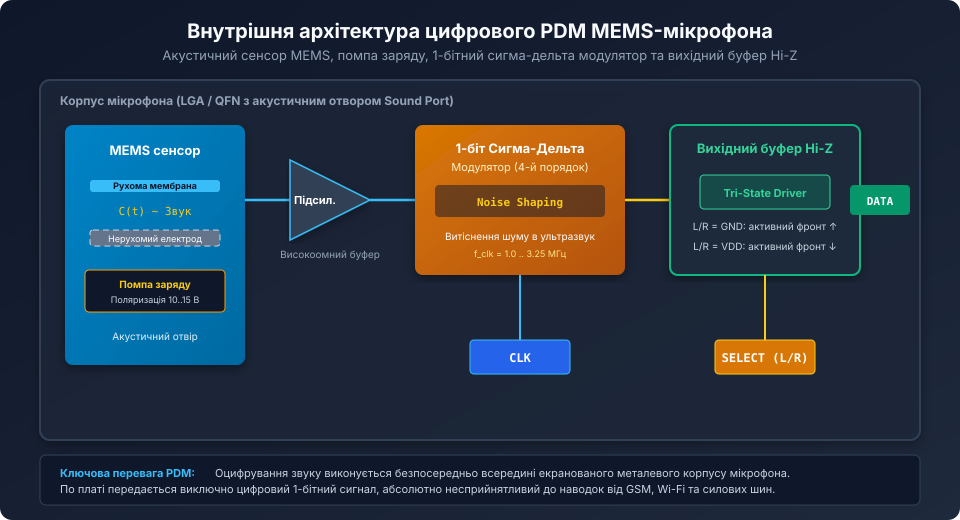
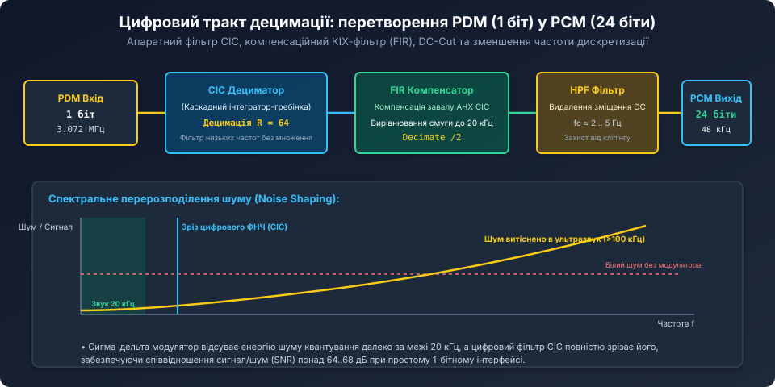
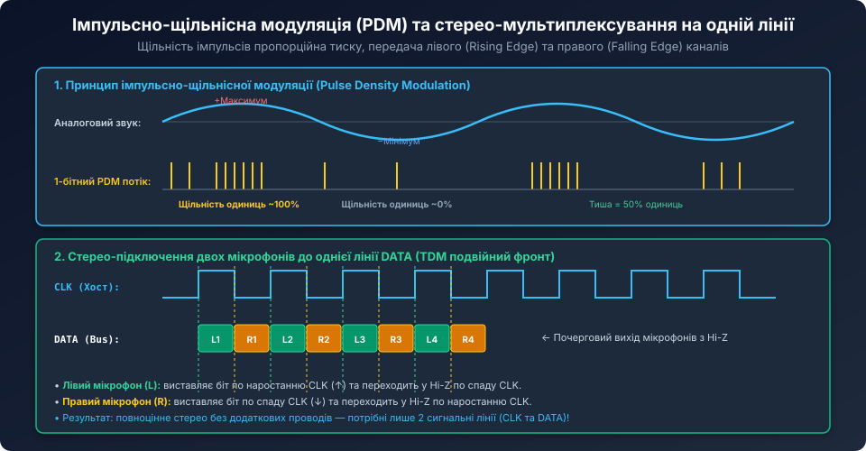

# Поглиблений аналіз сигма-дельта модуляції, цифрових CIC-фільтрів та децимації PDM-аудіо

<preknowlist>
- [PDM MEMS-мікрофони та цифрова децимація](root:cat-hw-sensors/pdm-mems-microphones) — базовий огляд принципу PDM, стерео-мультиплексування та порівняння з I2S.
- [MEMS-мікрофони з інтерфейсом I2S](root:cat-hw-sensors/i2s-mems-microphone) — архітектура аудіотракту та часова сітка PCM.
- [Конфігурація та усереднення вимірювань INA226](root:cat-hw-sensors/ina226-config-and-averaging) — принципи роботи сигма-дельта перетворювачів та фільтрації.
</preknowlist>

## Математична теорія сигма-дельта модуляції та формування шуму (Noise Shaping)

В основі цифрового PDM-мікрофона лежить 1-бітний сигма-дельта модулятор високого порядку (зазвичай `N = 4` або `N = 5`). На відміну від звичайних АЦП порозрядного наближення (SAR), де шум квантування рівномірно розподілений у смузі Найквіста, сигма-дельта перетворювач використовує надлишкову дискретизацію (Oversampling) у поєднанні з фільтрацією помилки зворотного зв'язку.



У Z-області рівняння ідеального сигма-дельта модулятора порядку `N` має вигляд:

```text
Y(z) = X(z) * z^-k + E(z) * (1 - z^-1)^N
```

де:
- `X(z)` — вхідний аналоговий звуковий сигнал;
- `E(z)` — помилка квантування 1-бітного компаратора (яка моделюється як адитивний білий шум);
- `STF(z) = z^-k` — передавальна функція корисного сигналу (Signal Transfer Function), що являє собою просту затримку на кілька тактів;
- `NTF(z) = (1 - z^-1)^N` — передавальна функція шуму квантування (Noise Transfer Function).

Оператор `(1 - z^-1)` діє в частотній області як дискретний диференціатор — тобто фільтр високих частот. 

Підставивши `z = exp(i * 2 * pi * f / f_s)`, модуль передавальної функції шуму набуває вигляду:

```text
|NTF(f)| = [ 2 * sin( pi * f / f_s ) ]^N
```

На низьких звукових частотах (`f << f_s`, де `f_s` становить 3.072 МГц, а звукова смуга обмежена 20 кГц) значення `sin(pi * f / f_s)` прямує до нуля. Таким чином, коефіцієнт передачі шуму в звуковому діапазоні зменшується пропорційно `(2 * pi * f / f_s)^N`.

Кожне подвоєння коефіцієнта децимації `OSR = f_s / (2 * f_audio)` збільшує динамічний діапазон (SNR) системи на:

```text
delta_SNR = (6.02 * N + 1.76) дБ на кожну октаву OSR
```

Для модулятора 4-го порядку (`N = 4`) при `OSR = 64` досягається теоретичне придушення шуму квантування в звуковій смузі понад 85 дБ, що значно перевищує динамічний діапазон самої механічної мембрани MEMS (типово 64..68 дБ SNR).

## Теорія та розрахунок CIC-дециматора (Cascaded Integrator-Comb)

Оскільки вихідний потік PDM надходить із надзвичайно високою частотою (до 3.25 МГц), використання класичних КІХ-фільтрів (FIR) з сотнями множників на кожну вибірку перевантажило б процесор або вимагало б надмірної площі кристала.



Для першого етапу децимації застосовують **фільтр Хогенауера (Hogenauer Filter)**, або **CIC (Cascaded Integrator-Comb)**. Головна перевага CIC-фільтра — **повна відсутність операцій множення**: він будується виключно на дискретних суматорах (Integrators) та віднімачах (Combs).

Передавальна функція децимуючого CIC-фільтра порядку `K` з фактором децимації `R` описується рівнянням:

```text
H(z) = [ (1 - z^-R) / (1 - z^-1) ]^K = [ sum_{i=0}^{R-1} z^-i ]^K
```

### 1. Зростання розрядності регістрів (Bit Growth)
Щоб уникнути переповнення під час інтегрування, розрядність внутрішніх акумуляторів CIC повинна поступово зростати. Максимальна розрядність вихідного слова на виході K-го каскаду розраховується за формулою Хогенауера:

```text
B_max = B_in + K * ceil( log2(R) )
```

де `B_in = 1 біт` (вхідний PDM потік).
Для фільтра 5-го порядку (`K = 5`) при децимації `R = 64`:

```text
log2(64) = 6
B_max = 1 + 5 * 6 = 31 біт
```

Отже, для коректної роботи 5-каскадного дециматора без втрати точності внутрішні регістри інтеграторів повинні мати ширину не менше **31 біта** (на практиці використовують стандартні 32-бітні цілочисельні регістри із переповненням за модулем 2^32, яке завдяки властивостям доповняльного коду автоматично компенсується в блоці гребінчастих фільтрів).

### 2. Компенсація спаду амплітудно-частотної характеристики (Passband Droop)
Амплітудна характеристика CIC-фільтра має форму піднесеної до степеня функції sinc:

```text
|H(f)| = [ sin(pi * f * R / f_s) / (R * sin(pi * f / f_s)) ]^K
```

У верхній частині звукової смуги (біля 15..20 кГц) АЧХ фільтра має помітний завал (Passband Droop) глибиною від 1 до 4 дБ. Для вирівнювання звуку після CIC-каскаду встановлюють компенсаційний FIR-фільтр низького порядку (Half-Band FIR Filter), частотна характеристика якого має зворотний підйом: `1 / |H(f)|`.

## Апаратний блок STM32 DFSDM (Digital Filter for Sigma-Delta Modulators)

У високопродуктивних мікроконтролерах сімейств STM32F4/F7/H7 та STM32MP1 децимація PDM реалізована в окремому апаратному периферійному блоці **DFSDM**:



Архітектурні особливості DFSDM:
1. **Багатоканальний вхід:** підтримує до 8 незалежних каналів PDM, дозволяючи будувати фазовані антенні мікрофонні решітки (Beamforming Arrays).
2. **Апаратний Sinc-фільтр з вибором порядку:** можливість вибору порядку від `Sinc1` до `Sinc5`. Для якісного аудіо зазвичай обирають `Sinc3` або `Sinc4` при `FOSR = 64`.
3. **Акустичний сторожовий таймер (Analog Watchdog / Wake-on-Sound):** дозволяє мікроконтролеру перебувати у глибокому сні (Stop Mode), доки енергія звуку в приміщенні не перевищить заданий рівень децибелів. При появі звуку (бавовна в долоні, голос) DFSDM апаратно будить ядро процесора за лічені мікросекунди.

## Програмна оптимізація CIC-дециматора на C (ARM Cortex-M4/M7)

Для мікроконтролерів, які не мають апаратного блоку DFSDM (наприклад, Cortex-M4 з інтерфейсом SPI/I2S, що приймає PDM як потік слів `uint32_t`), децимація може бути реалізована програмно за допомогою оптимізованого алгоритму:

```c
#include <stdint.h>
#include <stddef.h>

#define PDM_DECIMATION_FACTOR   64

// Стан інтеграторів та гребінок 3-каскадного CIC (K = 3)
typedef struct {
    int32_t i1, i2, i3;      // 3 каскади інтеграторів (частота 3.072 МГц)
    int32_t c1_d, c2_d, c3_d;// Регістри затримки гребінок (частота 48 кГц)
    int32_t hpf_prev_in;     // Регістри фільтра відсікання постійної складової (DC-cut)
    int32_t hpf_prev_out;
} cic3_filter_t;

void cic3_init(cic3_filter_t *f) {
    f->i1 = f->i2 = f->i3 = 0;
    f->c1_d = f->c2_d = f->c3_d = 0;
    f->hpf_prev_in = 0;
    f->hpf_prev_out = 0;
}

// Обробка одного 64-бітного блоку PDM (перетворюється на один 24-бітний відлік PCM)
int32_t cic3_process_64bits(cic3_filter_t *f, uint64_t pdm_bits) {
    // 1. Інтегратори працюють на повній частоті бітового потоку (64 кроки)
    for (int b = 63; b >= 0; b--) {
        // Трансляція біта: 1 -> +1, 0 -> -1
        int32_t x = ((pdm_bits >> b) & 1) ? 1 : -1;

        f->i1 += x;
        f->i2 += f->i1;
        f->i3 += f->i2;
    }

    // 2. Децимація: зчитування виходу 3-го інтегратора 1 раз на 64 такти
    int32_t decimated_sample = f->i3;

    // 3. Гребінчасті фільтри (Comb stages, працюють на частоті 48 кГц)
    // Диференціатор 1
    int32_t comb1 = decimated_sample - f->c1_d;
    f->c1_d = decimated_sample;

    // Диференціатор 2
    int32_t comb2 = comb1 - f->c2_d;
    f->c2_d = comb1;

    // Диференціатор 3
    int32_t comb3 = comb2 - f->c3_d;
    f->c3_d = comb2;

    // 4. Масштабування розрядності до 24-бітного звуку (ділення на коефіцієнт підсилення R^K = 64^3 = 262144)
    // 262144 = 2^18, тобто зсув праворуч на 18 розрядів (>> 18)
    int32_t scaled_pcm = comb3 >> 2; // Масштабовано під 24-бітний діапазон

    // 5. Цифровий ФВЧ першого порядку (DC-Cut): y[n] = x[n] - x[n-1] + 0.995 * y[n-1]
    int32_t hpf_out = scaled_pcm - f->hpf_prev_in + ((f->hpf_prev_out * 1019) >> 10);
    f->hpf_prev_in = scaled_pcm;
    f->hpf_prev_out = hpf_out;

    return hpf_out;
}
```

## Акустичні мікрофонні решітки (Beamforming)

Завдяки строго синфазному тактуванню від єдиного генератора `CLK` група з 4..8 PDM-мікрофонів, розміщених на одній друкованій платі (наприклад, по колу діаметром 60–100 мм), утворює когерентну антенну решітку.

Мікроконтролер або DSP обчислює взаємну затримку приходу звукової хвилі між мікрофонами з точністю до одного такту PDM (близько 325 наносекунд, що відповідає просторовій роздільній здатності по повітрю `340 м/с * 325 нс ≈ 0.11 мм`!). 

Застосування алгоритмів затримки та додавання (Delay-and-Sum Beamforming):
- Формує вузький просторовий промінь спрямованості безпосередньо в бік мовця;
- Забезпечує придушення сторонніх шумів приміщення, відлуння (Acoustic Echo Cancellation) та реверберації на 12–20 дБ без спотворення тембру корисного голосу.

Поєднання апаратної простоти, стійкості до наводок та гнучкості цифрової децимації робить PDM MEMS-мікрофони фундаментом сучасних промислових та споживчих акустичних систем високої роздільної здатності.
