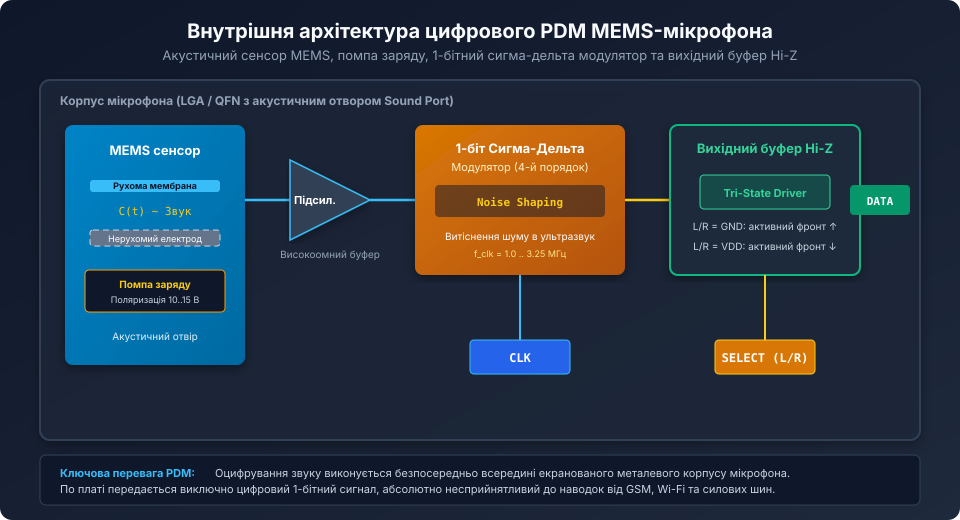
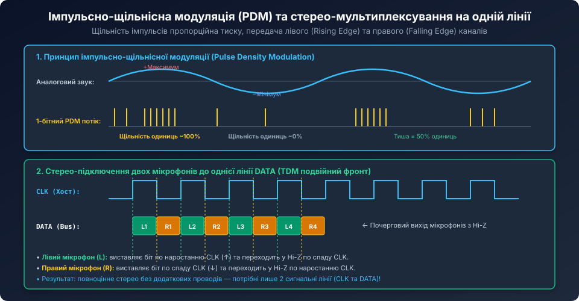
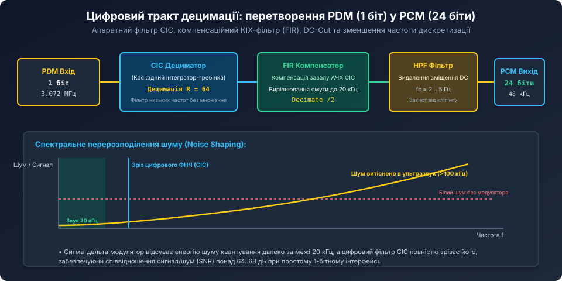

# PDM MEMS-мікрофони та цифрова децимація

<preknowlist>
- [MEMS-мікрофони з інтерфейсом I2S](root:cat-hw-sensors/i2s-mems-microphone) — архітектура цифрового звуку, тактування BCLK/WS та формати PCM.
- [Аналогові модулі мікрофонів з компаратором LM393](root:cat-hw-sensors/sound-lm393) — базові принципи акустичних перетворювачів та порогового детектування.
- [Огляд пасивних інфрачервоних давачів руху (PIR)](root:cat-hw-sensors/pir-motion-sensors-overview) — обробка низькоамплітудних сенсорних сигналів.
</preknowlist>

## Будова та принцип дії цифрового MEMS-мікрофона

У сучасних смартфонах, голосових асистентах, системах розпізнавання мови та мікрофонних решітках (Microphone Arrays) класичні електретні мікрофони (ECM) практично повністю витіснені мініатюрними напівпровідниковими **MEMS-мікрофонами (Micro-Electro-Mechanical Systems)**.

Головна відмінність цифрових MEMS-мікрофонів полягає в тому, що аналогово-цифрове перетворення звуку відбувається безпосередньо всередині металевого або керамічного корпусу мікрофона на кристалі інтегральної схеми (ASIC).



Конструктивно цифровий MEMS-мікрофон складається з двох кристалів, об'єднаних в одному корпусі:
1. **Акустичний MEMS-сенсор:** кремнієва пластина з мікроскопічною рухомою мембраною товщиною менше 1 мкм та перфорованим нерухомим електродом (Backplate). Звукові коливання тиску повітря, що надходять крізь отвір у корпусі (Sound Port), згинають мембрану, змінюючи електричну ємність конденсатора (типово 1 .. 2 пФ).
2. **Інтегральна схема ASIC:** містить помпу заряду (Charge Pump), яка формує стабільну напругу поляризації конденсатора 10–15 В, надвисокоомний підсилювач-буфер, тактовий генератор та високошвидкісний **1-бітний сигма-дельта модулятор**.

На виході мікрофона формується не паралельний багатобітний код, а високочастотний 1-бітний цифровий потік даних — **PDM (Pulse Density Modulation)**. Завдяки цьому по друкованій платі передаються виключно стійкі цифрові рівні 0/1, що робить лінію мікрофона абсолютно нечутливою до високочастотних радіозавад від антен Wi-Fi, Bluetooth та GSM-модемів.

## Імпульсно-щільнісна модуляція (PDM) та спектральне формування шуму

У класичному цифровому звуковому потоці PCM (Pulse Code Modulation, застосовуваному в I2S) звук передається багатобітними вибірками (наприклад, 16 або 24 біти) з частотою дискретизації 44.1 або 48 кГц.

На відміну від PCM, в інтерфейсі **PDM (Pulse Density Modulation — імпульсно-щільнісна модуляція)** інформація кодується виключно **відносною щільністю одиниць** у безперервному 1-бітному потоці, що тактується зовнішньою частотою `f_clk` (зазвичай від 1.0 МГц до 3.25 МГц, типово 3.072 МГц):



- **Стан акустичної тиші (нульовий звуковий тиск):** потік містить строго рівну кількість нулів та одиниць — середня щільність становить рівно 50% (`...10101010...`).
- **Позитивний півперіод звукової хвилі:** щільність одиниць зростає пропорційно амплітуді тиску, наближаючись на піку до 100% (`...1111011111...`).
- **Негативний півперіод звукової хвилі:** щільність одиниць падає, наближаючись на піку розрідження до 0% (`...0000100000...`).

### Формування шуму квантування (Noise Shaping)

Як 1-бітний потік може забезпечити студійну якість звуку зі співвідношенням сигнал/шум понад 65 дБ? 

При 1-бітному квантуванні звичайний шум дискретизації є колосальним. Проте вбудований у мікрофон сигма-дельта модулятор 4-го або 5-го порядку реалізує механізм **Noise Shaping (спектральне витіснення шуму)**:
1. Завдяки глибокому негативному зворотному зв'язку з інтеграторами енергія шуму квантування у звуковому діапазоні (від 20 Гц до 20 кГц) примусово пригнічується практично до нуля.
2. Увесь масив шуму квантування переноситься у високочастотну нечутну область спектра (вище 100 кГц).
3. На наступному етапі цифровий фільтр мікроконтролера легко відсікає цей ультразвуковий шум звичайним ФНЧ.

## Стерео-конфігурація L/R на єдиній сигнальній лінії DATA

Критичною перевагою PDM перед I2S є мінімальна кількість проводів: для передачі **стереозвуку** (два незалежні мікрофони) потрібно лише **дві сигнальні лінії**:
- **CLK:** спільна тактова частота від мікроконтролера до обох мікрофонів;
- **DATA:** спільна об'єднана лінія даних, підключена до обох мікрофонів одночасно.

Вибір каналу здійснюється виводом `SELECT` (або `L/R`):
- **Лівий мікрофон (L/R підключено до GND):** виставляє свій біт даних на лінію DATA по **наростаючому фронту (Rising Edge)** тактового сигналу CLK, а по спадному фронту переводить свій вихідний буфер у високоімпедансний стан (Hi-Z).
- **Правий мікрофон (L/R підключено до VDD):** навпаки, утримує вихід у стані Hi-Z під час наростання CLK і передає свій біт даних по **спадному фронту (Falling Edge)**.

Хост-контролер зчитує лівий канал на високому напівперіоді такту, а правий канал — на низькому. Таким чином досягається безконфліктне апаратне мультиплексування за часом (Time Division Multiplexing) без будь-яких зовнішніх логічних вентилів.

## Цифровий тракт децимації: перетворення PDM у PCM

Мікроконтролер не може безпосередньо відтворювати або обробляти 1-бітний потік на частоті 3 МГц у звукових алгоритмах (еквалайзерах, FFT, кодеках MP3/Opus). Його необхідно децимувати — знизити частоту дискретизації до стандартних 48 кГц із одночасним збільшенням розрядності до 16 або 24 біт.



Коефіцієнт децимації (OverSampling Ratio — OSR) розраховується як відношення частот:

```text
OSR = f_clk / f_audio = 3072000 Гц / 48000 Гц = 64
```

Тракт обробки складається з трьох послідовних цифрових блоків:
1. **CIC-фільтр (Cascaded Integrator-Comb):** спеціалізований багатокаскадний децимуючий фільтр без операцій множення (містить лише суматори та регістри затримки). Він обчислює середнє значення імпульсів у вікні OSR і зрізає високочастотний шум сигма-дельта модулятора.
2. **FIR-компенсатор:** КІХ-фільтр, який виправляє завал амплітудно-частотної характеристики (Droop Compensation), що виникає на верхніх звукових частотах (10..20 кГц) через дію функції sinc у CIC-фільтрі.
3. **Фільтр відсікання постійної складової (High-Pass DC-Cut):** цифровий ФВЧ першого порядку з частотою зрізу 2..5 Гц, який видаляє статичний зсув нуля мікрофона, запобігаючи односторонньому кліпінгу аудіотракту.

Сучасні мікроконтролери (STM32 з модулем DFSDM, ESP32 з PDM-контролером, nRF52/nRF53, NXP i.MX RT) виконують децимацію повністю апаратно, складаючи готовий 24-бітний стерео-PCM звук прямо в оперативну пам'ять через DMA.

## Схемотехніка підключення та конфігурація у прошивці

Для якісного прийому PDM-аудіо критично важлива стабільність тактової частоти. Будь-який джитер (тремтіння фронтів) сигналу CLK безпосередньо транслюється у звуковий шум у процесі децимації.

Правила трасування друкованої плати:
- Лінія `CLK` повинна бути якомога коротшою і захищеною суцільним полігоном GND.
- Вивід живлення `VDD` кожного мікрофона повинен шунтуватися керамічним конденсатором ємністю 100 нФ (типорозмів 0402/0603), розташованим не далі 2 мм від контактів мікрофона.
- Якщо довжина траси перевищує 5–10 см, у розрив лінії `CLK` біля виходу MCU встановлюють демпфуючий резистор 22..47 Ом для усунення дзвіна (ringing).

### Приклад конфігурації прийому PDM на ESP32 (ESP-IDF)

```c
#include <stdio.h>
#include "driver/i2s_pdm.h"
#include "esp_log.h"

#define PDM_CLK_PIN     GPIO_NUM_22
#define PDM_DATA_PIN    GPIO_NUM_21

static i2s_chan_handle_t rx_chan;

void app_pdm_mic_init(void) {
    // 1. Створення каналу I2S у режимі RX
    i2s_chan_config_t chan_cfg = I2S_CHANNEL_DEFAULT_CONFIG(I2S_NUM_0, I2S_ROLE_MASTER);
    i2s_new_channel(&chan_cfg, NULL, &rx_chan);

    // 2. Налаштування PDM RX конфігурації: 48 кГц, 16 біт, Моно (або Стерео)
    i2s_pdm_rx_config_t pdm_rx_cfg = {
        .clk_cfg = I2S_PDM_RX_CLK_DEFAULT_CONFIG(48000),
        .slot_cfg = I2S_PDM_RX_SLOT_DEFAULT_CONFIG(I2S_DATA_BIT_WIDTH_16BIT, I2S_SLOT_MODE_MONO),
        .gpio_cfg = {
            .clk = PDM_CLK_PIN,
            .din = PDM_DATA_PIN,
            .invert_flags = {
                .clk_inv = false,
            },
        },
    };

    // За замовчуванням тактова частота PDM CLK = 48000 * 64 = 3.072 МГц
    i2s_channel_init_pdm_rx_mode(rx_chan, &pdm_rx_cfg);
    i2s_channel_enable(rx_chan);
    ESP_LOGI("PDM", "PDM мікрофон успішно ініціалізовано (48 кГц, OSR=64)");
}

// Фонове читання оцифрованого PCM аудіо
void audio_recording_task(void *pvParameters) {
    int16_t audio_buffer[512];
    size_t bytes_read = 0;

    while (1) {
        // Зчитування розпакованих децимованих відліків через DMA
        if (i2s_channel_read(rx_chan, audio_buffer, sizeof(audio_buffer), &bytes_read, portMAX_DELAY) == ESP_OK) {
            int samples_count = bytes_read / sizeof(int16_t);
            // audio_buffer тепер містить якісний лінійний звук для обробки або запису
        }
    }
}
```

Використання PDM MEMS-мікрофонів у поєднанні з апаратною децимацією забезпечує мінімальну кількість ліній зв'язку, абсолютну завадостійкість до радіонаводок та студійну якість передачі голосу в сучасних цифрових системах.
