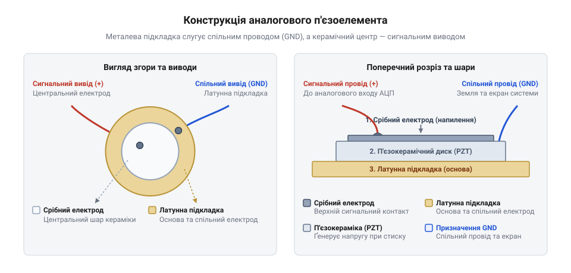
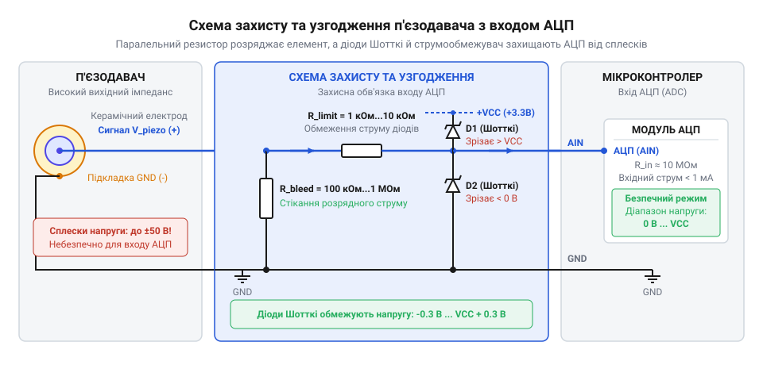

# Залізний інтерфейс аналогового п'єзодавача: електричні характеристики та захисна обв'язка

## Небезпека прямого підключення п'єзоелемента до АЦП

Механічний удар або різка деформація п'єзокерамічного диска перетворює фізичне зусилля на електричний заряд. У момент імпульсу цей заряд створює на електродах вихідну напругу, амплітуда якої може сягати десятків і навіть сотень вольт. Якщо підключити такий @@en|п'єзоелемент@@ (від грецького *piezein* — тиснути) безпосередньо до аналогового входу мікроконтролера, перший же сильний стук виведе мікросхему з ладу.

Входи аналогово-цифрового перетворювача (@@en|АЦП@@) розраховані на суворо обмежений діапазон напруг — зазвичай від 0 В до напруги живлення мікроконтролера (наприклад, 3.3 В або 5 В). Внутрішні захисні діоди виводів призначені лише для зняття малого статичного заряду і витримують струми не більше кількох міліампер. Короткий сплеск з амплітудою 30–50 В викликає електричний пробій напівпровідникової структури, створює ефект засувки (@@en|latch-up@@) або повністю випалює аналоговий порт.

Додатково ситуацію ускладнює те, що @@en|п'єзоелемент@@ працює як джерело сигналу, яке має @@en|високий вихідний імпеданс@@ (від англійського *impedance* — перешкода) ємнісного характеру. Під час аналогово-цифрового перетворення внутрішній @@en|конденсатор вибірки та утримання@@ @@en|АЦП@@ не встигає повністю зарядитися від такого високоомного джерела за короткий @@en|час вибірки@@, через що виміряне значення напруги стрімко плаває та викривляється. У момент зняття механічного зусилля відбувається пружна @@en|релаксація@@ (від латинського *relaxatio* — послаблення) кристалічної ґратки кераміки, зворотне вигинання якої змінює знак вихідної поляризації та формує від'ємну напівхвилю напруги. Цей від'ємний сплеск провалює потенціал виводу нижче рівня землі, що викликає прямий струм через захисні напівпровідникові переходи порту й загрожує збоєм або пошкодженням мікроконтролера. Для безпечного знімання даних потрібне проміжне коло, яке обмежить небезпечні піки, зріже від'ємний потенціал та перетворить згенерований заряд у стабільний напруговий сигнал.

## Електрична будова та виводи п'єзодиска

Конструктивно @@en|п'єзодиск@@ складається з двох основних частин: міцної металевої основи та нанесеного на неї шару @@en|п'єзокераміка@@. Металева @@en|підкладка@@ виготовляється з латуні або бронзи, а верхній керамічний шар вкритий тонким напиленням срібла, що утворює центральний електрод.

*Будова п'єзоелемента: центральний керамічний шар знімає заряд, а металева підкладка слугує спільним проводом та екраном від завад.*

З електричного погляду ця конструкція являє собою джерело заряду з послідовно утвореною @@en|власна ємність@@. Виводи елемента мають чітке функціональне призначення, від якого залежить рівень завад у вимірювальному тракті:

1. Центральний керамічний електрод слугує як @@en|сигнальний вивід@@. Саме на ньому формується основний потенціал під час деформації кераміки.
2. Металева латунна @@en|підкладка@@ виконує роль спільного проводу (GND). Завдяки більшій площі вона працює як фізичний екран.

Приєднання металевої підкладки до спільної шини землі захищає вимірювальну лінію від ємнісних та @@en|електромагнітні завади@@ навколишнього середовища. Якщо ж переплутати полярність і подати сигнал з металевого диска, велика відкрита площа латуні почне працювати як антена, збираючи мережевий гуд і спотворюючи корисний сигнал. Якість такого захисту та рівень вихідного сигналу безпосередньо залежать від способу механічного кріплення @@en|п'єзодиск@@. Кріплення диска за краї дозволяє його центральній керамічній зоні вільно вигинатися під дією механічного зусилля. Такий прогин забезпечує максимальну амплітуду деформації та найвищу вихідну напругу. Одночасно з цим затиснутий периметр металевої @@en|підкладка@@ утворює надійну зону для кільцевого підключення екрана до землі. Натомість фіксація диска за центр обмежує вигин кераміки й суттєво зменшує амплітуду сигналу. При цьому точкове заземлення в центрі залишає вільні краї металевої основи незахищеними від зовнішніх завад.

## Шунтувальний резистор стікання заряду

Оскільки п'єзокерамічний елемент володіє високим власним опором і власною ємністю, згенерований механічним ударом заряд залишається на електродах тривалий час. Без шляху для розряджання напруга на виводах зміщується, і кожен наступний удар додає заряд до попереднього, виводячи рівень за межі вимірювання.

Для перетворення заряду в доступну для вимірювання напругу паралельно до виводів п'єзодиска підключають @@en|резистор стікання заряду@@ номіналом від 100 кОм до 1 МОм. Цей шунт створює замкнений шлях, через який струм розряджає внутрішню ємність елемента.

Значення опору визначає @@en|постійна часу RC-кола@@, яка відповідає за швидкість згасання вимірюваного імпульсу. Величина постійної часу `τ` (грецька літера тау) залежить від опору шунта `R⛬` та власної ємності елемента `Cₚ` і розраховується за формулою:

τ = R⛬ × Cₚ
= 1.0 × 10⁶ Ом × 15 × 10⁻⁹ Ф    [підстановка опору 1 МОм та ємності 15 нФ]
= 0.015 с                        [перемноження]
= 15 мс                          [переведення в мілісекунди]

Значення `τ = 15 мс` виражає час, за який напруга після поштовху спадає приблизно на 63%. Це забезпечує швидке розряджання ємності для фіксації повторних ударів. Неперервне стікання заряду робить неможливим вимірювання @@en|статичного тиску@@ (від грец. *statikos* — нерухомий, тиск без механічних коливань): стале стискання ґенерує заряд лише в момент прикладання сили, після чого він повністю розряджається через шунт. З електричного погляду ємність елемента `Cₚ` та шунт `R⛬` утворюють пасивний @@en|фільтр високих частот@@ (англ. *high-pass filter*, ФВЧ; від *high* — високий, *pass* — пропускати), який відсікає постійну складову напруги. Нижню @@en|граничну частоту зрізу@@ `f_c` (від англ. *cutoff frequency*, де `f` — частота, `c` — зріз) цього фільтра розраховують за постійною часу `τ` за формулою:

f_c = 1 ÷ (2 × π × τ)
= 1 ÷ (2 × 3.1416 × 0.015 с)    [підстановка постійної часу 15 мс]
= 1 ÷ 0.0942 с                  [перемноження у знаменнику]
≈ 10.6 Гц                       [ділення та округлення]

Отримане значення `f_c ≈ 10.6 Гц` показує межу частотного діапазону: складники вібрацій з частотою, нижчою за 10.6 Гц, послаблюються і стікають до нуля без передавання амплітуди. Якщо обрати занадто малий опір шунта (наприклад, 1 кОм), заряд стікатиме миттєво, позбавляючи сигнал амплітуди. Якщо ж узяти опір понад 10 МОм, лінія довго залишатиметься зарядженою, а [вхідний імпеданс АЦП](root:hw-sensing/adc-input-impedance) спотворюватиме форму імпульсу. Опір у діапазоні 100 кОм — 1 МОм зберігає чутливість і часову форму вібраційного сплеску.

## Діодне обмеження сплесків напруги

Шунтувальний резистор перетворює заряд на напругу, але не обмежує амплітуду від сильних механічних поштовхів. Для захисту порту використовують [захисне діодне обмеження](root:hw-components/schottky-clamping), яке зрізає небезпечні піки напруги на рівнях шин живлення та землі.

Найкращим рішенням є паралельне підключення двох обмежувальних діодів. У цій ролі використовують @@en|діоди Шотткі@@, оскільки вони мають мале @@en|падіння прямої напруги@@ (близько 0.2–0.3 В):

- Верхній діод анодом підключають до сигнальної лінії, а катодом — до шини живлення `V꜀꜀`. Коли напруга сплеску перевищує `V꜀꜀ + 0.3 В`, діод відкривається та скидає надлишковий струм у лінію живлення.
- Нижній діод анодом підключають до землі GND, а катодом — до сигнальної лінії. Коли згенерований імпульс має від'ємну полярність і падає нижче `-0.3 В`, діод відкривається і фіксує потенціал на безпечному рівні.

Як альтернативу іноді застосовують @@en|стабілітрон@@, проте діодна пара Шотткі реагує швидше і автоматично підлаштовується під напругу живлення схеми.

Щоб струм через відкриті діоди під час високовольтного сплеску не перевищив допустимих значень, між вузлом п'єзоелемента та входом АЦП обов'язково встановлюють послідовний @@en|струмообмежувальний резистор@@ номіналом 10–47 кОм. Під час сильного механічного удару амплітуда сигналу перевищує напругу живлення, викликаючи відкривання захисного діода, який фіксує потенціал на рівні V_CC + V_D. При цьому увесь надлишок напруги спадає саме на послідовному резисторі. Для розрахунку мінімального безпечного опору R_lim(min) визначають різницю між очікуваною піковою напругою сплеску V_peak та напругою фіксації V_CC + V_D (де V_CC — напруга живлення, а V_D — @@en|падіння прямої напруги@@ на діоді), після чого ділять її на @@en|максимальний прямий струм@@ (від англ. *maximum forward current*, де *forward* — прямий, *current* — струм) I_max, що є припустимим для обраних діодів:

R_lim(min) = (V_peak - (V_CC + V_D)) ÷ I_max

Цей вираз показує мінімальний опір, необхідний для того, щоб струм через відкритий напівпровідниковий перехід не вийшов за граничні межі під час високовольтного піку.

**Обчислення мінімального опору для сплеску напруги 30 В при живленні 5 В та граничному струмові діода 1 мА:**

R_lim(min) = (30 В - (5 В + 0.3 В)) ÷ 0.001 А
= (30 В - 5.3 В) ÷ 0.001 А      [додавання напруги живлення та падіння на діоді Шотткі]
= 24.7 В ÷ 0.001 А              [обчислення спаду напруги на резисторі]
= 24700 Ом                       [ділення спаду напруги на граничний струм]
= 24.7 кОм                      [переведення опору в кілооми]

Отримане значення R_lim(min) = 24.7 кОм підтверджує доцільність використання номіналів 10–47 кОм: таке значення утримує струм через @@en|діоди Шотткі@@ на безпечному рівні кількох сотень мікроампер. Зменшення опору нижче 10 кОм створює ризик перегріву діодів і випалювання порту під час потужних поштовхів. Натомість надмірне збільшення опору понад 100 кОм разом із паразитною ємністю монтажу затягує фронти сигналу та спотворює вимірювання @@en|АЦП@@.

## Типова принципова схема захисної обв'язки

Поєднання розглянутих компонентів дає змогу сформувати закінчений залізний інтерфейс узгодження п'єзодавача з аналоговим входом мікроконтролера.

*Схема залізного інтерфейсу: резистор стікання R⛬ формує напругу, діоди VD1–VD2 фіксують сплески, а конденсатор C_f фільтрує високочастотний шум.*

У цій схемі компоненти розташовані в наступному порядку:

1. Шунтувальний резистор `R⛬` підключено паралельно виводам п'єзоелемента безпосередньо біля джерела сигналу.
2. Послідовно в лінію включено струмообмежувач `Rₗᵢₘ`, який розділяє вузол давача та вхід мікроконтролера.
3. Захисні діоди Шотткі `VD1` та `VD2` підключено безпосередньо біля аналогового виводу АЦП.
4. Паралельно входу АЦП встановлено фільтрувальний конденсатор `C_f` номіналом 1–10 нФ.

Конденсатор `C_f` разом із резистором `Rₗᵢₘ` утворює фільтр низьких частот, який придушує високочастотні механічні резонанси диска та мережеві наводки.

Перед підключенням зібраної обв'язка до мікроконтролера її перевіряють осцилографом або мультиметром під час поштовхів. Сигнал має чітко обмежуватися діапазоном від -0.3 В до `V꜀꜀ + 0.3 В`. На відміну від простих кулькових вимикачів, таких як [давач вібрації KY-002](root:cat-hw-sensors/ky-002-vibration) чи [давач нахилу SW-520D](root:cat-hw-sensors/sw-520d), або простих модулів на кшталт [давача стуку KY-031](root:cat-hw-sensors/ky-031-knock), представлена принципова схема дозволяє безпечно вимірювати точну силу аналогового удару без ризику пошкодження порту.
